# 装备道具

属性图片为官方原始资料，不代表已识读；网页表格中的固定/随机标记保留原文，不将随机池视为全部同时获得。

## 新武器-拳套

- 来源：https://w2i.wanmei.com/djzb/yxwp/20091102/36688.shtml
- 原文发布时间：2009-11-02
- 获取状态：ok
- 本地结构化数据：[JSON](../pages/eee3aab04ec5daeb2789.json)

拳套 | 枪戟 | 利刃 | 弓弩 | 斧锤 | 法器 | 刀剑 | 匕首 | 法宝 |
一次轮回
二次轮回
名称：★★四神召来•轮回
名称：★★四神幻舞•真如
类型：拳套
类型：拳套
品阶：13
品阶：15
物理攻击力：643~710
物理攻击力：798~882
攻击距离：2.5
攻击距离：2.5
升级效果：物理攻击+21
升级效果：物理攻击+21
附加属性： 致命一击+3% 物理攻击+84 体质+16~17
必然会出现的附加属性：狂暴、狂神之怒、致命一击+3%或致命一击+4%其中之一
升级需要的武器：★四神召来•狂
可能出现附加属性：致命一击+1% 真气+310 生命+350 力量+18~19 敏捷+18~19 体质+18~19 灵力+18~19 攻击等级+1 攻击间隔 -0.05 命中+30% 物理攻击上限+106 物理攻击上限+130 攻击等级+2 防御等级+2 致命一击+2% 攻击等级+3
新附加属性解释：狂神之怒，被祝福过的狂暴之力，更大机率使自已进入狂暴状态，物攻加倍，攻速提升，但会受加深伤害。
升级需要的武器：★★四神召来•轮回
一次轮回
二次轮回
名称：★★醒掌天下•轮回
名称：★★醉卧云巅
类型：拳套
类型：拳套
品阶：13
品阶：15
物理攻击力：643~710
物理攻击力：798~882
攻击距离：2.5
攻击距离：2.5
升级效果：物理攻击+21
升级效果：物理攻击+21
附加属性： 敏捷+16~17
必然会出现的附加属性：狂暴、狂神之怒、致命一击+3%或致命一击+4%其中之一
升级需要的武器：★十步杀一神或★醒掌天下
可能出现附加属性：致命一击+1% 真气+310 生命+350 力量+18~19 敏捷+18~19 体质+18~19 灵力+18~19 攻击等级+1 攻击间隔 -0.05 命中+30% 物理攻击上限+106 物理攻击上限+130 攻击等级+2 防御等级+2 致命一击+2% 攻击等级+3
三方并帝古未有，两贤向厄我所闻。何来洒落樽前语：天下英雄惟使君。
新附加属性解释：狂神之怒：被祝福过的狂暴之力，更大机率使自已进入狂暴状态，物攻加倍，攻速提升，但会受加深伤害。
升级需要的武器：★★醒掌天下•轮回
烟霞洞里无鸡犬，风雨林间有鬼神。醉卧云巅闲入梦，不知何物是吾身。

### 原始表格（按行与单元格保存）

#### 表 1

| 列 1 | 列 2 |
| --- | --- |
| 一次轮回 | 二次轮回 |
| 名称：★★四神召来•轮回 | 名称：★★四神幻舞•真如 |
| 类型：拳套 | 类型：拳套 |
| 品阶：13 | 品阶：15 |
| 物理攻击力：643~710 | 物理攻击力：798~882 |
| 攻击距离：2.5 | 攻击距离：2.5 |
| 升级效果：物理攻击+21 | 升级效果：物理攻击+21 |
| 附加属性： 致命一击+3% 物理攻击+84 体质+16~17 | 必然会出现的附加属性：狂暴、狂神之怒、致命一击+3%或致命一击+4%其中之一 |
| 升级需要的武器：★四神召来•狂（跨3行/1列） | 可能出现附加属性：致命一击+1% 真气+310 生命+350 力量+18~19 敏捷+18~19 体质+18~19 灵力+18~19 攻击等级+1 攻击间隔 -0.05 命中+30% 物理攻击上限+106 物理攻击上限+130 攻击等级+2 防御等级+2 致命一击+2% 攻击等级+3 |
| 新附加属性解释：狂神之怒，被祝福过的狂暴之力，更大机率使自已进入狂暴状态，物攻加倍，攻速提升，但会受加深伤害。 |  |
| 升级需要的武器：★★四神召来•轮回 |  |

#### 表 2

| 列 1 | 列 2 |
| --- | --- |
| 一次轮回 | 二次轮回 |
| 名称：★★醒掌天下•轮回 | 名称：★★醉卧云巅 |
| 类型：拳套 | 类型：拳套 |
| 品阶：13 | 品阶：15 |
| 物理攻击力：643~710 | 物理攻击力：798~882 |
| 攻击距离：2.5 | 攻击距离：2.5 |
| 升级效果：物理攻击+21 | 升级效果：物理攻击+21 |
| 附加属性： 敏捷+16~17 | 必然会出现的附加属性：狂暴、狂神之怒、致命一击+3%或致命一击+4%其中之一 |
| 升级需要的武器：★十步杀一神或★醒掌天下 | 可能出现附加属性：致命一击+1% 真气+310 生命+350 力量+18~19 敏捷+18~19 体质+18~19 灵力+18~19 攻击等级+1 攻击间隔 -0.05 命中+30% 物理攻击上限+106 物理攻击上限+130 攻击等级+2 防御等级+2 致命一击+2% 攻击等级+3 |
| 三方并帝古未有，两贤向厄我所闻。何来洒落樽前语：天下英雄惟使君。（跨3行/1列） | 新附加属性解释：狂神之怒：被祝福过的狂暴之力，更大机率使自已进入狂暴状态，物攻加倍，攻速提升，但会受加深伤害。 |
| 升级需要的武器：★★醒掌天下•轮回 |  |
| 烟霞洞里无鸡犬，风雨林间有鬼神。醉卧云巅闲入梦，不知何物是吾身。 |  |

### 官方原始图片（尚未全部转录）

- 原图来源：https://w2i.wanmei.com/pic/news_img/091102/1102091.jpg
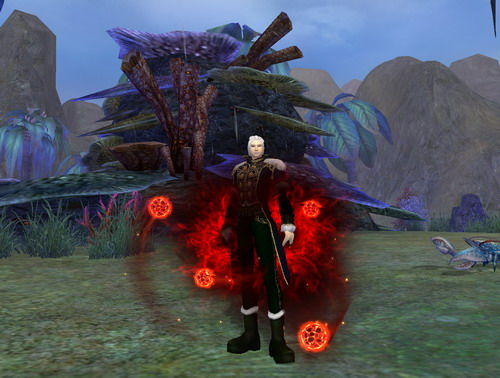
- 原图来源：https://w2i.wanmei.com/pic/news_img/091102/1102092.jpg
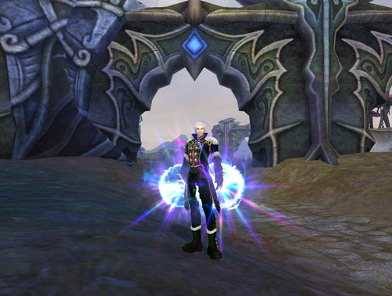

## 胧族武器

- 来源：https://w2i.wanmei.com/djzb/zb/20140928/73623.shtml
- 原文发布时间：2014-09-28
- 获取状态：ok
- 本地结构化数据：[JSON](../pages/c9a4d0fc72526d3b0d5a.json)

武器名称
武器类型
品阶
攻击力
攻击距离
升级效果
固定的附加属性
随机的附加属性
★★尽断愁缘刀·剪水
胧刀
15
物理攻击力：793~1322
3
本体物攻+28
狂战士、狂战神、致命一击+3%、致命一击+4%或攻击等级+20其中之一
致命一击+1% 真气+310 生命+350 力量+18-19 敏捷+18-19 灵力+18-19 体质+18-19 攻击等级+1 攻击距离+1 准确度+30% 物理攻击上限+106 物理攻击上限+130 攻击等级+2 防御等级+2 致命一击+2% 攻击等级+3
★★青锋竹中隐
胧刀
15
物理攻击力：793~1322
3
本体物攻+28
狂战士、狂战神、致命一击+3%、致命一击+4%或攻击等级+20其中之一
致命一击+1% 真气+310 生命+350 力量+18-19 敏捷+18-19 灵力+18-19 体质+18-19 攻击等级+1 攻击距离+1 准确度+30% 物理攻击上限+106 物理攻击上限+130 攻击等级+2 防御等级+2 致命一击+2% 攻击等级+3
★★天兵·摩云击宇
胧刀
15
物理攻击力：553~921
3
本体物攻+26
猎魔等级+60
致命一击+1% 真气+310 生命+350 力量+18-19 敏捷+18-19 灵力+18-19 体质+18-19 攻击等级+1 物理伤害减免+1% 防御等级+1 物理攻击上限+106 物理攻击上限+130 攻击等级+2 防御等级+2 致命一击+2% 攻击等级+3
★★噩梦之主
胧刀
15
物理攻击力：841~1401
3
本体物攻+28
攻击等级+10-25、防御等级+10-25、致命一击+3%-6%、十方八阵、狂战神或轰雷破其中之一
灵力+8-20 力量+8-20 敏捷+8-20 体质+8-20 攻击等级+1-5 防御等级+1-5 物理攻击上限+80-180 生命+120-300 真气+200-400 准确度+10%-50% 致命一击+1%-2% 物理防御+150-450 五行防御+150-450 物理伤害减免+1%-5% 五行伤害减免+1%-5% 攻击距离+1-2 攻击间隔-0.05
★★胧锩圣刀
胧刀
16
物理攻击力：845~1409
3
本体物攻+26
攻击等级+30、狂战神、力量+10-11、致命一击+2%、体质+10-11
★★★胧锩之赦
胧刀
16
物理攻击力：862~1437
3
本体物攻+26
狂战神、攻击等级+40、力量+10-11、致命一击+2%、体质+10-11
★★★胧锩笑渡生
胧刀
16
物理攻击力：862~1437
3
本体物攻+32
狂战神、攻击等级+70、攻击间隔-0.05、力量+25、生命+500、致命一击+5%、物理攻击+84
★★独步天下行
胧刀
16
物理攻击力：814~1356
3
本体物攻+26
攻击等级+50、攻击距离+2、物理攻击+63、致命一击+2%、敏捷+8-9
★★★独步天下行
胧刀
16
物理攻击力：814~1356
3
本体物攻+30
攻击等级+55-65、攻击距离+2、致命一击+3%、敏捷+18-19、物理攻击上限+130、物理攻击+70
★★命轮之刻·守护
月镰
15
法术攻击力：1090~1568
3
法术攻击+28
吟唱时间-6%、吟唱时间-10%或攻击等级+20
致命一击+1% 真气+310 生命+350 力量+18-19 敏捷+18-19 灵力+18-19 体质+18-19 攻击等级+1 物理伤害减免+2% 防御等级+1 法术攻击+100 法术攻击上限+130 攻击等级+2 防御等级+2 致命一击+2% 吟唱时间-3%
★★寒秋凌霜月
月镰
15
法术攻击力：1090~1568
3
法术攻击+28
吟唱时间-6%、吟唱时间-10%或攻击等级+20
致命一击+1% 真气+310 生命+350 力量+18-19 敏捷+18-19 灵力+18-19 体质+18-19 攻击等级+1 物理伤害减免+2% 防御等级+1 法术攻击+100 法术攻击上限+130 攻击等级+2 防御等级+2 致命一击+2% 吟唱时间-3%
★★天兵·天煞
月镰
15
法术攻击力：757~1090
3
法术攻击+26
猎魔等级+60
致命一击+1% 真气+310 生命+350 力量+18-19 敏捷+18-19 灵力+18-19 体质+18-19 攻击等级+1 物理伤害减免+2% 防御等级+1 法术攻击+100 法术攻击上限+130 攻击等级+2 防御等级+2 致命一击+2% 攻击等级+3
★★天魔之拥
月镰
15
法术攻击力：1151~1656
3
法术攻击+28
攻击等级+10-25、防御等级+10-25、致命一击+3%-6%、吟唱时间-3%-10%、装备需求-25%、太清咒或海无量其中之一
灵力+8-20 力量+8-20 敏捷+8-20 体质+8-20 攻击等级+1-5 防御等级+1-5 法术攻击上限+80-180 生命+120-300 真气+200-400 准确度+10%-50% 致命一击+1%-2% 物理防御+150-450 五行防御+150-450 物理伤害减免+1%-5% 五行伤害减免+1%-5% 吟唱时间-1%-3%
★★皎月圣镰
月镰
16
法术攻击力：1162~1672
3
法术攻击+26
攻击等级+30、致命一击+4%、灵力+10-11、物理防御+313、体质+10-11
★★★皎月之怒
月镰
16
法术攻击力：1185~1706
3
法术攻击+26
致命一击+4%、攻击等级+40、灵力+10-11、物理防御+313、生命+205
★★★皎怒月封天
月镰
16
法术攻击力：1185~1706
3
法术攻击+32
太清咒、攻击等级+70、吟唱时间-12%、灵力+25、生命+500、致命一击+5%、法术攻击+84
★★狼皇啸霜月
月镰
16
法术攻击力：1118~1610
3
法术攻击+26
攻击等级+50、致命一击+2%、吟唱时间-6%、法术攻击+63
★★★狼皇啸霜月
月镰
16
法术攻击力：1118~1610
3
法术攻击+30
攻击等级+55-65、吟唱时间-5%-10%、致命一击+3%、防御等级+3、法术攻击+70

### 原始表格（按行与单元格保存）

#### 表 1

| 列 1 | 列 2 | 列 3 | 列 4 | 列 5 | 列 6 | 列 7 | 列 8 |
| --- | --- | --- | --- | --- | --- | --- | --- |
| 武器名称 | 武器类型 | 品阶 | 攻击力 | 攻击距离 | 升级效果 | 固定的附加属性 | 随机的附加属性 |
| ★★尽断愁缘刀·剪水 | 胧刀 | 15 | 物理攻击力：793~1322 | 3 | 本体物攻+28 | 狂战士、狂战神、致命一击+3%、致命一击+4%或攻击等级+20其中之一 | 致命一击+1% 真气+310 生命+350 力量+18-19 敏捷+18-19 灵力+18-19 体质+18-19 攻击等级+1 攻击距离+1 准确度+30% 物理攻击上限+106 物理攻击上限+130 攻击等级+2 防御等级+2 致命一击+2% 攻击等级+3 |
| ★★青锋竹中隐 | 胧刀 | 15 | 物理攻击力：793~1322 | 3 | 本体物攻+28 | 狂战士、狂战神、致命一击+3%、致命一击+4%或攻击等级+20其中之一 | 致命一击+1% 真气+310 生命+350 力量+18-19 敏捷+18-19 灵力+18-19 体质+18-19 攻击等级+1 攻击距离+1 准确度+30% 物理攻击上限+106 物理攻击上限+130 攻击等级+2 防御等级+2 致命一击+2% 攻击等级+3 |
| ★★天兵·摩云击宇 | 胧刀 | 15 | 物理攻击力：553~921 | 3 | 本体物攻+26 | 猎魔等级+60 | 致命一击+1% 真气+310 生命+350 力量+18-19 敏捷+18-19 灵力+18-19 体质+18-19 攻击等级+1 物理伤害减免+1% 防御等级+1 物理攻击上限+106 物理攻击上限+130 攻击等级+2 防御等级+2 致命一击+2% 攻击等级+3 |
| ★★噩梦之主 | 胧刀 | 15 | 物理攻击力：841~1401 | 3 | 本体物攻+28 | 攻击等级+10-25、防御等级+10-25、致命一击+3%-6%、十方八阵、狂战神或轰雷破其中之一 | 灵力+8-20 力量+8-20 敏捷+8-20 体质+8-20 攻击等级+1-5 防御等级+1-5 物理攻击上限+80-180 生命+120-300 真气+200-400 准确度+10%-50% 致命一击+1%-2% 物理防御+150-450 五行防御+150-450 物理伤害减免+1%-5% 五行伤害减免+1%-5% 攻击距离+1-2 攻击间隔-0.05 |
| ★★胧锩圣刀 | 胧刀 | 16 | 物理攻击力：845~1409 | 3 | 本体物攻+26 | 攻击等级+30、狂战神、力量+10-11、致命一击+2%、体质+10-11 |  |
| ★★★胧锩之赦 | 胧刀 | 16 | 物理攻击力：862~1437 | 3 | 本体物攻+26 | 狂战神、攻击等级+40、力量+10-11、致命一击+2%、体质+10-11 |  |
| ★★★胧锩笑渡生 | 胧刀 | 16 | 物理攻击力：862~1437 | 3 | 本体物攻+32 | 狂战神、攻击等级+70、攻击间隔-0.05、力量+25、生命+500、致命一击+5%、物理攻击+84 |  |
| ★★独步天下行 | 胧刀 | 16 | 物理攻击力：814~1356 | 3 | 本体物攻+26 | 攻击等级+50、攻击距离+2、物理攻击+63、致命一击+2%、敏捷+8-9 |  |
| ★★★独步天下行 | 胧刀 | 16 | 物理攻击力：814~1356 | 3 | 本体物攻+30 | 攻击等级+55-65、攻击距离+2、致命一击+3%、敏捷+18-19、物理攻击上限+130、物理攻击+70 |  |
| ★★命轮之刻·守护 | 月镰 | 15 | 法术攻击力：1090~1568 | 3 | 法术攻击+28 | 吟唱时间-6%、吟唱时间-10%或攻击等级+20 | 致命一击+1% 真气+310 生命+350 力量+18-19 敏捷+18-19 灵力+18-19 体质+18-19 攻击等级+1 物理伤害减免+2% 防御等级+1 法术攻击+100 法术攻击上限+130 攻击等级+2 防御等级+2 致命一击+2% 吟唱时间-3% |
| ★★寒秋凌霜月 | 月镰 | 15 | 法术攻击力：1090~1568 | 3 | 法术攻击+28 | 吟唱时间-6%、吟唱时间-10%或攻击等级+20 | 致命一击+1% 真气+310 生命+350 力量+18-19 敏捷+18-19 灵力+18-19 体质+18-19 攻击等级+1 物理伤害减免+2% 防御等级+1 法术攻击+100 法术攻击上限+130 攻击等级+2 防御等级+2 致命一击+2% 吟唱时间-3% |
| ★★天兵·天煞 | 月镰 | 15 | 法术攻击力：757~1090 | 3 | 法术攻击+26 | 猎魔等级+60 | 致命一击+1% 真气+310 生命+350 力量+18-19 敏捷+18-19 灵力+18-19 体质+18-19 攻击等级+1 物理伤害减免+2% 防御等级+1 法术攻击+100 法术攻击上限+130 攻击等级+2 防御等级+2 致命一击+2% 攻击等级+3 |
| ★★天魔之拥 | 月镰 | 15 | 法术攻击力：1151~1656 | 3 | 法术攻击+28 | 攻击等级+10-25、防御等级+10-25、致命一击+3%-6%、吟唱时间-3%-10%、装备需求-25%、太清咒或海无量其中之一 | 灵力+8-20 力量+8-20 敏捷+8-20 体质+8-20 攻击等级+1-5 防御等级+1-5 法术攻击上限+80-180 生命+120-300 真气+200-400 准确度+10%-50% 致命一击+1%-2% 物理防御+150-450 五行防御+150-450 物理伤害减免+1%-5% 五行伤害减免+1%-5% 吟唱时间-1%-3% |
| ★★皎月圣镰 | 月镰 | 16 | 法术攻击力：1162~1672 | 3 | 法术攻击+26 | 攻击等级+30、致命一击+4%、灵力+10-11、物理防御+313、体质+10-11 |  |
| ★★★皎月之怒 | 月镰 | 16 | 法术攻击力：1185~1706 | 3 | 法术攻击+26 | 致命一击+4%、攻击等级+40、灵力+10-11、物理防御+313、生命+205 |  |
| ★★★皎怒月封天 | 月镰 | 16 | 法术攻击力：1185~1706 | 3 | 法术攻击+32 | 太清咒、攻击等级+70、吟唱时间-12%、灵力+25、生命+500、致命一击+5%、法术攻击+84 |  |
| ★★狼皇啸霜月 | 月镰 | 16 | 法术攻击力：1118~1610 | 3 | 法术攻击+26 | 攻击等级+50、致命一击+2%、吟唱时间-6%、法术攻击+63 |  |
| ★★★狼皇啸霜月 | 月镰 | 16 | 法术攻击力：1118~1610 | 3 | 法术攻击+30 | 攻击等级+55-65、吟唱时间-5%-10%、致命一击+3%、防御等级+3、法术攻击+70 |  |

## 武器-七神器

- 来源：https://w2i.wanmei.com/intro/guide/20091103/36701.shtml
- 原文发布时间：2009-11-03
- 获取状态：ok
- 本地结构化数据：[JSON](../pages/da8316fde2bcd01bf15a.json)

七神器介绍
在游戏里，战斗的激情永远充斥着玩家们的思想。对于男同胞们来说，胜利的荣耀更是他们游戏生活里苦苦追寻着的目标。战斗少不了舞刀弄枪，装备是奔赴战场前首要准备的必需品。任何一名英勇的将士，都渴望着拥有顶级实力的武器。《完美世界》里就有这样的一种兵器，它拥有着至高无上的极品属性，唯有英勇的“全才”才能够得到它。
它就是被赋予神力的“七神器”！在“七神器”非凡实力的诱惑下，完美大陆上的玩家们都渴望着有一天这神奇能归自己所有。
然而，想要得到“七神器”并不是那么容易的事情。玩家们必须要完成七种任务，最终得到能力的证明交给七贤使者才能有幸获得适合你使用的“七神器”。那么，要如何获得这些证明呢？
七种证明的获取方法：
1.力量的证明：夺宝奇兵活动
2.速度的证明：蛇岛赛马活动
3.智慧的证明：寻龙任务
4.勇气的证明：勇闯冥兽城
5.耐力的证明：龙宫寻宝活动
6.技巧的证明：命运魔方
7.无畏的证明：怪物攻城活动
收集齐以上所有的证明就可以在七贤使者处兑换七神器：仁者无敌的“玄德之剑”、精忠报国的“岳王之枪”、拳王神话的“泰森之拳”、万军莫敌的“元霸之锤”、被誉为老君神器的“子牙法剑”、圣僧神杖“玄奘法杖”和笑看天下的“秦皇神弩”这七种武器中的一种。

### 官方原始图片（尚未全部转录）

- 原图来源：https://w2i.wanmei.com/pic/news_img/091103/1103021.jpg
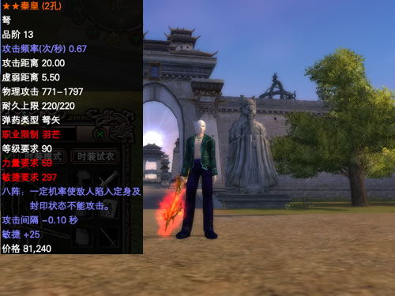
- 原图来源：https://w2i.wanmei.com/pic/news_img/091103/1103022.jpg
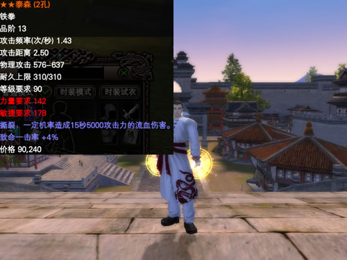
- 原图来源：https://w2i.wanmei.com/pic/news_img/091103/1103023.jpg
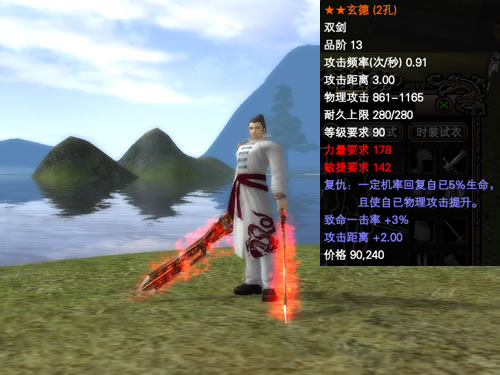
- 原图来源：https://w2i.wanmei.com/pic/news_img/091103/1103024.jpg
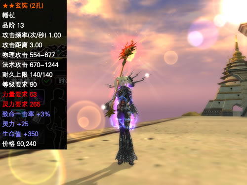
- 原图来源：https://w2i.wanmei.com/pic/news_img/091103/1103025.jpg
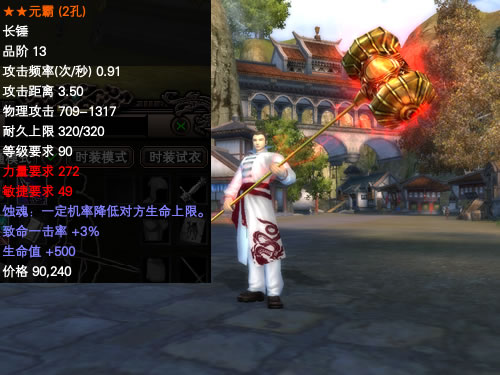
- 原图来源：https://w2i.wanmei.com/pic/news_img/091103/1103026.jpg
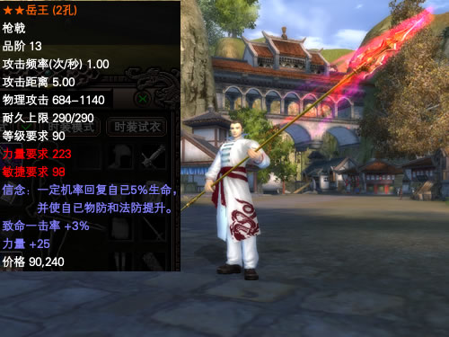
- 原图来源：https://w2i.wanmei.com/pic/news_img/091103/1103027.jpg
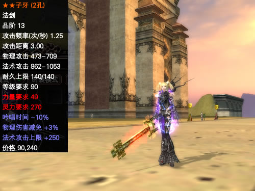

## 天怒神罚16阶顶级橙武-《完美国际》官方网站

- 来源：https://w2i.wanmei.com/event/200807/highweapon/index.htm
- 原文发布时间：页面未标明
- 获取状态：ok
- 本地结构化数据：[JSON](../pages/bd6a4da0ea55ad2a5bf5.json)

### 原始表格（按行与单元格保存）

#### 表 1

| 列 1 |
| --- |
|  |

#### 表 2

| 列 1 |
| --- |
|  |

### 官方原始图片（尚未全部转录）

- 原图来源：https://w2i.wanmei.com/event/200807/highweapon/images/title_01_01.jpg

- 原图来源：https://w2i.wanmei.com/event/200807/highweapon/images/title_02_02.jpg

- 原图来源：https://w2i.wanmei.com/event/200807/highweapon/images/title_03_03.jpg

- 原图来源：https://w2i.wanmei.com/event/200807/highweapon/images/title_04_04.jpg

- 原图来源：https://w2i.wanmei.com/event/200807/highweapon/images/title_05_05.jpg

- 原图来源：https://w2i.wanmei.com/event/200807/highweapon/images/title_06_06.jpg

- 原图来源：https://w2i.wanmei.com/event/200807/highweapon/images/title_07_07.jpg

- 原图来源：https://w2i.wanmei.com/event/200807/highweapon/images/title_08_08.jpg

- 原图来源：https://w2i.wanmei.com/event/200807/highweapon/images/title_09_09.jpg

- 原图来源：https://w2i.wanmei.com/event/200807/highweapon/images/title_10_10.jpg

- 原图来源：https://w2i.wanmei.com/event/200807/highweapon/images/title_11_11.jpg

- 原图来源：https://w2i.wanmei.com/event/200807/highweapon/images/nav_01_01.jpg

- 原图来源：https://w2i.wanmei.com/event/200807/highweapon/images/nav_02_02.jpg

- 原图来源：https://w2i.wanmei.com/event/200807/highweapon/images/nav_03_03.jpg

- 原图来源：https://w2i.wanmei.com/event/200807/highweapon/images/nav_04_04.jpg

- 原图来源：https://w2i.wanmei.com/event/200807/highweapon/images/main_01.jpg

- 原图来源：https://w2i.wanmei.com/event/200807/highweapon/images/main_02.jpg

- 原图来源：https://w2i.wanmei.com/event/200807/highweapon/images/main_03.jpg

- 原图来源：https://w2i.wanmei.com/event/200807/highweapon/images/main_04.jpg

- 原图来源：https://w2i.wanmei.com/event/200807/highweapon/images/main_05.jpg

- 原图来源：https://w2i.wanmei.com/event/200807/highweapon/images/main_06.jpg

- 原图来源：https://w2i.wanmei.com/event/200807/highweapon/images/main_07.jpg

- 原图来源：https://w2i.wanmei.com/event/200807/highweapon/images/main_08.jpg

- 原图来源：https://w2i.wanmei.com/event/200807/highweapon/images/title_01.jpg

- 原图来源：https://w2i.wanmei.com/event/200807/highweapon/images/title_02.jpg

- 原图来源：https://w2i.wanmei.com/event/200807/highweapon/images/title_03.jpg

- 原图来源：https://w2i.wanmei.com/event/200807/highweapon/images/title_04.jpg

- 原图来源：https://w2i.wanmei.com/event/200807/highweapon/images/title_05.jpg

- 原图来源：https://w2i.wanmei.com/event/200807/highweapon/images/title_06.jpg

- 原图来源：https://w2i.wanmei.com/event/200807/highweapon/images/title_07.jpg

- 原图来源：https://w2i.wanmei.com/event/200807/highweapon/images/title_08.jpg

- 原图来源：https://w2i.wanmei.com/event/200807/highweapon/images/title_09.jpg

- 原图来源：https://w2i.wanmei.com/event/200807/highweapon/images/title_10.jpg

- 原图来源：https://w2i.wanmei.com/event/200807/highweapon/images/title_11.jpg

- 原图来源：https://w2i.wanmei.com/event/200807/highweapon/images/main_09.jpg
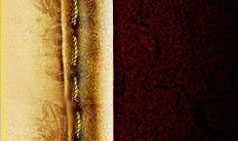
- 原图来源：https://w2i.wanmei.com/event/200807/highweapon/images/main_10.jpg

- 原图来源：https://w2i.wanmei.com/event/200807/highweapon/images/main_11.jpg
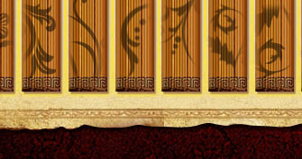
- 原图来源：https://w2i.wanmei.com/event/200807/highweapon/images/main_12.jpg

- 原图来源：https://w2i.wanmei.com/event/200807/highweapon/images/bottom.jpg

## 天怒神罚新增装备 - 装备介绍

- 来源：https://w2i.wanmei.com/djzb/zb/20091021/30198.shtml
- 原文发布时间：2009-10-21
- 获取状态：ok
- 本地结构化数据：[JSON](../pages/870f103f1fd35f4afd3b.json)

装备介绍 | 声望任务装备 | 材料产出 | 制造 |
装备介绍
玩家在资料片中生产装备将随机获得蓝、紫、黄色装备（现有生产为白、蓝、紫）。黄金装备防具为2-4孔、武器为1-2孔，附加属性随机产生，同种黄金装备属性不再固定不变。人品爆发的话有可能做出超极品的装备，下面列举一些黄金装备随机属性。相信属性更好的黄金装备将在您的手中诞生。

### 原始表格（按行与单元格保存）

#### 表 1

| 列 1 | 列 2 |
| --- | --- |
|  |  |
|  |  |
|  |  |
|  |  |
|  |  |
|  |  |
|  |  |

### 官方原始图片（尚未全部转录）

- 原图来源：https://w2i.wanmei.com/pic/news_img/zhuangbei/arming_01.jpg

- 原图来源：https://w2i.wanmei.com/pic/news_img/zhuangbei/arming_02.jpg
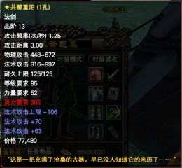
- 原图来源：https://w2i.wanmei.com/pic/news_img/zhuangbei/arming_03.jpg
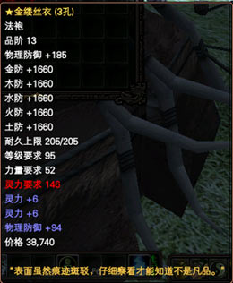
- 原图来源：https://w2i.wanmei.com/pic/news_img/zhuangbei/arming_04.jpg
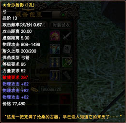
- 原图来源：https://w2i.wanmei.com/pic/news_img/zhuangbei/arming_05.jpg
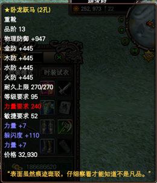
- 原图来源：https://w2i.wanmei.com/pic/news_img/zhuangbei/arming_06.jpg

- 原图来源：https://w2i.wanmei.com/pic/news_img/zhuangbei/arming_07.jpg

- 原图来源：https://w2i.wanmei.com/pic/news_img/zhuangbei/arming_08.jpg
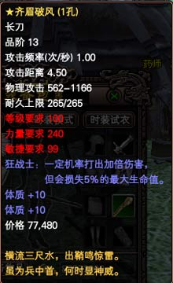
- 原图来源：https://w2i.wanmei.com/pic/news_img/zhuangbei/arming_09.jpg

- 原图来源：https://w2i.wanmei.com/pic/news_img/zhuangbei/arming_10.jpg
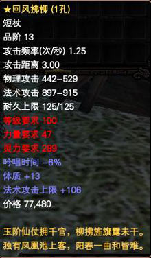
- 原图来源：https://w2i.wanmei.com/pic/news_img/zhuangbei/arming_11.jpg

- 原图来源：https://w2i.wanmei.com/pic/news_img/zhuangbei/arming_12.jpg
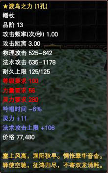
- 原图来源：https://w2i.wanmei.com/pic/news_img/zhuangbei/arming_13.jpg

- 原图来源：https://w2i.wanmei.com/pic/news_img/zhuangbei/arming_14.jpg

## 武器-黄昏武器

- 来源：https://w2i.wanmei.com/intro/guide/20091103/36702.shtml
- 原文发布时间：2009-11-03
- 获取状态：ok
- 本地结构化数据：[JSON](../pages/cfec03eb85e74b459cfc.json)

黄昏圣殿副本
黄昏圣殿副本首次以“动态副本”亮相。副本的规模远超过当时游戏所有副本的总和，内容分为多个区域，适合各等级玩家，六个月的时间都打不完，玩家完全可以把这个副本当成一款“新游戏”来体验。“主动变化”和“被动变化”一明一暗，凸显“动态副本”精髓。
除此之外，黄昏圣殿副本还推出了属性极强、外观华丽、适合各职业的套装。除了超强属性，更有加灵力和物理伤害减免的隐藏属性。再配上所向披靡的橙色武器，足以让你傲视整个完美大陆，成为完美大陆上万人瞩目的焦点。

### 官方原始图片（尚未全部转录）

- 原图来源：https://w2i.wanmei.com/pic/news_img/091103/1103031.jpg
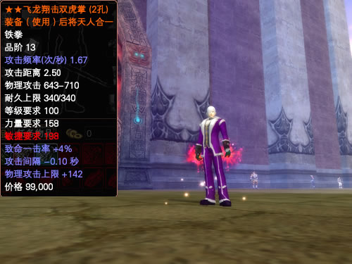
- 原图来源：https://w2i.wanmei.com/pic/news_img/091103/1103032.jpg
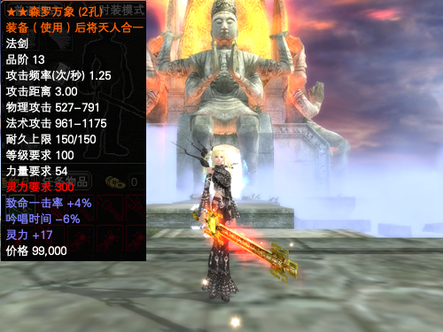
- 原图来源：https://w2i.wanmei.com/pic/news_img/091103/1103033.jpg
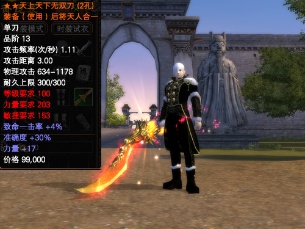
- 原图来源：https://w2i.wanmei.com/pic/news_img/091103/1103034.jpg
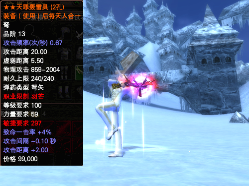
- 原图来源：https://w2i.wanmei.com/pic/news_img/091103/1103035.jpg
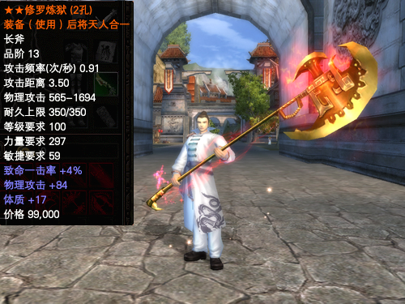
- 原图来源：https://w2i.wanmei.com/pic/news_img/091103/1103036.jpg
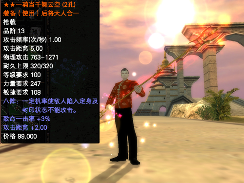

## 武器-神月武器

- 来源：https://w2i.wanmei.com/intro/guide/20091103/36703.shtml
- 原文发布时间：2009-11-03
- 获取状态：ok
- 本地结构化数据：[JSON](../pages/a443d8e171770dd68422.json)

神月副本介绍
覆霜城和神月谷自发布以来引起了无数新老玩家的关注，作为三大副本之一的神月谷，更是充满了神秘、惊喜与挑战，是广大骨灰级玩家一显身手的最好去处。它不仅带来了更加精良的装备，同时也为玩家提供了更多奖励丰厚、充满乐趣的副本任务，吸引着广大老玩家的目光。

### 官方原始图片（尚未全部转录）

- 原图来源：https://w2i.wanmei.com/pic/news_img/091103/1103041.jpg
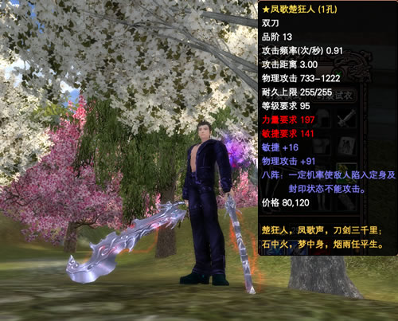
- 原图来源：https://w2i.wanmei.com/pic/news_img/091103/1103042.jpg
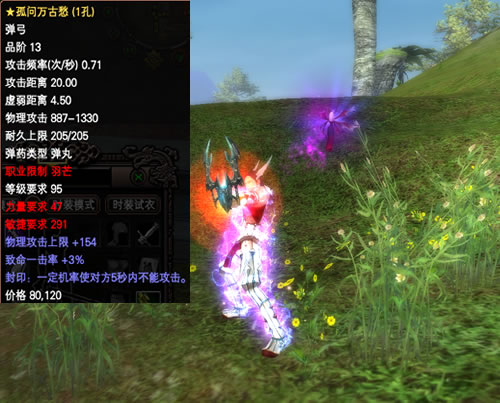
- 原图来源：https://w2i.wanmei.com/pic/news_img/091103/1103043.jpg
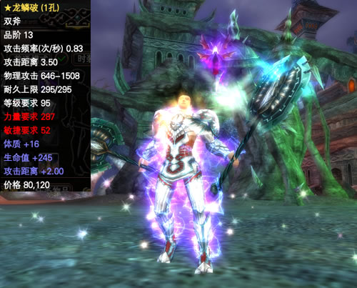
- 原图来源：https://w2i.wanmei.com/pic/news_img/091103/1103044.jpg
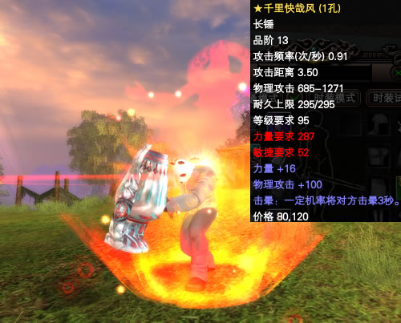
- 原图来源：https://w2i.wanmei.com/pic/news_img/091103/1103045.jpg
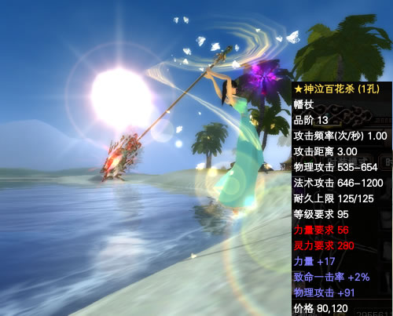
- 原图来源：https://w2i.wanmei.com/pic/news_img/091103/1103046.jpg
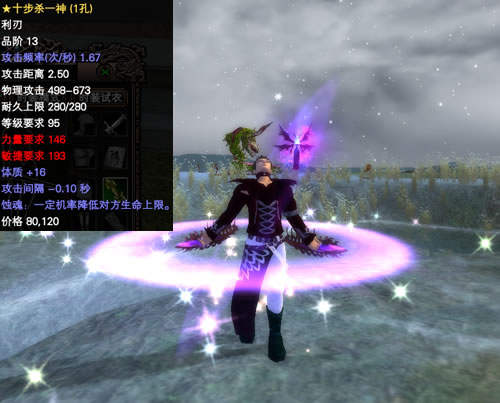
- 原图来源：https://w2i.wanmei.com/pic/news_img/091103/1103047.jpg
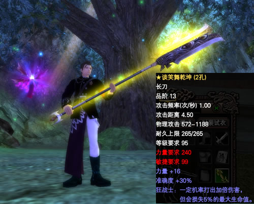
- 原图来源：https://w2i.wanmei.com/pic/news_img/091103/1103048.jpg
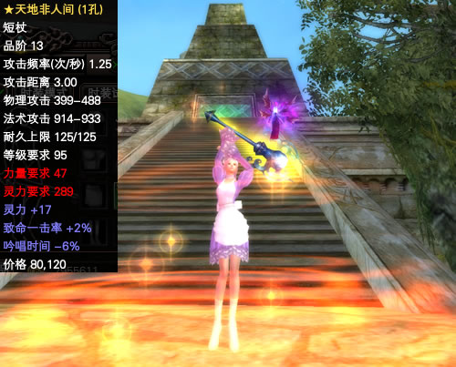
- 原图来源：https://w2i.wanmei.com/pic/news_img/091103/1103049.jpg
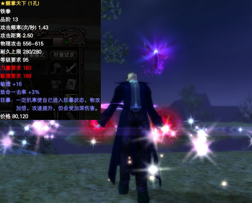
- 原图来源：https://w2i.wanmei.com/pic/news_img/091103/1103050.jpg
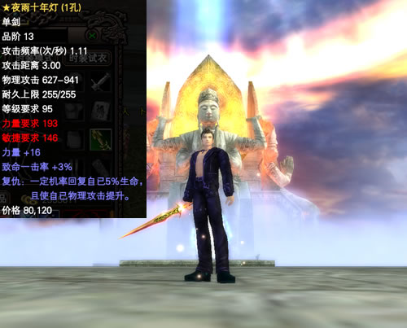
- 原图来源：https://w2i.wanmei.com/pic/news_img/091103/1103051.jpg
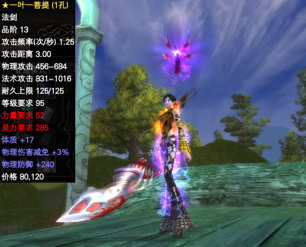
- 原图来源：https://w2i.wanmei.com/pic/news_img/091103/1103052.jpg
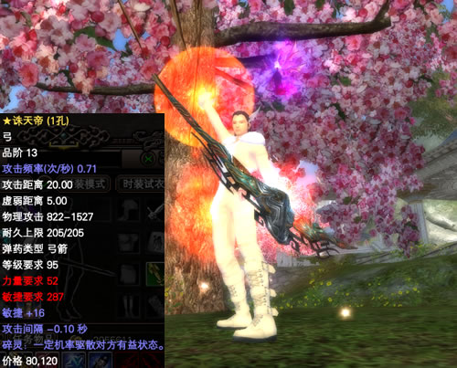

## 武器-覆霜武器

- 来源：https://w2i.wanmei.com/intro/guide/20091103/36704.shtml
- 原文发布时间：2009-11-03
- 获取状态：ok
- 本地结构化数据：[JSON](../pages/407b138fc1a275293ced.json)

覆霜副本介绍
冷风如刀，以大地为砧板，视众生为鱼肉。
万里飞雪，将苍穹作洪炉，溶万物为白银。
“覆霜城”中隐藏了太多的秘密，就如同覆盖在它上面的千年冰雪一样让我们有一种掘之不尽的感觉。虽然艰险，但我们仍要前进，为了获得珍贵的宝藏，为了探索我们所不知道的故事，让我们一起踏入这片被冰封的土地。

### 官方原始图片（尚未全部转录）

- 原图来源：https://w2i.wanmei.com/pic/news_img/091103/1103061.jpg
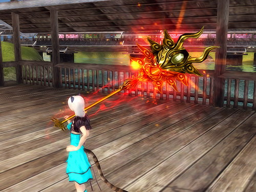
- 原图来源：https://w2i.wanmei.com/pic/news_img/091103/1103062.jpg
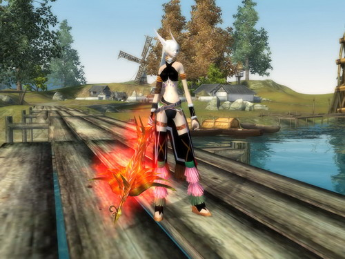
- 原图来源：https://w2i.wanmei.com/pic/news_img/091103/1103063.jpg
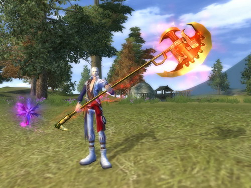

## 魂石

- 来源：https://w2i.wanmei.com/djzb/yxwp/20091015/29947.shtml
- 原文发布时间：2009-10-15
- 获取状态：ok
- 本地结构化数据：[JSON](../pages/97cf148035e762c44874.json)

名称
图标
融合在武器上的属性
融合在防具上的属性
火红之石1级
物理攻击 +3
物理防御 +5
火红之石2级
物理攻击 +6
物理防御 +10
火红之石3级
物理攻击 +9
物理防御 +15
火红之石4级
物理攻击 +12
物理防御 +20
火红之石5级
物理攻击 +16
物理防御 +26
火红之石6级
物理攻击 +20
物理防御 +33
火红之石7级
物理攻击 +25
物理防御 +41
火红之石8级
物理攻击 +32
物理防御 +53
火红之石9级
物理攻击 +40
物理防御 +66
火红之石10级
物理攻击 +50
物理防御 +85
赤眼之石
物理攻击 +75
物理防御 +125
龙炎之石
物理攻击 +100
物理防御 +170
白雾之石1级
法术攻击 +3
五行防御 +4
白雾之石2级
法术攻击 +6
五行防御 +8
白雾之石3级
法术攻击 +9
五行防御 +12
白雾之石4级
法术攻击 +12
五行防御 +16
白雾之石5级
法术攻击 +16
五行防御 +21
白雾之石6级
法术攻击 +20
五行防御 +26
白雾之石7级
法术攻击 +25
五行防御 +33
白雾之石8级
法术攻击 +32
五行防御 +42
白雾之石9级
法术攻击 +40
五行防御 +53
白雾之石10级
法术攻击 +50
五行防御 +70
海蓝之石
法术攻击 +75
五行防御 +100
冰凝之石
法术攻击 +100
五行防御 +135
锐利之石1级
准确度 +10
闪避度 +5
锐利之石2级
准确度 +20
闪避度 +10
锐利之石3级
准确度 +30
闪避度 +15
锐利之石4级
准确度 +40
闪避度 +20
锐利之石5级
准确度 +50
闪避度 +26
锐利之石6级
准确度 +65
闪避度 +33
锐利之石7级
准确度 +80
闪避度 +41
锐利之石8级
准确度 +100
闪避度 +53
锐利之石9级
准确度 +125
闪避度 +66
锐利之石10级
准确度 +150
闪避度 +85
眩光之石
准确度 +225
闪避度 +125
金魄之石
准确度 +300
闪避度 +170
暗青之石1级
真气值 +8
真气值 +8
暗青之石2级
真气值 +16
真气值 +16
暗青之石3级
真气值 +24
真气值 +24
暗青之石4级
真气值 +32
真气值 +32
暗青之石5级
真气值 +40
真气值 +40
暗青之石6级
真气值 +52
真气值 +52
暗青之石7级
真气值 +64
真气值 +64
暗青之石8级
真气值 +80
真气值 +80
暗青之石9级
真气值 +100
真气值 +100
暗青之石10级
真气值 +120
真气值 +120
翠绿之石
真气值 +180
真气值 +180
木灵之石
真气值 +240
真气值 +240
黄沉之石1级
生命值 +5
生命值 +5
黄沉之石2级
生命值 +10
生命值 +10
黄沉之石3级
生命值 +15
生命值 +15
黄沉之石4级
生命值 +20
生命值 +20
黄沉之石5级
生命值 +25
生命值 +25
黄沉之石6级
生命值 +32
生命值 +32
黄沉之石7级
生命值 +40
生命值 +40
黄沉之石8级
生命值 +50
生命值 +50
黄沉之石9级
生命值 +62
生命值 +62
黄沉之石10级
生命值 +75
生命值 +75
苍茫之石
生命值 +115
生命值 +115
大地之石
生命值 +160
生命值 +150
白玉之石1级
附加金系伤害 +6
金防 +8
白玉之石2级
附加金系伤害 +12
金防 +16
白玉之石3级
附加金系伤害 +18
金防 +24
白玉之石4级
附加金系伤害 +24
金防 +32
白玉之石5级
附加金系伤害 +32
金防 +42
白玉之石6级
附加金系伤害 +40
金防 +52
白玉之石7级
附加金系伤害 +50
金防 +66
白玉之石8级
附加金系伤害 +64
金防 +84
白玉之石9级
附加金系伤害 +80
金防 +106
白玉之石10级
附加金系伤害 +100
金防 +140
白刚之石
附加金系伤害 +150
金防 +200
雪花之石
附加金系伤害 +200
金防 +270
青玉之石1级
附加木系伤害 +6
木防 +8
青玉之石2级
附加木系伤害 +12
木防 +16
青玉之石3级
附加木系伤害 +18
木防 +24
青玉之石4级
附加木系伤害 +24
木防 +32
青玉之石5级
附加木系伤害 +32
木防 +42
青玉之石6级
附加木系伤害 +40
木防 +52
青玉之石7级
附加木系伤害 +50
木防 +66
青玉之石8级
附加木系伤害 +64
木防 +84
青玉之石9级
附加木系伤害 +80
木防 +106
青玉之石10级
附加木系伤害 +100
木防 +140
青和之石
附加木系伤害 +150
木防 +200
蓝雨之石
附加木系伤害 +200
木防 +270
黑玉之石1级
附加水系伤害 +6
水防 +8
黑玉之石2级
附加水系伤害 +12
水防 +16
黑玉之石3级
附加水系伤害 +18
水防 +24
黑玉之石4级
附加水系伤害 +24
水防 +32
黑玉之石5级
附加水系伤害 +32
水防 +42
黑玉之石6级
附加水系伤害 +40
水防 +52
黑玉之石7级
附加水系伤害 +50
水防 +66
黑玉之石8级
附加水系伤害 +64
水防 +84
黑玉之石9级
附加水系伤害 +80
水防 +106
黑玉之石10级
附加水系伤害 +100
水防 +140
黑善之石
附加水系伤害 +150
水防 +200
乌睿之石
附加水系伤害 +200
水防 +270
赤玉之石1级
附加火系伤害 +6
火防 +8
赤玉之石2级
附加火系伤害 +12
火防 +16
赤玉之石3级
附加火系伤害 +18
火防 +24
赤玉之石4级
附加火系伤害 +24
火防 +32
赤玉之石5级
附加火系伤害 +32
火防 +42
赤玉之石6级
附加火系伤害 +40
火防 +52
赤玉之石7级
附加火系伤害 +50
火防 +66
赤玉之石8级
附加火系伤害 +64
火防 +84
赤玉之石9级
附加火系伤害 +80
火防 +106
赤玉之石10级
附加火系伤害 +100
火防 +140
赤恭之石
附加火系伤害 +150
火防 +200
赤日之石
附加火系伤害 +200
火防 +270
黄玉之石1级
附加土系伤害 +6
土防 +8
黄玉之石2级
附加土系伤害 +12
土防 +16
黄玉之石3级
附加土系伤害 +18
土防 +24
黄玉之石4级
附加土系伤害 +24
土防 +32
黄玉之石5级
附加土系伤害 +32
土防 +42
黄玉之石6级
附加土系伤害 +40
土防 +52
黄玉之石7级
附加土系伤害 +50
土防 +66
黄玉之石8级
附加土系伤害 +64
土防 +84
黄玉之石9级
附加土系伤害 +80
土防 +106
黄玉之石10级
附加土系伤害 +100
土防 +140
黄厚之石
附加土系伤害 +150
土防 +200
金峰之石
附加土系伤害 +200
土防 +270
女娲之石
吟唱时间 -3%
体质 +10
轩辕之石
致命一击率 +1%
体质 +10
蚩尤之石
力量 +10
体质 +10
后羿之石
敏捷 +10
体质 +10
神农之石
灵力 +10
体质 +10

### 原始表格（按行与单元格保存）

#### 表 1

| 列 1 | 列 2 | 列 3 | 列 4 |
| --- | --- | --- | --- |
| 名称 | 图标 | 融合在武器上的属性 | 融合在防具上的属性 |
| 火红之石1级 |  | 物理攻击 +3 | 物理防御 +5 |
| 火红之石2级 |  | 物理攻击 +6 | 物理防御 +10 |
| 火红之石3级 |  | 物理攻击 +9 | 物理防御 +15 |
| 火红之石4级 |  | 物理攻击 +12 | 物理防御 +20 |
| 火红之石5级 |  | 物理攻击 +16 | 物理防御 +26 |
| 火红之石6级 |  | 物理攻击 +20 | 物理防御 +33 |
| 火红之石7级 |  | 物理攻击 +25 | 物理防御 +41 |
| 火红之石8级 |  | 物理攻击 +32 | 物理防御 +53 |
| 火红之石9级 |  | 物理攻击 +40 | 物理防御 +66 |
| 火红之石10级 |  | 物理攻击 +50 | 物理防御 +85 |
| 赤眼之石 |  | 物理攻击 +75 | 物理防御 +125 |
| 龙炎之石 |  | 物理攻击 +100 | 物理防御 +170 |
| （跨1行/4列） |  |  |  |
| 白雾之石1级 |  | 法术攻击 +3 | 五行防御 +4 |
| 白雾之石2级 |  | 法术攻击 +6 | 五行防御 +8 |
| 白雾之石3级 |  | 法术攻击 +9 | 五行防御 +12 |
| 白雾之石4级 |  | 法术攻击 +12 | 五行防御 +16 |
| 白雾之石5级 |  | 法术攻击 +16 | 五行防御 +21 |
| 白雾之石6级 |  | 法术攻击 +20 | 五行防御 +26 |
| 白雾之石7级 |  | 法术攻击 +25 | 五行防御 +33 |
| 白雾之石8级 |  | 法术攻击 +32 | 五行防御 +42 |
| 白雾之石9级 |  | 法术攻击 +40 | 五行防御 +53 |
| 白雾之石10级 |  | 法术攻击 +50 | 五行防御 +70 |
| 海蓝之石 |  | 法术攻击 +75 | 五行防御 +100 |
| 冰凝之石 |  | 法术攻击 +100 | 五行防御 +135 |
| （跨1行/4列） |  |  |  |
| 锐利之石1级 |  | 准确度 +10 | 闪避度 +5 |
| 锐利之石2级 |  | 准确度 +20 | 闪避度 +10 |
| 锐利之石3级 |  | 准确度 +30 | 闪避度 +15 |
| 锐利之石4级 |  | 准确度 +40 | 闪避度 +20 |
| 锐利之石5级 |  | 准确度 +50 | 闪避度 +26 |
| 锐利之石6级 |  | 准确度 +65 | 闪避度 +33 |
| 锐利之石7级 |  | 准确度 +80 | 闪避度 +41 |
| 锐利之石8级 |  | 准确度 +100 | 闪避度 +53 |
| 锐利之石9级 |  | 准确度 +125 | 闪避度 +66 |
| 锐利之石10级 |  | 准确度 +150 | 闪避度 +85 |
| 眩光之石 |  | 准确度 +225 | 闪避度 +125 |
| 金魄之石 |  | 准确度 +300 | 闪避度 +170 |
| （跨1行/4列） |  |  |  |
| 暗青之石1级 |  | 真气值 +8 | 真气值 +8 |
| 暗青之石2级 |  | 真气值 +16 | 真气值 +16 |
| 暗青之石3级 |  | 真气值 +24 | 真气值 +24 |
| 暗青之石4级 |  | 真气值 +32 | 真气值 +32 |
| 暗青之石5级 |  | 真气值 +40 | 真气值 +40 |
| 暗青之石6级 |  | 真气值 +52 | 真气值 +52 |
| 暗青之石7级 |  | 真气值 +64 | 真气值 +64 |
| 暗青之石8级 |  | 真气值 +80 | 真气值 +80 |
| 暗青之石9级 |  | 真气值 +100 | 真气值 +100 |
| 暗青之石10级 |  | 真气值 +120 | 真气值 +120 |
| 翠绿之石 |  | 真气值 +180 | 真气值 +180 |
| 木灵之石 |  | 真气值 +240 | 真气值 +240 |
| （跨1行/4列） |  |  |  |
| 黄沉之石1级 |  | 生命值 +5 | 生命值 +5 |
| 黄沉之石2级 |  | 生命值 +10 | 生命值 +10 |
| 黄沉之石3级 |  | 生命值 +15 | 生命值 +15 |
| 黄沉之石4级 |  | 生命值 +20 | 生命值 +20 |
| 黄沉之石5级 |  | 生命值 +25 | 生命值 +25 |
| 黄沉之石6级 |  | 生命值 +32 | 生命值 +32 |
| 黄沉之石7级 |  | 生命值 +40 | 生命值 +40 |
| 黄沉之石8级 |  | 生命值 +50 | 生命值 +50 |
| 黄沉之石9级 |  | 生命值 +62 | 生命值 +62 |
| 黄沉之石10级 |  | 生命值 +75 | 生命值 +75 |
| 苍茫之石 |  | 生命值 +115 | 生命值 +115 |
| 大地之石 |  | 生命值 +160 | 生命值 +150 |
| （跨1行/4列） |  |  |  |
| 白玉之石1级 |  | 附加金系伤害 +6 | 金防 +8 |
| 白玉之石2级 |  | 附加金系伤害 +12 | 金防 +16 |
| 白玉之石3级 |  | 附加金系伤害 +18 | 金防 +24 |
| 白玉之石4级 |  | 附加金系伤害 +24 | 金防 +32 |
| 白玉之石5级 |  | 附加金系伤害 +32 | 金防 +42 |
| 白玉之石6级 |  | 附加金系伤害 +40 | 金防 +52 |
| 白玉之石7级 |  | 附加金系伤害 +50 | 金防 +66 |
| 白玉之石8级 |  | 附加金系伤害 +64 | 金防 +84 |
| 白玉之石9级 |  | 附加金系伤害 +80 | 金防 +106 |
| 白玉之石10级 |  | 附加金系伤害 +100 | 金防 +140 |
| 白刚之石 |  | 附加金系伤害 +150 | 金防 +200 |
| 雪花之石 |  | 附加金系伤害 +200 | 金防 +270 |
| （跨1行/4列） |  |  |  |
| 青玉之石1级 |  | 附加木系伤害 +6 | 木防 +8 |
| 青玉之石2级 |  | 附加木系伤害 +12 | 木防 +16 |
| 青玉之石3级 |  | 附加木系伤害 +18 | 木防 +24 |
| 青玉之石4级 |  | 附加木系伤害 +24 | 木防 +32 |
| 青玉之石5级 |  | 附加木系伤害 +32 | 木防 +42 |
| 青玉之石6级 |  | 附加木系伤害 +40 | 木防 +52 |
| 青玉之石7级 |  | 附加木系伤害 +50 | 木防 +66 |
| 青玉之石8级 |  | 附加木系伤害 +64 | 木防 +84 |
| 青玉之石9级 |  | 附加木系伤害 +80 | 木防 +106 |
| 青玉之石10级 |  | 附加木系伤害 +100 | 木防 +140 |
| 青和之石 |  | 附加木系伤害 +150 | 木防 +200 |
| 蓝雨之石 |  | 附加木系伤害 +200 | 木防 +270 |
| （跨1行/4列） |  |  |  |
| 黑玉之石1级 |  | 附加水系伤害 +6 | 水防 +8 |
| 黑玉之石2级 |  | 附加水系伤害 +12 | 水防 +16 |
| 黑玉之石3级 |  | 附加水系伤害 +18 | 水防 +24 |
| 黑玉之石4级 |  | 附加水系伤害 +24 | 水防 +32 |
| 黑玉之石5级 |  | 附加水系伤害 +32 | 水防 +42 |
| 黑玉之石6级 |  | 附加水系伤害 +40 | 水防 +52 |
| 黑玉之石7级 |  | 附加水系伤害 +50 | 水防 +66 |
| 黑玉之石8级 |  | 附加水系伤害 +64 | 水防 +84 |
| 黑玉之石9级 |  | 附加水系伤害 +80 | 水防 +106 |
| 黑玉之石10级 |  | 附加水系伤害 +100 | 水防 +140 |
| 黑善之石 |  | 附加水系伤害 +150 | 水防 +200 |
| 乌睿之石 |  | 附加水系伤害 +200 | 水防 +270 |
| （跨1行/4列） |  |  |  |
| 赤玉之石1级 |  | 附加火系伤害 +6 | 火防 +8 |
| 赤玉之石2级 |  | 附加火系伤害 +12 | 火防 +16 |
| 赤玉之石3级 |  | 附加火系伤害 +18 | 火防 +24 |
| 赤玉之石4级 |  | 附加火系伤害 +24 | 火防 +32 |
| 赤玉之石5级 |  | 附加火系伤害 +32 | 火防 +42 |
| 赤玉之石6级 |  | 附加火系伤害 +40 | 火防 +52 |
| 赤玉之石7级 |  | 附加火系伤害 +50 | 火防 +66 |
| 赤玉之石8级 |  | 附加火系伤害 +64 | 火防 +84 |
| 赤玉之石9级 |  | 附加火系伤害 +80 | 火防 +106 |
| 赤玉之石10级 |  | 附加火系伤害 +100 | 火防 +140 |
| 赤恭之石 |  | 附加火系伤害 +150 | 火防 +200 |
| 赤日之石 |  | 附加火系伤害 +200 | 火防 +270 |
| （跨1行/4列） |  |  |  |
| 黄玉之石1级 |  | 附加土系伤害 +6 | 土防 +8 |
| 黄玉之石2级 |  | 附加土系伤害 +12 | 土防 +16 |
| 黄玉之石3级 |  | 附加土系伤害 +18 | 土防 +24 |
| 黄玉之石4级 |  | 附加土系伤害 +24 | 土防 +32 |
| 黄玉之石5级 |  | 附加土系伤害 +32 | 土防 +42 |
| 黄玉之石6级 |  | 附加土系伤害 +40 | 土防 +52 |
| 黄玉之石7级 |  | 附加土系伤害 +50 | 土防 +66 |
| 黄玉之石8级 |  | 附加土系伤害 +64 | 土防 +84 |
| 黄玉之石9级 |  | 附加土系伤害 +80 | 土防 +106 |
| 黄玉之石10级 |  | 附加土系伤害 +100 | 土防 +140 |
| 黄厚之石 |  | 附加土系伤害 +150 | 土防 +200 |
| 金峰之石 |  | 附加土系伤害 +200 | 土防 +270 |
| （跨1行/4列） |  |  |  |
| 女娲之石 |  | 吟唱时间 -3% | 体质 +10 |
| 轩辕之石 |  | 致命一击率 +1% | 体质 +10 |
| 蚩尤之石 |  | 力量 +10 | 体质 +10 |
| 后羿之石 |  | 敏捷 +10 | 体质 +10 |
| 神农之石 |  | 灵力 +10 | 体质 +10 |
| （跨1行/4列） |  |  |  |

### 官方原始图片（尚未全部转录）

- 原图来源：https://w2i.wanmei.com/pic/news_img/hunshi/image1581.jpg

- 原图来源：https://w2i.wanmei.com/pic/news_img/hunshi/image1583.jpg

- 原图来源：https://w2i.wanmei.com/pic/news_img/hunshi/image1585.jpg

- 原图来源：https://w2i.wanmei.com/pic/news_img/hunshi/image1587.jpg
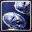
- 原图来源：https://w2i.wanmei.com/pic/news_img/hunshi/image1589.jpg

- 原图来源：https://w2i.wanmei.com/pic/news_img/hunshi/image1591.jpg

- 原图来源：https://w2i.wanmei.com/pic/news_img/hunshi/image1593.jpg
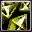
- 原图来源：https://w2i.wanmei.com/pic/news_img/hunshi/image1595.jpg

- 原图来源：https://w2i.wanmei.com/pic/news_img/hunshi/image1597.jpg

- 原图来源：https://w2i.wanmei.com/pic/news_img/hunshi/image1599.jpg

- 原图来源：https://w2i.wanmei.com/pic/news_img/hunshi/image1601.jpg

- 原图来源：https://w2i.wanmei.com/pic/news_img/hunshi/image1603.jpg

- 原图来源：https://w2i.wanmei.com/pic/news_img/hunshi/image1605.jpg

- 原图来源：https://w2i.wanmei.com/pic/news_img/hunshi/image1607.jpg
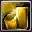
- 原图来源：https://w2i.wanmei.com/pic/news_img/hunshi/image1609.jpg

- 原图来源：https://w2i.wanmei.com/pic/news_img/hunshi/image1611.jpg
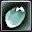
- 原图来源：https://w2i.wanmei.com/pic/news_img/hunshi/image1613.jpg
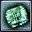
- 原图来源：https://w2i.wanmei.com/pic/news_img/hunshi/image1615.jpg

- 原图来源：https://w2i.wanmei.com/pic/news_img/hunshi/image1617.jpg

- 原图来源：https://w2i.wanmei.com/pic/news_img/hunshi/image1619.jpg
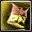
- 原图来源：https://w2i.wanmei.com/pic/news_img/hunshi/image1621.jpg

- 原图来源：https://w2i.wanmei.com/pic/news_img/hunshi/image1623.jpg

- 原图来源：https://w2i.wanmei.com/pic/news_img/hunshi/image1625.jpg

- 原图来源：https://w2i.wanmei.com/pic/news_img/hunshi/image1463.jpg

- 原图来源：https://w2i.wanmei.com/pic/news_img/hunshi/image1627.jpg

## 灵符

- 来源：https://w2i.wanmei.com/djzb/yxwp/20091015/29943.shtml
- 原文发布时间：2009-10-15
- 获取状态：ok
- 本地结构化数据：[JSON](../pages/16b67aae2fc39d311cd9.json)

名称
图标
种类
需求人物等级
冷却时间
初级裂刃符
物理攻击灵符
－
－
中级裂刃符
物理攻击灵符
－
－
高级裂刃符
物理攻击灵符
－
－
初级雷刃符
物理攻击灵符
－
－
中级雷刃符
物理攻击灵符
－
－
高级雷刃符
物理攻击灵符
－
－
初级光刃符
物理攻击灵符
－
－
中级光刃符
物理攻击灵符
－
－
高级光刃符
物理攻击灵符
－
－
初级狂刃符
物理攻击灵符
－
－
中级狂刃符
物理攻击灵符
－
－
高级狂刃符
物理攻击灵符
－
－
初级天刃符
物理攻击灵符
－
－
中级天刃符
物理攻击灵符
－
－
高级天刃符
物理攻击灵符
－
－
初级咒灵符
法术攻击灵符
－
－
中级咒灵符
法术攻击灵符
－
－
高级咒灵符
法术攻击灵符
－
－
初级定灵符
法术攻击灵符
－
－
中级定灵符
法术攻击灵符
－
－
高级定灵符
法术攻击灵符
－
－
初级幻灵符
法术攻击灵符
－
－
中级幻灵符
法术攻击灵符
－
－
高级幻灵符
法术攻击灵符
－
－
初级道灵符
法术攻击灵符
－
－
中级道灵符
法术攻击灵符
－
－
高级道灵符
法术攻击灵符
－
－
初级仙灵符
法术攻击灵符
－
－
中级仙灵符
法术攻击灵符
－
－
高级仙灵符
法术攻击灵符
－
－
硬甲符
物理防御灵符
1~20
8秒
护甲符
物理防御灵符
21~40
8秒
麟甲符
物理防御灵符
41~60
8秒
御甲符
物理防御灵符
61~80
8秒
玄甲符
物理防御灵符
81~100
8秒
初级魔甲符
物理防御灵符
100
8秒
中级魔甲符
物理防御灵符
100
8秒
高级魔甲符
物理防御灵符
100
8秒
护神符
法术防御灵符
1~20
8秒
固神符
法术防御灵符
21~40
8秒
聚神符
法术防御灵符
41~60
8秒
凝神符
法术防御灵符
61~80
8秒
定神符
法术防御灵符
81~100
8秒
初级召神符
法术防御灵符
100
8秒
中级召神符
法术防御灵符
100
8秒
高级召神符
法术防御灵符
100
8秒

### 原始表格（按行与单元格保存）

#### 表 1

| 列 1 | 列 2 | 列 3 | 列 4 | 列 5 |
| --- | --- | --- | --- | --- |
| 名称 | 图标 | 种类 | 需求人物等级 | 冷却时间 |
| 初级裂刃符 |  | 物理攻击灵符 | － | － |
| 中级裂刃符 |  | 物理攻击灵符 | － | － |
| 高级裂刃符 |  | 物理攻击灵符 | － | － |
| 初级雷刃符 |  | 物理攻击灵符 | － | － |
| 中级雷刃符 |  | 物理攻击灵符 | － | － |
| 高级雷刃符 |  | 物理攻击灵符 | － | － |
| 初级光刃符 |  | 物理攻击灵符 | － | － |
| 中级光刃符 |  | 物理攻击灵符 | － | － |
| 高级光刃符 |  | 物理攻击灵符 | － | － |
| 初级狂刃符 |  | 物理攻击灵符 | － | － |
| 中级狂刃符 |  | 物理攻击灵符 | － | － |
| 高级狂刃符 |  | 物理攻击灵符 | － | － |
| 初级天刃符 |  | 物理攻击灵符 | － | － |
| 中级天刃符 |  | 物理攻击灵符 | － | － |
| 高级天刃符 |  | 物理攻击灵符 | － | － |
| （跨1行/5列） |  |  |  |  |
| 初级咒灵符 |  | 法术攻击灵符 | － | － |
| 中级咒灵符 |  | 法术攻击灵符 | － | － |
| 高级咒灵符 |  | 法术攻击灵符 | － | － |
| 初级定灵符 |  | 法术攻击灵符 | － | － |
| 中级定灵符 |  | 法术攻击灵符 | － | － |
| 高级定灵符 |  | 法术攻击灵符 | － | － |
| 初级幻灵符 |  | 法术攻击灵符 | － | － |
| 中级幻灵符 |  | 法术攻击灵符 | － | － |
| 高级幻灵符 |  | 法术攻击灵符 | － | － |
| 初级道灵符 |  | 法术攻击灵符 | － | － |
| 中级道灵符 |  | 法术攻击灵符 | － | － |
| 高级道灵符 |  | 法术攻击灵符 | － | － |
| 初级仙灵符 |  | 法术攻击灵符 | － | － |
| 中级仙灵符 |  | 法术攻击灵符 | － | － |
| 高级仙灵符 |  | 法术攻击灵符 | － | － |
| （跨1行/5列） |  |  |  |  |
| 硬甲符 |  | 物理防御灵符 | 1~20 | 8秒 |
| 护甲符 |  | 物理防御灵符 | 21~40 | 8秒 |
| 麟甲符 |  | 物理防御灵符 | 41~60 | 8秒 |
| 御甲符 |  | 物理防御灵符 | 61~80 | 8秒 |
| 玄甲符 |  | 物理防御灵符 | 81~100 | 8秒 |
| 初级魔甲符 |  | 物理防御灵符 | 100 | 8秒 |
| 中级魔甲符 |  | 物理防御灵符 | 100 | 8秒 |
| 高级魔甲符 |  | 物理防御灵符 | 100 | 8秒 |
| （跨1行/5列） |  |  |  |  |
| 护神符 |  | 法术防御灵符 | 1~20 | 8秒 |
| 固神符 |  | 法术防御灵符 | 21~40 | 8秒 |
| 聚神符 |  | 法术防御灵符 | 41~60 | 8秒 |
| 凝神符 |  | 法术防御灵符 | 61~80 | 8秒 |
| 定神符 |  | 法术防御灵符 | 81~100 | 8秒 |
| 初级召神符 |  | 法术防御灵符 | 100 | 8秒 |
| 中级召神符 |  | 法术防御灵符 | 100 | 8秒 |
| 高级召神符 |  | 法术防御灵符 | 100 | 8秒 |

### 官方原始图片（尚未全部转录）

- 原图来源：https://w2i.wanmei.com/pic/news_img/lingfu/image1629.jpg
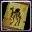
- 原图来源：https://w2i.wanmei.com/pic/news_img/lingfu/image1631.jpg
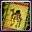
- 原图来源：https://w2i.wanmei.com/pic/news_img/lingfu/image1633.jpg
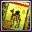
- 原图来源：https://w2i.wanmei.com/pic/news_img/lingfu/image1635.jpg

- 原图来源：https://w2i.wanmei.com/pic/news_img/lingfu/image1637.jpg

- 原图来源：https://w2i.wanmei.com/pic/news_img/lingfu/image1639.jpg

- 原图来源：https://w2i.wanmei.com/pic/news_img/lingfu/image1641.jpg

- 原图来源：https://w2i.wanmei.com/pic/news_img/lingfu/image1643.jpg

- 原图来源：https://w2i.wanmei.com/pic/news_img/lingfu/image1645.jpg

- 原图来源：https://w2i.wanmei.com/pic/news_img/lingfu/image1647.jpg

- 原图来源：https://w2i.wanmei.com/pic/news_img/lingfu/image1649.jpg

- 原图来源：https://w2i.wanmei.com/pic/news_img/lingfu/image1651.jpg

- 原图来源：https://w2i.wanmei.com/pic/news_img/lingfu/image1653.jpg

- 原图来源：https://w2i.wanmei.com/pic/news_img/lingfu/image1655.jpg

- 原图来源：https://w2i.wanmei.com/pic/news_img/lingfu/image1657.jpg

- 原图来源：https://w2i.wanmei.com/pic/news_img/lingfu/image1659.jpg
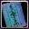
- 原图来源：https://w2i.wanmei.com/pic/news_img/lingfu/image1661.jpg

- 原图来源：https://w2i.wanmei.com/pic/news_img/lingfu/image1663.jpg

- 原图来源：https://w2i.wanmei.com/pic/news_img/lingfu/image1665.jpg

- 原图来源：https://w2i.wanmei.com/pic/news_img/lingfu/image1667.jpg

## 药品

- 来源：https://w2i.wanmei.com/djzb/yxwp/20091015/29942.shtml
- 原文发布时间：2009-10-15
- 获取状态：ok
- 本地结构化数据：[JSON](../pages/763115147ff940f6e632.json)

名称
图标
种类
需求人物等级
恢复方式
恢复生命值
恢复真气值
冷却时间
小瓶金创药
生命恢复药
1
10秒内
30
0
15秒
中瓶金创药
生命恢复药
5
10秒内
80
0
15秒
大瓶金创药
生命恢复药
12
10秒内
160
0
15秒
精制金创药
生命恢复药
20
10秒内
270
0
15秒
完美金创药
生命恢复药
30
10秒内
410
0
15秒
小瓶活血散
生命恢复药
40
10秒内
580
0
15秒
中瓶活血散
生命恢复药
50
10秒内
780
0
15秒
大瓶活血散
生命恢复药
60
10秒内
1000
0
15秒
精制活血散
生命恢复药
70
10秒内
1270
0
15秒
完美活血散
生命恢复药
80
10秒内
1560
0
15秒
小瓶归元散
生命恢复药
90
10秒内
1880
0
15秒
中瓶归元散
生命恢复药
100
10秒内
2250
0
15秒
小瓶神气丸
真气恢复药
1
10秒内
0
40
15秒
中瓶神气丸
真气恢复药
5
10秒内
0
100
15秒
大瓶神气丸
真气恢复药
12
10秒内
0
200
15秒
精制神气丸
真气恢复药
20
10秒内
0
330
15秒
完美神气丸
真气恢复药
30
10秒内
0
510
15秒
小瓶还灵水
真气恢复药
40
10秒内
0
730
15秒
中瓶还灵水
真气恢复药
50
10秒内
0
980
15秒
大瓶还灵水
真气恢复药
60
10秒内
0
1250
15秒
精制还灵水
真气恢复药
70
10秒内
0
1600
15秒
完美还灵水
真气恢复药
80
10秒内
0
1950
15秒
小瓶沉香丸
真气恢复药
90
10秒内
0
2350
15秒
中瓶沉香丸
真气恢复药
100
10秒内
0
2800
15秒
小瓶九阳丹
速效恢复药
1
瞬间恢复
20
30
60秒
中瓶九阳丹
速效恢复药
5
瞬间恢复
60
70
60秒
大瓶九阳丹
速效恢复药
12
瞬间恢复
110
140
60秒
精制九阳丹
速效恢复药
20
瞬间恢复
180
220
60秒
完美九阳丹
速效恢复药
30
瞬间恢复
280
340
60秒
小瓶九龙散
速效恢复药
40
瞬间恢复
390
490
60秒
中瓶九龙散
速效恢复药
50
瞬间恢复
520
660
60秒
大瓶九龙散
速效恢复药
60
瞬间恢复
670
840
60秒
精制九龙散
速效恢复药
70
瞬间恢复
850
1070
60秒
完美九龙散
速效恢复药
80
瞬间恢复
1040
1300
60秒
小瓶龙涎香
速效恢复药
90
瞬间恢复
1260
1570
60秒
中瓶龙涎香
速效恢复药
100
瞬间恢复
1500
1870
60秒

### 原始表格（按行与单元格保存）

#### 表 1

| 列 1 | 列 2 | 列 3 | 列 4 | 列 5 | 列 6 | 列 7 | 列 8 |
| --- | --- | --- | --- | --- | --- | --- | --- |
| 名称 | 图标 | 种类 | 需求人物等级 | 恢复方式 | 恢复生命值 | 恢复真气值 | 冷却时间 |
| 小瓶金创药 |  | 生命恢复药 | 1 | 10秒内 | 30 | 0 | 15秒 |
| 中瓶金创药 |  | 生命恢复药 | 5 | 10秒内 | 80 | 0 | 15秒 |
| 大瓶金创药 |  | 生命恢复药 | 12 | 10秒内 | 160 | 0 | 15秒 |
| 精制金创药 |  | 生命恢复药 | 20 | 10秒内 | 270 | 0 | 15秒 |
| 完美金创药 |  | 生命恢复药 | 30 | 10秒内 | 410 | 0 | 15秒 |
| 小瓶活血散 |  | 生命恢复药 | 40 | 10秒内 | 580 | 0 | 15秒 |
| 中瓶活血散 |  | 生命恢复药 | 50 | 10秒内 | 780 | 0 | 15秒 |
| 大瓶活血散 |  | 生命恢复药 | 60 | 10秒内 | 1000 | 0 | 15秒 |
| 精制活血散 |  | 生命恢复药 | 70 | 10秒内 | 1270 | 0 | 15秒 |
| 完美活血散 |  | 生命恢复药 | 80 | 10秒内 | 1560 | 0 | 15秒 |
| 小瓶归元散 |  | 生命恢复药 | 90 | 10秒内 | 1880 | 0 | 15秒 |
| 中瓶归元散 |  | 生命恢复药 | 100 | 10秒内 | 2250 | 0 | 15秒 |
| （跨1行/8列） |  |  |  |  |  |  |  |
| 小瓶神气丸 |  | 真气恢复药 | 1 | 10秒内 | 0 | 40 | 15秒 |
| 中瓶神气丸 |  | 真气恢复药 | 5 | 10秒内 | 0 | 100 | 15秒 |
| 大瓶神气丸 |  | 真气恢复药 | 12 | 10秒内 | 0 | 200 | 15秒 |
| 精制神气丸 |  | 真气恢复药 | 20 | 10秒内 | 0 | 330 | 15秒 |
| 完美神气丸 |  | 真气恢复药 | 30 | 10秒内 | 0 | 510 | 15秒 |
| 小瓶还灵水 |  | 真气恢复药 | 40 | 10秒内 | 0 | 730 | 15秒 |
| 中瓶还灵水 |  | 真气恢复药 | 50 | 10秒内 | 0 | 980 | 15秒 |
| 大瓶还灵水 |  | 真气恢复药 | 60 | 10秒内 | 0 | 1250 | 15秒 |
| 精制还灵水 |  | 真气恢复药 | 70 | 10秒内 | 0 | 1600 | 15秒 |
| 完美还灵水 |  | 真气恢复药 | 80 | 10秒内 | 0 | 1950 | 15秒 |
| 小瓶沉香丸 |  | 真气恢复药 | 90 | 10秒内 | 0 | 2350 | 15秒 |
| 中瓶沉香丸 |  | 真气恢复药 | 100 | 10秒内 | 0 | 2800 | 15秒 |
| （跨1行/8列） |  |  |  |  |  |  |  |
| 小瓶九阳丹 |  | 速效恢复药 | 1 | 瞬间恢复 | 20 | 30 | 60秒 |
| 中瓶九阳丹 |  | 速效恢复药 | 5 | 瞬间恢复 | 60 | 70 | 60秒 |
| 大瓶九阳丹 |  | 速效恢复药 | 12 | 瞬间恢复 | 110 | 140 | 60秒 |
| 精制九阳丹 |  | 速效恢复药 | 20 | 瞬间恢复 | 180 | 220 | 60秒 |
| 完美九阳丹 |  | 速效恢复药 | 30 | 瞬间恢复 | 280 | 340 | 60秒 |
| 小瓶九龙散 |  | 速效恢复药 | 40 | 瞬间恢复 | 390 | 490 | 60秒 |
| 中瓶九龙散 |  | 速效恢复药 | 50 | 瞬间恢复 | 520 | 660 | 60秒 |
| 大瓶九龙散 |  | 速效恢复药 | 60 | 瞬间恢复 | 670 | 840 | 60秒 |
| 精制九龙散 |  | 速效恢复药 | 70 | 瞬间恢复 | 850 | 1070 | 60秒 |
| 完美九龙散 |  | 速效恢复药 | 80 | 瞬间恢复 | 1040 | 1300 | 60秒 |
| 小瓶龙涎香 |  | 速效恢复药 | 90 | 瞬间恢复 | 1260 | 1570 | 60秒 |
| 中瓶龙涎香 |  | 速效恢复药 | 100 | 瞬间恢复 | 1500 | 1870 | 60秒 |

### 官方原始图片（尚未全部转录）

- 原图来源：https://w2i.wanmei.com/pic/news_img/yaopin/image1669.jpg

- 原图来源：https://w2i.wanmei.com/pic/news_img/yaopin/image1671.jpg

- 原图来源：https://w2i.wanmei.com/pic/news_img/yaopin/image1673.jpg

- 原图来源：https://w2i.wanmei.com/pic/news_img/yaopin/image1675.jpg

- 原图来源：https://w2i.wanmei.com/pic/news_img/yaopin/image1677.jpg

- 原图来源：https://w2i.wanmei.com/pic/news_img/yaopin/image1679.jpg

- 原图来源：https://w2i.wanmei.com/pic/news_img/yaopin/image1681.jpg
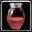
- 原图来源：https://w2i.wanmei.com/pic/news_img/yaopin/image1683.jpg

- 原图来源：https://w2i.wanmei.com/pic/news_img/yaopin/image1685.jpg

- 原图来源：https://w2i.wanmei.com/pic/news_img/yaopin/image1687.jpg

- 原图来源：https://w2i.wanmei.com/pic/news_img/yaopin/image1689.jpg

- 原图来源：https://w2i.wanmei.com/pic/news_img/yaopin/image1691.jpg

- 原图来源：https://w2i.wanmei.com/pic/news_img/yaopin/image1699.jpg

- 原图来源：https://w2i.wanmei.com/pic/news_img/yaopin/image1701.jpg

- 原图来源：https://w2i.wanmei.com/pic/news_img/yaopin/image1703.jpg

- 原图来源：https://w2i.wanmei.com/pic/news_img/yaopin/image1705.jpg

- 原图来源：https://w2i.wanmei.com/pic/news_img/yaopin/image1707.jpg

- 原图来源：https://w2i.wanmei.com/pic/news_img/yaopin/image1709.jpg

- 原图来源：https://w2i.wanmei.com/pic/news_img/yaopin/image1711.jpg

- 原图来源：https://w2i.wanmei.com/pic/news_img/yaopin/image1713.jpg

- 原图来源：https://w2i.wanmei.com/pic/news_img/yaopin/image1715.jpg

- 原图来源：https://w2i.wanmei.com/pic/news_img/yaopin/image1717.jpg

- 原图来源：https://w2i.wanmei.com/pic/news_img/yaopin/image1719.jpg

- 原图来源：https://w2i.wanmei.com/pic/news_img/yaopin/image1721.jpg

- 原图来源：https://w2i.wanmei.com/pic/news_img/yaopin/image1729.jpg

- 原图来源：https://w2i.wanmei.com/pic/news_img/yaopin/image1731.jpg

- 原图来源：https://w2i.wanmei.com/pic/news_img/yaopin/image1733.jpg

- 原图来源：https://w2i.wanmei.com/pic/news_img/yaopin/image1735.jpg

- 原图来源：https://w2i.wanmei.com/pic/news_img/yaopin/image1737.jpg

- 原图来源：https://w2i.wanmei.com/pic/news_img/yaopin/image1739.jpg

- 原图来源：https://w2i.wanmei.com/pic/news_img/yaopin/image1741.jpg

- 原图来源：https://w2i.wanmei.com/pic/news_img/yaopin/image1743.jpg

- 原图来源：https://w2i.wanmei.com/pic/news_img/yaopin/image1745.jpg

- 原图来源：https://w2i.wanmei.com/pic/news_img/yaopin/image1747.jpg

- 原图来源：https://w2i.wanmei.com/pic/news_img/yaopin/image1749.jpg

- 原图来源：https://w2i.wanmei.com/pic/news_img/yaopin/image1751.jpg

## 《完美国际》副本大革新

- 来源：https://w2i.wanmei.com/hd/newfb/zhonglei.htm
- 原文发布时间：页面未标明
- 获取状态：ok
- 本地结构化数据：[JSON](../pages/5202593b0629bc05bd75.json)

### 官方原始图片（尚未全部转录）

- 原图来源：http://images.wanmei.com/huodong/images/w2i/logo/transparent.gif
  图片未获取。
- 原图来源：https://w2i.wanmei.com/hd/newfb/images/top01.jpg

- 原图来源：https://w2i.wanmei.com/hd/newfb/images/b01.gif

- 原图来源：https://w2i.wanmei.com/hd/newfb/images/m04_01.jpg

- 原图来源：https://w2i.wanmei.com/hd/newfb/images/m04_02.jpg

- 原图来源：https://w2i.wanmei.com/hd/newfb/images/m04_03.jpg

- 原图来源：https://w2i.wanmei.com/hd/newfb/images/m04_04.jpg

- 原图来源：https://w2i.wanmei.com/hd/newfb/images/m04_05.jpg

- 原图来源：https://w2i.wanmei.com/hd/newfb/images/m04_06.jpg

- 原图来源：https://w2i.wanmei.com/hd/newfb/images/m04_07.jpg

- 原图来源：https://w2i.wanmei.com/hd/newfb/images/m04_08.jpg

- 原图来源：https://w2i.wanmei.com/hd/newfb/images/m04_09.jpg

- 原图来源：https://w2i.wanmei.com/hd/newfb/images/m04_10.jpg

- 原图来源：https://w2i.wanmei.com/hd/newfb/images/m04_11.jpg

- 原图来源：https://w2i.wanmei.com/hd/newfb/images/m04_12.jpg

- 原图来源：https://w2i.wanmei.com/hd/newfb/images/m04_13.jpg

- 原图来源：https://w2i.wanmei.com/hd/newfb/images/m04_14.jpg

- 原图来源：https://w2i.wanmei.com/hd/newfb/images/m04_15.jpg

- 原图来源：https://w2i.wanmei.com/hd/newfb/images/m04_16.jpg

- 原图来源：https://w2i.wanmei.com/hd/newfb/images/m04_17.jpg

- 原图来源：https://w2i.wanmei.com/hd/newfb/images/m04_18.jpg

- 原图来源：https://w2i.wanmei.com/hd/newfb/images/m04_19.jpg

- 原图来源：https://w2i.wanmei.com/hd/newfb/images/m04_20.jpg

- 原图来源：https://w2i.wanmei.com/hd/newfb/images/m04_21.jpg

- 原图来源：https://w2i.wanmei.com/hd/newfb/images/m04_22.jpg

- 原图来源：https://w2i.wanmei.com/hd/newfb/images/m04_23.jpg

- 原图来源：https://w2i.wanmei.com/hd/newfb/images/m04_24.jpg

- 原图来源：https://w2i.wanmei.com/hd/newfb/images/m04_25.jpg

- 原图来源：https://w2i.wanmei.com/hd/newfb/images/m04_26.jpg

- 原图来源：https://w2i.wanmei.com/hd/newfb/images/m04_27.jpg

- 原图来源：https://w2i.wanmei.com/hd/newfb/images/m04_28.jpg

- 原图来源：https://w2i.wanmei.com/hd/newfb/images/m04_29.jpg

- 原图来源：https://w2i.wanmei.com/hd/newfb/images/m04_30.jpg

- 原图来源：https://w2i.wanmei.com/hd/newfb/images/m04_31.jpg

- 原图来源：https://w2i.wanmei.com/hd/newfb/images/m04_32.jpg

- 原图来源：https://w2i.wanmei.com/hd/newfb/images/m04_33.jpg

- 原图来源：https://w2i.wanmei.com/hd/newfb/images/m04_34.jpg

- 原图来源：https://w2i.wanmei.com/hd/newfb/images/m04_35.jpg

- 原图来源：https://w2i.wanmei.com/hd/newfb/images/m04_36.jpg

## 武器 - 刀剑

- 来源：https://w2i.wanmei.com/djzb/zb/20091015/29859.shtml
- 原文发布时间：2009-10-15
- 获取状态：ok
- 本地结构化数据：[JSON](../pages/e1fe6614443052284ef7.json)

刀剑 | 长兵 | 斧锤 | 拳套 | 弓弩 | 法器 | 传说 | 创世 | 弹药 | 任务奖励 |
名称
图标
类型
需求人物等级
需求职业
需求力量点数
需求敏捷点数
需求体质点数
需求灵力点数
青铜剑
单剑
4
－
8
7
－
－
淬铁剑
单剑
11
－
18
14
－
－
百炼剑
单剑
19
－
33
26
－
－
青锋剑
单剑
29
－
61
47
－
－
寒霜剑
单剑
39
－
81
62
－
－
丹心剑
单剑
49
－
101
77
－
－
碧涛剑
单剑
59
－
121
92
－
－
流光剑
单剑
69
－
141
107
－
－
藏锋剑
单剑
79
－
161
122
－
－
多情剑
单剑
89
－
181
137
－
－
孤穹
单剑
99
－
201
152
－
－
子母双剑
双剑
1
－
5
5
－
－
鸳鸯双剑
双剑
5
－
9
9
－
－
连横双剑
双剑
13
－
23
20
－
－
阴阳双剑
双剑
21
－
43
37
－
－
坎离双剑
双剑
31
－
62
53
－
－
和合双剑
双剑
41
－
81
69
－
－
流金双剑
双剑
51
－
100
85
－
－
比翼双剑
双剑
61
－
119
101
－
－
风花双剑
双剑
71
－
138
117
－
－
紫青双剑
双剑
81
－
157
133
－
－
鸳蝶舞
双剑
91
－
176
149
－
－
点钢刀
单刀
3
－
7
6
－
－
折铁刀
单刀
9
－
15
12
－
－
鬼头刀
单刀
17
－
30
24
－
－
百战刀
单刀
27
－
57
44
－
－
破阵刀
单刀
37
－
77
59
－
－
斩将刀
单刀
47
－
97
74
－
－
归尘刀
单刀
57
－
117
89
－
－
溢彩刀
单刀
67
－
137
104
－
－
若拙刀
单刀
77
－
157
119
－
－
绝情刀
单刀
87
－
177
134
－
－
断岳
单刀
97
－
197
149
－
－
柳叶双刀
双刀
2
－
6
5
－
－
蝴蝶双刀
双刀
7
－
13
10
－
－
合纵双刀
双刀
15
－
28
20
－
－
连环双刀
双刀
24
－
53
37
－
－
子午双刀
双刀
34
－
74
51
－
－
锯齿双刀
双刀
44
－
95
65
－
－
饮血双刀
双刀
54
－
116
79
－
－
比目双刀
双刀
64
－
137
93
－
－
雪月双刀
双刀
74
－
158
107
－
－
形意双刀
双刀
84
－
179
121
－
－
恩爱会
双刀
94
－
200
135
－
－

### 原始表格（按行与单元格保存）

#### 表 1

| 列 1 | 列 2 | 列 3 | 列 4 | 列 5 | 列 6 | 列 7 | 列 8 | 列 9 |
| --- | --- | --- | --- | --- | --- | --- | --- | --- |
| 名称 | 图标 | 类型 | 需求人物等级 | 需求职业 | 需求力量点数 | 需求敏捷点数 | 需求体质点数 | 需求灵力点数 |
| 青铜剑 |  | 单剑 | 4 | － | 8 | 7 | － | － |
| 淬铁剑 |  | 单剑 | 11 | － | 18 | 14 | － | － |
| 百炼剑 |  | 单剑 | 19 | － | 33 | 26 | － | － |
| 青锋剑 |  | 单剑 | 29 | － | 61 | 47 | － | － |
| 寒霜剑 |  | 单剑 | 39 | － | 81 | 62 | － | － |
| 丹心剑 |  | 单剑 | 49 | － | 101 | 77 | － | － |
| 碧涛剑 |  | 单剑 | 59 | － | 121 | 92 | － | － |
| 流光剑 |  | 单剑 | 69 | － | 141 | 107 | － | － |
| 藏锋剑 |  | 单剑 | 79 | － | 161 | 122 | － | － |
| 多情剑 |  | 单剑 | 89 | － | 181 | 137 | － | － |
| 孤穹 |  | 单剑 | 99 | － | 201 | 152 | － | － |
|  |  |  |  |  |  |  |  |  |
| 子母双剑 |  | 双剑 | 1 | － | 5 | 5 | － | － |
| 鸳鸯双剑 |  | 双剑 | 5 | － | 9 | 9 | － | － |
| 连横双剑 |  | 双剑 | 13 | － | 23 | 20 | － | － |
| 阴阳双剑 |  | 双剑 | 21 | － | 43 | 37 | － | － |
| 坎离双剑 |  | 双剑 | 31 | － | 62 | 53 | － | － |
| 和合双剑 |  | 双剑 | 41 | － | 81 | 69 | － | － |
| 流金双剑 |  | 双剑 | 51 | － | 100 | 85 | － | － |
| 比翼双剑 |  | 双剑 | 61 | － | 119 | 101 | － | － |
| 风花双剑 |  | 双剑 | 71 | － | 138 | 117 | － | － |
| 紫青双剑 |  | 双剑 | 81 | － | 157 | 133 | － | － |
| 鸳蝶舞 |  | 双剑 | 91 | － | 176 | 149 | － | － |
|  |  |  |  |  |  |  |  |  |
| 点钢刀 |  | 单刀 | 3 | － | 7 | 6 | － | － |
| 折铁刀 |  | 单刀 | 9 | － | 15 | 12 | － | － |
| 鬼头刀 |  | 单刀 | 17 | － | 30 | 24 | － | － |
| 百战刀 |  | 单刀 | 27 | － | 57 | 44 | － | － |
| 破阵刀 |  | 单刀 | 37 | － | 77 | 59 | － | － |
| 斩将刀 |  | 单刀 | 47 | － | 97 | 74 | － | － |
| 归尘刀 |  | 单刀 | 57 | － | 117 | 89 | － | － |
| 溢彩刀 |  | 单刀 | 67 | － | 137 | 104 | － | － |
| 若拙刀 |  | 单刀 | 77 | － | 157 | 119 | － | － |
| 绝情刀 |  | 单刀 | 87 | － | 177 | 134 | － | － |
| 断岳 |  | 单刀 | 97 | － | 197 | 149 | － | － |
|  |  |  |  |  |  |  |  |  |
| 柳叶双刀 |  | 双刀 | 2 | － | 6 | 5 | － | － |
| 蝴蝶双刀 |  | 双刀 | 7 | － | 13 | 10 | － | － |
| 合纵双刀 |  | 双刀 | 15 | － | 28 | 20 | － | － |
| 连环双刀 |  | 双刀 | 24 | － | 53 | 37 | － | － |
| 子午双刀 |  | 双刀 | 34 | － | 74 | 51 | － | － |
| 锯齿双刀 |  | 双刀 | 44 | － | 95 | 65 | － | － |
| 饮血双刀 |  | 双刀 | 54 | － | 116 | 79 | － | － |
| 比目双刀 |  | 双刀 | 64 | － | 137 | 93 | － | － |
| 雪月双刀 |  | 双刀 | 74 | － | 158 | 107 | － | － |
| 形意双刀 |  | 双刀 | 84 | － | 179 | 121 | － | － |
| 恩爱会 |  | 双刀 | 94 | － | 200 | 135 | － | － |

### 官方原始图片（尚未全部转录）

- 原图来源：https://w2i.wanmei.com/pic/news_img/wuqi_dj/image002.jpg

- 原图来源：https://w2i.wanmei.com/pic/news_img/wuqi_dj/image004.jpg

- 原图来源：https://w2i.wanmei.com/pic/news_img/wuqi_dj/image006.jpg

- 原图来源：https://w2i.wanmei.com/pic/news_img/wuqi_dj/image008.jpg

- 原图来源：https://w2i.wanmei.com/pic/news_img/wuqi_dj/image010.jpg

- 原图来源：https://w2i.wanmei.com/pic/news_img/wuqi_dj/image012.jpg

- 原图来源：https://w2i.wanmei.com/pic/news_img/wuqi_dj/image014.jpg

- 原图来源：https://w2i.wanmei.com/pic/news_img/wuqi_dj/image016.jpg

- 原图来源：https://w2i.wanmei.com/pic/news_img/wuqi_dj/image018.jpg

- 原图来源：https://w2i.wanmei.com/pic/news_img/wuqi_dj/image020.jpg

- 原图来源：https://w2i.wanmei.com/pic/news_img/wuqi_dj/image022.jpg

- 原图来源：https://w2i.wanmei.com/pic/news_img/wuqi_dj/image028.jpg

- 原图来源：https://w2i.wanmei.com/pic/news_img/wuqi_dj/image030.jpg

- 原图来源：https://w2i.wanmei.com/pic/news_img/wuqi_dj/image032.jpg

- 原图来源：https://w2i.wanmei.com/pic/news_img/wuqi_dj/image034.jpg

- 原图来源：https://w2i.wanmei.com/pic/news_img/wuqi_dj/image036.jpg

- 原图来源：https://w2i.wanmei.com/pic/news_img/wuqi_dj/image038.jpg

- 原图来源：https://w2i.wanmei.com/pic/news_img/wuqi_dj/image040.jpg

- 原图来源：https://w2i.wanmei.com/pic/news_img/wuqi_dj/image042.jpg

- 原图来源：https://w2i.wanmei.com/pic/news_img/wuqi_dj/image044.jpg

- 原图来源：https://w2i.wanmei.com/pic/news_img/wuqi_dj/image046.jpg

- 原图来源：https://w2i.wanmei.com/pic/news_img/wuqi_dj/image048.jpg

- 原图来源：https://w2i.wanmei.com/pic/news_img/wuqi_dj/image054.jpg

- 原图来源：https://w2i.wanmei.com/pic/news_img/wuqi_dj/image056.jpg

- 原图来源：https://w2i.wanmei.com/pic/news_img/wuqi_dj/image058.jpg

- 原图来源：https://w2i.wanmei.com/pic/news_img/wuqi_dj/image060.jpg

- 原图来源：https://w2i.wanmei.com/pic/news_img/wuqi_dj/image062.jpg

- 原图来源：https://w2i.wanmei.com/pic/news_img/wuqi_dj/image064.jpg

- 原图来源：https://w2i.wanmei.com/pic/news_img/wuqi_dj/image066.jpg

- 原图来源：https://w2i.wanmei.com/pic/news_img/wuqi_dj/image068.jpg

- 原图来源：https://w2i.wanmei.com/pic/news_img/wuqi_dj/image070.jpg

- 原图来源：https://w2i.wanmei.com/pic/news_img/wuqi_dj/image072.jpg

- 原图来源：https://w2i.wanmei.com/pic/news_img/wuqi_dj/image074.jpg

- 原图来源：https://w2i.wanmei.com/pic/news_img/wuqi_dj/image080.jpg

- 原图来源：https://w2i.wanmei.com/pic/news_img/wuqi_dj/image082.jpg

- 原图来源：https://w2i.wanmei.com/pic/news_img/wuqi_dj/image084.jpg

- 原图来源：https://w2i.wanmei.com/pic/news_img/wuqi_dj/image086.jpg

- 原图来源：https://w2i.wanmei.com/pic/news_img/wuqi_dj/image088.jpg

- 原图来源：https://w2i.wanmei.com/pic/news_img/wuqi_dj/image090.jpg

- 原图来源：https://w2i.wanmei.com/pic/news_img/wuqi_dj/image092.jpg

- 原图来源：https://w2i.wanmei.com/pic/news_img/wuqi_dj/image094.jpg

- 原图来源：https://w2i.wanmei.com/pic/news_img/wuqi_dj/image096.jpg

- 原图来源：https://w2i.wanmei.com/pic/news_img/wuqi_dj/image098.jpg

- 原图来源：https://w2i.wanmei.com/pic/news_img/wuqi_dj/image100.jpg

## 精练宝典 -《完美国际》官方网站

- 来源：https://w2i.wanmei.com/hd/wi_itemsdemo/soulstone.htm
- 原文发布时间：页面未标明
- 获取状态：ok
- 本地结构化数据：[JSON](../pages/ddb9fc3f70957c28e9b5.json)

如何进行装备精练？
精练辅助道具都有什么？
怎样获得高级龙珠？
如何给装备进行打孔？
怎么用天人合一符绑定装备？
如何进行装备精练转移？
如何给装备镶嵌魂石？
怎么获得高级魂石？
魂石大全
普通魂石
高级魂石
特殊魂石
火红之石
白雾之石
暗青之石
黄沉之石
锐利之石
白玉之石
赤玉之石
黑玉之石
黄玉之石
青玉之石

### 原始表格（按行与单元格保存）

#### 表 1

| 列 1 | 列 2 | 列 3 | 列 4 | 列 5 | 列 6 | 列 7 | 列 8 | 列 9 | 列 10 |
| --- | --- | --- | --- | --- | --- | --- | --- | --- | --- |
|  |  |  |  |  |  |  |  |  |  |
| 火红之石 | 白雾之石 | 暗青之石 | 黄沉之石 | 锐利之石 | 白玉之石 | 赤玉之石 | 黑玉之石 | 黄玉之石 | 青玉之石 |

### 官方原始图片（尚未全部转录）

- 原图来源：https://w2i.wanmei.com/images/logo/transparent.gif

- 原图来源：https://w2i.wanmei.com/hd/wi_itemsdemo/images/nav.jpg

- 原图来源：https://w2i.wanmei.com/hd/wi_itemsdemo/images/none.gif

- 原图来源：https://w2i.wanmei.com/hd/wi_itemsdemo/images/info_01.jpg

- 原图来源：https://w2i.wanmei.com/hd/wi_itemsdemo/images/info_02.jpg

- 原图来源：https://w2i.wanmei.com/hd/wi_itemsdemo/images/info_03.jpg

- 原图来源：https://w2i.wanmei.com/hd/wi_itemsdemo/images/info_04.jpg

- 原图来源：https://w2i.wanmei.com/hd/wi_itemsdemo/images/sel_new.jpg

- 原图来源：https://w2i.wanmei.com/hd/wi_itemsdemo/images/knowtit_01.jpg

- 原图来源：https://w2i.wanmei.com/hd/wi_itemsdemo/images/knowtit_02.jpg

- 原图来源：https://w2i.wanmei.com/hd/wi_itemsdemo/images/knowtit_03.jpg

- 原图来源：https://w2i.wanmei.com/hd/wi_itemsdemo/images/knowtit_04.jpg

- 原图来源：https://w2i.wanmei.com/hd/wi_itemsdemo/images/knowtit_05.jpg

- 原图来源：https://w2i.wanmei.com/hd/wi_itemsdemo/images/pic/hs_01.jpg

- 原图来源：https://w2i.wanmei.com/hd/wi_itemsdemo/images/pic/hs_02.jpg

- 原图来源：https://w2i.wanmei.com/hd/wi_itemsdemo/images/pic/hs_03.jpg

- 原图来源：https://w2i.wanmei.com/hd/wi_itemsdemo/images/pic/hs_04.jpg

- 原图来源：https://w2i.wanmei.com/hd/wi_itemsdemo/images/pic/hs_05.jpg

- 原图来源：https://w2i.wanmei.com/hd/wi_itemsdemo/images/pic/hs_06.jpg

- 原图来源：https://w2i.wanmei.com/hd/wi_itemsdemo/images/pic/hs_07.jpg

- 原图来源：https://w2i.wanmei.com/hd/wi_itemsdemo/images/pic/hs_08.jpg

- 原图来源：https://w2i.wanmei.com/hd/wi_itemsdemo/images/pic/hs_09.jpg

- 原图来源：https://w2i.wanmei.com/hd/wi_itemsdemo/images/pic/hs_10.jpg

## 精练宝典 -《完美国际》官方网站

- 来源：https://w2i.wanmei.com/hd/wi_itemsdemo/compare01.htm
- 原文发布时间：页面未标明
- 获取状态：ok
- 本地结构化数据：[JSON](../pages/4c3f7e0f9450a727c196.json)

精炼效果：请选择一个装备

### 官方原始图片（尚未全部转录）

- 原图来源：https://w2i.wanmei.com/hd/wi_itemsdemo/images/noimg.jpg

## 精练宝典 -《完美国际》官方网站

- 来源：https://w2i.wanmei.com/hd/wi_itemsdemo/compare02.htm
- 原文发布时间：页面未标明
- 获取状态：ok
- 本地结构化数据：[JSON](../pages/83a0bdfa704d7bf492e9.json)

精炼效果：请选择一个装备

### 官方原始图片（尚未全部转录）

- 原图来源：https://w2i.wanmei.com/hd/wi_itemsdemo/images/noimg.jpg

## 精练宝典 -《完美国际》官方网站

- 来源：https://w2i.wanmei.com/hd/wi_itemsdemo/soulstone02.htm
- 原文发布时间：页面未标明
- 获取状态：ok
- 本地结构化数据：[JSON](../pages/f3fba696107bbedaf3ea.json)

如何进行装备精练？
精练辅助道具都有什么？
怎样获得高级龙珠？
如何给装备进行打孔？
怎么用天人合一符绑定装备？
如何进行装备精练转移？
如何给装备镶嵌魂石？
怎么获得高级魂石？
魂石大全
普通魂石
高级魂石
特殊魂石
图标
物品名称
需求装备品阶
武器镶嵌效果
防具镶嵌效果
来源
赤眼之石
11
物理攻击 +75
物理防御 +125
怪物掉落、合成大师合成
龙炎之石
12
物理攻击 +100
物理防御 +170
怪物掉落、合成大师合成
海蓝之石
11
法术攻击 +75
五行防御 +100
怪物掉落、合成大师合成
冰凝之石
12
法术攻击 +100
五行防御 +135
怪物掉落、合成大师合成
眩光之石
11
准确度 +225
闪避度 +125
怪物掉落、合成大师合成
金魄之石
12
准确度 +300
闪避度 +170
怪物掉落、合成大师合成
翠绿之石
11
真气值 +180
真气值 +180
怪物掉落、合成大师合成
木灵之石
12
真气值 +240
真气值 +240
怪物掉落、合成大师合成
苍茫之石
11
生命值 +115
生命值 +115
怪物掉落、合成大师合成
大地之石
12
生命值 +160
生命值 +160
怪物掉落、合成大师合成
白刚之石
11
附加金系伤害 +150
金防 +200
怪物掉落、合成大师合成
雪花之石
12
附加金系伤害 +200
金防 +270
怪物掉落、合成大师合成
青和之石
11
附加木系伤害 +150
木防 +200
怪物掉落、合成大师合成
蓝雨之石
12
附加木系伤害 +200
木防 +270
怪物掉落、合成大师合成
黑善之石
11
附加水系伤害 +150
水防 +200
怪物掉落、合成大师合成
乌睿之石
12
附加水系伤害 +200
水防 +270
怪物掉落、合成大师合成
赤恭之石
11
附加火系伤害 +150
火防 +200
怪物掉落、合成大师合成
赤日之石
12
附加火系伤害 +200
火防 +270
怪物掉落、合成大师合成
黄厚之石
11
附加土系伤害 +150
土防 +200
怪物掉落、合成大师合成
金峰之石
12
附加土系伤害 +200
土防 +270
怪物掉落、合成大师合成

### 原始表格（按行与单元格保存）

#### 表 1

| 列 1 | 列 2 | 列 3 | 列 4 | 列 5 | 列 6 |
| --- | --- | --- | --- | --- | --- |
| 图标 | 物品名称 | 需求装备品阶 | 武器镶嵌效果 | 防具镶嵌效果 | 来源 |
|  | 赤眼之石 | 11 | 物理攻击 +75 | 物理防御 +125 | 怪物掉落、合成大师合成 |
|  | 龙炎之石 | 12 | 物理攻击 +100 | 物理防御 +170 | 怪物掉落、合成大师合成 |
|  | 海蓝之石 | 11 | 法术攻击 +75 | 五行防御 +100 | 怪物掉落、合成大师合成 |
|  | 冰凝之石 | 12 | 法术攻击 +100 | 五行防御 +135 | 怪物掉落、合成大师合成 |
|  | 眩光之石 | 11 | 准确度 +225 | 闪避度 +125 | 怪物掉落、合成大师合成 |
|  | 金魄之石 | 12 | 准确度 +300 | 闪避度 +170 | 怪物掉落、合成大师合成 |
|  | 翠绿之石 | 11 | 真气值 +180 | 真气值 +180 | 怪物掉落、合成大师合成 |
|  | 木灵之石 | 12 | 真气值 +240 | 真气值 +240 | 怪物掉落、合成大师合成 |
|  | 苍茫之石 | 11 | 生命值 +115 | 生命值 +115 | 怪物掉落、合成大师合成 |
|  | 大地之石 | 12 | 生命值 +160 | 生命值 +160 | 怪物掉落、合成大师合成 |
|  | 白刚之石 | 11 | 附加金系伤害 +150 | 金防 +200 | 怪物掉落、合成大师合成 |
|  | 雪花之石 | 12 | 附加金系伤害 +200 | 金防 +270 | 怪物掉落、合成大师合成 |
|  | 青和之石 | 11 | 附加木系伤害 +150 | 木防 +200 | 怪物掉落、合成大师合成 |
|  | 蓝雨之石 | 12 | 附加木系伤害 +200 | 木防 +270 | 怪物掉落、合成大师合成 |
|  | 黑善之石 | 11 | 附加水系伤害 +150 | 水防 +200 | 怪物掉落、合成大师合成 |
|  | 乌睿之石 | 12 | 附加水系伤害 +200 | 水防 +270 | 怪物掉落、合成大师合成 |
|  | 赤恭之石 | 11 | 附加火系伤害 +150 | 火防 +200 | 怪物掉落、合成大师合成 |
|  | 赤日之石 | 12 | 附加火系伤害 +200 | 火防 +270 | 怪物掉落、合成大师合成 |
|  | 黄厚之石 | 11 | 附加土系伤害 +150 | 土防 +200 | 怪物掉落、合成大师合成 |
|  | 金峰之石 | 12 | 附加土系伤害 +200 | 土防 +270 | 怪物掉落、合成大师合成 |

### 官方原始图片（尚未全部转录）

- 原图来源：https://w2i.wanmei.com/images/logo/transparent.gif

- 原图来源：https://w2i.wanmei.com/hd/wi_itemsdemo/images/nav.jpg

- 原图来源：https://w2i.wanmei.com/hd/wi_itemsdemo/images/none.gif

- 原图来源：https://w2i.wanmei.com/hd/wi_itemsdemo/images/info_01.jpg

- 原图来源：https://w2i.wanmei.com/hd/wi_itemsdemo/images/info_02.jpg

- 原图来源：https://w2i.wanmei.com/hd/wi_itemsdemo/images/info_03.jpg

- 原图来源：https://w2i.wanmei.com/hd/wi_itemsdemo/images/info_04.jpg

- 原图来源：https://w2i.wanmei.com/hd/wi_itemsdemo/images/sel_new.jpg

- 原图来源：https://w2i.wanmei.com/hd/wi_itemsdemo/images/knowtit_01.jpg

- 原图来源：https://w2i.wanmei.com/hd/wi_itemsdemo/images/knowtit_02.jpg

- 原图来源：https://w2i.wanmei.com/hd/wi_itemsdemo/images/knowtit_03.jpg

- 原图来源：https://w2i.wanmei.com/hd/wi_itemsdemo/images/knowtit_04.jpg

- 原图来源：https://w2i.wanmei.com/hd/wi_itemsdemo/images/knowtit_05.jpg

- 原图来源：https://w2i.wanmei.com/hd/wi_itemsdemo/images/pic/hs_g_01.jpg

- 原图来源：https://w2i.wanmei.com/hd/wi_itemsdemo/images/pic/hs_g_02.jpg

- 原图来源：https://w2i.wanmei.com/hd/wi_itemsdemo/images/pic/hs_g_03.jpg

- 原图来源：https://w2i.wanmei.com/hd/wi_itemsdemo/images/pic/hs_g_04.jpg

- 原图来源：https://w2i.wanmei.com/hd/wi_itemsdemo/images/pic/hs_g_05.jpg

- 原图来源：https://w2i.wanmei.com/hd/wi_itemsdemo/images/pic/hs_g_06.jpg

- 原图来源：https://w2i.wanmei.com/hd/wi_itemsdemo/images/pic/hs_g_07.jpg

- 原图来源：https://w2i.wanmei.com/hd/wi_itemsdemo/images/pic/hs_g_08.jpg

- 原图来源：https://w2i.wanmei.com/hd/wi_itemsdemo/images/pic/hs_g_09.jpg

- 原图来源：https://w2i.wanmei.com/hd/wi_itemsdemo/images/pic/hs_g_10.jpg

- 原图来源：https://w2i.wanmei.com/hd/wi_itemsdemo/images/pic/hs_g_11.jpg

- 原图来源：https://w2i.wanmei.com/hd/wi_itemsdemo/images/pic/hs_g_12.jpg

- 原图来源：https://w2i.wanmei.com/hd/wi_itemsdemo/images/pic/hs_g_13.jpg

- 原图来源：https://w2i.wanmei.com/hd/wi_itemsdemo/images/pic/hs_g_14.jpg

- 原图来源：https://w2i.wanmei.com/hd/wi_itemsdemo/images/pic/hs_g_15.jpg

- 原图来源：https://w2i.wanmei.com/hd/wi_itemsdemo/images/pic/hs_g_16.jpg

- 原图来源：https://w2i.wanmei.com/hd/wi_itemsdemo/images/pic/hs_g_17.jpg

- 原图来源：https://w2i.wanmei.com/hd/wi_itemsdemo/images/pic/hs_g_18.jpg

- 原图来源：https://w2i.wanmei.com/hd/wi_itemsdemo/images/pic/hs_g_19.jpg

- 原图来源：https://w2i.wanmei.com/hd/wi_itemsdemo/images/pic/hs_g_20.jpg

## 精练宝典 -《完美国际》官方网站

- 来源：https://w2i.wanmei.com/hd/wi_itemsdemo/soulstone03.htm
- 原文发布时间：页面未标明
- 获取状态：ok
- 本地结构化数据：[JSON](../pages/de6ded2fb4eb68ce525c.json)

如何进行装备精练？
精练辅助道具都有什么？
怎样获得高级龙珠？
如何给装备进行打孔？
怎么用天人合一符绑定装备？
如何进行装备精练转移？
如何给装备镶嵌魂石？
怎么获得高级魂石？
魂石大全
普通魂石
高级魂石
特殊魂石
图标
物品名称
需求装备品阶
武器镶嵌效果
防具镶嵌效果
来源
金刚之石
12
攻击等级+1
攻击等级+1
合成大师合成
磐甲之石
12
防御等级+1
防御等级+1
合成大师合成
轩辕之石
12
武器效果：爆击+1%
防具效果：体质+10
彩票活动
女娲之石
12
武器效果：吟唱-3%
防具效果：体质+10
彩票活动

### 原始表格（按行与单元格保存）

#### 表 1

| 列 1 | 列 2 | 列 3 | 列 4 | 列 5 | 列 6 |
| --- | --- | --- | --- | --- | --- |
| 图标 | 物品名称 | 需求装备品阶 | 武器镶嵌效果 | 防具镶嵌效果 | 来源 |
|  | 金刚之石 | 12 | 攻击等级+1 | 攻击等级+1 | 合成大师合成 |
|  | 磐甲之石 | 12 | 防御等级+1 | 防御等级+1 | 合成大师合成 |
|  | 轩辕之石 | 12 | 武器效果：爆击+1% | 防具效果：体质+10 | 彩票活动 |
|  | 女娲之石 | 12 | 武器效果：吟唱-3% | 防具效果：体质+10 | 彩票活动 |

### 官方原始图片（尚未全部转录）

- 原图来源：https://w2i.wanmei.com/images/logo/transparent.gif

- 原图来源：https://w2i.wanmei.com/hd/wi_itemsdemo/images/nav.jpg

- 原图来源：https://w2i.wanmei.com/hd/wi_itemsdemo/images/none.gif

- 原图来源：https://w2i.wanmei.com/hd/wi_itemsdemo/images/info_01.jpg

- 原图来源：https://w2i.wanmei.com/hd/wi_itemsdemo/images/info_02.jpg

- 原图来源：https://w2i.wanmei.com/hd/wi_itemsdemo/images/info_03.jpg

- 原图来源：https://w2i.wanmei.com/hd/wi_itemsdemo/images/info_04.jpg

- 原图来源：https://w2i.wanmei.com/hd/wi_itemsdemo/images/sel_new.jpg

- 原图来源：https://w2i.wanmei.com/hd/wi_itemsdemo/images/knowtit_01.jpg

- 原图来源：https://w2i.wanmei.com/hd/wi_itemsdemo/images/knowtit_02.jpg

- 原图来源：https://w2i.wanmei.com/hd/wi_itemsdemo/images/knowtit_03.jpg

- 原图来源：https://w2i.wanmei.com/hd/wi_itemsdemo/images/knowtit_04.jpg

- 原图来源：https://w2i.wanmei.com/hd/wi_itemsdemo/images/knowtit_05.jpg

- 原图来源：https://w2i.wanmei.com/hd/wi_itemsdemo/images/pic/hs_s_01.jpg

- 原图来源：https://w2i.wanmei.com/hd/wi_itemsdemo/images/pic/hs_s_02.jpg

- 原图来源：https://w2i.wanmei.com/hd/wi_itemsdemo/images/pic/hs_s_03.jpg

- 原图来源：https://w2i.wanmei.com/hd/wi_itemsdemo/images/pic/hs_s_04.jpg

## 《完美国际》新装备揭秘

- 来源：https://w2i.wanmei.com/event/200806/arming/html/
- 原文发布时间：页面未标明
- 获取状态：ok
- 本地结构化数据：[JSON](../pages/de47feb33ca455460610.json)

### 原始表格（按行与单元格保存）

#### 表 1

| 列 1 |
| --- |
|  |

#### 表 2

| 列 1 | 列 2 | 列 3 |
| --- | --- | --- |
| （跨1行/3列） |  |  |
|  |  |  |
|  |  |  |

#### 表 3

| 列 1 | 列 2 | 列 3 |
| --- | --- | --- |
|  |  |  |
|  |  |  |

#### 表 4

| 列 1 |
| --- |
|  |

#### 表 5

| 列 1 |
| --- |
|  |

#### 表 6

| 列 1 | 列 2 |
| --- | --- |
|  |  |

#### 表 7

| 列 1 |
| --- |
|  |

### 官方原始图片（尚未全部转录）

- 原图来源：https://w2i.wanmei.com/event/200806/arming/html/images/button_001.jpg

- 原图来源：https://w2i.wanmei.com/event/200806/arming/html/images/button_002.jpg

- 原图来源：https://w2i.wanmei.com/event/200806/arming/html/images/button_003.jpg

- 原图来源：https://w2i.wanmei.com/event/200806/arming/html/images/button_004.jpg

- 原图来源：https://w2i.wanmei.com/event/200806/arming/html/images/top_1.jpg

- 原图来源：https://w2i.wanmei.com/event/200806/arming/html/images/top_04.jpg

- 原图来源：https://w2i.wanmei.com/event/200806/arming/html/images/top_05.jpg

- 原图来源：https://w2i.wanmei.com/event/200806/arming/html/images/top_06.jpg

- 原图来源：https://w2i.wanmei.com/event/200806/arming/html/images/top_07.jpg

- 原图来源：https://w2i.wanmei.com/event/200806/arming/html/images/top_08.jpg

- 原图来源：https://w2i.wanmei.com/event/200806/arming/html/images/top_09.jpg

- 原图来源：https://w2i.wanmei.com/event/200806/arming/html/images/top_10.jpg

- 原图来源：https://w2i.wanmei.com/event/200806/arming/html/images/button_01.jpg

- 原图来源：https://w2i.wanmei.com/event/200806/arming/html/images/top_11.jpg

- 原图来源：https://w2i.wanmei.com/event/200806/arming/html/images/button_02.jpg

- 原图来源：https://w2i.wanmei.com/event/200806/arming/html/images/button_03.jpg

- 原图来源：https://w2i.wanmei.com/event/200806/arming/html/images/button_04.jpg

- 原图来源：https://w2i.wanmei.com/event/200806/arming/html/images/bg_donwon.jpg

- 原图来源：https://w2i.wanmei.com/event/200806/arming/html/images/pic_01.jpg

- 原图来源：https://w2i.wanmei.com/event/200806/arming/html/images/pic_02.jpg

- 原图来源：https://w2i.wanmei.com/event/200806/arming/html/images/pic_03.jpg

- 原图来源：https://w2i.wanmei.com/event/200806/arming/html/images/pic_04.jpg

- 原图来源：https://w2i.wanmei.com/event/200806/arming/html/images/pic_05.jpg

- 原图来源：https://w2i.wanmei.com/event/200806/arming/html/images/pic_06.jpg

- 原图来源：https://w2i.wanmei.com/event/200806/arming/html/images/pic_07.jpg

- 原图来源：https://w2i.wanmei.com/event/200806/arming/html/images/pic_08.jpg

- 原图来源：https://w2i.wanmei.com/event/200806/arming/html/images/pic_09.jpg

- 原图来源：https://w2i.wanmei.com/event/200806/arming/html/images/pic_10.jpg

- 原图来源：https://w2i.wanmei.com/event/200806/arming/html/images/pic_11.jpg

- 原图来源：https://w2i.wanmei.com/event/200806/arming/html/images/pic_12.jpg

- 原图来源：https://w2i.wanmei.com/event/200806/arming/html/images/pic_13.jpg

- 原图来源：https://w2i.wanmei.com/event/200806/arming/html/images/pic_14.jpg

- 原图来源：https://w2i.wanmei.com/event/200806/arming/html/images/pic_15.jpg

- 原图来源：https://w2i.wanmei.com/event/200806/arming/html/images/pic_16.jpg

- 原图来源：https://w2i.wanmei.com/event/200806/arming/html/images/pic_17.jpg

- 原图来源：https://w2i.wanmei.com/event/200806/arming/html/images/pic_18.jpg

- 原图来源：https://w2i.wanmei.com/event/200806/arming/html/images/pic_19.jpg

## 装备介绍

- 来源：https://w2i.wanmei.com/event/200806/arming/html/arming.html
- 原文发布时间：页面未标明
- 获取状态：ok
- 本地结构化数据：[JSON](../pages/a121cc2c46023857e0f9.json)

装 备 介 绍
玩家在资料篇中生前装备将随机获得 蓝、紫、黄色装备（现有生产为白、蓝、紫）。黄金装备防具为2-4孔、武器为1-2孔，附加属性随机产生，同种黄金装备属性不再固定不变。人品爆发的话有可能做出超极品的装备，下面列举一些黄金装备随机属性。相信属性更好的黄金装备将在您的手中诞生。

### 原始表格（按行与单元格保存）

#### 表 1

| 列 1 | 列 2 |
| --- | --- |
| 装 备 介 绍（跨1行/2列） |  |
| 玩家在资料篇中生前装备将随机获得 蓝、紫、黄色装备（现有生产为白、蓝、紫）。黄金装备防具为2-4孔、武器为1-2孔，附加属性随机产生，同种黄金装备属性不再固定不变。人品爆发的话有可能做出超极品的装备，下面列举一些黄金装备随机属性。相信属性更好的黄金装备将在您的手中诞生。（跨1行/2列） |  |
|  |  |
|  |  |
|  |  |
|  |  |
|  |  |
|  |  |
|  |  |

### 官方原始图片（尚未全部转录）

- 原图来源：https://w2i.wanmei.com/event/200806/arming/html/images/arming_01.jpg

- 原图来源：https://w2i.wanmei.com/event/200806/arming/html/images/arming_02.jpg

- 原图来源：https://w2i.wanmei.com/event/200806/arming/html/images/arming_03.jpg

- 原图来源：https://w2i.wanmei.com/event/200806/arming/html/images/arming_04.jpg

- 原图来源：https://w2i.wanmei.com/event/200806/arming/html/images/arming_05.jpg

- 原图来源：https://w2i.wanmei.com/event/200806/arming/html/images/arming_06.jpg

- 原图来源：https://w2i.wanmei.com/event/200806/arming/html/images/arming_07.jpg

- 原图来源：https://w2i.wanmei.com/event/200806/arming/html/images/arming_08.jpg

- 原图来源：https://w2i.wanmei.com/event/200806/arming/html/images/arming_09.jpg

- 原图来源：https://w2i.wanmei.com/event/200806/arming/html/images/arming_10.jpg

- 原图来源：https://w2i.wanmei.com/event/200806/arming/html/images/arming_11.jpg

- 原图来源：https://w2i.wanmei.com/event/200806/arming/html/images/arming_12.jpg

- 原图来源：https://w2i.wanmei.com/event/200806/arming/html/images/arming_13.jpg

- 原图来源：https://w2i.wanmei.com/event/200806/arming/html/images/arming_14.jpg

## 声望装备任务

- 来源：https://w2i.wanmei.com/event/200806/arming/html/role.html
- 原文发布时间：页面未标明
- 获取状态：ok
- 本地结构化数据：[JSON](../pages/49f2ee350bcf56efbcbf.json)

声望装备任务
玩家在《完美国际》资料篇中除了可以自己制造装备，还可以通过收集新场景中的声望物来兑换新装备，以下是新的兑换声望装备任务介绍
任务一 伤麒声望任务
杀怪任务名：清剿钢脊豺，清剿人类联军长官，清剿雷胄精魂，清剿怨女残魂。
发放
NPC：四任务分别为狸儿，紫雪，沙尹，哲伯勒。
完成方式：杀死60只与任务名相对应的怪物。
奖励：怨魂之魄4个
伤麒声望物品掉落怪：
钢脊豺
人类联军长官
雷胄飞龙
怨女残魂
兑奖任务名：怨魂之魄（一）、（二）、（三）、（四）、（五）
发放NPC：统一为妖族营地的铁匠铁牙。
完成方式：交给铁牙任务所需怨魂之魄兑换相应装备。
奖励分五档，均为头盔，可自选法盔或重盔
任务1第一选择5级
任务1第二选择5级
任务二 伤痕声望任务
任务名：清剿冰风杀手，清剿冰风弓箭手，清剿冰风刺客，清剿冰风祭司。
发放NPC：四任务分别为毕焕之、铁断山、徐真、龙伯伦。
完成方式：杀死100只与任务名相对应的怪物。
奖励：怨魂之眼4个
伤痕谷声望物品掉落怪：
冰风杀手
冰风弓箭手
冰风刺客
冰蛮祭司
兑奖任务名：怨魂之眼（一）、（二）、（三）、（四）、（五）
发放NPC：统一为伤痕谷场景联军铁匠杭巧锋（联军营地内）
完成方式：交给铁牙任务所需怨魂之眼兑换相应装备。
奖励分五档：均为靴子，可自选法靴或重靴或轻甲靴
任务2第一选择5级
任务2第二选择5级
任务2第三选择5级
任务三 沙漠声望任务
任务名：清剿流沙蝎，清剿炽沙蛛，清剿祭血豺，清剿龙牙貂。
发放NPC：肖道齐
完成方式：杀死60只与任务名相对应的怪物。
奖励：怨魂之骨4个
沙之塔声望物品掉落怪：
流沙蝎
炽沙蛛
祭血豺
龙牙貂
兑奖任务名：怨魂之骨（一）、（二）、（三）、（四）、（五）
发放NPC：统一为沙之塔场景的肖道齐。（传送点西北营地里）
完成方式：交给铁牙任务所需怨魂之魄兑换相应装备。
奖励分5档：均为披风，不可选
任务3没选择5级

### 原始表格（按行与单元格保存）

#### 表 1

| 列 1 |
| --- |
| 声望装备任务 玩家在《完美国际》资料篇中除了可以自己制造装备，还可以通过收集新场景中的声望物来兑换新装备，以下是新的兑换声望装备任务介绍 任务一 伤麒声望任务 杀怪任务名：清剿钢脊豺，清剿人类联军长官，清剿雷胄精魂，清剿怨女残魂。 发放 NPC：四任务分别为狸儿，紫雪，沙尹，哲伯勒。 完成方式：杀死60只与任务名相对应的怪物。 奖励：怨魂之魄4个 伤麒声望物品掉落怪： 钢脊豺 人类联军长官 雷胄飞龙 怨女残魂 兑奖任务名：怨魂之魄（一）、（二）、（三）、（四）、（五） 发放NPC：统一为妖族营地的铁匠铁牙。 完成方式：交给铁牙任务所需怨魂之魄兑换相应装备。 奖励分五档，均为头盔，可自选法盔或重盔 任务1第一选择5级 任务1第二选择5级 任务二 伤痕声望任务 任务名：清剿冰风杀手，清剿冰风弓箭手，清剿冰风刺客，清剿冰风祭司。 发放NPC：四任务分别为毕焕之、铁断山、徐真、龙伯伦。 完成方式：杀死100只与任务名相对应的怪物。 奖励：怨魂之眼4个 伤痕谷声望物品掉落怪： 冰风杀手 冰风弓箭手 冰风刺客 冰蛮祭司 兑奖任务名：怨魂之眼（一）、（二）、（三）、（四）、（五） 发放NPC：统一为伤痕谷场景联军铁匠杭巧锋（联军营地内） 完成方式：交给铁牙任务所需怨魂之眼兑换相应装备。 奖励分五档：均为靴子，可自选法靴或重靴或轻甲靴 任务2第一选择5级 任务2第二选择5级 任务2第三选择5级 任务三 沙漠声望任务 任务名：清剿流沙蝎，清剿炽沙蛛，清剿祭血豺，清剿龙牙貂。 发放NPC：肖道齐 完成方式：杀死60只与任务名相对应的怪物。 奖励：怨魂之骨4个 沙之塔声望物品掉落怪： 流沙蝎 炽沙蛛 祭血豺 龙牙貂 兑奖任务名：怨魂之骨（一）、（二）、（三）、（四）、（五） 发放NPC：统一为沙之塔场景的肖道齐。（传送点西北营地里） 完成方式：交给铁牙任务所需怨魂之魄兑换相应装备。 奖励分5档：均为披风，不可选 任务3没选择5级 |

#### 表 2

| 列 1 |
| --- |
| 声望装备任务 |
| 玩家在《完美国际》资料篇中除了可以自己制造装备，还可以通过收集新场景中的声望物来兑换新装备，以下是新的兑换声望装备任务介绍 |
| 任务一 伤麒声望任务 |
| 杀怪任务名：清剿钢脊豺，清剿人类联军长官，清剿雷胄精魂，清剿怨女残魂。 发放 NPC：四任务分别为狸儿，紫雪，沙尹，哲伯勒。 完成方式：杀死60只与任务名相对应的怪物。 奖励：怨魂之魄4个 |
| 伤麒声望物品掉落怪： 钢脊豺 人类联军长官 雷胄飞龙 怨女残魂 |
| 兑奖任务名：怨魂之魄（一）、（二）、（三）、（四）、（五） 发放NPC：统一为妖族营地的铁匠铁牙。 完成方式：交给铁牙任务所需怨魂之魄兑换相应装备。 奖励分五档，均为头盔，可自选法盔或重盔 |
| 任务1第一选择5级 任务1第二选择5级 |
| 任务二 伤痕声望任务 |
| 任务名：清剿冰风杀手，清剿冰风弓箭手，清剿冰风刺客，清剿冰风祭司。 发放NPC：四任务分别为毕焕之、铁断山、徐真、龙伯伦。 完成方式：杀死100只与任务名相对应的怪物。 奖励：怨魂之眼4个 |
| 伤痕谷声望物品掉落怪： 冰风杀手 冰风弓箭手 冰风刺客 冰蛮祭司 |
| 兑奖任务名：怨魂之眼（一）、（二）、（三）、（四）、（五） 发放NPC：统一为伤痕谷场景联军铁匠杭巧锋（联军营地内） 完成方式：交给铁牙任务所需怨魂之眼兑换相应装备。 奖励分五档：均为靴子，可自选法靴或重靴或轻甲靴 |
| 任务2第一选择5级 任务2第二选择5级 任务2第三选择5级 |
| 任务三 沙漠声望任务 |
| 任务名：清剿流沙蝎，清剿炽沙蛛，清剿祭血豺，清剿龙牙貂。 发放NPC：肖道齐 完成方式：杀死60只与任务名相对应的怪物。 奖励：怨魂之骨4个 |
| 沙之塔声望物品掉落怪： 流沙蝎 炽沙蛛 祭血豺 龙牙貂 |
| 兑奖任务名：怨魂之骨（一）、（二）、（三）、（四）、（五） 发放NPC：统一为沙之塔场景的肖道齐。（传送点西北营地里） 完成方式：交给铁牙任务所需怨魂之魄兑换相应装备。 奖励分5档：均为披风，不可选 |
|  |
| 任务3没选择5级 |

#### 表 3

| 列 1 |
| --- |
| 钢脊豺 |
| 人类联军长官 |
| 雷胄飞龙 |
| 怨女残魂 |

#### 表 4

| 列 1 | 列 2 |
| --- | --- |
|  |  |
| 任务1第一选择5级 | 任务1第二选择5级 |

#### 表 5

| 列 1 |
| --- |
| 冰风杀手 |
| 冰风弓箭手 |
| 冰风刺客 |
| 冰蛮祭司 |

#### 表 6

| 列 1 | 列 2 |
| --- | --- |
|  |  |
| 任务2第一选择5级 | 任务2第二选择5级 |
|  |  |
| 任务2第三选择5级 |  |

#### 表 7

| 列 1 |
| --- |
| 流沙蝎 |
| 炽沙蛛 |
| 祭血豺 |
| 龙牙貂 |

### 官方原始图片（尚未全部转录）

- 原图来源：https://w2i.wanmei.com/event/200806/arming/html/images/role_01.jpg

- 原图来源：https://w2i.wanmei.com/event/200806/arming/html/images/role_02.jpg

- 原图来源：https://w2i.wanmei.com/event/200806/arming/html/images/role_03.jpg

- 原图来源：https://w2i.wanmei.com/event/200806/arming/html/images/role_04.jpg

- 原图来源：https://w2i.wanmei.com/event/200806/arming/html/images/role_05.jpg

- 原图来源：https://w2i.wanmei.com/event/200806/arming/html/images/role_06.jpg

## 新武器-枪戟

- 来源：https://w2i.wanmei.com/djzb/yxwp/20091102/36687.shtml
- 原文发布时间：2009-11-02
- 获取状态：ok
- 本地结构化数据：[JSON](../pages/4604ff508f140a109632.json)

拳套 | 枪戟 | 利刃 | 弓弩 | 斧锤 | 法器 | 刀剑 | 匕首 | 法宝 |
一次轮回
二次轮回
名称：★★薄浪愁·轮回
名称：★★惊涛千堆雪
类型：长刀
类型：长刀
品阶：13
品阶：15
物理攻击力：661~1373
物理攻击力：821~1704
攻击距离：4.5
攻击距离：4.5
升级效果：物理攻击+28
升级效果：物理攻击+28
附加属性：力量+16~17 命中率+30% 狂战士
必然会出现的附加属性：八阵、十方八阵、破釜沉舟或生死意念其中之一
升级需要的武器：★谈笑舞乾坤
可能出现附加属性：致命一击+1% 真气+310 生命+350 力量+18~19 敏捷+18~19 体质+18~19 灵力+18~19 攻击等级+ 1 命中+30% 攻击距离+1 物理攻击+100 物理攻击上限+130 攻击等级+2 防御等级+2 致命一击+2% 攻击等级+3
新附加属性解释：十方八阵，被祝福过的八阵之力，更大机率使敌人陷入定身及封印状态不能攻击。
生死意念，被祝福过的破釜沉舟之力，更大机率将对方击晕5秒，同时自已定身10秒。
升级需要的武器：★★薄浪愁•轮回
祖龙刀攒万片霜，寒江浪起千堆雪。此时西去定如何，空使南心远凄切。
一次轮回
二次轮回
名称：★★风声破·轮回
名称：★★天雷惊
类型：枪戟
类型：枪戟
品阶：13
品阶：15
物理攻击力：763~1271
物理攻击力：947~1578
攻击距离：5
攻击距离：5
升级效果：物理攻击+28
升级效果：物理攻击+28
可能出现的附加属性：致命一击+3% 物理攻击上限+142 生命+245
必然会出现的附加属性：八阵、十方八阵、破釜沉舟或生死意念其中之一
升级需要的武器：★谈笑舞乾坤
可能出现附加属性：致命一击+1% 真气+310 生命+350 力量+18~19 敏捷+18~19 体质+18~19 灵力+18~19 攻击等级+ 1 命中+30% 攻击距离+1 物理攻击+100 物理攻击上限+130 攻击等级+2 防御等级+2 致命一击+2% 攻击等级+3
云龙出水风声急，海鹤鸣皋日色清。
新附加属性解释：十方八阵，被祝福过的八阵之力，更大机率使敌人陷入定身及封印状态不能攻击。
生死意念，被祝福过的破釜沉舟之力，更大机率将对方击晕5秒，同时自已定身10秒。
升级需要的武器：★★风声破·轮回
霁分星斗天雷惊，凉入轩窗枕簟闲。谁似浮云知进退，才成霖雨便归山。
一次轮回
二次轮回
名称：★★青锋斩将刀·轮回
名称：★★血无痕·七杀
类型：长刀
类型：长刀
品阶：13
品阶：15
物理攻击力：661~1373
物理攻击力：821~1704
攻击距离：4.5
攻击距离：4.5
升级效果：物理攻击+28
升级效果：物理攻击+28
附加属性：力量+16~17 命中+30% 狂战士
必然会出现的附加属性：八阵、十方八阵、破釜沉舟或生死意念其中之一
升级需要的武器：★白色沙漠•苍影
可能出现附加属性：致命一击+1% 真气+310 生命+350 力量+18~19 敏捷+18~19 体质+18~19 灵力+18~19 攻击等级+1 防御等级+1 攻击间隔 -0.05 物理攻击+100 物理攻击上限+130 攻击等级+2 防御等级+2 致命一击+2% 攻击等级+3
新附加属性解释：十方八阵，被祝福过的八阵之力，更大机率使敌人陷入定身及封印状态不能攻击。
生死意念，被祝福过的破釜沉舟之力，更大机率将对方击晕5秒，同时自已定身10秒。
升级需要的武器：★★青锋斩将刀·轮回
一次轮回
二次轮回
名称：★★白色沙漠·轮回
名称：★★瀚海绝云·烈日
类型：枪戟
类型：枪戟
品阶：13
品阶：15
物理攻击力：763~1271
物理攻击力：947~1578
攻击距离：5
攻击距离：5
升级效果：物理攻击+28
升级效果：物理攻击+28
附加属性：致命一击+3% 物理攻击上限+142 生命+245
必然会出现的附加属性：八阵、十方八阵、破釜沉舟或生死意念其中之一
升级需要的武器：★白色沙漠•苍影
可能出现附加属性：致命一击+1% 真气+310 生命+350 力量+18~19 敏捷+18~19 体质+18~19 灵力+18~19 攻击等级+1 防御等级+1 攻击间隔 -0.05 物理攻击+100 物理攻击上限+130 攻击等级+2 防御等级+2 致命一击+2% 攻击等级+3
新附加属性解释：十方八阵，被祝福过的八阵之力，更大机率使敌人陷入定身及封印状态不能攻击。
生死意念，被祝福过的破釜沉舟之力，更大机率将对方击晕5秒，同时自已定身10秒。
升级需要的武器：★★白色沙漠·轮回

### 原始表格（按行与单元格保存）

#### 表 1

| 列 1 | 列 2 |
| --- | --- |
| 一次轮回 | 二次轮回 |
| 名称：★★薄浪愁·轮回 | 名称：★★惊涛千堆雪 |
| 类型：长刀 | 类型：长刀 |
| 品阶：13 | 品阶：15 |
| 物理攻击力：661~1373 | 物理攻击力：821~1704 |
| 攻击距离：4.5 | 攻击距离：4.5 |
| 升级效果：物理攻击+28 | 升级效果：物理攻击+28 |
| 附加属性：力量+16~17 命中率+30% 狂战士 | 必然会出现的附加属性：八阵、十方八阵、破釜沉舟或生死意念其中之一 |
| 升级需要的武器：★谈笑舞乾坤（跨5行/1列） | 可能出现附加属性：致命一击+1% 真气+310 生命+350 力量+18~19 敏捷+18~19 体质+18~19 灵力+18~19 攻击等级+ 1 命中+30% 攻击距离+1 物理攻击+100 物理攻击上限+130 攻击等级+2 防御等级+2 致命一击+2% 攻击等级+3 |
| 新附加属性解释：十方八阵，被祝福过的八阵之力，更大机率使敌人陷入定身及封印状态不能攻击。 |  |
| 生死意念，被祝福过的破釜沉舟之力，更大机率将对方击晕5秒，同时自已定身10秒。 |  |
| 升级需要的武器：★★薄浪愁•轮回 |  |
| 祖龙刀攒万片霜，寒江浪起千堆雪。此时西去定如何，空使南心远凄切。 |  |

#### 表 2

| 列 1 | 列 2 |
| --- | --- |
| 一次轮回 | 二次轮回 |
| 名称：★★风声破·轮回 | 名称：★★天雷惊 |
| 类型：枪戟 | 类型：枪戟 |
| 品阶：13 | 品阶：15 |
| 物理攻击力：763~1271 | 物理攻击力：947~1578 |
| 攻击距离：5 | 攻击距离：5 |
| 升级效果：物理攻击+28 | 升级效果：物理攻击+28 |
| 可能出现的附加属性：致命一击+3% 物理攻击上限+142 生命+245 | 必然会出现的附加属性：八阵、十方八阵、破釜沉舟或生死意念其中之一 |
| 升级需要的武器：★谈笑舞乾坤 | 可能出现附加属性：致命一击+1% 真气+310 生命+350 力量+18~19 敏捷+18~19 体质+18~19 灵力+18~19 攻击等级+ 1 命中+30% 攻击距离+1 物理攻击+100 物理攻击上限+130 攻击等级+2 防御等级+2 致命一击+2% 攻击等级+3 |
| 云龙出水风声急，海鹤鸣皋日色清。（跨4行/1列） | 新附加属性解释：十方八阵，被祝福过的八阵之力，更大机率使敌人陷入定身及封印状态不能攻击。 |
| 生死意念，被祝福过的破釜沉舟之力，更大机率将对方击晕5秒，同时自已定身10秒。 |  |
| 升级需要的武器：★★风声破·轮回 |  |
| 霁分星斗天雷惊，凉入轩窗枕簟闲。谁似浮云知进退，才成霖雨便归山。 |  |

#### 表 3

| 列 1 | 列 2 |
| --- | --- |
| 一次轮回 | 二次轮回 |
| 名称：★★青锋斩将刀·轮回 | 名称：★★血无痕·七杀 |
| 类型：长刀 | 类型：长刀 |
| 品阶：13 | 品阶：15 |
| 物理攻击力：661~1373 | 物理攻击力：821~1704 |
| 攻击距离：4.5 | 攻击距离：4.5 |
| 升级效果：物理攻击+28 | 升级效果：物理攻击+28 |
| 附加属性：力量+16~17 命中+30% 狂战士 | 必然会出现的附加属性：八阵、十方八阵、破釜沉舟或生死意念其中之一 |
| 升级需要的武器：★白色沙漠•苍影（跨4行/1列） | 可能出现附加属性：致命一击+1% 真气+310 生命+350 力量+18~19 敏捷+18~19 体质+18~19 灵力+18~19 攻击等级+1 防御等级+1 攻击间隔 -0.05 物理攻击+100 物理攻击上限+130 攻击等级+2 防御等级+2 致命一击+2% 攻击等级+3 |
| 新附加属性解释：十方八阵，被祝福过的八阵之力，更大机率使敌人陷入定身及封印状态不能攻击。 |  |
| 生死意念，被祝福过的破釜沉舟之力，更大机率将对方击晕5秒，同时自已定身10秒。 |  |
| 升级需要的武器：★★青锋斩将刀·轮回 |  |

#### 表 4

| 列 1 | 列 2 |
| --- | --- |
| 一次轮回 | 二次轮回 |
| 名称：★★白色沙漠·轮回 | 名称：★★瀚海绝云·烈日 |
| 类型：枪戟 | 类型：枪戟 |
| 品阶：13 | 品阶：15 |
| 物理攻击力：763~1271 | 物理攻击力：947~1578 |
| 攻击距离：5 | 攻击距离：5 |
| 升级效果：物理攻击+28 | 升级效果：物理攻击+28 |
| 附加属性：致命一击+3% 物理攻击上限+142 生命+245 | 必然会出现的附加属性：八阵、十方八阵、破釜沉舟或生死意念其中之一 |
| 升级需要的武器：★白色沙漠•苍影（跨4行/1列） | 可能出现附加属性：致命一击+1% 真气+310 生命+350 力量+18~19 敏捷+18~19 体质+18~19 灵力+18~19 攻击等级+1 防御等级+1 攻击间隔 -0.05 物理攻击+100 物理攻击上限+130 攻击等级+2 防御等级+2 致命一击+2% 攻击等级+3 |
| 新附加属性解释：十方八阵，被祝福过的八阵之力，更大机率使敌人陷入定身及封印状态不能攻击。 |  |
| 生死意念，被祝福过的破釜沉舟之力，更大机率将对方击晕5秒，同时自已定身10秒。 |  |
| 升级需要的武器：★★白色沙漠·轮回 |  |

### 官方原始图片（尚未全部转录）

- 原图来源：https://w2i.wanmei.com/pic/news_img/091102/1102081.jpg

- 原图来源：https://w2i.wanmei.com/pic/news_img/091102/1102082.jpg

- 原图来源：https://w2i.wanmei.com/pic/news_img/091102/1102083.jpg

- 原图来源：https://w2i.wanmei.com/pic/news_img/091102/1102084.jpg

## 新武器-利刃

- 来源：https://w2i.wanmei.com/djzb/yxwp/20091102/36686.shtml
- 原文发布时间：2009-11-02
- 获取状态：ok
- 本地结构化数据：[JSON](../pages/6c14103ab26360a90a04.json)

拳套 | 枪戟 | 利刃 | 弓弩 | 斧锤 | 法器 | 刀剑 | 匕首 | 法宝 |
一次轮回
二次轮回
名称：★★小泼风·轮回
名称：★★狂风鬼见愁·破魂
类型：短刃
类型：短刃
品阶：13
品阶：15
物理攻击力：575~778
物理攻击力：714~966
攻击距离：2.5
攻击距离：2.5
升级效果：物理攻击+21
升级效果：物理攻击+21
附加属性：体质+16~17 攻击间隔 -0.1 蚀魂
必然会出现的附加属性：复仇、血仇、致命一击+3%或致命一击+4%其中之一
升级需要的武器：★四神召来·狂
可能出现附加属性：致命一击+1% 真气+310 生命+350 力量+18~19 敏捷+18~19 体质+18~19 灵力+18~19 攻击等级+1 攻击间隔 -0.05 命中+30% 物理攻击上限+106 物理攻击上限+130 攻击等级+2 防御等级+2 致命一击+2% 攻击等级+3
新附加属性解释：血仇，被祝福过的复仇之力，更大机率回复自已5%%生命，且使自已物理攻击提升。
升级需要的武器：★★小泼风·轮回
一次轮回
二次轮回
名称：★★十步杀一神·轮回
名称：★★三界不留行
类型：短刃
类型：短刃
品阶：13
品阶：15
物理攻击力：575~778
物理攻击力：714~966
攻击距离：2.5
攻击距离：2.5
升级效果：物理攻击+21
升级效果：物理攻击+21
附加属性：体质+16~17 攻击间隔 -0.1 蚀魂
必然会出现的附加属性：复仇、血仇、致命一击+3%或致命一击+4%其中之一
升级需要的武器：★十步杀一神或★醒掌天下
可能出现附加属性：致命一击+1% 真气+310 生命+350 力量+18~19 敏捷+18~19 体质+18~19 灵力+18~19 攻击等级+1 攻击间隔 -0.05 命中+30% 物理攻击上限+106 物理攻击上限+130 攻击等级+2 防御等级+2 致命一击+2% 攻击等级+3
十步杀一神，飞章奏天庭。千秋二壮士，煊赫惊涛城。
新附加属性解释：血仇，被祝福过的复仇之力，更大机率回复自已5%%生命，且使自已物理攻击提升。
升级需要的武器：★★十步杀一神·轮回
一为书剑客，二遇圣明君。三界不留行，逍遥实快乐。

### 原始表格（按行与单元格保存）

#### 表 1

| 列 1 | 列 2 |
| --- | --- |
| 一次轮回 | 二次轮回 |
| 名称：★★小泼风·轮回 | 名称：★★狂风鬼见愁·破魂 |
| 类型：短刃 | 类型：短刃 |
| 品阶：13 | 品阶：15 |
| 物理攻击力：575~778 | 物理攻击力：714~966 |
| 攻击距离：2.5 | 攻击距离：2.5 |
| 升级效果：物理攻击+21 | 升级效果：物理攻击+21 |
| 附加属性：体质+16~17 攻击间隔 -0.1 蚀魂 | 必然会出现的附加属性：复仇、血仇、致命一击+3%或致命一击+4%其中之一 |
| 升级需要的武器：★四神召来·狂（跨3行/1列） | 可能出现附加属性：致命一击+1% 真气+310 生命+350 力量+18~19 敏捷+18~19 体质+18~19 灵力+18~19 攻击等级+1 攻击间隔 -0.05 命中+30% 物理攻击上限+106 物理攻击上限+130 攻击等级+2 防御等级+2 致命一击+2% 攻击等级+3 |
| 新附加属性解释：血仇，被祝福过的复仇之力，更大机率回复自已5%%生命，且使自已物理攻击提升。 |  |
| 升级需要的武器：★★小泼风·轮回 |  |

#### 表 2

| 列 1 | 列 2 |
| --- | --- |
| 一次轮回 | 二次轮回 |
| 名称：★★十步杀一神·轮回 | 名称：★★三界不留行 |
| 类型：短刃 | 类型：短刃 |
| 品阶：13 | 品阶：15 |
| 物理攻击力：575~778 | 物理攻击力：714~966 |
| 攻击距离：2.5 | 攻击距离：2.5 |
| 升级效果：物理攻击+21 | 升级效果：物理攻击+21 |
| 附加属性：体质+16~17 攻击间隔 -0.1 蚀魂 | 必然会出现的附加属性：复仇、血仇、致命一击+3%或致命一击+4%其中之一 |
| 升级需要的武器：★十步杀一神或★醒掌天下 | 可能出现附加属性：致命一击+1% 真气+310 生命+350 力量+18~19 敏捷+18~19 体质+18~19 灵力+18~19 攻击等级+1 攻击间隔 -0.05 命中+30% 物理攻击上限+106 物理攻击上限+130 攻击等级+2 防御等级+2 致命一击+2% 攻击等级+3 |
| 十步杀一神，飞章奏天庭。千秋二壮士，煊赫惊涛城。（跨3行/1列） | 新附加属性解释：血仇，被祝福过的复仇之力，更大机率回复自已5%%生命，且使自已物理攻击提升。 |
| 升级需要的武器：★★十步杀一神·轮回 |  |
| 一为书剑客，二遇圣明君。三界不留行，逍遥实快乐。 |  |

### 官方原始图片（尚未全部转录）

- 原图来源：https://w2i.wanmei.com/pic/news_img/091102/1102071.jpg

- 原图来源：https://w2i.wanmei.com/pic/news_img/091102/1102072.jpg

## 新武器-弓弩

- 来源：https://w2i.wanmei.com/djzb/yxwp/20091102/36685.shtml
- 原文发布时间：2009-11-02
- 获取状态：ok
- 本地结构化数据：[JSON](../pages/0abe6ceccad74c753902.json)

拳套 | 枪戟 | 利刃 | 弓弩 | 斧锤 | 法器 | 刀剑 | 匕首 | 法宝 |
一次轮回
二次轮回
名称：★★龙弓·轮回
名称：★★龙怒·骇世
类型：弓
类型：弓
品阶：13
品阶：15
物理攻击力：950~1765
物理攻击力：1180~2191
攻击距离：20
攻击距离：20
升级效果：物理攻击+35
升级效果：物理攻击+35
附加属性：物理攻击+109 体质+16~17 生命+225
必然出现的附加属性：碎灵、碎灵池、击晕或雷霆震其中之一
升级需要的武器：★龙弓·无名、★星群·殒落或★龙弓·传世
可能出现的附加属性：致命一击+1% 真气+310 生命+350 力量+18~19 敏捷+18~19体质+18~19 灵力+18~19 攻击等级+1 攻击间隔 -0.05 防御等级+1 物理攻击+100
物理攻击上限+130 攻击等级+2 防御等级+2 致命一击+2% 攻击等级+3
新附加属性解释：碎灵池，被祝福过的碎灵之力，更大机率驱散对方有益状态。
雷霆震，被祝福过的击晕之力，更大机率将对方击晕3秒。
升级需要的武器：★★龙弓·轮回
一次轮回
二次轮回
名称：★★孤问万古愁·轮回
名称：★★万古谁解忧
类型：弹弓
类型：弹弓
品阶：13
品阶：15
物理攻击力：1025~1537
物理攻击力：1273~1909
攻击距离：20
攻击距离：20
升级效果：物理攻击+35
升级效果：物理攻击+35
附加属性：物理攻击上限+154 致命一击+3% 封印
必然会出现的附加属性：封印、封魂击晕或雷霆震其中之一
升级需要的武器：★诛天帝或★孤问万古愁
可能出现附加属性：致命一击+1% 真气+310 生命+350 力量+18~19 敏捷+18~19 体质+18~19 灵力+18~19 攻击等级+1 防御等级+1 攻击间隔 -0.05 物理攻击+100 物理攻击上限+130 攻击等级+2 防御等级+2 致命一击+2% 攻击等级+3
江山胜概。天与飞楼供眼界。上得楼头。销尽人间万古愁。
新附加属性解释：封魂，被祝福过的封印之力，更大机率使对方5秒内不能攻击。
升级需要的武器：★★孤问万古愁·轮回
对酒当歌，人生几何?
譬如朝露，去日苦多。
慨当以慷，忧思难忘。
何以解忧，唯有杜康。
一次轮回
二次轮回
名称：★★诛天帝·轮回
名称：★★笑玉皇
类型：弓
类型：弓
品阶：13
品阶：15
物理攻击力：950~1765
物理攻击力：1180~2191
攻击距离：20
攻击距离：20
升级效果：物理攻击+35
升级效果：物理攻击+35
附加属性： 敏捷+16~17 攻击间隔 –0.1 碎灵
必然出现的附加属性： 碎灵、碎灵池、击晕或雷霆震其中之一
升级需要的武器：★诛天帝或★孤问万古愁
可能出现的附加属性： 致命一击+1% 真气+310 生命+350 力量+18~19 敏捷+18~19 体质+18~19 灵力+18~19 攻击等级+1 防御等级+1 攻击间隔 -0.05 物理攻击+100 物理攻击上限+130 攻击等级+2 防御等级+2 致命一击+2% 攻击等级+3
美人一笑万骨山，修罗血战意阑珊。早醒无事诛天帝，敢教日月换新天。
新附加属性解释：碎灵池，被祝福过的碎灵之力，更大机率驱散对方有益状态。
雷霆震，被祝福过的击晕之力，更大机率将对方击晕3秒。
升级需要的武器：★★诛天帝·轮回
潜虬隐尺水，著论谈兴亡。入洞过天地，登真笑玉皇。
一次轮回
二次轮回
名称：★★星群·轮回
名称：★★星界·光明
类型：弩
类型：弩
品阶：13
品阶：15
物理攻击力：859~2004
物理攻击力：1067~2488
攻击距离：20
攻击距离：20
升级效果：物理攻击+35
升级效果：物理攻击+35
附加属性：致命一击+3% 物理攻击+185 生命+245
必然出现的附加属性：碎灵、碎灵池、击晕或雷霆震其中之一
升级需要的武器：★龙弓·无名、★星群·殒落或★龙弓·传世
可能出现的附加属性：致命一击+1% 真气+310 生命+350 力量+18~19 敏捷+18~19 体质+18~19 灵力+18~19 攻击等级+1 攻击间隔 -0.05 防御等级+1 物理攻击+100
物理攻击上限+130 攻击等级+2 防御等级+2 致命一击+2% 攻击等级+3
新附加属性解释：碎灵池，被祝福过的碎灵之力，更大机率驱散对方有益状态。
雷霆震，被祝福过的击晕之力，更大机率将对方击晕3秒。
升级需要的武器：★★星群·轮回
一次轮回
二次轮回
名称：★★织星痕·轮回
名称：★★摇紫微
类型：弩
类型：弩
品阶：13
品阶：15
物理攻击力：859~2004
物理攻击力：1067~2448
攻击距离：20
攻击距离：20
升级效果：物理攻击+35
升级效果：物理攻击+35
附加属性：致命一击+3% 物理攻击上限+185 生命+245
必然会出现的附加属性：碎灵、碎灵池、击晕或雷霆震其中之一
升级需要的武器：★诛天帝或★孤问万古愁
可能出现附加属性：致命一击+1% 真气+310 生命+350 力量+18~19 敏捷+18~19 体质+18~19 灵力+18~19 攻击等级+1 防御等级+1 攻击间隔 -0.05 物理攻击+100 物理攻击上限+130 攻击等级+2 防御等级+2 致命一击+2% 攻击等级+3
晓月过残垒，繁星宿故关。寒禽与衰草，处处伴愁颜。
新附加属性解释：：碎灵池，被祝福过的碎灵之力，更大机率驱散对方有益状态。
雷霆震，被祝福过的击晕之力，更大机率将对方击晕3秒。
升级需要的武器：★★织星痕·轮回
诗作马蹄随笔走，猎酣鹰翅伴觥飞。北都莫作多时计，再为苍生摇紫微。
一次轮回
二次轮回
名称：★★向云巅·轮回
名称：★★逐龙雀·飞天
类型：弹弓
类型：弹弓
品阶：13
品阶：15
物理攻击力：1025~1537
物理攻击力：1273~1909
攻击距离：20
攻击距离：20
升级效果：物理攻击+35
升级效果：物理攻击+35
可能出现的附加属性：物理攻击上限+154 致命一击+3% 封印
必然出现的附加属性： 封印、封魂 击晕或雷霆震其中之一
升级需要的武器：★龙弓·无名、★星群·殒落或★龙弓·传世
可能出现的附加属性：致命一击+1% 真气+310 生命+350 力量+18~19 敏捷+18~19 体质+18~19 灵力+18~19 攻击等级+1 攻击间隔 -0.05 防御等级+1 物理攻击+100
物理攻击上限+130 攻击等级+2 防御等级+2 致命一击+2% 攻击等级+3
新附加属性解释：封魂，被祝福过的封印之力，更大机率使对方5秒内不能攻击。
雷霆震，被祝福过的击晕之力，更大机率将对方击晕3秒。
升级需要的武器：★★向云巅·轮回

### 原始表格（按行与单元格保存）

#### 表 1

| 列 1 | 列 2 |
| --- | --- |
| 一次轮回 | 二次轮回 |
| 名称：★★龙弓·轮回 | 名称：★★龙怒·骇世 |
| 类型：弓 | 类型：弓 |
| 品阶：13 | 品阶：15 |
| 物理攻击力：950~1765 | 物理攻击力：1180~2191 |
| 攻击距离：20 | 攻击距离：20 |
| 升级效果：物理攻击+35 | 升级效果：物理攻击+35 |
| 附加属性：物理攻击+109 体质+16~17 生命+225 | 必然出现的附加属性：碎灵、碎灵池、击晕或雷霆震其中之一 |
| 升级需要的武器：★龙弓·无名、★星群·殒落或★龙弓·传世（跨5行/1列） | 可能出现的附加属性：致命一击+1% 真气+310 生命+350 力量+18~19 敏捷+18~19体质+18~19 灵力+18~19 攻击等级+1 攻击间隔 -0.05 防御等级+1 物理攻击+100 |
| 物理攻击上限+130 攻击等级+2 防御等级+2 致命一击+2% 攻击等级+3 |  |
| 新附加属性解释：碎灵池，被祝福过的碎灵之力，更大机率驱散对方有益状态。 |  |
| 雷霆震，被祝福过的击晕之力，更大机率将对方击晕3秒。 |  |
| 升级需要的武器：★★龙弓·轮回 |  |

#### 表 2

| 列 1 | 列 2 |
| --- | --- |
| 一次轮回 | 二次轮回 |
| 名称：★★孤问万古愁·轮回 | 名称：★★万古谁解忧 |
| 类型：弹弓 | 类型：弹弓 |
| 品阶：13 | 品阶：15 |
| 物理攻击力：1025~1537 | 物理攻击力：1273~1909 |
| 攻击距离：20 | 攻击距离：20 |
| 升级效果：物理攻击+35 | 升级效果：物理攻击+35 |
| 附加属性：物理攻击上限+154 致命一击+3% 封印 | 必然会出现的附加属性：封印、封魂击晕或雷霆震其中之一 |
| 升级需要的武器：★诛天帝或★孤问万古愁 | 可能出现附加属性：致命一击+1% 真气+310 生命+350 力量+18~19 敏捷+18~19 体质+18~19 灵力+18~19 攻击等级+1 防御等级+1 攻击间隔 -0.05 物理攻击+100 物理攻击上限+130 攻击等级+2 防御等级+2 致命一击+2% 攻击等级+3 |
| 江山胜概。天与飞楼供眼界。上得楼头。销尽人间万古愁。（跨3行/1列） | 新附加属性解释：封魂，被祝福过的封印之力，更大机率使对方5秒内不能攻击。 |
| 升级需要的武器：★★孤问万古愁·轮回 |  |
| 对酒当歌，人生几何? 譬如朝露，去日苦多。 慨当以慷，忧思难忘。 何以解忧，唯有杜康。 |  |

#### 表 3

| 列 1 | 列 2 |
| --- | --- |
| 一次轮回 | 二次轮回 |
| 名称：★★诛天帝·轮回 | 名称：★★笑玉皇 |
| 类型：弓 | 类型：弓 |
| 品阶：13 | 品阶：15 |
| 物理攻击力：950~1765 | 物理攻击力：1180~2191 |
| 攻击距离：20 | 攻击距离：20 |
| 升级效果：物理攻击+35 | 升级效果：物理攻击+35 |
| 附加属性： 敏捷+16~17 攻击间隔 –0.1 碎灵 | 必然出现的附加属性： 碎灵、碎灵池、击晕或雷霆震其中之一 |
| 升级需要的武器：★诛天帝或★孤问万古愁 | 可能出现的附加属性： 致命一击+1% 真气+310 生命+350 力量+18~19 敏捷+18~19 体质+18~19 灵力+18~19 攻击等级+1 防御等级+1 攻击间隔 -0.05 物理攻击+100 物理攻击上限+130 攻击等级+2 防御等级+2 致命一击+2% 攻击等级+3 |
| 美人一笑万骨山，修罗血战意阑珊。早醒无事诛天帝，敢教日月换新天。（跨4行/1列） | 新附加属性解释：碎灵池，被祝福过的碎灵之力，更大机率驱散对方有益状态。 |
| 雷霆震，被祝福过的击晕之力，更大机率将对方击晕3秒。 |  |
| 升级需要的武器：★★诛天帝·轮回 |  |
| 潜虬隐尺水，著论谈兴亡。入洞过天地，登真笑玉皇。 |  |

#### 表 4

| 列 1 | 列 2 |
| --- | --- |
| 一次轮回 | 二次轮回 |
| 名称：★★星群·轮回 | 名称：★★星界·光明 |
| 类型：弩 | 类型：弩 |
| 品阶：13 | 品阶：15 |
| 物理攻击力：859~2004 | 物理攻击力：1067~2488 |
| 攻击距离：20 | 攻击距离：20 |
| 升级效果：物理攻击+35 | 升级效果：物理攻击+35 |
| 附加属性：致命一击+3% 物理攻击+185 生命+245 | 必然出现的附加属性：碎灵、碎灵池、击晕或雷霆震其中之一 |
| 升级需要的武器：★龙弓·无名、★星群·殒落或★龙弓·传世（跨5行/1列） | 可能出现的附加属性：致命一击+1% 真气+310 生命+350 力量+18~19 敏捷+18~19 体质+18~19 灵力+18~19 攻击等级+1 攻击间隔 -0.05 防御等级+1 物理攻击+100 |
| 物理攻击上限+130 攻击等级+2 防御等级+2 致命一击+2% 攻击等级+3 |  |
| 新附加属性解释：碎灵池，被祝福过的碎灵之力，更大机率驱散对方有益状态。 |  |
| 雷霆震，被祝福过的击晕之力，更大机率将对方击晕3秒。 |  |
| 升级需要的武器：★★星群·轮回 |  |

#### 表 5

| 列 1 | 列 2 |
| --- | --- |
| 一次轮回 | 二次轮回 |
| 名称：★★织星痕·轮回 | 名称：★★摇紫微 |
| 类型：弩 | 类型：弩 |
| 品阶：13 | 品阶：15 |
| 物理攻击力：859~2004 | 物理攻击力：1067~2448 |
| 攻击距离：20 | 攻击距离：20 |
| 升级效果：物理攻击+35 | 升级效果：物理攻击+35 |
| 附加属性：致命一击+3% 物理攻击上限+185 生命+245 | 必然会出现的附加属性：碎灵、碎灵池、击晕或雷霆震其中之一 |
| 升级需要的武器：★诛天帝或★孤问万古愁 | 可能出现附加属性：致命一击+1% 真气+310 生命+350 力量+18~19 敏捷+18~19 体质+18~19 灵力+18~19 攻击等级+1 防御等级+1 攻击间隔 -0.05 物理攻击+100 物理攻击上限+130 攻击等级+2 防御等级+2 致命一击+2% 攻击等级+3 |
| 晓月过残垒，繁星宿故关。寒禽与衰草，处处伴愁颜。（跨4行/1列） | 新附加属性解释：：碎灵池，被祝福过的碎灵之力，更大机率驱散对方有益状态。 |
| 雷霆震，被祝福过的击晕之力，更大机率将对方击晕3秒。 |  |
| 升级需要的武器：★★织星痕·轮回 |  |
| 诗作马蹄随笔走，猎酣鹰翅伴觥飞。北都莫作多时计，再为苍生摇紫微。 |  |

#### 表 6

| 列 1 | 列 2 |
| --- | --- |
| 一次轮回 | 二次轮回 |
| 名称：★★向云巅·轮回 | 名称：★★逐龙雀·飞天 |
| 类型：弹弓 | 类型：弹弓 |
| 品阶：13 | 品阶：15 |
| 物理攻击力：1025~1537 | 物理攻击力：1273~1909 |
| 攻击距离：20 | 攻击距离：20 |
| 升级效果：物理攻击+35 | 升级效果：物理攻击+35 |
| 可能出现的附加属性：物理攻击上限+154 致命一击+3% 封印 | 必然出现的附加属性： 封印、封魂 击晕或雷霆震其中之一 |
| 升级需要的武器：★龙弓·无名、★星群·殒落或★龙弓·传世（跨5行/1列） | 可能出现的附加属性：致命一击+1% 真气+310 生命+350 力量+18~19 敏捷+18~19 体质+18~19 灵力+18~19 攻击等级+1 攻击间隔 -0.05 防御等级+1 物理攻击+100 |
| 物理攻击上限+130 攻击等级+2 防御等级+2 致命一击+2% 攻击等级+3 |  |
| 新附加属性解释：封魂，被祝福过的封印之力，更大机率使对方5秒内不能攻击。 |  |
| 雷霆震，被祝福过的击晕之力，更大机率将对方击晕3秒。 |  |
| 升级需要的武器：★★向云巅·轮回 |  |

### 官方原始图片（尚未全部转录）

- 原图来源：https://w2i.wanmei.com/pic/news_img/091106/1106011.jpg

- 原图来源：https://w2i.wanmei.com/pic/news_img/091106/1106012.jpg

- 原图来源：https://w2i.wanmei.com/pic/news_img/091106/1106013.jpg

- 原图来源：https://w2i.wanmei.com/pic/news_img/091106/1106014.jpg

- 原图来源：https://w2i.wanmei.com/pic/news_img/091106/1106015.jpg

- 原图来源：https://w2i.wanmei.com/pic/news_img/091106/1106016.jpg

## 新武器-斧锤

- 来源：https://w2i.wanmei.com/djzb/yxwp/20091102/36684.shtml
- 原文发布时间：2009-11-02
- 获取状态：ok
- 本地结构化数据：[JSON](../pages/6d95bf47eb5231d97b4f.json)

拳套 | 枪戟 | 利刃 | 弓弩 | 斧锤 | 法器 | 刀剑 | 匕首 | 法宝 |
一次轮回
二次轮回
名称：★★丹心碧·轮回
名称：★★傲骨铮
类型：双锤
类型：双锤
品阶：13
品阶：15
物理攻击力：996~1493
物理攻击力：1236~1854
攻击距离：3.5
攻击距离：3.5
升级效果：物理攻击+28
升级效果：物理攻击+28
附加属性：体质+16~17 生命+245 攻击距离+2
必然会出现的附加属性：狂战士、狂战神、致命一击+3%或致命一击+4%其中之一
升级需要的武器：★千里快哉风或★龙鳞破
可能出现附加属性： 致命一击+1% 真气+310 生命+350 力量+18~19 敏捷+18~19 体质+18~19 灵力+18~19 攻击等级+ 1 命中+30% 攻击距离+1 物理攻击上限+106 物理攻击上限+130攻击等级+2 防御等级+2 致命一击+2% 攻击等级+3
新附加属性解释：狂战神，被祝福过的狂战士之力，更大几率打出加倍伤害，但会损失5%的最大生命值。
牧羊驱马虽戎服，白发丹心尽汉臣。
升级需要的武器：★★丹心碧·轮回
登高丘，望远海。摇杀气，傲骨铮。
一次轮回
二次轮回
名称：★★镇山锤·轮回
名称：★★定岳锤·乾坤
类型：双锤
类型：双锤
品阶：13
品阶：15
物理攻击力：996~1493
物理攻击力：1236~1854
攻击距离：3.5
攻击距离：3.5
升级效果：物理攻击+28
升级效果：物理攻击+28
附加属性：致命一击+3% 物理攻击上限+142 体质+16~17
必然会出现的附加属性：狂战士、狂战神、致命一击+3%或致命一击+4%其中之一
升级需要的武器：★无敌烽火轮·破或★混沌冲击·巨力
可能出现附加属性：致命一击+1% 真气+310 生命+350 力量+18~19 敏捷+18~19 体质+18~19 灵力+18~19 攻击等级+ 1 命中+30% 攻击距离+1 物理攻击上限+106 物理攻击上限+130 攻击等级+2 防御等级+2 致命一击+2% 攻击等级+3
新附加属性解释：狂战神，被祝福过的狂战士之力，更大几率打出加倍伤害，但会损失5%的最大生命值。
升级需要的武器：★★镇山锤·轮回
一次轮回
二次轮回
名称：★★乌云乱·轮回
名称：★★风雪寒
类型：长斧
类型：长斧
品阶：13
品阶：15
物理攻击力：565~1694
物理攻击力：702~~2104
攻击距离：3.5
攻击距离：3.5
升级效果：物理攻击+28
升级效果：物理攻击+28
附加属性：力量+16~17 物理攻击+100 击晕
必然出现的附加属性： 破甲、碎甲、装备需求-20%或装备需求-30%其中之一
升级需要的武器：★龙鳞破或★千里快哉风。
可能出现附加属性： 致命一击+1% 真气+310 生命+350 力量+18~19 敏捷+18~19 体质+18~19 灵力+18~19 攻击等级+ 1 命中+30% 攻击距离+1 物理攻击上限+106 物理攻击上限+130 攻击等级+2 防御等级+2 致命一击+2% 攻击等级+3
扫尽乌云黑雾，放出青霄碧落，恰似我情怀。
新附加属性解释：碎甲，被祝福过的破甲之力，更大机率使对方物防降低。
升级需要的武器：★★乌云乱·轮回
窗外风雪寒，拥炉开酒缸。何如钓船雨，篷底睡秋江。
一次轮回
二次轮回
名称：★★无敌烽火轮·轮回
名称：★★烽火蔽天轮·幻灭
类型：双斧
类型：双斧
品阶：13
品阶：15
物理攻击力：747~1742
物理攻击力：927~2163
攻击距离：3.5
攻击距离：3.5
升级效果：物理攻击+28
升级效果：物理攻击+28
可能出现的附加属性：致命一击+3% 物理攻击上限+142 体质+16~17
必然出现的附加属性：狂战士、狂战神、致命一击+3%或致命一击+4%其中之一
可能出现附加属性： 致命一击+1% 真气+310 生命+350 力量+18~19 敏捷+18~19 体质+18~19 灵力+18~19 攻击等级+ 1 命中+30% 攻击距离+1 物理攻击上限+106 物理攻击上限+130 攻击等级+2 防御等级+2 致命一击+2% 攻击等级+3
升级需要的武器：★无敌烽火轮·破或★混沌冲击·巨力
新附加属性解释：狂战神，被祝福过的狂战士之力，更大几率打出加倍伤害，但会损失5%的最大生命值。
升级需要的武器：★★无敌烽火轮·轮回
一次轮回
二次轮回
名称：★★混沌冲击·轮回
名称：★★混沌之力·倾山
类型：长锤
类型：长锤
品阶：13
品阶：15
物理攻击力：791~1469
物理攻击力：982~1823
攻击距离：3.5
攻击距离：3.5
升级效果：物理攻击+28
升级效果：物理攻击+28
附加属性：物理伤害减免 3% 体质+16~17 生命+225
必然会出现的附加属性：破甲、碎甲、装备需求-20%或装备需求-30%其中之一
升级需要的武器：★无敌烽火轮·破或★混沌冲击·巨力
可能出现附加属性：致命一击+1% 真气+310 生命+350 力量+18~19 敏捷+18~19 体质+18~19 灵力+18~19 攻击等级+ 1 命中+30% 攻击距离+1 物理攻击上限+106 物理攻击上限+130 攻击等级+2 防御等级+2 致命一击+2% 攻击等级+3
新附加属性解释：碎甲，被祝福过的破甲之力，更大机率使对方物防降低。
升级需要的武器：★★混沌冲击·轮回
一次轮回
二次轮回
名称：★★仙鱼斧·轮回
名称：★★龙尾钺·斩虹
类型：长斧
类型：长斧
品阶：13
品阶：15
物理攻击力：565~1694
物理攻击力：702~2104
攻击距离：3.5
攻击距离：3.5
升级效果：物理攻击+28
升级效果：物理攻击+28
可能出现的附加属性： 物理伤害减免3% 体质+16~17 生命+225
必然会出现的附加属性：破甲、碎甲、装备需求-20%或装备需求-30%其中之一
升级需要的武器：★无敌烽火轮·破或★混沌冲击·巨力
可能出现附加属性：致命一击+1% 真气+310 生命+350 力量+18~19 敏捷+18~19 体质+18~19 灵力+18~19 攻击等级+ 1 命中+30% 攻击距离+1 物理攻击上限+106 物理攻击上限+130 攻击等级+2 防御等级+2 致命一击+2% 攻击等级+3
新附加属性解释：碎甲，被祝福过的破甲之力，更大机率使对方物防降低。
升级需要的武器：★★仙鱼斧·轮回
一次轮回
二次轮回
名称：★★千里快哉风·轮回
名称：★★平天浩然气
类型：长锤
类型：长锤
品阶：13
品阶：15
物理攻击力：791~1469
物理攻击力：982~1823
攻击距离：3.5
攻击距离：3.5
升级效果：物理攻击+28
升级效果：物理攻击+28
附加属性：力量+16~17 物理攻击+100 击晕
必然会出现的附加属性：破甲、碎甲、装备需求-20%或装备需求-30%其中之一
升级需要的武器：★千里快哉风或★龙鳞破
可能出现附加属性：致命一击+1% 真气+310 生命+350 力量+18~19 敏捷+18~19 体质+18~19 灵力+18~19 攻击等级+ 1 命中+30% 攻击距离+1 物理攻击+100 物理攻击上限+130 攻击等级+2 防御等级+2 致命一击+2% 攻击等级+3
新附加属性解释：碎甲，被祝福过的破甲之力，更大机率使对方物防降低。
长亭酒未醒，千里风动地。
升级需要的武器：★★千里快哉风·轮回
北风吹万里，南雁不知数。平天浩然气，独立风尘首。
一次轮回
二次轮回
名称：★★龙鳞破·轮回
名称：★★麒麟劫
类型：双斧
类型：双斧
品阶：13
品阶：15
物理攻击力：747~1742
物理攻击力：927~~2163
攻击距离：3.5
攻击距离：3.5
升级效果：物理攻击+28
升级效果：物理攻击+28
附加属性： 体质+16~17 生命+245 攻击距离+2
必然会出现的附加属性：狂战士、狂战神、致命一击+3%或致命一击+4%其中之一
升级需要的武器：★龙鳞破或★千里快哉风。
可能出现附加属性： 致命一击+1% 真气+310 生命+350 力量+18~19 敏捷+18~19 体质+18~19 灵力+18~19 攻击等级+ 1 命中+30% 攻击距离+1 物理攻击上限+106 物理攻击上限+130 攻击等级+2 防御等级+2 致命一击+2% 攻击等级+3
徒使茯苓成琥珀，不为松老破龙鳞。
新附加属性解释：狂战神，被祝福过的狂战士之力，更大几率打出加倍伤害，但会损失5%的最大生命值。
升级需要的武器：★★龙鳞破·轮回
今持麒麟劫，何人第一功。君王自神武，驾驭必英雄。

### 原始表格（按行与单元格保存）

#### 表 1

| 列 1 | 列 2 |
| --- | --- |
| 一次轮回 | 二次轮回 |
| 名称：★★丹心碧·轮回 | 名称：★★傲骨铮 |
| 类型：双锤 | 类型：双锤 |
| 品阶：13 | 品阶：15 |
| 物理攻击力：996~1493 | 物理攻击力：1236~1854 |
| 攻击距离：3.5 | 攻击距离：3.5 |
| 升级效果：物理攻击+28 | 升级效果：物理攻击+28 |
| 附加属性：体质+16~17 生命+245 攻击距离+2 | 必然会出现的附加属性：狂战士、狂战神、致命一击+3%或致命一击+4%其中之一 |
| 升级需要的武器：★千里快哉风或★龙鳞破（跨2行/1列） | 可能出现附加属性： 致命一击+1% 真气+310 生命+350 力量+18~19 敏捷+18~19 体质+18~19 灵力+18~19 攻击等级+ 1 命中+30% 攻击距离+1 物理攻击上限+106 物理攻击上限+130攻击等级+2 防御等级+2 致命一击+2% 攻击等级+3 |
| 新附加属性解释：狂战神，被祝福过的狂战士之力，更大几率打出加倍伤害，但会损失5%的最大生命值。 |  |
| 牧羊驱马虽戎服，白发丹心尽汉臣。（跨2行/1列） | 升级需要的武器：★★丹心碧·轮回 |
| 登高丘，望远海。摇杀气，傲骨铮。 |  |

#### 表 2

| 列 1 | 列 2 |
| --- | --- |
| 一次轮回 | 二次轮回 |
| 名称：★★镇山锤·轮回 | 名称：★★定岳锤·乾坤 |
| 类型：双锤 | 类型：双锤 |
| 品阶：13 | 品阶：15 |
| 物理攻击力：996~1493 | 物理攻击力：1236~1854 |
| 攻击距离：3.5 | 攻击距离：3.5 |
| 升级效果：物理攻击+28 | 升级效果：物理攻击+28 |
| 附加属性：致命一击+3% 物理攻击上限+142 体质+16~17 | 必然会出现的附加属性：狂战士、狂战神、致命一击+3%或致命一击+4%其中之一 |
| 升级需要的武器：★无敌烽火轮·破或★混沌冲击·巨力（跨3行/1列） | 可能出现附加属性：致命一击+1% 真气+310 生命+350 力量+18~19 敏捷+18~19 体质+18~19 灵力+18~19 攻击等级+ 1 命中+30% 攻击距离+1 物理攻击上限+106 物理攻击上限+130 攻击等级+2 防御等级+2 致命一击+2% 攻击等级+3 |
| 新附加属性解释：狂战神，被祝福过的狂战士之力，更大几率打出加倍伤害，但会损失5%的最大生命值。 |  |
| 升级需要的武器：★★镇山锤·轮回 |  |

#### 表 3

| 列 1 | 列 2 |
| --- | --- |
| 一次轮回 | 二次轮回 |
| 名称：★★乌云乱·轮回 | 名称：★★风雪寒 |
| 类型：长斧 | 类型：长斧 |
| 品阶：13 | 品阶：15 |
| 物理攻击力：565~1694 | 物理攻击力：702~~2104 |
| 攻击距离：3.5 | 攻击距离：3.5 |
| 升级效果：物理攻击+28 | 升级效果：物理攻击+28 |
| 附加属性：力量+16~17 物理攻击+100 击晕 | 必然出现的附加属性： 破甲、碎甲、装备需求-20%或装备需求-30%其中之一 |
| 升级需要的武器：★龙鳞破或★千里快哉风。 | 可能出现附加属性： 致命一击+1% 真气+310 生命+350 力量+18~19 敏捷+18~19 体质+18~19 灵力+18~19 攻击等级+ 1 命中+30% 攻击距离+1 物理攻击上限+106 物理攻击上限+130 攻击等级+2 防御等级+2 致命一击+2% 攻击等级+3 |
| 扫尽乌云黑雾，放出青霄碧落，恰似我情怀。（跨3行/1列） | 新附加属性解释：碎甲，被祝福过的破甲之力，更大机率使对方物防降低。 |
| 升级需要的武器：★★乌云乱·轮回 |  |
| 窗外风雪寒，拥炉开酒缸。何如钓船雨，篷底睡秋江。 |  |

#### 表 4

| 列 1 | 列 2 |
| --- | --- |
| 一次轮回 | 二次轮回 |
| 名称：★★无敌烽火轮·轮回 | 名称：★★烽火蔽天轮·幻灭 |
| 类型：双斧 | 类型：双斧 |
| 品阶：13 | 品阶：15 |
| 物理攻击力：747~1742 | 物理攻击力：927~2163 |
| 攻击距离：3.5 | 攻击距离：3.5 |
| 升级效果：物理攻击+28 | 升级效果：物理攻击+28 |
| 可能出现的附加属性：致命一击+3% 物理攻击上限+142 体质+16~17（跨2行/1列） | 必然出现的附加属性：狂战士、狂战神、致命一击+3%或致命一击+4%其中之一 |
| 可能出现附加属性： 致命一击+1% 真气+310 生命+350 力量+18~19 敏捷+18~19 体质+18~19 灵力+18~19 攻击等级+ 1 命中+30% 攻击距离+1 物理攻击上限+106 物理攻击上限+130 攻击等级+2 防御等级+2 致命一击+2% 攻击等级+3 |  |
| 升级需要的武器：★无敌烽火轮·破或★混沌冲击·巨力（跨2行/1列） | 新附加属性解释：狂战神，被祝福过的狂战士之力，更大几率打出加倍伤害，但会损失5%的最大生命值。 |
| 升级需要的武器：★★无敌烽火轮·轮回 |  |

#### 表 5

| 列 1 | 列 2 |
| --- | --- |
| 一次轮回 | 二次轮回 |
| 名称：★★混沌冲击·轮回 | 名称：★★混沌之力·倾山 |
| 类型：长锤 | 类型：长锤 |
| 品阶：13 | 品阶：15 |
| 物理攻击力：791~1469 | 物理攻击力：982~1823 |
| 攻击距离：3.5 | 攻击距离：3.5 |
| 升级效果：物理攻击+28 | 升级效果：物理攻击+28 |
| 附加属性：物理伤害减免 3% 体质+16~17 生命+225 | 必然会出现的附加属性：破甲、碎甲、装备需求-20%或装备需求-30%其中之一 |
| 升级需要的武器：★无敌烽火轮·破或★混沌冲击·巨力（跨3行/1列） | 可能出现附加属性：致命一击+1% 真气+310 生命+350 力量+18~19 敏捷+18~19 体质+18~19 灵力+18~19 攻击等级+ 1 命中+30% 攻击距离+1 物理攻击上限+106 物理攻击上限+130 攻击等级+2 防御等级+2 致命一击+2% 攻击等级+3 |
| 新附加属性解释：碎甲，被祝福过的破甲之力，更大机率使对方物防降低。 |  |
| 升级需要的武器：★★混沌冲击·轮回 |  |

#### 表 6

| 列 1 | 列 2 |
| --- | --- |
| 一次轮回 | 二次轮回 |
| 名称：★★仙鱼斧·轮回 | 名称：★★龙尾钺·斩虹 |
| 类型：长斧 | 类型：长斧 |
| 品阶：13 | 品阶：15 |
| 物理攻击力：565~1694 | 物理攻击力：702~2104 |
| 攻击距离：3.5 | 攻击距离：3.5 |
| 升级效果：物理攻击+28 | 升级效果：物理攻击+28 |
| 可能出现的附加属性： 物理伤害减免3% 体质+16~17 生命+225 | 必然会出现的附加属性：破甲、碎甲、装备需求-20%或装备需求-30%其中之一 |
| 升级需要的武器：★无敌烽火轮·破或★混沌冲击·巨力（跨3行/1列） | 可能出现附加属性：致命一击+1% 真气+310 生命+350 力量+18~19 敏捷+18~19 体质+18~19 灵力+18~19 攻击等级+ 1 命中+30% 攻击距离+1 物理攻击上限+106 物理攻击上限+130 攻击等级+2 防御等级+2 致命一击+2% 攻击等级+3 |
| 新附加属性解释：碎甲，被祝福过的破甲之力，更大机率使对方物防降低。 |  |
| 升级需要的武器：★★仙鱼斧·轮回 |  |

#### 表 7

| 列 1 | 列 2 |
| --- | --- |
| 一次轮回 | 二次轮回 |
| 名称：★★千里快哉风·轮回 | 名称：★★平天浩然气 |
| 类型：长锤 | 类型：长锤 |
| 品阶：13 | 品阶：15 |
| 物理攻击力：791~1469 | 物理攻击力：982~1823 |
| 攻击距离：3.5 | 攻击距离：3.5 |
| 升级效果：物理攻击+28 | 升级效果：物理攻击+28 |
| 附加属性：力量+16~17 物理攻击+100 击晕 | 必然会出现的附加属性：破甲、碎甲、装备需求-20%或装备需求-30%其中之一 |
| 升级需要的武器：★千里快哉风或★龙鳞破（跨2行/1列） | 可能出现附加属性：致命一击+1% 真气+310 生命+350 力量+18~19 敏捷+18~19 体质+18~19 灵力+18~19 攻击等级+ 1 命中+30% 攻击距离+1 物理攻击+100 物理攻击上限+130 攻击等级+2 防御等级+2 致命一击+2% 攻击等级+3 |
| 新附加属性解释：碎甲，被祝福过的破甲之力，更大机率使对方物防降低。 |  |
| 长亭酒未醒，千里风动地。（跨2行/1列） | 升级需要的武器：★★千里快哉风·轮回 |
| 北风吹万里，南雁不知数。平天浩然气，独立风尘首。 |  |

#### 表 8

| 列 1 | 列 2 |
| --- | --- |
| 一次轮回 | 二次轮回 |
| 名称：★★龙鳞破·轮回 | 名称：★★麒麟劫 |
| 类型：双斧 | 类型：双斧 |
| 品阶：13 | 品阶：15 |
| 物理攻击力：747~1742 | 物理攻击力：927~~2163 |
| 攻击距离：3.5 | 攻击距离：3.5 |
| 升级效果：物理攻击+28 | 升级效果：物理攻击+28 |
| 附加属性： 体质+16~17 生命+245 攻击距离+2 | 必然会出现的附加属性：狂战士、狂战神、致命一击+3%或致命一击+4%其中之一 |
| 升级需要的武器：★龙鳞破或★千里快哉风。 | 可能出现附加属性： 致命一击+1% 真气+310 生命+350 力量+18~19 敏捷+18~19 体质+18~19 灵力+18~19 攻击等级+ 1 命中+30% 攻击距离+1 物理攻击上限+106 物理攻击上限+130 攻击等级+2 防御等级+2 致命一击+2% 攻击等级+3 |
| 徒使茯苓成琥珀，不为松老破龙鳞。（跨3行/1列） | 新附加属性解释：狂战神，被祝福过的狂战士之力，更大几率打出加倍伤害，但会损失5%的最大生命值。 |
| 升级需要的武器：★★龙鳞破·轮回 |  |
| 今持麒麟劫，何人第一功。君王自神武，驾驭必英雄。 |  |

### 官方原始图片（尚未全部转录）

- 原图来源：https://w2i.wanmei.com/pic/news_img/091102/1102051.jpg

- 原图来源：https://w2i.wanmei.com/pic/news_img/091102/1102052.jpg

- 原图来源：https://w2i.wanmei.com/pic/news_img/091102/1102053.jpg

- 原图来源：https://w2i.wanmei.com/pic/news_img/091102/1102054.jpg

- 原图来源：https://w2i.wanmei.com/pic/news_img/091102/1102055.jpg

- 原图来源：https://w2i.wanmei.com/pic/news_img/091102/1102056.jpg

- 原图来源：https://w2i.wanmei.com/pic/news_img/091102/1102057.jpg

- 原图来源：https://w2i.wanmei.com/pic/news_img/091102/1102058.jpg

## 新武器-法器

- 来源：https://w2i.wanmei.com/djzb/yxwp/20091102/36683.shtml
- 原文发布时间：2009-11-02
- 获取状态：ok
- 本地结构化数据：[JSON](../pages/8f0f7e0b74c57d60c065.json)

拳套 | 枪戟 | 利刃 | 弓弩 | 斧锤 | 法器 | 刀剑 | 匕首 | 法宝 |
一次轮回
二次轮回
名称：★★神泣百花杀·轮回
名称：★★花尽千霜默
类型：幡杖
类型：幡杖
品阶：13
品阶：15
法术攻击力：748~1389
法术攻击力：930~1727
攻击距离：3
攻击距离：3
升级效果：法术攻击+28
升级效果：法术攻击+28
附加属性：力量+16~17 致命一击+2% 物理攻击+91
必然会出现的附加属性：物理防御+289或物理防御+400
升级需要的武器：★天地非人间、★神泣百花杀或★一叶一菩提
可能出现附加属性：致命一击+1% 真气+310 生命+350 力量+18~19 敏捷+18~19 体质+18~19 灵力+18~19 攻击等级+1 物理伤害减免 2% 防御等级+1 法术攻击+100 法术攻击上限+130 攻击等级+2 防御等级+2 致命一击+2% 吟唱时间 -3%
待到秋来九月八，我花开后百花杀。冲天香阵透长安，满城尽带黄金甲。
升级需要的武器：★★神泣百花杀·轮回
花尽千霜默，世界苦人多。愁醉非因酒，悲吟不是歌。
一次轮回
二次轮回
名称：★★一花分五叶·轮回
名称：★★六道一转轮
类型：宝轮
类型：宝轮
品阶：13
品阶：15
法术攻击力：855~1282
法术攻击力： 1063~1594
攻击距离：3
攻击距离：3
升级效果：法术攻击+28
升级效果：法术攻击+28
附加属性： 吟唱时间-6% 灵力+16~17 体质+16~17
必然出现的附加属性： 吟唱时间-6%或吟唱时间-10%
升级需要的武器：★一叶一菩提或★天地非人间或★神泣百花杀
可能出现的附加属性：致命一击+1% 真气+310 生命+350 力量+18~19 敏捷+18~19 体质+18~19 灵力+18~19 攻击等级+1 物理伤害减免 2% 防御等级+1 法术攻击+100 法术攻击上限+130 攻击等级+2 防御等级+2 致命一击+2% 吟唱时间 -3%
昨日一花开，今日一花开。今日花正好，昨日花已老。
升级需要的武器：★★一花分五叶·轮回
四时无止息，年去又年来。六道一转轮，冥冥去不回。
一次轮回
二次轮回
名称：★★再世阴阳·轮回
名称：★★轮回转生·六道
类型：短杖
类型：短杖
品阶：13
品阶：15
法术攻击力：1058~1079
法术攻击力：1316~1342
攻击距离：3
攻击距离：3
升级效果：法术攻击+28
升级效果：法术攻击+28
附加属性： 灵力+16~17 致命一击+2% 吟唱时间-6%
必然出现的附加属性：吟唱时间-6%或吟唱时间-10%
升级需要的武器：★仙魔俱灭·无灵或★逆命王轮·疾或★神护之杖·固
可能出现的附加属性：致命一击+1% 真气+310 生命+350 力量+18~19 敏捷+18~19 体质+18~19 灵力+18~19 攻击等级+1 物理伤害减免 2% 防御等级+1 法术攻击+100 法术攻击上限+130 攻击等级+2 防御等级+2 致命一击+2% 吟唱时间 -3%
升级需要的武器：★★再世阴阳·轮回
一次轮回
二次轮回
名称：★★天地非人间·轮回
名称：★★人间只天地
类型：短杖
类型：短杖
品阶：13
品阶：15
法术攻击力：1058~1079
法术攻击力：1316~1342
攻击距离：3
攻击距离：3
升级效果：法术攻击+28
升级效果：法术攻击+28
附加属性：灵力+16~17 致命一击+2% 吟唱时间-6%
必然会出现的附加属性：吟唱时间-6%或吟唱时间-10%
升级需要的武器：★天地非人间、★神泣百花杀或★一叶一菩提
可能出现附加属性：致命一击+1% 真气+310 生命+350 力量+18~19 敏捷+18~19 体质+18~19 灵力+18~19 攻击等级+1 物理伤害减免 2% 防御等级+1 法术攻击+100 法术攻击上限+130 攻击等级+2 防御等级+2 致命一击+2% 吟唱时间 -3%
南溪有仙涧，天地非人间。泠泠松风下，日暮空苍山。
升级需要的武器：★★天地非人间·轮回
月宫清冷桂团团，岁岁花开只自攀。
共在人间说天上，不知天上忆人间。
一次轮回
二次轮回
名称：★★仙魔俱灭·轮回
名称：★★十方轮回·世界
类型：法剑
类型：法剑
品阶：13
品阶：15
法术攻击力：961~1175
法术攻击力：1196~1462
攻击距离：3
攻击距离：3
升级效果：法术攻击+28
升级效果：法术攻击+28
附加属性：致命一击+3% 法术攻击上限+142 生命+245
必然出现的附加属性： 致命一击+3%或致命一击+4%
升级需要的武器：★仙魔俱灭·无灵、★逆命王轮·疾或★神护之杖·固
可能出现的附加属性：致命一击+1% 真气+310 生命+350 力量+18~19 敏捷+18~19 体质+18~19 灵力+18~19 攻击等级+1 物理伤害减免 2% 防御等级+1 法术攻击+100 法术攻击上限+130 攻击等级+2 防御等级+2 致命一击+2% 吟唱时间 -3%
升级需要的武器： ★★仙魔俱灭·轮回
一次轮回
二次轮回
名称：★★逆命王轮·轮回
名称：★★天命之轮·无限
类型：宝轮
类型：宝轮
品阶：13
品阶：15
法术攻击力 885~1282
法术攻击力：1063~1594
攻击距离：3
攻击距离：3
升级效果：法术攻击+28
升级效果：法术攻击+28
附加属性：吟唱时间-6% 灵力+16~17 体质+16~17
必然出现的附加属性：吟唱时间-6%或吟唱时间-10%
升级需要的武器：★仙魔俱灭·无灵或★逆命王轮·疾或★神护之杖·固
可能出现的附加属性：致命一击+1% 真气+310 生命+350 力量+18~19 敏捷+18~19 体质+18~19 灵力+18~19 攻击等级+1 物理伤害减免 2% 防御等级+1 法术攻击+100 法术攻击上限+130 攻击等级+2 防御等级+2 致命一击+2% 吟唱时间 -3%
升级需要的武器：★★逆命王轮·轮回
一次轮回
二次轮回
名称： ★★一叶一菩提·轮回
名称：★★一沙一世界
类型：法剑
类型：法剑
品阶：13
品阶：15
法术攻击力：961~1175
法术攻击力：1196~1462
攻击距离：3
攻击距离：3
升级效果：法术攻击+28
升级效果：法术攻击+28
附加属性： 体质+16~17 物理伤害减免 3% 物理防御+ 240
必然出现的附加属性： 致命一击+3%或致命一击+4%
升级需要的武器：★一叶一菩提或★天地非人间或★神泣百花杀
可能出现的附加属性：致命一击+1% 真气+310 生命+350 力量+18~19 敏捷+18~19 体质+18~19 灵力+18~19 攻击等级+1 物理伤害减免 2% 防御等级+1 法术攻击+100 法术攻击上限+130 攻击等级+2 防御等级+2 致命一击+2% 吟唱时间 -3%
一叶一菩提，莫使有尘埃。身是菩提树，心如明镜台。
升级需要的武器：★★一叶一菩提·轮回
一沙一世界，一花一天堂。
一次轮回
二次轮回
名称：★★神护之杖·轮回
名称：★★诸神之杖·守护
类型：幡杖
类型：幡杖
品阶：13
品阶：15
法术攻击力：748~1389
法术攻击力：930~1727
攻击距离：3
攻击距离：3
升级效果：法术攻击+28
升级效果：法术攻击+28
附加属性：物理伤害减免2% 物理防御+289 生命 +285
必然出现的附加属性：物理防御+289或物理防御+400
升级需要的武器：★仙魔俱灭·无灵、★逆命王轮·疾或★神护之杖·固
可能出现的附加属性：致命一击+1% 真气+310 生命+350 力量+18~19 敏捷+18~19 体质+18~19 灵力+18~19 攻击等级+1 物理伤害减免 2% 防御等级+1 法术攻击+100 法术攻击上限+130 攻击等级+2 防御等级+2 致命一击+2% 吟唱时间 -3%
升级需要的武器：★★神护之杖·轮回

### 原始表格（按行与单元格保存）

#### 表 1

| 列 1 | 列 2 |
| --- | --- |
| 一次轮回 | 二次轮回 |
| 名称：★★神泣百花杀·轮回 | 名称：★★花尽千霜默 |
| 类型：幡杖 | 类型：幡杖 |
| 品阶：13 | 品阶：15 |
| 法术攻击力：748~1389 | 法术攻击力：930~1727 |
| 攻击距离：3 | 攻击距离：3 |
| 升级效果：法术攻击+28 | 升级效果：法术攻击+28 |
| 附加属性：力量+16~17 致命一击+2% 物理攻击+91 | 必然会出现的附加属性：物理防御+289或物理防御+400 |
| 升级需要的武器：★天地非人间、★神泣百花杀或★一叶一菩提 | 可能出现附加属性：致命一击+1% 真气+310 生命+350 力量+18~19 敏捷+18~19 体质+18~19 灵力+18~19 攻击等级+1 物理伤害减免 2% 防御等级+1 法术攻击+100 法术攻击上限+130 攻击等级+2 防御等级+2 致命一击+2% 吟唱时间 -3% |
| 待到秋来九月八，我花开后百花杀。冲天香阵透长安，满城尽带黄金甲。（跨2行/1列） | 升级需要的武器：★★神泣百花杀·轮回 |
| 花尽千霜默，世界苦人多。愁醉非因酒，悲吟不是歌。 |  |

#### 表 2

| 列 1 | 列 2 |
| --- | --- |
| 一次轮回 | 二次轮回 |
| 名称：★★一花分五叶·轮回 | 名称：★★六道一转轮 |
| 类型：宝轮 | 类型：宝轮 |
| 品阶：13 | 品阶：15 |
| 法术攻击力：855~1282 | 法术攻击力： 1063~1594 |
| 攻击距离：3 | 攻击距离：3 |
| 升级效果：法术攻击+28 | 升级效果：法术攻击+28 |
| 附加属性： 吟唱时间-6% 灵力+16~17 体质+16~17 | 必然出现的附加属性： 吟唱时间-6%或吟唱时间-10% |
| 升级需要的武器：★一叶一菩提或★天地非人间或★神泣百花杀 | 可能出现的附加属性：致命一击+1% 真气+310 生命+350 力量+18~19 敏捷+18~19 体质+18~19 灵力+18~19 攻击等级+1 物理伤害减免 2% 防御等级+1 法术攻击+100 法术攻击上限+130 攻击等级+2 防御等级+2 致命一击+2% 吟唱时间 -3% |
| 昨日一花开，今日一花开。今日花正好，昨日花已老。（跨2行/1列） | 升级需要的武器：★★一花分五叶·轮回 |
| 四时无止息，年去又年来。六道一转轮，冥冥去不回。 |  |

#### 表 3

| 列 1 | 列 2 |
| --- | --- |
| 一次轮回 | 二次轮回 |
| 名称：★★再世阴阳·轮回 | 名称：★★轮回转生·六道 |
| 类型：短杖 | 类型：短杖 |
| 品阶：13 | 品阶：15 |
| 法术攻击力：1058~1079 | 法术攻击力：1316~1342 |
| 攻击距离：3 | 攻击距离：3 |
| 升级效果：法术攻击+28 | 升级效果：法术攻击+28 |
| 附加属性： 灵力+16~17 致命一击+2% 吟唱时间-6% | 必然出现的附加属性：吟唱时间-6%或吟唱时间-10% |
| 升级需要的武器：★仙魔俱灭·无灵或★逆命王轮·疾或★神护之杖·固（跨2行/1列） | 可能出现的附加属性：致命一击+1% 真气+310 生命+350 力量+18~19 敏捷+18~19 体质+18~19 灵力+18~19 攻击等级+1 物理伤害减免 2% 防御等级+1 法术攻击+100 法术攻击上限+130 攻击等级+2 防御等级+2 致命一击+2% 吟唱时间 -3% |
| 升级需要的武器：★★再世阴阳·轮回 |  |

#### 表 4

| 列 1 | 列 2 |
| --- | --- |
| 一次轮回 | 二次轮回 |
| 名称：★★天地非人间·轮回 | 名称：★★人间只天地 |
| 类型：短杖 | 类型：短杖 |
| 品阶：13 | 品阶：15 |
| 法术攻击力：1058~1079 | 法术攻击力：1316~1342 |
| 攻击距离：3 | 攻击距离：3 |
| 升级效果：法术攻击+28 | 升级效果：法术攻击+28 |
| 附加属性：灵力+16~17 致命一击+2% 吟唱时间-6% | 必然会出现的附加属性：吟唱时间-6%或吟唱时间-10% |
| 升级需要的武器：★天地非人间、★神泣百花杀或★一叶一菩提 | 可能出现附加属性：致命一击+1% 真气+310 生命+350 力量+18~19 敏捷+18~19 体质+18~19 灵力+18~19 攻击等级+1 物理伤害减免 2% 防御等级+1 法术攻击+100 法术攻击上限+130 攻击等级+2 防御等级+2 致命一击+2% 吟唱时间 -3% |
| 南溪有仙涧，天地非人间。泠泠松风下，日暮空苍山。（跨2行/1列） | 升级需要的武器：★★天地非人间·轮回 |
| 月宫清冷桂团团，岁岁花开只自攀。 共在人间说天上，不知天上忆人间。 |  |

#### 表 5

| 列 1 | 列 2 |
| --- | --- |
| 一次轮回 | 二次轮回 |
| 名称：★★仙魔俱灭·轮回 | 名称：★★十方轮回·世界 |
| 类型：法剑 | 类型：法剑 |
| 品阶：13 | 品阶：15 |
| 法术攻击力：961~1175 | 法术攻击力：1196~1462 |
| 攻击距离：3 | 攻击距离：3 |
| 升级效果：法术攻击+28 | 升级效果：法术攻击+28 |
| 附加属性：致命一击+3% 法术攻击上限+142 生命+245 | 必然出现的附加属性： 致命一击+3%或致命一击+4% |
| 升级需要的武器：★仙魔俱灭·无灵、★逆命王轮·疾或★神护之杖·固（跨2行/1列） | 可能出现的附加属性：致命一击+1% 真气+310 生命+350 力量+18~19 敏捷+18~19 体质+18~19 灵力+18~19 攻击等级+1 物理伤害减免 2% 防御等级+1 法术攻击+100 法术攻击上限+130 攻击等级+2 防御等级+2 致命一击+2% 吟唱时间 -3% |
| 升级需要的武器： ★★仙魔俱灭·轮回 |  |

#### 表 6

| 列 1 | 列 2 |
| --- | --- |
| 一次轮回 | 二次轮回 |
| 名称：★★逆命王轮·轮回 | 名称：★★天命之轮·无限 |
| 类型：宝轮 | 类型：宝轮 |
| 品阶：13 | 品阶：15 |
| 法术攻击力 885~1282 | 法术攻击力：1063~1594 |
| 攻击距离：3 | 攻击距离：3 |
| 升级效果：法术攻击+28 | 升级效果：法术攻击+28 |
| 附加属性：吟唱时间-6% 灵力+16~17 体质+16~17 | 必然出现的附加属性：吟唱时间-6%或吟唱时间-10% |
| 升级需要的武器：★仙魔俱灭·无灵或★逆命王轮·疾或★神护之杖·固（跨2行/1列） | 可能出现的附加属性：致命一击+1% 真气+310 生命+350 力量+18~19 敏捷+18~19 体质+18~19 灵力+18~19 攻击等级+1 物理伤害减免 2% 防御等级+1 法术攻击+100 法术攻击上限+130 攻击等级+2 防御等级+2 致命一击+2% 吟唱时间 -3% |
| 升级需要的武器：★★逆命王轮·轮回 |  |

#### 表 7

| 列 1 | 列 2 |
| --- | --- |
| 一次轮回 | 二次轮回 |
| 名称： ★★一叶一菩提·轮回 | 名称：★★一沙一世界 |
| 类型：法剑 | 类型：法剑 |
| 品阶：13 | 品阶：15 |
| 法术攻击力：961~1175 | 法术攻击力：1196~1462 |
| 攻击距离：3 | 攻击距离：3 |
| 升级效果：法术攻击+28 | 升级效果：法术攻击+28 |
| 附加属性： 体质+16~17 物理伤害减免 3% 物理防御+ 240 | 必然出现的附加属性： 致命一击+3%或致命一击+4% |
| 升级需要的武器：★一叶一菩提或★天地非人间或★神泣百花杀 | 可能出现的附加属性：致命一击+1% 真气+310 生命+350 力量+18~19 敏捷+18~19 体质+18~19 灵力+18~19 攻击等级+1 物理伤害减免 2% 防御等级+1 法术攻击+100 法术攻击上限+130 攻击等级+2 防御等级+2 致命一击+2% 吟唱时间 -3% |
| 一叶一菩提，莫使有尘埃。身是菩提树，心如明镜台。（跨2行/1列） | 升级需要的武器：★★一叶一菩提·轮回 |
| 一沙一世界，一花一天堂。 |  |

#### 表 8

| 列 1 | 列 2 |
| --- | --- |
| 一次轮回 | 二次轮回 |
| 名称：★★神护之杖·轮回 | 名称：★★诸神之杖·守护 |
| 类型：幡杖 | 类型：幡杖 |
| 品阶：13 | 品阶：15 |
| 法术攻击力：748~1389 | 法术攻击力：930~1727 |
| 攻击距离：3 | 攻击距离：3 |
| 升级效果：法术攻击+28 | 升级效果：法术攻击+28 |
| 附加属性：物理伤害减免2% 物理防御+289 生命 +285 | 必然出现的附加属性：物理防御+289或物理防御+400 |
| 升级需要的武器：★仙魔俱灭·无灵、★逆命王轮·疾或★神护之杖·固（跨2行/1列） | 可能出现的附加属性：致命一击+1% 真气+310 生命+350 力量+18~19 敏捷+18~19 体质+18~19 灵力+18~19 攻击等级+1 物理伤害减免 2% 防御等级+1 法术攻击+100 法术攻击上限+130 攻击等级+2 防御等级+2 致命一击+2% 吟唱时间 -3% |
| 升级需要的武器：★★神护之杖·轮回 |  |

### 官方原始图片（尚未全部转录）

- 原图来源：https://w2i.wanmei.com/pic/news_img/091102/1102041.jpg

- 原图来源：https://w2i.wanmei.com/pic/news_img/091102/1102042.jpg

- 原图来源：https://w2i.wanmei.com/pic/news_img/091102/1102043.jpg

- 原图来源：https://w2i.wanmei.com/pic/news_img/091102/1102044.jpg

- 原图来源：https://w2i.wanmei.com/pic/news_img/091102/1102045.jpg

- 原图来源：https://w2i.wanmei.com/pic/news_img/091102/1102046.jpg

- 原图来源：https://w2i.wanmei.com/pic/news_img/091102/1102047.jpg

- 原图来源：https://w2i.wanmei.com/pic/news_img/091102/1102048.jpg

## 新武器-刀剑

- 来源：https://w2i.wanmei.com/djzb/yxwp/20091102/36682.shtml
- 原文发布时间：2009-11-02
- 获取状态：ok
- 本地结构化数据：[JSON](../pages/d1cfab30817245c1085c.json)

拳套 | 枪戟 | 利刃 | 弓弩 | 斧锤 | 法器 | 刀剑 | 匕首 | 法宝 |
一次轮回
二次轮回
名称：★★夜雨十年灯·轮回
名称：★★江湖秋月明
类型：单剑
类型：单剑
品阶：13
品阶：15
物理攻击力：725~1087
物理攻击力：900~1350
攻击距离：3
攻击距离：3
升级效果：物理攻击+28
升级效果：物理攻击+28
附加属性：力量+16~17 致命一击+3% 复仇
必然会出现的附加属性：复仇、血仇、致命一击+3%或致命一击+4%其中之一
升级需要的武器：★夜雨十年灯或★凤歌楚狂人
可能出现附加属性： 致命一击+1% 真气+310 生命+350 力量+18~19 敏捷+18~19 体质+18~19 灵力+18~19 攻击等级+1 命中+30% 攻击距离+1 物理攻击上限+106 物理攻击上限+130 攻击等级+2 防御等级+2 致命一击+2% 攻击等级+3
桃李春风一杯酒，江湖夜雨十年灯。
新附加属性解释：血仇，被祝福过的复仇之力，更大机率回复自已5%%生命，且使自已物理攻击提升。
升级需要的武器：★★夜雨十年灯·轮回
秋风清。秋月明。谁捣秋砧烟外声。悲秋无尽情。
一次轮回
二次轮回
名称：★★封龙剑·轮回
名称：★★惊龙刃·啸天
类型：双剑
类型：双剑
品阶：13
品阶：15
物理攻击力：960~1299
物理攻击力：1192~1613
攻击距离：3
攻击距离：3
升级效果：物理攻击+28
升级效果：物理攻击+28
可能出现的附加属性：致命一击+2% 敏捷+14~15 体质+14~15
必然出现的附加属性：复仇、血仇、致命一击+3%或致命一击+4%其中之一
升级需要的武器：★鬼神斩破刀·黑牙、★封龙剑·绝门或★黑灭刀·十绝
可能出现的附加属性：致命一击+1% 真气+310 生命+350 力量+18~19 敏捷+18~19 体质+18~19 灵力+18~19 攻击等级+ 1 命中+30% 攻击距离+1 物理攻击上限+106 物理攻击上限+130 攻击等级+2 防御等级+2 致命一击+2% 攻击等级+3
新附加属性解释：血仇，被祝福过的复仇之力，更大机率回复自已5%%生命，且使自已物理攻击提升。
升级需要的武器：★★封龙剑·轮回
一次轮回
二次轮回
名称：★★鬼神斩破刀·轮回
名称：★★神罗灭破斩·无我
类型：单刀
类型：单刀
品阶：13
品阶：15
物理攻击力：634~1178
物理攻击力：788~1462
攻击距离：3
攻击距离：3
升级效果：物理攻击+28
升级效果：物理攻击+28
附加属性：致命一击+3% 物理攻击+84 生命+245
必然出现的附加属性：复仇、血仇、致命一击+3%或致命一击+4%其中之一
升级需要的武器：★鬼神斩破刀·黑牙、★封龙剑·绝门或★黑灭刀·十绝
可能出现的附加属性：致命一击+1% 真气+310 生命+350 力量+18~19 敏捷+18~19 体质+18~19 灵力+18~19 攻击等级+ 1 命中+30% 攻击距离+1 物理攻击上限+106 物理攻击上限+130 攻击等级+2 防御等级+2 致命一击+2% 攻击等级+3
升级需要的武器：★★鬼神斩破刀·轮回
一次轮回
二次轮回
名称：★★凤歌楚狂人·轮回
名称：★★太白放歌声
类型：双刀
类型：双刀
品阶：13
品阶：15
物理攻击力：847~1412
物理攻击力：1052~1753
攻击距离：3
攻击距离：3
升级效果：物理攻击+28
升级效果：物理攻击+28
附加属性：敏捷+16~17 物理攻击+91 八阵
必然会出现的附加属性：复仇、血仇、致命一击+3%或致命一击+4%其中之一
升级需要的武器：★夜雨十年灯或★凤歌楚狂人
可能出现附加属性：致命一击+1% 真气+310 生命+350 力量+18~19 敏捷+18~19 体质+18~19 灵力+18~19 攻击等级+1 命中+30% 攻击距离+1 物理攻击上限+106 物理攻击上限+130 攻击等级+2 防御等级+2 致命一击+2% 攻击等级+3
我本楚狂人，凤歌笑孔丘。
新附加属性解释：血仇，被祝福过的复仇之力，更大机率回复自已5%%生命，且使自已物理攻击提升。
升级需要的武器：★★凤歌楚狂人·轮回
太白放歌声，幽思忽相亲。余亦归休者，依君老此身。
一次轮回
二次轮回
名称：★★尽相思·轮回
名称：★★相思无尽处
类型：双剑
类型：双剑
品阶：13
品阶：15
物理攻击力：960~1299
物理攻击力：1192~1613
攻击距离：3
攻击距离：3
升级效果：物理攻击+28
升级效果：物理攻击+28
附加属性：致命一击+2% 敏捷+14~15 体质+14~15
必然会出现的附加属性：复仇、血仇、致命一击+3%或致命一击+4%其中之一
升级需要的武器：★夜雨十年灯或★凤歌楚狂人
可能出现附加属性：致命一击+1% 真气+310 生命+350 力量+18~19 敏捷+18~19 体质+18~19 灵力+18~19 攻击等级+1 命中+30% 攻击距离+1 物理攻击上限+106 物理攻击上限+130 攻击等级+2 防御等级+2 致命一击+2% 攻击等级+3
向曲中,尽相思。三弄处，寸心碎。
新附加属性解释：血仇，被祝福过的复仇之力，更大机率回复自已5%%生命，且使自已物理攻击提升。
升级需要的武器：★★尽相思·轮回
无情不似多情苦，一寸还成千万缕。天涯地角有穷时，只有相思无尽处。
一次轮回
二次轮回
名称：★★扁舟子·轮回
名称：★★一水半青山
类型：单刀
类型：单刀
品阶：13
品阶：15
物理攻击力：634~1178
物理攻击力：788~1462
攻击距离：3
攻击距离：3
升级效果：物理攻击+28
升级效果：物理攻击+28
附加属性：致命一击+3% 物理攻击+84 生命+245
必然会出现的附加属性：复仇、血仇、致命一击+3%或致命一击+4%其中之一
升级需要的武器：★夜雨十年灯或★凤歌楚狂人
可能出现附加属性：致命一击+1% 真气+310 生命+350 力量+18~19 敏捷+18~19 体质+18~19 灵力+18~19 攻击等级+1 命中+30% 攻击距离+1 物理攻击上限+106 物理攻击上限+130 攻击等级+2 防御等级+2 致命一击+2% 攻击等级+3
谁家今夜扁舟子？何处相思明月楼？
升级需要的武器：★★扁舟子·轮回
一点飞鸿影下，青山绿水，白草红叶黄花。
一次轮回
二次轮回
名称：★★黑灭刀·轮回
名称：★★黯绝刀·灭法
类型：双刀
类型：双刀
品阶：13
品阶：15
物理攻击力：847~1412
物理攻击力：1052~1753
攻击距离：3
攻击距离：3
升级效果：物理攻击+28
升级效果：物理攻击+28
附加属性： 致命一击+2% 命中+10% 生命+225
必然出现的附加属性：复仇、血仇、致命一击+3%或致命一击+4%其中之一
升级需要的武器：★鬼神斩破刀·黑牙、★封龙剑·绝门或★黑灭刀·十绝
可能出现的附加属性：致命一击+1% 真气+310 生命+350 力量+18~19 敏捷+18~19 体质+18~19 灵力+18~19 攻击等级+ 1 命中+30% 攻击距离+1 物理攻击上限+106 物理攻击上限+130 攻击等级+2 防御等级+2 致命一击+2% 攻击等级+3
新附加属性解释：血仇，被祝福过的复仇之力，更大机率回复自已5%%生命，且使自已物理攻击提升。
升级需要的武器：★★黑灭刀·轮回
一次轮回
二次轮回
名称：★★罗刹鬼幽剑·轮回
名称：★★修罗赤天剑·炎鸣
类型：单剑
类型：单剑
品阶：13
品阶：15
物理攻击力：725~1087
物理攻击力：900~1350
攻击距离：3
攻击距离：3
升级效果：物理攻击+28
升级效果：物理攻击+28
可能出现的附加属性：力量+16~17 致命一击+3% 复仇
必然出现的附加属性：复仇、血仇、致命一击+3%或致命一击+4%其中之一
升级需要的武器：★鬼神斩破刀·黑牙、★封龙剑·绝门或★黑灭刀·十绝
可能出现的附加属性：致命一击+1% 真气+310 生命+350 力量+18~19 敏捷+18~19 体质+18~19 灵力+18~19 攻击等级+ 1 命中+30% 攻击距离+1 物理攻击上限+106 物理攻击上限+130 攻击等级+2 防御等级+2 致命一击+2% 攻击等级+3
新附加属性解释：血仇，被祝福过的复仇之力，更大机率回复自已5%%生命，且使自已物理攻击提升。
升级需要的武器： ★★罗刹鬼幽剑·轮回

### 原始表格（按行与单元格保存）

#### 表 1

| 列 1 | 列 2 |
| --- | --- |
| 一次轮回 | 二次轮回 |
| 名称：★★夜雨十年灯·轮回 | 名称：★★江湖秋月明 |
| 类型：单剑 | 类型：单剑 |
| 品阶：13 | 品阶：15 |
| 物理攻击力：725~1087 | 物理攻击力：900~1350 |
| 攻击距离：3 | 攻击距离：3 |
| 升级效果：物理攻击+28 | 升级效果：物理攻击+28 |
| 附加属性：力量+16~17 致命一击+3% 复仇 | 必然会出现的附加属性：复仇、血仇、致命一击+3%或致命一击+4%其中之一 |
| 升级需要的武器：★夜雨十年灯或★凤歌楚狂人 | 可能出现附加属性： 致命一击+1% 真气+310 生命+350 力量+18~19 敏捷+18~19 体质+18~19 灵力+18~19 攻击等级+1 命中+30% 攻击距离+1 物理攻击上限+106 物理攻击上限+130 攻击等级+2 防御等级+2 致命一击+2% 攻击等级+3 |
| 桃李春风一杯酒，江湖夜雨十年灯。（跨3行/1列） | 新附加属性解释：血仇，被祝福过的复仇之力，更大机率回复自已5%%生命，且使自已物理攻击提升。 |
| 升级需要的武器：★★夜雨十年灯·轮回 |  |
| 秋风清。秋月明。谁捣秋砧烟外声。悲秋无尽情。 |  |

#### 表 2

| 列 1 | 列 2 |
| --- | --- |
| 一次轮回 | 二次轮回 |
| 名称：★★封龙剑·轮回 | 名称：★★惊龙刃·啸天 |
| 类型：双剑 | 类型：双剑 |
| 品阶：13 | 品阶：15 |
| 物理攻击力：960~1299 | 物理攻击力：1192~1613 |
| 攻击距离：3 | 攻击距离：3 |
| 升级效果：物理攻击+28 | 升级效果：物理攻击+28 |
| 可能出现的附加属性：致命一击+2% 敏捷+14~15 体质+14~15 | 必然出现的附加属性：复仇、血仇、致命一击+3%或致命一击+4%其中之一 |
| 升级需要的武器：★鬼神斩破刀·黑牙、★封龙剑·绝门或★黑灭刀·十绝（跨3行/1列） | 可能出现的附加属性：致命一击+1% 真气+310 生命+350 力量+18~19 敏捷+18~19 体质+18~19 灵力+18~19 攻击等级+ 1 命中+30% 攻击距离+1 物理攻击上限+106 物理攻击上限+130 攻击等级+2 防御等级+2 致命一击+2% 攻击等级+3 |
| 新附加属性解释：血仇，被祝福过的复仇之力，更大机率回复自已5%%生命，且使自已物理攻击提升。 |  |
| 升级需要的武器：★★封龙剑·轮回 |  |

#### 表 3

| 列 1 | 列 2 |
| --- | --- |
| 一次轮回 | 二次轮回 |
| 名称：★★鬼神斩破刀·轮回 | 名称：★★神罗灭破斩·无我 |
| 类型：单刀 | 类型：单刀 |
| 品阶：13 | 品阶：15 |
| 物理攻击力：634~1178 | 物理攻击力：788~1462 |
| 攻击距离：3 | 攻击距离：3 |
| 升级效果：物理攻击+28 | 升级效果：物理攻击+28 |
| 附加属性：致命一击+3% 物理攻击+84 生命+245 | 必然出现的附加属性：复仇、血仇、致命一击+3%或致命一击+4%其中之一 |
| 升级需要的武器：★鬼神斩破刀·黑牙、★封龙剑·绝门或★黑灭刀·十绝（跨2行/1列） | 可能出现的附加属性：致命一击+1% 真气+310 生命+350 力量+18~19 敏捷+18~19 体质+18~19 灵力+18~19 攻击等级+ 1 命中+30% 攻击距离+1 物理攻击上限+106 物理攻击上限+130 攻击等级+2 防御等级+2 致命一击+2% 攻击等级+3 |
| 升级需要的武器：★★鬼神斩破刀·轮回 |  |

#### 表 4

| 列 1 | 列 2 |
| --- | --- |
| 一次轮回 | 二次轮回 |
| 名称：★★凤歌楚狂人·轮回 | 名称：★★太白放歌声 |
| 类型：双刀 | 类型：双刀 |
| 品阶：13 | 品阶：15 |
| 物理攻击力：847~1412 | 物理攻击力：1052~1753 |
| 攻击距离：3 | 攻击距离：3 |
| 升级效果：物理攻击+28 | 升级效果：物理攻击+28 |
| 附加属性：敏捷+16~17 物理攻击+91 八阵 | 必然会出现的附加属性：复仇、血仇、致命一击+3%或致命一击+4%其中之一 |
| 升级需要的武器：★夜雨十年灯或★凤歌楚狂人 | 可能出现附加属性：致命一击+1% 真气+310 生命+350 力量+18~19 敏捷+18~19 体质+18~19 灵力+18~19 攻击等级+1 命中+30% 攻击距离+1 物理攻击上限+106 物理攻击上限+130 攻击等级+2 防御等级+2 致命一击+2% 攻击等级+3 |
| 我本楚狂人，凤歌笑孔丘。（跨3行/1列） | 新附加属性解释：血仇，被祝福过的复仇之力，更大机率回复自已5%%生命，且使自已物理攻击提升。 |
| 升级需要的武器：★★凤歌楚狂人·轮回 |  |
| 太白放歌声，幽思忽相亲。余亦归休者，依君老此身。 |  |

#### 表 5

| 列 1 | 列 2 |
| --- | --- |
| 一次轮回 | 二次轮回 |
| 名称：★★尽相思·轮回 | 名称：★★相思无尽处 |
| 类型：双剑 | 类型：双剑 |
| 品阶：13 | 品阶：15 |
| 物理攻击力：960~1299 | 物理攻击力：1192~1613 |
| 攻击距离：3 | 攻击距离：3 |
| 升级效果：物理攻击+28 | 升级效果：物理攻击+28 |
| 附加属性：致命一击+2% 敏捷+14~15 体质+14~15 | 必然会出现的附加属性：复仇、血仇、致命一击+3%或致命一击+4%其中之一 |
| 升级需要的武器：★夜雨十年灯或★凤歌楚狂人 | 可能出现附加属性：致命一击+1% 真气+310 生命+350 力量+18~19 敏捷+18~19 体质+18~19 灵力+18~19 攻击等级+1 命中+30% 攻击距离+1 物理攻击上限+106 物理攻击上限+130 攻击等级+2 防御等级+2 致命一击+2% 攻击等级+3 |
| 向曲中,尽相思。三弄处，寸心碎。（跨3行/1列） | 新附加属性解释：血仇，被祝福过的复仇之力，更大机率回复自已5%%生命，且使自已物理攻击提升。 |
| 升级需要的武器：★★尽相思·轮回 |  |
| 无情不似多情苦，一寸还成千万缕。天涯地角有穷时，只有相思无尽处。 |  |

#### 表 6

| 列 1 | 列 2 |
| --- | --- |
| 一次轮回 | 二次轮回 |
| 名称：★★扁舟子·轮回 | 名称：★★一水半青山 |
| 类型：单刀 | 类型：单刀 |
| 品阶：13 | 品阶：15 |
| 物理攻击力：634~1178 | 物理攻击力：788~1462 |
| 攻击距离：3 | 攻击距离：3 |
| 升级效果：物理攻击+28 | 升级效果：物理攻击+28 |
| 附加属性：致命一击+3% 物理攻击+84 生命+245 | 必然会出现的附加属性：复仇、血仇、致命一击+3%或致命一击+4%其中之一 |
| 升级需要的武器：★夜雨十年灯或★凤歌楚狂人 | 可能出现附加属性：致命一击+1% 真气+310 生命+350 力量+18~19 敏捷+18~19 体质+18~19 灵力+18~19 攻击等级+1 命中+30% 攻击距离+1 物理攻击上限+106 物理攻击上限+130 攻击等级+2 防御等级+2 致命一击+2% 攻击等级+3 |
| 谁家今夜扁舟子？何处相思明月楼？（跨2行/1列） | 升级需要的武器：★★扁舟子·轮回 |
| 一点飞鸿影下，青山绿水，白草红叶黄花。 |  |

#### 表 7

| 列 1 | 列 2 |
| --- | --- |
| 一次轮回 | 二次轮回 |
| 名称：★★黑灭刀·轮回 | 名称：★★黯绝刀·灭法 |
| 类型：双刀 | 类型：双刀 |
| 品阶：13 | 品阶：15 |
| 物理攻击力：847~1412 | 物理攻击力：1052~1753 |
| 攻击距离：3 | 攻击距离：3 |
| 升级效果：物理攻击+28 | 升级效果：物理攻击+28 |
| 附加属性： 致命一击+2% 命中+10% 生命+225 | 必然出现的附加属性：复仇、血仇、致命一击+3%或致命一击+4%其中之一 |
| 升级需要的武器：★鬼神斩破刀·黑牙、★封龙剑·绝门或★黑灭刀·十绝（跨3行/1列） | 可能出现的附加属性：致命一击+1% 真气+310 生命+350 力量+18~19 敏捷+18~19 体质+18~19 灵力+18~19 攻击等级+ 1 命中+30% 攻击距离+1 物理攻击上限+106 物理攻击上限+130 攻击等级+2 防御等级+2 致命一击+2% 攻击等级+3 |
| 新附加属性解释：血仇，被祝福过的复仇之力，更大机率回复自已5%%生命，且使自已物理攻击提升。 |  |
| 升级需要的武器：★★黑灭刀·轮回 |  |

#### 表 8

| 列 1 | 列 2 |
| --- | --- |
| 一次轮回 | 二次轮回 |
| 名称：★★罗刹鬼幽剑·轮回 | 名称：★★修罗赤天剑·炎鸣 |
| 类型：单剑 | 类型：单剑 |
| 品阶：13 | 品阶：15 |
| 物理攻击力：725~1087 | 物理攻击力：900~1350 |
| 攻击距离：3 | 攻击距离：3 |
| 升级效果：物理攻击+28 | 升级效果：物理攻击+28 |
| 可能出现的附加属性：力量+16~17 致命一击+3% 复仇 | 必然出现的附加属性：复仇、血仇、致命一击+3%或致命一击+4%其中之一 |
| 升级需要的武器：★鬼神斩破刀·黑牙、★封龙剑·绝门或★黑灭刀·十绝（跨3行/1列） | 可能出现的附加属性：致命一击+1% 真气+310 生命+350 力量+18~19 敏捷+18~19 体质+18~19 灵力+18~19 攻击等级+ 1 命中+30% 攻击距离+1 物理攻击上限+106 物理攻击上限+130 攻击等级+2 防御等级+2 致命一击+2% 攻击等级+3 |
| 新附加属性解释：血仇，被祝福过的复仇之力，更大机率回复自已5%%生命，且使自已物理攻击提升。 |  |
| 升级需要的武器： ★★罗刹鬼幽剑·轮回 |  |

### 官方原始图片（尚未全部转录）

- 原图来源：https://w2i.wanmei.com/pic/news_img/091102/1102031s.jpg

- 原图来源：https://w2i.wanmei.com/pic/news_img/091102/1102032s.jpg

- 原图来源：https://w2i.wanmei.com/pic/news_img/091102/1102033s.jpg

- 原图来源：https://w2i.wanmei.com/pic/news_img/091102/1102034s.jpg

- 原图来源：https://w2i.wanmei.com/pic/news_img/091102/1102035s.jpg

- 原图来源：https://w2i.wanmei.com/pic/news_img/091102/1102036s.jpg

- 原图来源：https://w2i.wanmei.com/pic/news_img/091102/1102037s.jpg

- 原图来源：https://w2i.wanmei.com/pic/news_img/091102/1102038s.jpg

## 新武器-匕首

- 来源：https://w2i.wanmei.com/djzb/yxwp/20091205/37697.shtml
- 原文发布时间：2009-12-05
- 获取状态：ok
- 本地结构化数据：[JSON](../pages/65aee77a1ff80bae91f7.json)

拳套 | 枪戟 | 利刃 | 弓弩 | 斧锤 | 法器 | 刀剑 | 匕首 | 法宝 |
一次轮回
二次轮回
名称：★★对影两不知·轮回
名称：★★黄泉应笑我
类型：匕首
类型：匕首
品阶：13
品阶：15
物理攻击力：603~904
物理攻击力：685~1028
攻击距离：2.5
攻击距离：2.5
升级效果：物理攻击+21
升级效果：物理攻击+21
附加属性：嗜血 致命一击+1% 生命+245
必然会出现的附加属性：狂战士、狂战神、致命一击+3%或致命一击+4%其中之一
升级需要的武器：★对影两不知
可能出现附加属性：致命一击+1% 攻击距离+1 生命+350 力量+18~19 敏捷+18~19 体质+18~19 灵力+18~19 攻击等级+1 攻击间隔 -0.05 命中+30% 物理攻击上限+106 物理攻击上限+130 攻击等级+2 防御等级+2 致命一击+2% 攻击等级+3
失侣度山觅，投林舍北啼。今将独夜意，对影两不知。
新附加属性解释：狂战神，被祝福过的狂战士之力，更大几率打出加倍伤害，但会损失5%的最大生命值。
升级需要的武器：★★对影两不知·轮回
畏途方万里，生涯近百年。不知将白首，何处入黄泉。
一次轮回
二次轮回
名称：★★海狱刺·轮回
名称：★★青冥海狱刺
类型：匕首
类型：匕首
品阶：13
品阶：15
物理攻击力：603~904
物理攻击力：685~1028
攻击距离：2.5
攻击距离：2.5
升级效果：本体物攻21
升级效果：本体物攻21
可能出现的附加属性：攻击间隔 -0.1 致命一击+1% 生命+245
必然出现的附加属性：狂战士、狂战神、致命一击+3%或致命一击+4%其中之一
升级需要的武器：★海狱刺·裂胆
可能出现的附加属性：致命一击+1% 攻击距离+1 生命+350 力量+18~19 敏捷+18~19 体质+18~19 灵力+18~19 攻击等级+1 攻击间隔 -0.05 命中+30% 物理攻击上限+106 物理攻击上限+130 攻击等级+2 防御等级+2 致命一击+2% 攻击等级+3
新附加属性解释：狂战神，被祝福过的狂战士之力，更大几率打出加倍伤害，但会损失5%的最大生命值。
升级需要的武器：★★海狱刺·轮回

### 原始表格（按行与单元格保存）

#### 表 1

| 列 1 | 列 2 |
| --- | --- |
| 一次轮回 | 二次轮回 |
| 名称：★★对影两不知·轮回 | 名称：★★黄泉应笑我 |
| 类型：匕首 | 类型：匕首 |
| 品阶：13 | 品阶：15 |
| 物理攻击力：603~904 | 物理攻击力：685~1028 |
| 攻击距离：2.5 | 攻击距离：2.5 |
| 升级效果：物理攻击+21 | 升级效果：物理攻击+21 |
| 附加属性：嗜血 致命一击+1% 生命+245 | 必然会出现的附加属性：狂战士、狂战神、致命一击+3%或致命一击+4%其中之一 |
| 升级需要的武器：★对影两不知 | 可能出现附加属性：致命一击+1% 攻击距离+1 生命+350 力量+18~19 敏捷+18~19 体质+18~19 灵力+18~19 攻击等级+1 攻击间隔 -0.05 命中+30% 物理攻击上限+106 物理攻击上限+130 攻击等级+2 防御等级+2 致命一击+2% 攻击等级+3 |
| 失侣度山觅，投林舍北啼。今将独夜意，对影两不知。（跨3行/1列） | 新附加属性解释：狂战神，被祝福过的狂战士之力，更大几率打出加倍伤害，但会损失5%的最大生命值。 |
| 升级需要的武器：★★对影两不知·轮回 |  |
| 畏途方万里，生涯近百年。不知将白首，何处入黄泉。 |  |

#### 表 2

| 列 1 | 列 2 |
| --- | --- |
| 一次轮回 | 二次轮回 |
| 名称：★★海狱刺·轮回 | 名称：★★青冥海狱刺 |
| 类型：匕首 | 类型：匕首 |
| 品阶：13 | 品阶：15 |
| 物理攻击力：603~904 | 物理攻击力：685~1028 |
| 攻击距离：2.5 | 攻击距离：2.5 |
| 升级效果：本体物攻21 | 升级效果：本体物攻21 |
| 可能出现的附加属性：攻击间隔 -0.1 致命一击+1% 生命+245 | 必然出现的附加属性：狂战士、狂战神、致命一击+3%或致命一击+4%其中之一 |
| 升级需要的武器：★海狱刺·裂胆（跨3行/1列） | 可能出现的附加属性：致命一击+1% 攻击距离+1 生命+350 力量+18~19 敏捷+18~19 体质+18~19 灵力+18~19 攻击等级+1 攻击间隔 -0.05 命中+30% 物理攻击上限+106 物理攻击上限+130 攻击等级+2 防御等级+2 致命一击+2% 攻击等级+3 |
| 新附加属性解释：狂战神，被祝福过的狂战士之力，更大几率打出加倍伤害，但会损失5%的最大生命值。 |  |
| 升级需要的武器：★★海狱刺·轮回 |  |

### 官方原始图片（尚未全部转录）

- 原图来源：https://w2i.wanmei.com/resources/jpg/091207/10021260175799196.jpg

- 原图来源：https://w2i.wanmei.com/resources/jpg/091207/10021260175798181.jpg

## 新武器-法宝

- 来源：https://w2i.wanmei.com/djzb/yxwp/20091205/37698.shtml
- 原文发布时间：2009-12-05
- 获取状态：ok
- 本地结构化数据：[JSON](../pages/d350eeffc4baea62aff5.json)

拳套 | 枪戟 | 利刃 | 弓弩 | 斧锤 | 法器 | 刀剑 | 匕首 | 法宝 |
一次轮回
二次轮回
名称：★★别梦咒逝川·轮回
名称：★★三秋菩提恨
类型：法宝
类型：法宝
品阶：13
品阶：15
法术攻击力：908~1228
法术攻击力：1033~1397
攻击距离：2.5
攻击距离：2.5
升级效果：法术攻击+28
升级效果：法术攻击+28
附加属性：致命一击+2% 体质+18~19 灵力+18~19
必然会出现的附加属性：致命一击+3或致命一击+4%
升级需要的武器：★别梦咒逝川
可能出现附加属性：致命一击+1% 真气+310 生命+350 力量+18~19 敏捷+18~19 体质+18~19 灵力+18~19 攻击等级+1 物理伤害减免 2% 防御等级+1 法术攻击+100 法术攻击上限+130 攻击等级+2 防御等级+2 致命一击+2% 吟唱时间 -3%
别梦依稀咒逝川，故园三十二年前。为有牺牲多壮志，遍地英雄下夕烟。
升级需要的武器：★★别梦咒逝川·轮回
唯堪片片紫霞映，不与蒙蒙白雾迷。
心若无私罗汉在，参差免向日虹西。
一次轮回
二次轮回
名称：★★海狱珠·轮回
名称：★★海狱溟歌珠
类型：法宝
类型：法宝
品阶：13
品阶：15
法术攻击力：908~1228
法术攻击力：1033~1397
攻击距离：2.5
攻击距离：2.5
升级效果：法术攻击+28
升级效果：法术攻击+28
附加属性：吟唱时间-6% 法术攻击+100 灵力+18~19
必然出现的附加属性：致命一击+3% 或 致命一击+4%
升级需要的武器：★海狱珠·镇魂
可能出现的附加属性：致命一击+1% 真气+310 生命+350 力量+18~19 敏捷+18~19 体质+18~19 灵力+18~19 攻击等级+1 物理伤害减免 2% 防御等级+1 法术攻击+100 法术攻击上限+130 攻击等级+2 防御等级+2 致命一击+2% 吟唱时间 -3%
升级需要的武器：★★海狱珠·轮回

### 原始表格（按行与单元格保存）

#### 表 1

| 列 1 | 列 2 |
| --- | --- |
| 一次轮回 | 二次轮回 |
| 名称：★★别梦咒逝川·轮回 | 名称：★★三秋菩提恨 |
| 类型：法宝 | 类型：法宝 |
| 品阶：13 | 品阶：15 |
| 法术攻击力：908~1228 | 法术攻击力：1033~1397 |
| 攻击距离：2.5 | 攻击距离：2.5 |
| 升级效果：法术攻击+28 | 升级效果：法术攻击+28 |
| 附加属性：致命一击+2% 体质+18~19 灵力+18~19 | 必然会出现的附加属性：致命一击+3或致命一击+4% |
| 升级需要的武器：★别梦咒逝川 | 可能出现附加属性：致命一击+1% 真气+310 生命+350 力量+18~19 敏捷+18~19 体质+18~19 灵力+18~19 攻击等级+1 物理伤害减免 2% 防御等级+1 法术攻击+100 法术攻击上限+130 攻击等级+2 防御等级+2 致命一击+2% 吟唱时间 -3% |
| 别梦依稀咒逝川，故园三十二年前。为有牺牲多壮志，遍地英雄下夕烟。（跨2行/1列） | 升级需要的武器：★★别梦咒逝川·轮回 |
| 唯堪片片紫霞映，不与蒙蒙白雾迷。 心若无私罗汉在，参差免向日虹西。 |  |

#### 表 2

| 列 1 | 列 2 |
| --- | --- |
| 一次轮回 | 二次轮回 |
| 名称：★★海狱珠·轮回 | 名称：★★海狱溟歌珠 |
| 类型：法宝 | 类型：法宝 |
| 品阶：13 | 品阶：15 |
| 法术攻击力：908~1228 | 法术攻击力：1033~1397 |
| 攻击距离：2.5 | 攻击距离：2.5 |
| 升级效果：法术攻击+28 | 升级效果：法术攻击+28 |
| 附加属性：吟唱时间-6% 法术攻击+100 灵力+18~19 | 必然出现的附加属性：致命一击+3% 或 致命一击+4% |
| 升级需要的武器：★海狱珠·镇魂（跨2行/1列） | 可能出现的附加属性：致命一击+1% 真气+310 生命+350 力量+18~19 敏捷+18~19 体质+18~19 灵力+18~19 攻击等级+1 物理伤害减免 2% 防御等级+1 法术攻击+100 法术攻击上限+130 攻击等级+2 防御等级+2 致命一击+2% 吟唱时间 -3% |
| 升级需要的武器：★★海狱珠·轮回 |  |

### 官方原始图片（尚未全部转录）

- 原图来源：https://w2i.wanmei.com/resources/jpg/091207/10021260175798588.jpg

- 原图来源：https://w2i.wanmei.com/resources/jpg/091207/10021260175798714.jpg

## 天怒神罚16阶顶级橙武-《完美国际》官方网站

- 来源：https://w2i.wanmei.com/event/200807/highweapon/iframe_top.htm
- 原文发布时间：页面未标明
- 获取状态：ok
- 本地结构化数据：[JSON](../pages/47ec369fda69c04d5b2a.json)

### 官方原始图片（尚未全部转录）

- 原图来源：https://w2i.wanmei.com/event/200807/highweapon/images/header_05_05.jpg

- 原图来源：https://w2i.wanmei.com/event/200807/highweapon/images/header_06_06.jpg

- 原图来源：https://w2i.wanmei.com/event/200807/highweapon/images/header_07_07.jpg

- 原图来源：https://w2i.wanmei.com/event/200807/highweapon/images/header_08_08.jpg

- 原图来源：https://w2i.wanmei.com/event/200807/highweapon/images/header_09_09.jpg

- 原图来源：https://w2i.wanmei.com/event/200807/highweapon/images/header_10_10.jpg

- 原图来源：http://images.wanmei.com/huodong/images/w2i/logo/transparent.gif
  图片未获取。
- 原图来源：https://w2i.wanmei.com/event/200807/highweapon/images/header_01.jpg

- 原图来源：https://w2i.wanmei.com/event/200807/highweapon/images/header_02.jpg

- 原图来源：https://w2i.wanmei.com/event/200807/highweapon/images/header_03.jpg

- 原图来源：https://w2i.wanmei.com/event/200807/highweapon/images/header_04.jpg

- 原图来源：https://w2i.wanmei.com/event/200807/highweapon/images/header_05.jpg

- 原图来源：https://w2i.wanmei.com/event/200807/highweapon/images/header_06.jpg

- 原图来源：https://w2i.wanmei.com/event/200807/highweapon/images/header_07.jpg

- 原图来源：https://w2i.wanmei.com/event/200807/highweapon/images/header_08.jpg

- 原图来源：https://w2i.wanmei.com/event/200807/highweapon/images/header_09.jpg

- 原图来源：https://w2i.wanmei.com/event/200807/highweapon/images/header_10.jpg

- 原图来源：https://w2i.wanmei.com/event/200807/highweapon/images/header_11.jpg

- 原图来源：https://w2i.wanmei.com/event/200807/highweapon/images/header_12.jpg

- 原图来源：https://w2i.wanmei.com/event/200807/highweapon/images/header_13.jpg

- 原图来源：https://w2i.wanmei.com/event/200807/highweapon/images/header_14.jpg

## 天怒神罚16阶顶级橙武-《完美国际》官方网站

- 来源：https://w2i.wanmei.com/event/200807/highweapon/weapon_01.htm
- 原文发布时间：页面未标明
- 获取状态：ok
- 本地结构化数据：[JSON](../pages/672c01826f17ba45d88e.json)

苍云横渡
武器类型
单刀
品阶
16
等级限制
80
力量限制
193
敏捷限制
146
体力限制
0
灵力限制
0
物理攻击
808~1501
法术攻击
0~0
附加属性
特殊属性
破甲
攻击等级
+50
物理攻击
+63
生命值
+205
致命一击
+2%
力量
+8~9
破甲说明
一定机率使对方物防降低

### 原始表格（按行与单元格保存）

#### 表 1

| 列 1 |
| --- |
|  |

#### 表 2

| 列 1 | 列 2 | 列 3 | 列 4 | 列 5 | 列 6 |
| --- | --- | --- | --- | --- | --- |
| 苍云横渡（跨1行/6列） |  |  |  |  |  |
| 武器类型 | 单刀 | 品阶 | 16 | 等级限制 | 80 |
| 力量限制 | 193 | 敏捷限制 | 146 | 体力限制 | 0 |
| 灵力限制 | 0 | 物理攻击 | 808~1501 | 法术攻击 | 0~0 |
| 附加属性（跨1行/6列） |  |  |  |  |  |
| 特殊属性 | 破甲 | 攻击等级 | +50 | 物理攻击 | +63 |
| 生命值 | +205 | 致命一击 | +2% | 力量 | +8~9 |
| 破甲说明 | 一定机率使对方物防降低（跨1行/5列） |  |  |  |  |

#### 表 3

| 列 1 |
| --- |
|  |

### 官方原始图片（尚未全部转录）

- 原图来源：https://w2i.wanmei.com/event/200807/highweapon/images/main_top.jpg

- 原图来源：https://w2i.wanmei.com/event/200807/highweapon/images/left_01.jpg

- 原图来源：https://w2i.wanmei.com/event/200807/highweapon/images/left_02.jpg

- 原图来源：https://w2i.wanmei.com/event/200807/highweapon/images/right_top.jpg

- 原图来源：https://w2i.wanmei.com/event/200807/highweapon/images/right_l.jpg

- 原图来源：https://w2i.wanmei.com/event/200807/highweapon/images/pic_01.jpg

- 原图来源：https://w2i.wanmei.com/event/200807/highweapon/images/right_r.jpg

- 原图来源：https://w2i.wanmei.com/event/200807/highweapon/images/right_bot.jpg

- 原图来源：https://w2i.wanmei.com/event/200807/highweapon/images/box_top.jpg

- 原图来源：https://w2i.wanmei.com/event/200807/highweapon/images/box_bot.jpg

- 原图来源：https://w2i.wanmei.com/event/200807/highweapon/images/right.jpg

## 天怒神罚16阶顶级橙武-《完美国际》官方网站

- 来源：https://w2i.wanmei.com/event/200807/highweapon/weapon_02.htm
- 原文发布时间：页面未标明
- 获取状态：ok
- 本地结构化数据：[JSON](../pages/1a1eeb3807c03a6c384f.json)

冷月葬花魂
武器类型
单剑
品阶
16
等级限制
80
力量限制
193
敏捷限制
146
体力限制
0
灵力限制
0
物理攻击
924~1385
法术攻击
0~0
附加属性
特殊属性
利刃
攻击等级
+50
攻击距离
+2.00
力量
+8~9
致命一击
+2%
敏捷
+8~9
利刃说明
一定机率使自己物攻提高

### 原始表格（按行与单元格保存）

#### 表 1

| 列 1 |
| --- |
|  |

#### 表 2

| 列 1 | 列 2 | 列 3 | 列 4 | 列 5 | 列 6 |
| --- | --- | --- | --- | --- | --- |
| 冷月葬花魂（跨1行/6列） |  |  |  |  |  |
| 武器类型 | 单剑 | 品阶 | 16 | 等级限制 | 80 |
| 力量限制 | 193 | 敏捷限制 | 146 | 体力限制 | 0 |
| 灵力限制 | 0 | 物理攻击 | 924~1385 | 法术攻击 | 0~0 |
| 附加属性（跨1行/6列） |  |  |  |  |  |
| 特殊属性 | 利刃 | 攻击等级 | +50 | 攻击距离 | +2.00 |
| 力量 | +8~9 | 致命一击 | +2% | 敏捷 | +8~9 |
| 利刃说明 | 一定机率使自己物攻提高（跨1行/5列） |  |  |  |  |

#### 表 3

| 列 1 |
| --- |
|  |

### 官方原始图片（尚未全部转录）

- 原图来源：https://w2i.wanmei.com/event/200807/highweapon/images/main_top.jpg

- 原图来源：https://w2i.wanmei.com/event/200807/highweapon/images/left_01.jpg

- 原图来源：https://w2i.wanmei.com/event/200807/highweapon/images/left_02.jpg

- 原图来源：https://w2i.wanmei.com/event/200807/highweapon/images/right_top.jpg

- 原图来源：https://w2i.wanmei.com/event/200807/highweapon/images/right_l.jpg

- 原图来源：https://w2i.wanmei.com/event/200807/highweapon/images/pic_02.jpg

- 原图来源：https://w2i.wanmei.com/event/200807/highweapon/images/right_r.jpg

- 原图来源：https://w2i.wanmei.com/event/200807/highweapon/images/right_bot.jpg

- 原图来源：https://w2i.wanmei.com/event/200807/highweapon/images/box_top.jpg

- 原图来源：https://w2i.wanmei.com/event/200807/highweapon/images/box_bot.jpg

- 原图来源：https://w2i.wanmei.com/event/200807/highweapon/images/right.jpg

## 天怒神罚16阶顶级橙武-《完美国际》官方网站

- 来源：https://w2i.wanmei.com/event/200807/highweapon/weapon_04.htm
- 原文发布时间：页面未标明
- 获取状态：ok
- 本地结构化数据：[JSON](../pages/fa8281882a4afd8639f6.json)

肝胆两昆仑
武器类型
双斧
品阶
16
等级限制
80
力量限制
287
敏捷限制
52
体力限制
0
灵力限制
0
物理攻击
952~2220
法术攻击
0~0
附加属性
特殊属性
撕裂
攻击等级
+50
物理攻击
+63
生命值
+205
物攻上限
+118
力量
+8~9
撕裂说明
一定机率造成15秒5000攻击力的流血伤害

### 原始表格（按行与单元格保存）

#### 表 1

| 列 1 |
| --- |
|  |

#### 表 2

| 列 1 | 列 2 | 列 3 | 列 4 | 列 5 | 列 6 |
| --- | --- | --- | --- | --- | --- |
| 肝胆两昆仑（跨1行/6列） |  |  |  |  |  |
| 武器类型 | 双斧 | 品阶 | 16 | 等级限制 | 80 |
| 力量限制 | 287 | 敏捷限制 | 52 | 体力限制 | 0 |
| 灵力限制 | 0 | 物理攻击 | 952~2220 | 法术攻击 | 0~0 |
| 附加属性（跨1行/6列） |  |  |  |  |  |
| 特殊属性 | 撕裂 | 攻击等级 | +50 | 物理攻击 | +63 |
| 生命值 | +205 | 物攻上限 | +118 | 力量 | +8~9 |
| 撕裂说明 | 一定机率造成15秒5000攻击力的流血伤害（跨1行/5列） |  |  |  |  |

#### 表 3

| 列 1 |
| --- |
|  |

### 官方原始图片（尚未全部转录）

- 原图来源：https://w2i.wanmei.com/event/200807/highweapon/images/main_top.jpg

- 原图来源：https://w2i.wanmei.com/event/200807/highweapon/images/left_01.jpg

- 原图来源：https://w2i.wanmei.com/event/200807/highweapon/images/left_02.jpg

- 原图来源：https://w2i.wanmei.com/event/200807/highweapon/images/right_top.jpg

- 原图来源：https://w2i.wanmei.com/event/200807/highweapon/images/right_l.jpg

- 原图来源：https://w2i.wanmei.com/event/200807/highweapon/images/pic_04.jpg

- 原图来源：https://w2i.wanmei.com/event/200807/highweapon/images/right_r.jpg

- 原图来源：https://w2i.wanmei.com/event/200807/highweapon/images/right_bot.jpg

- 原图来源：https://w2i.wanmei.com/event/200807/highweapon/images/box_top.jpg

- 原图来源：https://w2i.wanmei.com/event/200807/highweapon/images/box_bot.jpg

- 原图来源：https://w2i.wanmei.com/event/200807/highweapon/images/right.jpg

## 天怒神罚16阶顶级橙武-《完美国际》官方网站

- 来源：https://w2i.wanmei.com/event/200807/highweapon/weapon_08.htm
- 原文发布时间：页面未标明
- 获取状态：ok
- 本地结构化数据：[JSON](../pages/f8201daf068db101d971.json)

血染斜阳红
武器类型
宝轮
品阶
16
等级限制
80
力量限制
52
敏捷限制
0
体力限制
0
灵力限制
285
物理攻击
674~912
法术攻击
1091~1637
附加属性
吟唱时间
-6%
攻击等级
+50
法术攻击
+63
法术攻击
+63
法术攻击
+63
法术攻击
+63

### 原始表格（按行与单元格保存）

#### 表 1

| 列 1 |
| --- |
|  |

#### 表 2

| 列 1 | 列 2 | 列 3 | 列 4 | 列 5 | 列 6 |
| --- | --- | --- | --- | --- | --- |
| 血染斜阳红（跨1行/6列） |  |  |  |  |  |
| 武器类型 | 宝轮 | 品阶 | 16 | 等级限制 | 80 |
| 力量限制 | 52 | 敏捷限制 | 0 | 体力限制 | 0 |
| 灵力限制 | 285 | 物理攻击 | 674~912 | 法术攻击 | 1091~1637 |
| 附加属性（跨1行/6列） |  |  |  |  |  |
| 吟唱时间 | -6% | 攻击等级 | +50 | 法术攻击 | +63 |
| 法术攻击 | +63 | 法术攻击 | +63 | 法术攻击 | +63 |

#### 表 3

| 列 1 |
| --- |
|  |

### 官方原始图片（尚未全部转录）

- 原图来源：https://w2i.wanmei.com/event/200807/highweapon/images/main_top.jpg

- 原图来源：https://w2i.wanmei.com/event/200807/highweapon/images/left_01.jpg

- 原图来源：https://w2i.wanmei.com/event/200807/highweapon/images/left_02.jpg

- 原图来源：https://w2i.wanmei.com/event/200807/highweapon/images/right_top.jpg

- 原图来源：https://w2i.wanmei.com/event/200807/highweapon/images/right_l.jpg

- 原图来源：https://w2i.wanmei.com/event/200807/highweapon/images/pic_08.jpg

- 原图来源：https://w2i.wanmei.com/event/200807/highweapon/images/right_r.jpg

- 原图来源：https://w2i.wanmei.com/event/200807/highweapon/images/right_bot.jpg

- 原图来源：https://w2i.wanmei.com/event/200807/highweapon/images/box_top.jpg

- 原图来源：https://w2i.wanmei.com/event/200807/highweapon/images/box_bot.jpg

- 原图来源：https://w2i.wanmei.com/event/200807/highweapon/images/right.jpg

## 天怒神罚16阶顶级橙武-《完美国际》官方网站

- 来源：https://w2i.wanmei.com/event/200807/highweapon/weapon_09.htm
- 原文发布时间：页面未标明
- 获取状态：ok
- 本地结构化数据：[JSON](../pages/0b1f87f0fe690cf3e2e6.json)

何人共与醉
武器类型
幡杖
品阶
16
等级限制
80
力量限制
56
敏捷限制
0
体力限制
0
灵力限制
280
物理攻击
787~962
法术攻击
955~1773
附加属性
吟唱时间
-3%
攻击等级
+50
致命一击
+2%
生命值
+205
生命值
+205
生命值
+205

### 原始表格（按行与单元格保存）

#### 表 1

| 列 1 |
| --- |
|  |

#### 表 2

| 列 1 | 列 2 | 列 3 | 列 4 | 列 5 | 列 6 |
| --- | --- | --- | --- | --- | --- |
| 何人共与醉（跨1行/6列） |  |  |  |  |  |
| 武器类型 | 幡杖 | 品阶 | 16 | 等级限制 | 80 |
| 力量限制 | 56 | 敏捷限制 | 0 | 体力限制 | 0 |
| 灵力限制 | 280 | 物理攻击 | 787~962 | 法术攻击 | 955~1773 |
| 附加属性（跨1行/6列） |  |  |  |  |  |
| 吟唱时间 | -3% | 攻击等级 | +50 | 致命一击 | +2% |
| 生命值 | +205 | 生命值 | +205 | 生命值 | +205 |

#### 表 3

| 列 1 |
| --- |
|  |

### 官方原始图片（尚未全部转录）

- 原图来源：https://w2i.wanmei.com/event/200807/highweapon/images/main_top.jpg

- 原图来源：https://w2i.wanmei.com/event/200807/highweapon/images/left_01.jpg

- 原图来源：https://w2i.wanmei.com/event/200807/highweapon/images/left_02.jpg

- 原图来源：https://w2i.wanmei.com/event/200807/highweapon/images/right_top.jpg

- 原图来源：https://w2i.wanmei.com/event/200807/highweapon/images/right_l.jpg

- 原图来源：https://w2i.wanmei.com/event/200807/highweapon/images/pic_09.jpg

- 原图来源：https://w2i.wanmei.com/event/200807/highweapon/images/right_r.jpg

- 原图来源：https://w2i.wanmei.com/event/200807/highweapon/images/right_bot.jpg

- 原图来源：https://w2i.wanmei.com/event/200807/highweapon/images/box_top.jpg

- 原图来源：https://w2i.wanmei.com/event/200807/highweapon/images/box_bot.jpg

- 原图来源：https://w2i.wanmei.com/event/200807/highweapon/images/right.jpg

## 天怒神罚16阶顶级橙武-《完美国际》官方网站

- 来源：https://w2i.wanmei.com/event/200807/highweapon/weapon_11.htm
- 原文发布时间：页面未标明
- 获取状态：ok
- 本地结构化数据：[JSON](../pages/eeffeb940810621bba0d.json)

灭日九殇
武器类型
弓
品阶
16
等级限制
80
力量限制
52
敏捷限制
287
体力限制
0
灵力限制
0
物理攻击
1211~2248
法术攻击
0~0
附加属性
特殊属性
虚弱
攻击等级
+50
致命一击
+2%
致命一击
+2%
敏捷
+8~9
敏捷
+8~9
虚弱说明
一定机率使对方法防降低

### 原始表格（按行与单元格保存）

#### 表 1

| 列 1 |
| --- |
|  |

#### 表 2

| 列 1 | 列 2 | 列 3 | 列 4 | 列 5 | 列 6 |
| --- | --- | --- | --- | --- | --- |
| 灭日九殇（跨1行/6列） |  |  |  |  |  |
| 武器类型 | 弓 | 品阶 | 16 | 等级限制 | 80 |
| 力量限制 | 52 | 敏捷限制 | 287 | 体力限制 | 0 |
| 灵力限制 | 0 | 物理攻击 | 1211~2248 | 法术攻击 | 0~0 |
| 附加属性（跨1行/6列） |  |  |  |  |  |
| 特殊属性 | 虚弱 | 攻击等级 | +50 | 致命一击 | +2% |
| 致命一击 | +2% | 敏捷 | +8~9 | 敏捷 | +8~9 |
| 虚弱说明 | 一定机率使对方法防降低（跨1行/5列） |  |  |  |  |

#### 表 3

| 列 1 |
| --- |
|  |

### 官方原始图片（尚未全部转录）

- 原图来源：https://w2i.wanmei.com/event/200807/highweapon/images/main_top.jpg

- 原图来源：https://w2i.wanmei.com/event/200807/highweapon/images/left_01.jpg

- 原图来源：https://w2i.wanmei.com/event/200807/highweapon/images/left_02.jpg

- 原图来源：https://w2i.wanmei.com/event/200807/highweapon/images/right_top.jpg

- 原图来源：https://w2i.wanmei.com/event/200807/highweapon/images/right_l.jpg

- 原图来源：https://w2i.wanmei.com/event/200807/highweapon/images/pic_11.jpg

- 原图来源：https://w2i.wanmei.com/event/200807/highweapon/images/right_r.jpg

- 原图来源：https://w2i.wanmei.com/event/200807/highweapon/images/right_bot.jpg

- 原图来源：https://w2i.wanmei.com/event/200807/highweapon/images/box_top.jpg

- 原图来源：https://w2i.wanmei.com/event/200807/highweapon/images/box_bot.jpg

- 原图来源：https://w2i.wanmei.com/event/200807/highweapon/images/right.jpg

## 天怒神罚16阶顶级橙武-《完美国际》官方网站

- 来源：https://w2i.wanmei.com/event/200807/highweapon/weapon_05.htm
- 原文发布时间：页面未标明
- 获取状态：ok
- 本地结构化数据：[JSON](../pages/35b55c8e43f5504c4aea.json)

立地成佛
武器类型
拳套
品阶
16
等级限制
80
力量限制
150
敏捷限制
188
体力限制
0
灵力限制
0
物理攻击
819~905
法术攻击
0~0
附加属性
特殊属性
定身
攻击等级
+50
生命值
+205
致命一击
+2%
致命一击
+2%
致命一击
+2%
定身说明
一定机率使对方定身3秒

### 原始表格（按行与单元格保存）

#### 表 1

| 列 1 |
| --- |
|  |

#### 表 2

| 列 1 | 列 2 | 列 3 | 列 4 | 列 5 | 列 6 |
| --- | --- | --- | --- | --- | --- |
| 立地成佛（跨1行/6列） |  |  |  |  |  |
| 武器类型 | 拳套 | 品阶 | 16 | 等级限制 | 80 |
| 力量限制 | 150 | 敏捷限制 | 188 | 体力限制 | 0 |
| 灵力限制 | 0 | 物理攻击 | 819~905 | 法术攻击 | 0~0 |
| 附加属性（跨1行/6列） |  |  |  |  |  |
| 特殊属性 | 定身 | 攻击等级 | +50 | 生命值 | +205 |
| 致命一击 | +2% | 致命一击 | +2% | 致命一击 | +2% |
| 定身说明 | 一定机率使对方定身3秒（跨1行/5列） |  |  |  |  |

#### 表 3

| 列 1 |
| --- |
|  |

### 官方原始图片（尚未全部转录）

- 原图来源：https://w2i.wanmei.com/event/200807/highweapon/images/main_top.jpg

- 原图来源：https://w2i.wanmei.com/event/200807/highweapon/images/left_01.jpg

- 原图来源：https://w2i.wanmei.com/event/200807/highweapon/images/left_02.jpg

- 原图来源：https://w2i.wanmei.com/event/200807/highweapon/images/right_top.jpg

- 原图来源：https://w2i.wanmei.com/event/200807/highweapon/images/right_l.jpg

- 原图来源：https://w2i.wanmei.com/event/200807/highweapon/images/pic_05.jpg

- 原图来源：https://w2i.wanmei.com/event/200807/highweapon/images/right_r.jpg

- 原图来源：https://w2i.wanmei.com/event/200807/highweapon/images/right_bot.jpg

- 原图来源：https://w2i.wanmei.com/event/200807/highweapon/images/box_top.jpg

- 原图来源：https://w2i.wanmei.com/event/200807/highweapon/images/box_bot.jpg

- 原图来源：https://w2i.wanmei.com/event/200807/highweapon/images/right.jpg

## 天怒神罚16阶顶级橙武-《完美国际》官方网站

- 来源：https://w2i.wanmei.com/event/200807/highweapon/weapon_10.htm
- 原文发布时间：页面未标明
- 获取状态：ok
- 本地结构化数据：[JSON](../pages/451ea9ce2e80c7b283d1.json)

花醉三千客
武器类型
法剑
品阶
16
等级限制
80
力量限制
52
敏捷限制
0
体力限制
0
灵力限制
285
物理攻击
672~1008
法术攻击
1228~1500
附加属性
物伤减免
+3%
攻击等级
+50
灵力
+8~9
体质
+8~9
灵力
+8~9
体质
+8~9

### 原始表格（按行与单元格保存）

#### 表 1

| 列 1 |
| --- |
|  |

#### 表 2

| 列 1 | 列 2 | 列 3 | 列 4 | 列 5 | 列 6 |
| --- | --- | --- | --- | --- | --- |
| 花醉三千客（跨1行/6列） |  |  |  |  |  |
| 武器类型 | 法剑 | 品阶 | 16 | 等级限制 | 80 |
| 力量限制 | 52 | 敏捷限制 | 0 | 体力限制 | 0 |
| 灵力限制 | 285 | 物理攻击 | 672~1008 | 法术攻击 | 1228~1500 |
| 附加属性（跨1行/6列） |  |  |  |  |  |
| 物伤减免 | +3% | 攻击等级 | +50 | 灵力 | +8~9 |
| 体质 | +8~9 | 灵力 | +8~9 | 体质 | +8~9 |

#### 表 3

| 列 1 |
| --- |
|  |

### 官方原始图片（尚未全部转录）

- 原图来源：https://w2i.wanmei.com/event/200807/highweapon/images/main_top.jpg

- 原图来源：https://w2i.wanmei.com/event/200807/highweapon/images/left_01.jpg

- 原图来源：https://w2i.wanmei.com/event/200807/highweapon/images/left_02.jpg

- 原图来源：https://w2i.wanmei.com/event/200807/highweapon/images/right_top.jpg

- 原图来源：https://w2i.wanmei.com/event/200807/highweapon/images/right_l.jpg

- 原图来源：https://w2i.wanmei.com/event/200807/highweapon/images/pic_10.jpg

- 原图来源：https://w2i.wanmei.com/event/200807/highweapon/images/right_r.jpg

- 原图来源：https://w2i.wanmei.com/event/200807/highweapon/images/right_bot.jpg

- 原图来源：https://w2i.wanmei.com/event/200807/highweapon/images/box_top.jpg

- 原图来源：https://w2i.wanmei.com/event/200807/highweapon/images/box_bot.jpg

- 原图来源：https://w2i.wanmei.com/event/200807/highweapon/images/right.jpg

## 天怒神罚16阶顶级橙武-《完美国际》官方网站

- 来源：https://w2i.wanmei.com/event/200807/highweapon/weapon_06.htm
- 原文发布时间：页面未标明
- 获取状态：ok
- 本地结构化数据：[JSON](../pages/c9492cce7c30423bbf1e.json)

江河万古流
武器类型
利刃
品阶
16
等级限制
80
力量限制
146
敏捷限制
193
体力限制
0
灵力限制
0
物理攻击
733~991
法术攻击
0~0
附加属性
致命一击
+2%
攻击等级
+50
物攻上限
+118
物攻上限
+118
物攻上限
+118
物攻上限
+118

### 原始表格（按行与单元格保存）

#### 表 1

| 列 1 |
| --- |
|  |

#### 表 2

| 列 1 | 列 2 | 列 3 | 列 4 | 列 5 | 列 6 |
| --- | --- | --- | --- | --- | --- |
| 江河万古流（跨1行/6列） |  |  |  |  |  |
| 武器类型 | 利刃 | 品阶 | 16 | 等级限制 | 80 |
| 力量限制 | 146 | 敏捷限制 | 193 | 体力限制 | 0 |
| 灵力限制 | 0 | 物理攻击 | 733~991 | 法术攻击 | 0~0 |
| 附加属性（跨1行/6列） |  |  |  |  |  |
| 致命一击 | +2% | 攻击等级 | +50 | 物攻上限 | +118 |
| 物攻上限 | +118 | 物攻上限 | +118 | 物攻上限 | +118 |

#### 表 3

| 列 1 |
| --- |
|  |

### 官方原始图片（尚未全部转录）

- 原图来源：https://w2i.wanmei.com/event/200807/highweapon/images/main_top.jpg

- 原图来源：https://w2i.wanmei.com/event/200807/highweapon/images/left_01.jpg

- 原图来源：https://w2i.wanmei.com/event/200807/highweapon/images/left_02.jpg

- 原图来源：https://w2i.wanmei.com/event/200807/highweapon/images/right_top.jpg

- 原图来源：https://w2i.wanmei.com/event/200807/highweapon/images/right_l.jpg

- 原图来源：https://w2i.wanmei.com/event/200807/highweapon/images/pic_06.jpg

- 原图来源：https://w2i.wanmei.com/event/200807/highweapon/images/right_r.jpg

- 原图来源：https://w2i.wanmei.com/event/200807/highweapon/images/right_bot.jpg

- 原图来源：https://w2i.wanmei.com/event/200807/highweapon/images/box_top.jpg

- 原图来源：https://w2i.wanmei.com/event/200807/highweapon/images/box_bot.jpg

- 原图来源：https://w2i.wanmei.com/event/200807/highweapon/images/right.jpg

## 天怒神罚16阶顶级橙武-《完美国际》官方网站

- 来源：https://w2i.wanmei.com/event/200807/highweapon/weapon_07.htm
- 原文发布时间：页面未标明
- 获取状态：ok
- 本地结构化数据：[JSON](../pages/dabe9356761d74b92e85.json)

一笑大江横
武器类型
长枪
品阶
16
等级限制
80
力量限制
235
敏捷限制
103
体力限制
0
灵力限制
0
物理攻击
972~1629
法术攻击
0~0
附加属性
特殊属性
八阵
攻击等级
+50
物理攻击
+63
物攻上限
+118
敏捷
+8~9
力量
+8~9
八阵说明
一定机率使对方陷入定身及封印状态不能攻击

### 原始表格（按行与单元格保存）

#### 表 1

| 列 1 |
| --- |
|  |

#### 表 2

| 列 1 | 列 2 | 列 3 | 列 4 | 列 5 | 列 6 |
| --- | --- | --- | --- | --- | --- |
| 一笑大江横（跨1行/6列） |  |  |  |  |  |
| 武器类型 | 长枪 | 品阶 | 16 | 等级限制 | 80 |
| 力量限制 | 235 | 敏捷限制 | 103 | 体力限制 | 0 |
| 灵力限制 | 0 | 物理攻击 | 972~1629 | 法术攻击 | 0~0 |
| 附加属性（跨1行/6列） |  |  |  |  |  |
| 特殊属性 | 八阵 | 攻击等级 | +50 | 物理攻击 | +63 |
| 物攻上限 | +118 | 敏捷 | +8~9 | 力量 | +8~9 |
| 八阵说明 | 一定机率使对方陷入定身及封印状态不能攻击（跨1行/5列） |  |  |  |  |

#### 表 3

| 列 1 |
| --- |
|  |

### 官方原始图片（尚未全部转录）

- 原图来源：https://w2i.wanmei.com/event/200807/highweapon/images/main_top.jpg

- 原图来源：https://w2i.wanmei.com/event/200807/highweapon/images/left_01.jpg

- 原图来源：https://w2i.wanmei.com/event/200807/highweapon/images/left_02.jpg

- 原图来源：https://w2i.wanmei.com/event/200807/highweapon/images/right_top.jpg

- 原图来源：https://w2i.wanmei.com/event/200807/highweapon/images/right_l.jpg

- 原图来源：https://w2i.wanmei.com/event/200807/highweapon/images/pic_07.jpg

- 原图来源：https://w2i.wanmei.com/event/200807/highweapon/images/right_r.jpg

- 原图来源：https://w2i.wanmei.com/event/200807/highweapon/images/right_bot.jpg

- 原图来源：https://w2i.wanmei.com/event/200807/highweapon/images/box_top.jpg

- 原图来源：https://w2i.wanmei.com/event/200807/highweapon/images/box_bot.jpg

- 原图来源：https://w2i.wanmei.com/event/200807/highweapon/images/right.jpg

## 天怒神罚16阶顶级橙武-《完美国际》官方网站

- 来源：https://w2i.wanmei.com/event/200807/highweapon/weapon_03.htm
- 原文发布时间：页面未标明
- 获取状态：ok
- 本地结构化数据：[JSON](../pages/416858c28ceb7c3b1562.json)

人面桃花
武器类型
长锤
品阶
16
等级限制
80
力量限制
287
敏捷限制
52
体力限制
0
灵力限制
0
物理攻击
1008~1871
法术攻击
0~0
附加属性
特殊属性
击晕
攻击等级
+50
力量
+8~9
力量
+8~9
力量
+8~9
力量
+14~15
击晕说明
一定机率将对方击晕3秒

### 原始表格（按行与单元格保存）

#### 表 1

| 列 1 |
| --- |
|  |

#### 表 2

| 列 1 | 列 2 | 列 3 | 列 4 | 列 5 | 列 6 |
| --- | --- | --- | --- | --- | --- |
| 人面桃花（跨1行/6列） |  |  |  |  |  |
| 武器类型 | 长锤 | 品阶 | 16 | 等级限制 | 80 |
| 力量限制 | 287 | 敏捷限制 | 52 | 体力限制 | 0 |
| 灵力限制 | 0 | 物理攻击 | 1008~1871 | 法术攻击 | 0~0 |
| 附加属性（跨1行/6列） |  |  |  |  |  |
| 特殊属性 | 击晕 | 攻击等级 | +50 | 力量 | +8~9 |
| 力量 | +8~9 | 力量 | +8~9 | 力量 | +14~15 |
| 击晕说明 | 一定机率将对方击晕3秒（跨1行/5列） |  |  |  |  |

#### 表 3

| 列 1 |
| --- |
|  |

### 官方原始图片（尚未全部转录）

- 原图来源：https://w2i.wanmei.com/event/200807/highweapon/images/main_top.jpg

- 原图来源：https://w2i.wanmei.com/event/200807/highweapon/images/left_01.jpg

- 原图来源：https://w2i.wanmei.com/event/200807/highweapon/images/left_02.jpg

- 原图来源：https://w2i.wanmei.com/event/200807/highweapon/images/right_top.jpg

- 原图来源：https://w2i.wanmei.com/event/200807/highweapon/images/right_l.jpg

- 原图来源：https://w2i.wanmei.com/event/200807/highweapon/images/pic_03.jpg

- 原图来源：https://w2i.wanmei.com/event/200807/highweapon/images/right_r.jpg

- 原图来源：https://w2i.wanmei.com/event/200807/highweapon/images/right_bot.jpg

- 原图来源：https://w2i.wanmei.com/event/200807/highweapon/images/box_top.jpg

- 原图来源：https://w2i.wanmei.com/event/200807/highweapon/images/box_bot.jpg

- 原图来源：https://w2i.wanmei.com/event/200807/highweapon/images/right.jpg

## 天怒神罚新增装备 - 声望任务装备

- 来源：https://w2i.wanmei.com/djzb/zb/20091021/30200.shtml
- 原文发布时间：2009-10-21
- 获取状态：ok
- 本地结构化数据：[JSON](../pages/83c6dc68ffa6daf22b72.json)

装备介绍 | 声望任务装备 | 材料产出 | 制造 |
声望装备任务
玩家在《完美国际》资料篇中除了可以自己制造装备，还可以通过收集新场景中的声望物来兑换新装备，以下是新的兑换声望装备任务介绍。
任务一 伤麒声望任务
杀怪任务名：清剿钢脊豺，清剿人类联军长官，清剿雷胄精魂，清剿怨女残魂。
发放NPC：四任务分别为狸儿，紫雪，沙尹，哲伯勒。
完成方式：杀死60只与任务名相对应的怪物。
奖励：怨魂之魄4个
伤麒声望物品掉落怪：
钢脊豺
人类联军长官
雷胄飞龙
怨女残魂
兑奖任务名：怨魂之魄（一）、（二）、（三）、（四）、（五）
发放NPC：统一为妖族营地的铁匠铁牙。
完成方式：交给铁牙任务所需怨魂之魄兑换相应装备。
奖励分五档，均为头盔，可自选法盔或重盔
任务1第一选择5级
任务1第二选择5级
任务二 伤痕声望任务
任务名：清剿冰风杀手，清剿冰风弓箭手，清剿冰风刺客，清剿冰风祭司。
发放NPC：四任务分别为毕焕之、铁断山、徐真、龙伯伦。
完成方式：杀死100只与任务名相对应的怪物。
奖励：怨魂之眼4个
伤痕谷声望物品掉落怪：
冰风杀手
冰风弓箭手
冰风刺客
冰蛮祭司
兑奖任务名：怨魂之眼（一）、（二）、（三）、（四）、（五）
发放NPC：统一为伤痕谷场景联军铁匠杭巧锋（联军营地内）
完成方式：交给铁牙任务所需怨魂之眼兑换相应装备。
奖励分五档：均为靴子，可自选法靴或重靴或轻甲靴
任务2第一选择5级
任务2第二选择5级
任务2第三选择5级
任务三 沙漠声望任务
任务名：清剿流沙蝎，清剿炽沙蛛，清剿祭血豺，清剿龙牙貂。
发放NPC：肖道齐
完成方式：杀死60只与任务名相对应的怪物。
奖励：怨魂之骨4个
沙之塔声望物品掉落怪：
流沙蝎
炽沙蛛
祭血豺
龙牙貂
兑奖任务名：怨魂之骨（一）、（二）、（三）、（四）、（五）
发放NPC：统一为沙之塔场景的肖道齐。（传送点西北营地里）
完成方式：交给铁牙任务所需怨魂之魄兑换相应装备。
奖励分5档：均为披风，不可选
任务3没选择5级

### 官方原始图片（尚未全部转录）

- 原图来源：https://w2i.wanmei.com/pic/news_img/zhuangbei/role_01.jpg

- 原图来源：https://w2i.wanmei.com/pic/news_img/zhuangbei/role_02.jpg

- 原图来源：https://w2i.wanmei.com/pic/news_img/zhuangbei/role_03.jpg

- 原图来源：https://w2i.wanmei.com/pic/news_img/zhuangbei/role_04.jpg

- 原图来源：https://w2i.wanmei.com/pic/news_img/zhuangbei/role_05.jpg

- 原图来源：https://w2i.wanmei.com/pic/news_img/zhuangbei/role_06.jpg

## 天怒神罚新增装备 - 材料产出

- 来源：https://w2i.wanmei.com/djzb/zb/20091021/30201.shtml
- 原文发布时间：2009-10-21
- 获取状态：ok
- 本地结构化数据：[JSON](../pages/03b794337c9c554e8b63.json)

装备介绍 | 声望任务装备 | 材料产出 | 制造 |
材料出产说明
1. 随机生产材料
随机生产材料分为四类。
第一类为“黄金雕塑”，产出方式主要分成两种：
第一种是新场景所有非任务怪的普通怪物掉落；
第二种是黄昏圣殿神无谷命运魔方杀死BOSS或通关后的奖励。
第二类为“力量铸材、灵力铸材、敏捷铸材及耐力铸材”，产出方式为：
杀死某些卡片BOSS获得，力量铸材杀死1-4号卡片BOSS可以获得；
耐力铸材杀死5-8号卡片BOSS可以获得；灵力铸材杀死9-12号卡片BOSS可以获得；敏捷铸材杀死13-16号卡片BOSS可以获得。
第三类为“天泪之泉、伤麒森林之叶、伤痕之石及沙之塔雕”，产出方式主要分成两种：
第一种是完成四张新场景的每日一次任务获取；
第二种是黄昏圣殿神无谷杀死BOSS后的奖励。
第四类为“光石”，产出方式主要分成两种：
第一种是在新场景挖矿获得；
第二种是黄昏圣殿神无谷命运魔方杀死BOSS或通关后的奖励。

## 天怒神罚新增装备 - 制造

- 来源：https://w2i.wanmei.com/djzb/zb/20091021/30202.shtml
- 原文发布时间：2009-10-21
- 获取状态：ok
- 本地结构化数据：[JSON](../pages/ec8b22ae6576534715f5.json)

装备介绍 | 声望任务装备 | 材料产出 | 制造 |
制造
制造说明：
玩家须将资料片主线进度进行到时空天泪之城，在时空天泪城上有4个熔炉，其中有一个是制作资料片新技能用，另外三个为制作资料片新装备用。玩家集齐制造物品所需要材料即可在对应处制造新装备。
1）饰品制造：
2）防具制造：
3）武器制造：
4）炼化制造：

### 官方原始图片（尚未全部转录）

- 原图来源：https://w2i.wanmei.com/pic/news_img/zhuangbei/make_01.jpg

- 原图来源：https://w2i.wanmei.com/pic/news_img/zhuangbei/make_02.jpg

- 原图来源：https://w2i.wanmei.com/pic/news_img/zhuangbei/make_03.jpg

- 原图来源：https://w2i.wanmei.com/pic/news_img/zhuangbei/make_04.jpg

- 原图来源：https://w2i.wanmei.com/pic/news_img/zhuangbei/make_05.jpg

## 武器 - 长兵

- 来源：https://w2i.wanmei.com/djzb/zb/20091015/29873.shtml
- 原文发布时间：2009-10-15
- 获取状态：ok
- 本地结构化数据：[JSON](../pages/b107c028737ae8ee7b6d.json)

刀剑 | 长兵 | 斧锤 | 拳套 | 弓弩 | 法器 | 传说 | 创世 | 弹药 | 任务奖励 |
名称
图标
类型
需求人物等级
需求职业
需求力量点数
需求敏捷点数
需求体质点数
需求灵力点数
点钢枪
枪戟
3
－
7
6
－
－
浑铁枪
枪戟
8
－
15
10
－
－
烂银枪
枪戟
16
－
33
18
－
－
蛇形枪
枪戟
25
－
62
31
－
－
沥泉枪
枪戟
35
－
86
42
－
－
提炉枪
枪戟
45
－
110
53
－
－
梨花枪
枪戟
55
－
134
64
－
－
雁翎枪
枪戟
65
－
158
75
－
－
透甲枪
枪戟
75
－
182
86
－
－
腾蛟枪
枪戟
85
－
206
97
－
－
闪空
枪戟
95
－
230
108
－
－
长朴刀
长刀
1
－
5
5
－
－
扫叶刀
长刀
6
－
13
8
－
－
劈挂刀
长刀
13
－
29
14
－
－
斩马刀
长刀
22
－
57
26
－
－
偃月刀
长刀
32
－
82
36
－
－
凤嘴刀
长刀
42
－
107
46
－
－
眉间刀
长刀
52
－
132
56
－
－
银鲤刀
长刀
62
－
157
66
－
－
象鼻刀
长刀
72
－
182
76
－
－
春秋刀
长刀
82
－
207
86
－
－
烽火
长刀
92
－
232
96
－
－
棘木棒
镗
4
－
8
6
－
－
狼牙棒
镗
10
－
19
10
－
－
铜头棒
镗
19
－
41
19
－
－
雁尾镗
镗
28
－
72
32
－
－
碎灵镗
镗
38
－
97
42
－
－
贪狼镗
镗
48
－
122
52
－
－
嘶风镗
镗
58
－
147
62
－
－
雷公镗
镗
68
－
172
72
－
－
凤翅镗
镗
78
－
197
82
－
－
九曲镗
镗
88
－
222
92
－
－
吞云
镗
98
－
247
102
－
－

### 原始表格（按行与单元格保存）

#### 表 1

| 列 1 | 列 2 | 列 3 | 列 4 | 列 5 | 列 6 | 列 7 | 列 8 | 列 9 |
| --- | --- | --- | --- | --- | --- | --- | --- | --- |
| 名称 | 图标 | 类型 | 需求人物等级 | 需求职业 | 需求力量点数 | 需求敏捷点数 | 需求体质点数 | 需求灵力点数 |
| 点钢枪 |  | 枪戟 | 3 | － | 7 | 6 | － | － |
| 浑铁枪 |  | 枪戟 | 8 | － | 15 | 10 | － | － |
| 烂银枪 |  | 枪戟 | 16 | － | 33 | 18 | － | － |
| 蛇形枪 |  | 枪戟 | 25 | － | 62 | 31 | － | － |
| 沥泉枪 |  | 枪戟 | 35 | － | 86 | 42 | － | － |
| 提炉枪 |  | 枪戟 | 45 | － | 110 | 53 | － | － |
| 梨花枪 |  | 枪戟 | 55 | － | 134 | 64 | － | － |
| 雁翎枪 |  | 枪戟 | 65 | － | 158 | 75 | － | － |
| 透甲枪 |  | 枪戟 | 75 | － | 182 | 86 | － | － |
| 腾蛟枪 |  | 枪戟 | 85 | － | 206 | 97 | － | － |
| 闪空 |  | 枪戟 | 95 | － | 230 | 108 | － | － |
|  |  |  |  |  |  |  |  |  |
| 长朴刀 |  | 长刀 | 1 | － | 5 | 5 | － | － |
| 扫叶刀 |  | 长刀 | 6 | － | 13 | 8 | － | － |
| 劈挂刀 |  | 长刀 | 13 | － | 29 | 14 | － | － |
| 斩马刀 |  | 长刀 | 22 | － | 57 | 26 | － | － |
| 偃月刀 |  | 长刀 | 32 | － | 82 | 36 | － | － |
| 凤嘴刀 |  | 长刀 | 42 | － | 107 | 46 | － | － |
| 眉间刀 |  | 长刀 | 52 | － | 132 | 56 | － | － |
| 银鲤刀 |  | 长刀 | 62 | － | 157 | 66 | － | － |
| 象鼻刀 |  | 长刀 | 72 | － | 182 | 76 | － | － |
| 春秋刀 |  | 长刀 | 82 | － | 207 | 86 | － | － |
| 烽火 |  | 长刀 | 92 | － | 232 | 96 | － | － |
|  |  |  |  |  |  |  |  |  |
| 棘木棒 |  | 镗 | 4 | － | 8 | 6 | － | － |
| 狼牙棒 |  | 镗 | 10 | － | 19 | 10 | － | － |
| 铜头棒 |  | 镗 | 19 | － | 41 | 19 | － | － |
| 雁尾镗 |  | 镗 | 28 | － | 72 | 32 | － | － |
| 碎灵镗 |  | 镗 | 38 | － | 97 | 42 | － | － |
| 贪狼镗 |  | 镗 | 48 | － | 122 | 52 | － | － |
| 嘶风镗 |  | 镗 | 58 | － | 147 | 62 | － | － |
| 雷公镗 |  | 镗 | 68 | － | 172 | 72 | － | － |
| 凤翅镗 |  | 镗 | 78 | － | 197 | 82 | － | － |
| 九曲镗 |  | 镗 | 88 | － | 222 | 92 | － | － |
| 吞云 |  | 镗 | 98 | － | 247 | 102 | － | － |

### 官方原始图片（尚未全部转录）

- 原图来源：https://w2i.wanmei.com/pic/news_img/wuqi_cb/image106.jpg

- 原图来源：https://w2i.wanmei.com/pic/news_img/wuqi_cb/image108.jpg

- 原图来源：https://w2i.wanmei.com/pic/news_img/wuqi_cb/image110.jpg

- 原图来源：https://w2i.wanmei.com/pic/news_img/wuqi_cb/image112.jpg

- 原图来源：https://w2i.wanmei.com/pic/news_img/wuqi_cb/image114.jpg

- 原图来源：https://w2i.wanmei.com/pic/news_img/wuqi_cb/image116.jpg

- 原图来源：https://w2i.wanmei.com/pic/news_img/wuqi_cb/image118.jpg

- 原图来源：https://w2i.wanmei.com/pic/news_img/wuqi_cb/image120.jpg

- 原图来源：https://w2i.wanmei.com/pic/news_img/wuqi_cb/image122.jpg

- 原图来源：https://w2i.wanmei.com/pic/news_img/wuqi_cb/image124.jpg

- 原图来源：https://w2i.wanmei.com/pic/news_img/wuqi_cb/image126.jpg

- 原图来源：https://w2i.wanmei.com/pic/news_img/wuqi_cb/image132.jpg

- 原图来源：https://w2i.wanmei.com/pic/news_img/wuqi_cb/image134.jpg

- 原图来源：https://w2i.wanmei.com/pic/news_img/wuqi_cb/image136.jpg

- 原图来源：https://w2i.wanmei.com/pic/news_img/wuqi_cb/image138.jpg

- 原图来源：https://w2i.wanmei.com/pic/news_img/wuqi_cb/image140.jpg

- 原图来源：https://w2i.wanmei.com/pic/news_img/wuqi_cb/image142.jpg

- 原图来源：https://w2i.wanmei.com/pic/news_img/wuqi_cb/image144.jpg

- 原图来源：https://w2i.wanmei.com/pic/news_img/wuqi_cb/image146.jpg

- 原图来源：https://w2i.wanmei.com/pic/news_img/wuqi_cb/image148.jpg

- 原图来源：https://w2i.wanmei.com/pic/news_img/wuqi_cb/image150.jpg

- 原图来源：https://w2i.wanmei.com/pic/news_img/wuqi_cb/image152.jpg

- 原图来源：https://w2i.wanmei.com/pic/news_img/wuqi_cb/image158.jpg

- 原图来源：https://w2i.wanmei.com/pic/news_img/wuqi_cb/image160.jpg

- 原图来源：https://w2i.wanmei.com/pic/news_img/wuqi_cb/image162.jpg

- 原图来源：https://w2i.wanmei.com/pic/news_img/wuqi_cb/image164.jpg

- 原图来源：https://w2i.wanmei.com/pic/news_img/wuqi_cb/image166.jpg

- 原图来源：https://w2i.wanmei.com/pic/news_img/wuqi_cb/image168.jpg

- 原图来源：https://w2i.wanmei.com/pic/news_img/wuqi_cb/image170.jpg

- 原图来源：https://w2i.wanmei.com/pic/news_img/wuqi_cb/image172.jpg

- 原图来源：https://w2i.wanmei.com/pic/news_img/wuqi_cb/image174.jpg

- 原图来源：https://w2i.wanmei.com/pic/news_img/wuqi_cb/image176.jpg

- 原图来源：https://w2i.wanmei.com/pic/news_img/wuqi_cb/image178.jpg

## 武器 - 斧锤

- 来源：https://w2i.wanmei.com/djzb/zb/20091015/29877.shtml
- 原文发布时间：2009-10-15
- 获取状态：ok
- 本地结构化数据：[JSON](../pages/59138861d3ccb56e4cf5.json)

刀剑 | 长兵 | 斧锤 | 拳套 | 弓弩 | 法器 | 传说 | 创世 | 弹药 | 任务奖励 |
名称
图标
类型
需求人物等级
需求职业
需求力量点数
需求敏捷点数
需求体质点数
需求灵力点数
尖石长斧
长斧
1
－
5
5
－
－
青铜长斧
长斧
5
－
12
6
－
－
宣花长斧
长斧
13
－
33
9
－
－
巨灵长斧
长斧
21
－
65
15
－
－
裂地长斧
长斧
31
－
95
20
－
－
暗狱长斧
长斧
41
－
125
25
－
－
獠牙长斧
长斧
51
－
155
30
－
－
新月长斧
长斧
61
－
185
35
－
－
劈空长斧
长斧
71
－
215
40
－
－
贯芒长斧
长斧
81
－
245
45
－
－
惊雷
长斧
91
－
275
50
－
－
咆哮
长斧
101
－
305
55
－
－
粗石斧
双斧
3
－
7
5
－
－
短柄斧
双斧
9
－
20
8
－
－
双板斧
双斧
17
－
42
12
－
－
蘸金斧
双斧
27
－
80
20
－
－
鱼尾斧
双斧
37
－
109
26
－
－
归心斧
双斧
47
－
138
32
－
－
血河斧
双斧
57
－
167
38
－
－
闪华斧
双斧
67
－
196
44
－
－
旋风斧
双斧
77
－
225
50
－
－
坠星斧
双斧
87
－
254
56
－
－
霹雳
双斧
97
－
283
62
－
－
纵横
双斧
107
－
312
68
－
－
工字长锤
长锤
2
－
6
5
－
－
开山长锤
长锤
7
－
16
6
－
－
八角长锤
长锤
15
－
38
10
－
－
瓦棱长锤
长锤
24
－
74
16
－
－
破冰长锤
长锤
34
－
104
21
－
－
血牙长锤
长锤
44
－
134
26
－
－
六丁长锤
长锤
54
－
164
31
－
－
六甲长锤
长锤
64
－
194
36
－
－
紫金长锤
长锤
74
－
224
41
－
－
碎玉长锤
长锤
84
－
254
46
－
－
定音
长锤
94
－
284
51
－
－
定神
长锤
104
－
314
56
－
－
坚石锤
双锤
4
－
9
5
－
－
打铁锤
双锤
11
－
25
7
－
－
亮银锤
双锤
19
－
49
10
－
－
镏金锤
双锤
29
－
91
16
－
－
青犊锤
双锤
39
－
122
20
－
－
炽焰锤
双锤
49
－
153
24
－
－
碧空锤
双锤
59
－
184
28
－
－
紫阳锤
双锤
69
－
215
32
－
－
贯耳锤
双锤
79
－
246
36
－
－
四猛锤
双锤
89
－
277
40
－
－
锁元
双锤
99
－
308
44
－
－
镇元
双锤
109
－
339
48
－
－

### 原始表格（按行与单元格保存）

#### 表 1

| 列 1 | 列 2 | 列 3 | 列 4 | 列 5 | 列 6 | 列 7 | 列 8 | 列 9 |
| --- | --- | --- | --- | --- | --- | --- | --- | --- |
| 名称 | 图标 | 类型 | 需求人物等级 | 需求职业 | 需求力量点数 | 需求敏捷点数 | 需求体质点数 | 需求灵力点数 |
| 尖石长斧 |  | 长斧 | 1 | － | 5 | 5 | － | － |
| 青铜长斧 |  | 长斧 | 5 | － | 12 | 6 | － | － |
| 宣花长斧 |  | 长斧 | 13 | － | 33 | 9 | － | － |
| 巨灵长斧 |  | 长斧 | 21 | － | 65 | 15 | － | － |
| 裂地长斧 |  | 长斧 | 31 | － | 95 | 20 | － | － |
| 暗狱长斧 |  | 长斧 | 41 | － | 125 | 25 | － | － |
| 獠牙长斧 |  | 长斧 | 51 | － | 155 | 30 | － | － |
| 新月长斧 |  | 长斧 | 61 | － | 185 | 35 | － | － |
| 劈空长斧 |  | 长斧 | 71 | － | 215 | 40 | － | － |
| 贯芒长斧 |  | 长斧 | 81 | － | 245 | 45 | － | － |
| 惊雷 |  | 长斧 | 91 | － | 275 | 50 | － | － |
| 咆哮 |  | 长斧 | 101 | － | 305 | 55 | － | － |
|  |  |  |  |  |  |  |  |  |
| 粗石斧 |  | 双斧 | 3 | － | 7 | 5 | － | － |
| 短柄斧 |  | 双斧 | 9 | － | 20 | 8 | － | － |
| 双板斧 |  | 双斧 | 17 | － | 42 | 12 | － | － |
| 蘸金斧 |  | 双斧 | 27 | － | 80 | 20 | － | － |
| 鱼尾斧 |  | 双斧 | 37 | － | 109 | 26 | － | － |
| 归心斧 |  | 双斧 | 47 | － | 138 | 32 | － | － |
| 血河斧 |  | 双斧 | 57 | － | 167 | 38 | － | － |
| 闪华斧 |  | 双斧 | 67 | － | 196 | 44 | － | － |
| 旋风斧 |  | 双斧 | 77 | － | 225 | 50 | － | － |
| 坠星斧 |  | 双斧 | 87 | － | 254 | 56 | － | － |
| 霹雳 |  | 双斧 | 97 | － | 283 | 62 | － | － |
| 纵横 |  | 双斧 | 107 | － | 312 | 68 | － | － |
|  |  |  |  |  |  |  |  |  |
| 工字长锤 |  | 长锤 | 2 | － | 6 | 5 | － | － |
| 开山长锤 |  | 长锤 | 7 | － | 16 | 6 | － | － |
| 八角长锤 |  | 长锤 | 15 | － | 38 | 10 | － | － |
| 瓦棱长锤 |  | 长锤 | 24 | － | 74 | 16 | － | － |
| 破冰长锤 |  | 长锤 | 34 | － | 104 | 21 | － | － |
| 血牙长锤 |  | 长锤 | 44 | － | 134 | 26 | － | － |
| 六丁长锤 |  | 长锤 | 54 | － | 164 | 31 | － | － |
| 六甲长锤 |  | 长锤 | 64 | － | 194 | 36 | － | － |
| 紫金长锤 |  | 长锤 | 74 | － | 224 | 41 | － | － |
| 碎玉长锤 |  | 长锤 | 84 | － | 254 | 46 | － | － |
| 定音 |  | 长锤 | 94 | － | 284 | 51 | － | － |
| 定神 |  | 长锤 | 104 | － | 314 | 56 | － | － |
|  |  |  |  |  |  |  |  |  |
| 坚石锤 |  | 双锤 | 4 | － | 9 | 5 | － | － |
| 打铁锤 |  | 双锤 | 11 | － | 25 | 7 | － | － |
| 亮银锤 |  | 双锤 | 19 | － | 49 | 10 | － | － |
| 镏金锤 |  | 双锤 | 29 | － | 91 | 16 | － | － |
| 青犊锤 |  | 双锤 | 39 | － | 122 | 20 | － | － |
| 炽焰锤 |  | 双锤 | 49 | － | 153 | 24 | － | － |
| 碧空锤 |  | 双锤 | 59 | － | 184 | 28 | － | － |
| 紫阳锤 |  | 双锤 | 69 | － | 215 | 32 | － | － |
| 贯耳锤 |  | 双锤 | 79 | － | 246 | 36 | － | － |
| 四猛锤 |  | 双锤 | 89 | － | 277 | 40 | － | － |
| 锁元 |  | 双锤 | 99 | － | 308 | 44 | － | － |
| 镇元 |  | 双锤 | 109 | － | 339 | 48 | － | － |

### 官方原始图片（尚未全部转录）

- 原图来源：https://w2i.wanmei.com/pic/news_img/wuqi_fc/image184.jpg

- 原图来源：https://w2i.wanmei.com/pic/news_img/wuqi_fc/image186.jpg

- 原图来源：https://w2i.wanmei.com/pic/news_img/wuqi_fc/image188.jpg

- 原图来源：https://w2i.wanmei.com/pic/news_img/wuqi_fc/image190.jpg

- 原图来源：https://w2i.wanmei.com/pic/news_img/wuqi_fc/image192.jpg

- 原图来源：https://w2i.wanmei.com/pic/news_img/wuqi_fc/image194.jpg

- 原图来源：https://w2i.wanmei.com/pic/news_img/wuqi_fc/image196.jpg

- 原图来源：https://w2i.wanmei.com/pic/news_img/wuqi_fc/image198.jpg

- 原图来源：https://w2i.wanmei.com/pic/news_img/wuqi_fc/image200.jpg

- 原图来源：https://w2i.wanmei.com/pic/news_img/wuqi_fc/image202.jpg

- 原图来源：https://w2i.wanmei.com/pic/news_img/wuqi_fc/image204.jpg

- 原图来源：https://w2i.wanmei.com/pic/news_img/wuqi_fc/image206.jpg

- 原图来源：https://w2i.wanmei.com/pic/news_img/wuqi_fc/image210.jpg

- 原图来源：https://w2i.wanmei.com/pic/news_img/wuqi_fc/image212.jpg

- 原图来源：https://w2i.wanmei.com/pic/news_img/wuqi_fc/image214.jpg

- 原图来源：https://w2i.wanmei.com/pic/news_img/wuqi_fc/image216.jpg

- 原图来源：https://w2i.wanmei.com/pic/news_img/wuqi_fc/image218.jpg

- 原图来源：https://w2i.wanmei.com/pic/news_img/wuqi_fc/image220.jpg

- 原图来源：https://w2i.wanmei.com/pic/news_img/wuqi_fc/image222.jpg

- 原图来源：https://w2i.wanmei.com/pic/news_img/wuqi_fc/image224.jpg

- 原图来源：https://w2i.wanmei.com/pic/news_img/wuqi_fc/image226.jpg

- 原图来源：https://w2i.wanmei.com/pic/news_img/wuqi_fc/image228.jpg

- 原图来源：https://w2i.wanmei.com/pic/news_img/wuqi_fc/image230.jpg

- 原图来源：https://w2i.wanmei.com/pic/news_img/wuqi_fc/image232.jpg

- 原图来源：https://w2i.wanmei.com/pic/news_img/wuqi_fc/image236.jpg

- 原图来源：https://w2i.wanmei.com/pic/news_img/wuqi_fc/image238.jpg

- 原图来源：https://w2i.wanmei.com/pic/news_img/wuqi_fc/image240.jpg

- 原图来源：https://w2i.wanmei.com/pic/news_img/wuqi_fc/image242.jpg

- 原图来源：https://w2i.wanmei.com/pic/news_img/wuqi_fc/image244.jpg

- 原图来源：https://w2i.wanmei.com/pic/news_img/wuqi_fc/image246.jpg

- 原图来源：https://w2i.wanmei.com/pic/news_img/wuqi_fc/image248.jpg

- 原图来源：https://w2i.wanmei.com/pic/news_img/wuqi_fc/image250.jpg

- 原图来源：https://w2i.wanmei.com/pic/news_img/wuqi_fc/image252.jpg

- 原图来源：https://w2i.wanmei.com/pic/news_img/wuqi_fc/image254.jpg

- 原图来源：https://w2i.wanmei.com/pic/news_img/wuqi_fc/image256.jpg

- 原图来源：https://w2i.wanmei.com/pic/news_img/wuqi_fc/image258.jpg

- 原图来源：https://w2i.wanmei.com/pic/news_img/wuqi_fc/image262.jpg

- 原图来源：https://w2i.wanmei.com/pic/news_img/wuqi_fc/image264.jpg

- 原图来源：https://w2i.wanmei.com/pic/news_img/wuqi_fc/image266.jpg

- 原图来源：https://w2i.wanmei.com/pic/news_img/wuqi_fc/image268.jpg

- 原图来源：https://w2i.wanmei.com/pic/news_img/wuqi_fc/image270.jpg

- 原图来源：https://w2i.wanmei.com/pic/news_img/wuqi_fc/image272.jpg

- 原图来源：https://w2i.wanmei.com/pic/news_img/wuqi_fc/image274.jpg

- 原图来源：https://w2i.wanmei.com/pic/news_img/wuqi_fc/image276.jpg

- 原图来源：https://w2i.wanmei.com/pic/news_img/wuqi_fc/image278.jpg

- 原图来源：https://w2i.wanmei.com/pic/news_img/wuqi_fc/image280.jpg

- 原图来源：https://w2i.wanmei.com/pic/news_img/wuqi_fc/image282.jpg

- 原图来源：https://w2i.wanmei.com/pic/news_img/wuqi_fc/image284.jpg

## 武器 - 拳套

- 来源：https://w2i.wanmei.com/djzb/zb/20091015/29896.shtml
- 原文发布时间：2009-10-15
- 获取状态：ok
- 本地结构化数据：[JSON](../pages/e0f6bb305652eb19836c.json)

刀剑 | 长兵 | 斧锤 | 拳套 | 弓弩 | 法器 | 传说 | 创世 | 弹药 | 任务奖励 |
名称
图标
类型
需求人物等级
需求职业
需求力量点数
需求敏捷点数
需求体质点数
需求灵力点数
手虎刃
利刃
3
－
6
7
－
－
钢爪刃
利刃
10
－
13
16
－
－
袖里刃
利刃
18
－
25
32
－
－
银钩刃
利刃
28
－
45
59
－
－
暗影刃
利刃
38
－
60
79
－
－
封喉刃
利刃
48
－
75
99
－
－
夺魄刃
利刃
58
－
90
119
－
－
追魂刃
利刃
68
－
105
139
－
－
瞬杀刃
利刃
78
－
120
159
－
－
暴击刃
利刃
88
－
135
179
－
－
断肠
利刃
98
－
150
199
－
－
兽皮拳套
铁拳
1
－
5
5
－
－
粗铜拳套
铁拳
7
－
11
12
－
－
精铁拳套
铁拳
14
－
21
24
－
－
玄钢拳套
铁拳
23
－
40
46
－
－
灼热拳套
铁拳
33
－
56
65
－
－
裂岩拳套
铁拳
43
－
72
84
－
－
激流拳套
铁拳
53
－
88
103
－
－
炽烈拳套
铁拳
63
－
104
122
－
－
瞬击拳套
铁拳
73
－
120
141
－
－
贯征拳套
铁拳
83
－
136
160
－
－
魅影
铁拳
93
－
152
179
－
－

### 原始表格（按行与单元格保存）

#### 表 1

| 列 1 | 列 2 | 列 3 | 列 4 | 列 5 | 列 6 | 列 7 | 列 8 | 列 9 |
| --- | --- | --- | --- | --- | --- | --- | --- | --- |
| 名称 | 图标 | 类型 | 需求人物等级 | 需求职业 | 需求力量点数 | 需求敏捷点数 | 需求体质点数 | 需求灵力点数 |
| 手虎刃 |  | 利刃 | 3 | － | 6 | 7 | － | － |
| 钢爪刃 |  | 利刃 | 10 | － | 13 | 16 | － | － |
| 袖里刃 |  | 利刃 | 18 | － | 25 | 32 | － | － |
| 银钩刃 |  | 利刃 | 28 | － | 45 | 59 | － | － |
| 暗影刃 |  | 利刃 | 38 | － | 60 | 79 | － | － |
| 封喉刃 |  | 利刃 | 48 | － | 75 | 99 | － | － |
| 夺魄刃 |  | 利刃 | 58 | － | 90 | 119 | － | － |
| 追魂刃 |  | 利刃 | 68 | － | 105 | 139 | － | － |
| 瞬杀刃 |  | 利刃 | 78 | － | 120 | 159 | － | － |
| 暴击刃 |  | 利刃 | 88 | － | 135 | 179 | － | － |
| 断肠 |  | 利刃 | 98 | － | 150 | 199 | － | － |
|  |  |  |  |  |  |  |  |  |
| 兽皮拳套 |  | 铁拳 | 1 | － | 5 | 5 | － | － |
| 粗铜拳套 |  | 铁拳 | 7 | － | 11 | 12 | － | － |
| 精铁拳套 |  | 铁拳 | 14 | － | 21 | 24 | － | － |
| 玄钢拳套 |  | 铁拳 | 23 | － | 40 | 46 | － | － |
| 灼热拳套 |  | 铁拳 | 33 | － | 56 | 65 | － | － |
| 裂岩拳套 |  | 铁拳 | 43 | － | 72 | 84 | － | － |
| 激流拳套 |  | 铁拳 | 53 | － | 88 | 103 | － | － |
| 炽烈拳套 |  | 铁拳 | 63 | － | 104 | 122 | － | － |
| 瞬击拳套 |  | 铁拳 | 73 | － | 120 | 141 | － | － |
| 贯征拳套 |  | 铁拳 | 83 | － | 136 | 160 | － | － |
| 魅影 |  | 铁拳 | 93 | － | 152 | 179 | － | － |

### 官方原始图片（尚未全部转录）

- 原图来源：https://w2i.wanmei.com/pic/news_img/wuqi_qt/image288.jpg

- 原图来源：https://w2i.wanmei.com/pic/news_img/wuqi_qt/image290.jpg

- 原图来源：https://w2i.wanmei.com/pic/news_img/wuqi_qt/image292.jpg

- 原图来源：https://w2i.wanmei.com/pic/news_img/wuqi_qt/image294.jpg

- 原图来源：https://w2i.wanmei.com/pic/news_img/wuqi_qt/image296.jpg

- 原图来源：https://w2i.wanmei.com/pic/news_img/wuqi_qt/image298.jpg

- 原图来源：https://w2i.wanmei.com/pic/news_img/wuqi_qt/image300.jpg

- 原图来源：https://w2i.wanmei.com/pic/news_img/wuqi_qt/image302.jpg

- 原图来源：https://w2i.wanmei.com/pic/news_img/wuqi_qt/image304.jpg

- 原图来源：https://w2i.wanmei.com/pic/news_img/wuqi_qt/image306.jpg

- 原图来源：https://w2i.wanmei.com/pic/news_img/wuqi_qt/image308.jpg

- 原图来源：https://w2i.wanmei.com/pic/news_img/wuqi_qt/image314.jpg

- 原图来源：https://w2i.wanmei.com/pic/news_img/wuqi_qt/image316.jpg

- 原图来源：https://w2i.wanmei.com/pic/news_img/wuqi_qt/image318.jpg

- 原图来源：https://w2i.wanmei.com/pic/news_img/wuqi_qt/image320.jpg

- 原图来源：https://w2i.wanmei.com/pic/news_img/wuqi_qt/image322.jpg

- 原图来源：https://w2i.wanmei.com/pic/news_img/wuqi_qt/image324.jpg

- 原图来源：https://w2i.wanmei.com/pic/news_img/wuqi_qt/image326.jpg

- 原图来源：https://w2i.wanmei.com/pic/news_img/wuqi_qt/image328.jpg

- 原图来源：https://w2i.wanmei.com/pic/news_img/wuqi_qt/image330.jpg

- 原图来源：https://w2i.wanmei.com/pic/news_img/wuqi_qt/image332.jpg

- 原图来源：https://w2i.wanmei.com/pic/news_img/wuqi_qt/image334.jpg

## 武器 - 弓弩

- 来源：https://w2i.wanmei.com/djzb/zb/20091015/29900.shtml
- 原文发布时间：2009-10-15
- 获取状态：ok
- 本地结构化数据：[JSON](../pages/d15600c7e7503aa1f7ab.json)

刀剑 | 长兵 | 斧锤 | 拳套 | 弓弩 | 法器 | 传说 | 创世 | 弹药 | 任务奖励 |
名称
图标
类型
需求人物等级
需求职业
需求力量点数
需求敏捷点数
需求体质点数
需求灵力点数
竹木弓
弓
1
－
5
5
－
－
穿杨弓
弓
6
－
6
14
－
－
雀画弓
弓
13
－
9
33
－
－
铁胎弓
弓
22
－
15
68
－
－
疾电弓
弓
32
－
20
98
－
－
紫雕弓
弓
42
－
25
128
－
－
银翼弓
弓
52
－
30
158
－
－
鹰击弓
弓
62
－
35
188
－
－
新月弓
弓
72
－
40
218
－
－
射日弓
弓
82
－
45
248
－
－
凤翔
弓
92
－
50
278
－
－
青铜弩
弩
3
羽芒
5
7
－
－
十字弩
弩
8
羽芒
7
18
－
－
速射弩
弩
16
羽芒
12
39
－
－
连击弩
弩
25
羽芒
19
74
－
－
神臂弩
弩
35
羽芒
25
103
－
－
排云弩
弩
45
羽芒
31
132
－
－
射鲛弩
弩
55
羽芒
37
161
－
－
破空弩
弩
65
羽芒
43
190
－
－
安阳弩
弩
75
羽芒
49
219
－
－
诸葛弩
弩
85
羽芒
55
248
－
－
落凤
弩
95
羽芒
61
277
－
－
石丸
弹弓
4
羽芒
5
9
－
－
铁砂
弹弓
10
羽芒
7
23
－
－
驱鸟
弹弓
19
羽芒
10
49
－
－
逐雀
弹弓
28
羽芒
15
88
－
－
牛筋
弹弓
38
羽芒
19
119
－
－
鹰角
弹弓
48
羽芒
23
150
－
－
击玉
弹弓
58
羽芒
27
181
－
－
连珠
弹弓
68
羽芒
31
212
－
－
迅雷
弹弓
78
羽芒
35
243
－
－
骊珠
弹弓
88
羽芒
39
274
－
－
铁骑
弹弓
98
羽芒
43
305
－
－

### 原始表格（按行与单元格保存）

#### 表 1

| 列 1 | 列 2 | 列 3 | 列 4 | 列 5 | 列 6 | 列 7 | 列 8 | 列 9 |
| --- | --- | --- | --- | --- | --- | --- | --- | --- |
| 名称 | 图标 | 类型 | 需求人物等级 | 需求职业 | 需求力量点数 | 需求敏捷点数 | 需求体质点数 | 需求灵力点数 |
| 竹木弓 |  | 弓 | 1 | － | 5 | 5 | － | － |
| 穿杨弓 |  | 弓 | 6 | － | 6 | 14 | － | － |
| 雀画弓 |  | 弓 | 13 | － | 9 | 33 | － | － |
| 铁胎弓 |  | 弓 | 22 | － | 15 | 68 | － | － |
| 疾电弓 |  | 弓 | 32 | － | 20 | 98 | － | － |
| 紫雕弓 |  | 弓 | 42 | － | 25 | 128 | － | － |
| 银翼弓 |  | 弓 | 52 | － | 30 | 158 | － | － |
| 鹰击弓 |  | 弓 | 62 | － | 35 | 188 | － | － |
| 新月弓 |  | 弓 | 72 | － | 40 | 218 | － | － |
| 射日弓 |  | 弓 | 82 | － | 45 | 248 | － | － |
| 凤翔 |  | 弓 | 92 | － | 50 | 278 | － | － |
|  |  |  |  |  |  |  |  |  |
| 青铜弩 |  | 弩 | 3 | 羽芒 | 5 | 7 | － | － |
| 十字弩 |  | 弩 | 8 | 羽芒 | 7 | 18 | － | － |
| 速射弩 |  | 弩 | 16 | 羽芒 | 12 | 39 | － | － |
| 连击弩 |  | 弩 | 25 | 羽芒 | 19 | 74 | － | － |
| 神臂弩 |  | 弩 | 35 | 羽芒 | 25 | 103 | － | － |
| 排云弩 |  | 弩 | 45 | 羽芒 | 31 | 132 | － | － |
| 射鲛弩 |  | 弩 | 55 | 羽芒 | 37 | 161 | － | － |
| 破空弩 |  | 弩 | 65 | 羽芒 | 43 | 190 | － | － |
| 安阳弩 |  | 弩 | 75 | 羽芒 | 49 | 219 | － | － |
| 诸葛弩 |  | 弩 | 85 | 羽芒 | 55 | 248 | － | － |
| 落凤 |  | 弩 | 95 | 羽芒 | 61 | 277 | － | － |
|  |  |  |  |  |  |  |  |  |
| 石丸 |  | 弹弓 | 4 | 羽芒 | 5 | 9 | － | － |
| 铁砂 |  | 弹弓 | 10 | 羽芒 | 7 | 23 | － | － |
| 驱鸟 |  | 弹弓 | 19 | 羽芒 | 10 | 49 | － | － |
| 逐雀 |  | 弹弓 | 28 | 羽芒 | 15 | 88 | － | － |
| 牛筋 |  | 弹弓 | 38 | 羽芒 | 19 | 119 | － | － |
| 鹰角 |  | 弹弓 | 48 | 羽芒 | 23 | 150 | － | － |
| 击玉 |  | 弹弓 | 58 | 羽芒 | 27 | 181 | － | － |
| 连珠 |  | 弹弓 | 68 | 羽芒 | 31 | 212 | － | － |
| 迅雷 |  | 弹弓 | 78 | 羽芒 | 35 | 243 | － | － |
| 骊珠 |  | 弹弓 | 88 | 羽芒 | 39 | 274 | － | － |
| 铁骑 |  | 弹弓 | 98 | 羽芒 | 43 | 305 | － | － |

### 官方原始图片（尚未全部转录）

- 原图来源：https://w2i.wanmei.com/pic/news_img/wuqi_gn/image340.jpg

- 原图来源：https://w2i.wanmei.com/pic/news_img/wuqi_gn/image342.jpg

- 原图来源：https://w2i.wanmei.com/pic/news_img/wuqi_gn/image344.jpg

- 原图来源：https://w2i.wanmei.com/pic/news_img/wuqi_gn/image346.jpg

- 原图来源：https://w2i.wanmei.com/pic/news_img/wuqi_gn/image348.jpg

- 原图来源：https://w2i.wanmei.com/pic/news_img/wuqi_gn/image350.jpg

- 原图来源：https://w2i.wanmei.com/pic/news_img/wuqi_gn/image352.jpg

- 原图来源：https://w2i.wanmei.com/pic/news_img/wuqi_gn/image354.jpg

- 原图来源：https://w2i.wanmei.com/pic/news_img/wuqi_gn/image356.jpg

- 原图来源：https://w2i.wanmei.com/pic/news_img/wuqi_gn/image358.jpg

- 原图来源：https://w2i.wanmei.com/pic/news_img/wuqi_gn/image360.jpg

- 原图来源：https://w2i.wanmei.com/pic/news_img/wuqi_gn/image366.jpg

- 原图来源：https://w2i.wanmei.com/pic/news_img/wuqi_gn/image368.jpg

- 原图来源：https://w2i.wanmei.com/pic/news_img/wuqi_gn/image370.jpg

- 原图来源：https://w2i.wanmei.com/pic/news_img/wuqi_gn/image372.jpg

- 原图来源：https://w2i.wanmei.com/pic/news_img/wuqi_gn/image374.jpg

- 原图来源：https://w2i.wanmei.com/pic/news_img/wuqi_gn/image376.jpg

- 原图来源：https://w2i.wanmei.com/pic/news_img/wuqi_gn/image378.jpg

- 原图来源：https://w2i.wanmei.com/pic/news_img/wuqi_gn/image380.jpg

- 原图来源：https://w2i.wanmei.com/pic/news_img/wuqi_gn/image382.jpg

- 原图来源：https://w2i.wanmei.com/pic/news_img/wuqi_gn/image384.jpg

- 原图来源：https://w2i.wanmei.com/pic/news_img/wuqi_gn/image386.jpg

- 原图来源：https://w2i.wanmei.com/pic/news_img/wuqi_gn/image392.jpg

- 原图来源：https://w2i.wanmei.com/pic/news_img/wuqi_gn/image394.jpg

- 原图来源：https://w2i.wanmei.com/pic/news_img/wuqi_gn/image396.jpg

- 原图来源：https://w2i.wanmei.com/pic/news_img/wuqi_gn/image398.jpg

- 原图来源：https://w2i.wanmei.com/pic/news_img/wuqi_gn/image400.jpg

- 原图来源：https://w2i.wanmei.com/pic/news_img/wuqi_gn/image402.jpg

- 原图来源：https://w2i.wanmei.com/pic/news_img/wuqi_gn/image404.jpg

- 原图来源：https://w2i.wanmei.com/pic/news_img/wuqi_gn/image406.jpg

- 原图来源：https://w2i.wanmei.com/pic/news_img/wuqi_gn/image408.jpg

- 原图来源：https://w2i.wanmei.com/pic/news_img/wuqi_gn/image410.jpg

- 原图来源：https://w2i.wanmei.com/pic/news_img/wuqi_gn/image412.jpg

## 武器 - 法器

- 来源：https://w2i.wanmei.com/djzb/zb/20091015/29901.shtml
- 原文发布时间：2009-10-15
- 获取状态：ok
- 本地结构化数据：[JSON](../pages/9c1ef01ee36759a5edb2.json)

刀剑 | 长兵 | 斧锤 | 拳套 | 弓弩 | 法器 | 传说 | 创世 | 弹药 | 任务奖励 |
名称
图标
类型
需求人物等级
需求职业
需求力量点数
需求敏捷点数
需求体质点数
需求灵力点数
短木杖
短杖
1
－
5
－
－
3
骨节杖
短杖
5
－
6
－
－
11
绿玉杖
短杖
13
－
8
－
－
32
亡灵杖
短杖
21
－
13
－
－
65
聚灵杖
短杖
31
－
17
－
－
96
镇魂杖
短杖
41
－
21
－
－
127
通幽杖
短杖
51
－
25
－
－
158
启明杖
短杖
61
－
29
－
－
189
役鬼杖
短杖
71
－
33
－
－
220
驱神杖
短杖
81
－
37
－
－
251
璇玑
短杖
91
－
41
－
－
282
金刚撅
宝轮
4
－
5
－
－
7
韦陀杵
宝轮
11
－
8
－
－
22
净土轮
宝轮
19
－
12
－
－
46
日月钺
宝轮
29
－
19
－
－
87
降魔杵
宝轮
39
－
24
－
－
117
明王轮
宝轮
49
－
29
－
－
147
罗喉轮
宝轮
59
－
34
－
－
177
昊天轮
宝轮
69
－
39
－
－
207
五行轮
宝轮
79
－
44
－
－
237
三界轮
宝轮
89
－
49
－
－
267
伏虎
宝轮
99
－
54
－
－
297
桃木剑
法剑
2
－
5
－
－
4
松纹剑
法剑
7
－
6
－
－
14
七星剑
法剑
15
－
10
－
－
36
天师剑
法剑
24
－
－
－
72
摇光剑
法剑
34
－
21
－
－
102
达摩剑
法剑
44
－
26
－
－
132
真武剑
法剑
54
－
31
－
－
2
玉清剑
法剑
64
－
36
－
－
192
上清剑
法剑
74
－
41
－
－
222
太清剑
法剑
84
－
46
－
－
252
太阴
法剑
94
－
51
－
－
282
修竹杖
幡杖
3
－
5
－
－
5
鹿角杖
幡杖
9
－
8
－
－
18
符文杖
幡杖
17
－
12
－
－
40
咒血杖
幡杖
27
－
20
－
－
78
菩提杖
幡杖
37
－
26
－
－
107
辟邪幡
幡杖
47
－
32
－
－
136
逝水幡
幡杖
57
－
38
－
－
5
招魂幡
幡杖
67
－
44
－
－
194
驱魔幡
幡杖
77
－
50
－
－
223
疯魔幡
幡杖
87
－
56
－
－
252
雷音
幡杖
97
－
62
－
－
281

### 原始表格（按行与单元格保存）

#### 表 1

| 列 1 | 列 2 | 列 3 | 列 4 | 列 5 | 列 6 | 列 7 | 列 8 | 列 9 |
| --- | --- | --- | --- | --- | --- | --- | --- | --- |
| 名称 | 图标 | 类型 | 需求人物等级 | 需求职业 | 需求力量点数 | 需求敏捷点数 | 需求体质点数 | 需求灵力点数 |
| 短木杖 |  | 短杖 | 1 | － | 5 | － | － | 3 |
| 骨节杖 |  | 短杖 | 5 | － | 6 | － | － | 11 |
| 绿玉杖 |  | 短杖 | 13 | － | 8 | － | － | 32 |
| 亡灵杖 |  | 短杖 | 21 | － | 13 | － | － | 65 |
| 聚灵杖 |  | 短杖 | 31 | － | 17 | － | － | 96 |
| 镇魂杖 |  | 短杖 | 41 | － | 21 | － | － | 127 |
| 通幽杖 |  | 短杖 | 51 | － | 25 | － | － | 158 |
| 启明杖 |  | 短杖 | 61 | － | 29 | － | － | 189 |
| 役鬼杖 |  | 短杖 | 71 | － | 33 | － | － | 220 |
| 驱神杖 |  | 短杖 | 81 | － | 37 | － | － | 251 |
| 璇玑 |  | 短杖 | 91 | － | 41 | － | － | 282 |
|  |  |  |  |  |  |  |  |  |
| 金刚撅 |  | 宝轮 | 4 | － | 5 | － | － | 7 |
| 韦陀杵 |  | 宝轮 | 11 | － | 8 | － | － | 22 |
| 净土轮 |  | 宝轮 | 19 | － | 12 | － | － | 46 |
| 日月钺 |  | 宝轮 | 29 | － | 19 | － | － | 87 |
| 降魔杵 |  | 宝轮 | 39 | － | 24 | － | － | 117 |
| 明王轮 |  | 宝轮 | 49 | － | 29 | － | － | 147 |
| 罗喉轮 |  | 宝轮 | 59 | － | 34 | － | － | 177 |
| 昊天轮 |  | 宝轮 | 69 | － | 39 | － | － | 207 |
| 五行轮 |  | 宝轮 | 79 | － | 44 | － | － | 237 |
| 三界轮 |  | 宝轮 | 89 | － | 49 | － | － | 267 |
| 伏虎 |  | 宝轮 | 99 | － | 54 | － | － | 297 |
|  |  |  |  |  |  |  |  |  |
| 桃木剑 |  | 法剑 | 2 | － | 5 | － | － | 4 |
| 松纹剑 |  | 法剑 | 7 | － | 6 | － | － | 14 |
| 七星剑 |  | 法剑 | 15 | － | 10 | － | － | 36 |
| 天师剑 |  | 法剑 | 24 | － |  | － | － | 72 |
| 摇光剑 |  | 法剑 | 34 | － | 21 | － | － | 102 |
| 达摩剑 |  | 法剑 | 44 | － | 26 | － | － | 132 |
| 真武剑 |  | 法剑 | 54 | － | 31 | － | － | 2 |
| 玉清剑 |  | 法剑 | 64 | － | 36 | － | － | 192 |
| 上清剑 |  | 法剑 | 74 | － | 41 | － | － | 222 |
| 太清剑 |  | 法剑 | 84 | － | 46 | － | － | 252 |
| 太阴 |  | 法剑 | 94 | － | 51 | － | － | 282 |
|  |  |  |  |  |  |  |  |  |
| 修竹杖 |  | 幡杖 | 3 | － | 5 | － | － | 5 |
| 鹿角杖 |  | 幡杖 | 9 | － | 8 | － | － | 18 |
| 符文杖 |  | 幡杖 | 17 | － | 12 | － | － | 40 |
| 咒血杖 |  | 幡杖 | 27 | － | 20 | － | － | 78 |
| 菩提杖 |  | 幡杖 | 37 | － | 26 | － | － | 107 |
| 辟邪幡 |  | 幡杖 | 47 | － | 32 | － | － | 136 |
| 逝水幡 |  | 幡杖 | 57 | － | 38 | － | － | 5 |
| 招魂幡 |  | 幡杖 | 67 | － | 44 | － | － | 194 |
| 驱魔幡 |  | 幡杖 | 77 | － | 50 | － | － | 223 |
| 疯魔幡 |  | 幡杖 | 87 | － | 56 | － | － | 252 |
| 雷音 |  | 幡杖 | 97 | － | 62 | － | － | 281 |

### 官方原始图片（尚未全部转录）

- 原图来源：https://w2i.wanmei.com/pic/news_img/wuqi_fq/image418.jpg

- 原图来源：https://w2i.wanmei.com/pic/news_img/wuqi_fq/image420.jpg

- 原图来源：https://w2i.wanmei.com/pic/news_img/wuqi_fq/image422.jpg

- 原图来源：https://w2i.wanmei.com/pic/news_img/wuqi_fq/image424.jpg

- 原图来源：https://w2i.wanmei.com/pic/news_img/wuqi_fq/image426.jpg

- 原图来源：https://w2i.wanmei.com/pic/news_img/wuqi_fq/image428.jpg

- 原图来源：https://w2i.wanmei.com/pic/news_img/wuqi_fq/image430.jpg

- 原图来源：https://w2i.wanmei.com/pic/news_img/wuqi_fq/image432.jpg

- 原图来源：https://w2i.wanmei.com/pic/news_img/wuqi_fq/image434.jpg

- 原图来源：https://w2i.wanmei.com/pic/news_img/wuqi_fq/image436.jpg

- 原图来源：https://w2i.wanmei.com/pic/news_img/wuqi_fq/image438.jpg

- 原图来源：https://w2i.wanmei.com/pic/news_img/wuqi_fq/image444.jpg

- 原图来源：https://w2i.wanmei.com/pic/news_img/wuqi_fq/image446.jpg

- 原图来源：https://w2i.wanmei.com/pic/news_img/wuqi_fq/image448.jpg

- 原图来源：https://w2i.wanmei.com/pic/news_img/wuqi_fq/image450.jpg

- 原图来源：https://w2i.wanmei.com/pic/news_img/wuqi_fq/image452.jpg

- 原图来源：https://w2i.wanmei.com/pic/news_img/wuqi_fq/image454.jpg

- 原图来源：https://w2i.wanmei.com/pic/news_img/wuqi_fq/image456.jpg

- 原图来源：https://w2i.wanmei.com/pic/news_img/wuqi_fq/image458.jpg

- 原图来源：https://w2i.wanmei.com/pic/news_img/wuqi_fq/image460.jpg

- 原图来源：https://w2i.wanmei.com/pic/news_img/wuqi_fq/image462.jpg

- 原图来源：https://w2i.wanmei.com/pic/news_img/wuqi_fq/image464.jpg

- 原图来源：https://w2i.wanmei.com/pic/news_img/wuqi_fq/image470.jpg

- 原图来源：https://w2i.wanmei.com/pic/news_img/wuqi_fq/image472.jpg

- 原图来源：https://w2i.wanmei.com/pic/news_img/wuqi_fq/image474.jpg

- 原图来源：https://w2i.wanmei.com/pic/news_img/wuqi_fq/image476.jpg

- 原图来源：https://w2i.wanmei.com/pic/news_img/wuqi_fq/image478.jpg

- 原图来源：https://w2i.wanmei.com/pic/news_img/wuqi_fq/image480.jpg

- 原图来源：https://w2i.wanmei.com/pic/news_img/wuqi_fq/image482.jpg

- 原图来源：https://w2i.wanmei.com/pic/news_img/wuqi_fq/image484.jpg

- 原图来源：https://w2i.wanmei.com/pic/news_img/wuqi_fq/image486.jpg

- 原图来源：https://w2i.wanmei.com/pic/news_img/wuqi_fq/image488.jpg

- 原图来源：https://w2i.wanmei.com/pic/news_img/wuqi_fq/image490.jpg

- 原图来源：https://w2i.wanmei.com/pic/news_img/wuqi_fq/image496.jpg

- 原图来源：https://w2i.wanmei.com/pic/news_img/wuqi_fq/image498.jpg

- 原图来源：https://w2i.wanmei.com/pic/news_img/wuqi_fq/image500.jpg

- 原图来源：https://w2i.wanmei.com/pic/news_img/wuqi_fq/image502.jpg

- 原图来源：https://w2i.wanmei.com/pic/news_img/wuqi_fq/image504.jpg

- 原图来源：https://w2i.wanmei.com/pic/news_img/wuqi_fq/image506.jpg

- 原图来源：https://w2i.wanmei.com/pic/news_img/wuqi_fq/image508.jpg

- 原图来源：https://w2i.wanmei.com/pic/news_img/wuqi_fq/image510.jpg

- 原图来源：https://w2i.wanmei.com/pic/news_img/wuqi_fq/image512.jpg

- 原图来源：https://w2i.wanmei.com/pic/news_img/wuqi_fq/image514.jpg

- 原图来源：https://w2i.wanmei.com/pic/news_img/wuqi_fq/image516.jpg

## 武器 - 传说

- 来源：https://w2i.wanmei.com/djzb/zb/20091015/29985.shtml
- 原文发布时间：2009-10-15
- 获取状态：ok
- 本地结构化数据：[JSON](../pages/b61c999a769de8c62384.json)

刀剑 | 长兵 | 斧锤 | 拳套 | 弓弩 | 法器 | 传说 | 创世 | 弹药 | 任务奖励 |
名称
图标
类型
需求人物等级
需求职业
需求力量点数
需求敏捷点数
需求体质点数
需求灵力点数
火云剑
刀剑
22
－
47
36
－
－
双飞燕
刀剑
30
－
60
51
－
－
玄阴刀
刀剑
42
－
87
66
－
－
幻舞隐月剑
刀剑
61
－
125
95
－
－
梵天魔刀
刀剑
88
－
179
135
－
－
九鬼破天
刀剑
98
－
208
140
－
－
天叱宝刀
长兵
51
－
130
55
－
－
煞灵鬼头叉
长兵
71
－
180
75
－
－
乘胜万里伏
长兵
78
－
197
82
－
－
绝天龙牙枪
长兵
99
－
240
112
－
－
定光拳套
拳套
20
－
35
41
－
－
荆棘刺
拳套
30
－
48
63
－
－
鬼雄拳套
拳套
40
－
67
79
－
－
芙蓉刺
拳套
50
－
78
103
－
－
灭魂拳套
拳套
60
－
99
117
－
－
紫电辟邪
拳套
70
－
108
143
－
－
真刚拳套
拳套
98
－
160
189
－
－
蜻蜓刺玉
拳套
80
－
123
163
－
－
黑巢降魔斧
斧锤
22
－
68
15
－
－
鬼啸战斧
斧锤
30
－
89
22
－
－
玄冥长锤
斧锤
41
－
125
25
－
－
叱风战锤
斧锤
52
－
163
25
－
－
万钧巨斧
斧锤
62
－
188
35
－
－
血煞斧
斧锤
70
－
205
46
－
－
玄铁重锤
斧锤
79
－
239
44
－
－
龙彩双锤
斧锤
97
－
302
43
－
－
九鬼归命
斧锤
98
－
296
53
－
－
帝蛮锤
斧锤
87
－
263
48
－
－
烈炎杖
法器
22
－
13
－
－
68
玄影法剑
法器
22
－
15
－
－
66
藏星剑
法器
30
－
19
－
－
90
阴阳夺魄轮
法器
43
－
26
－
－
129
菩提宝杖
法器
52
－
35
－
－
150
驱龙杖
法器
60
－
28
－
－
185
灵犀释厄剑
法器
70
－
39
－
－
210
沉水龙雀
法器
79
－
44
－
－
237
九尺墨影
法器
97
－
62
－
－
281
九鬼闪雷
法器
98
－
53
－
－
294
倚天镇魂剑
法器
89
－
49
－
－
267
金顶佛光
法器
99
－
44
－
－
306
月灵弓
弓弩
22
－
15
68
－
－
逐光弩
弓弩
30
羽芒
22
89
－
－
鬼阴
弓弩
42
羽芒
21
132
－
－
穿云弓
弓弩
53
－
31
161
－
－
天劫射日弩
弓弩
61
羽芒
41
179
－
－
风云
弓弩
69
羽芒
32
215
－
－
神武镇天弓
弓弩
80
－
44
242
－
－
九鬼裂风
弓弩
98
羽芒
63
286
－
－
百里追风弩
弓弩
88
羽芒
57
257
－
－

### 原始表格（按行与单元格保存）

#### 表 1

| 列 1 | 列 2 | 列 3 | 列 4 | 列 5 | 列 6 | 列 7 | 列 8 | 列 9 |
| --- | --- | --- | --- | --- | --- | --- | --- | --- |
| 名称 | 图标 | 类型 | 需求人物等级 | 需求职业 | 需求力量点数 | 需求敏捷点数 | 需求体质点数 | 需求灵力点数 |
| 火云剑 |  | 刀剑 | 22 | － | 47 | 36 | － | － |
| 双飞燕 |  | 刀剑 | 30 | － | 60 | 51 | － | － |
| 玄阴刀 |  | 刀剑 | 42 | － | 87 | 66 | － | － |
| 幻舞隐月剑 |  | 刀剑 | 61 | － | 125 | 95 | － | － |
| 梵天魔刀 |  | 刀剑 | 88 | － | 179 | 135 | － | － |
| 九鬼破天 |  | 刀剑 | 98 | － | 208 | 140 | － | － |
|  |  |  |  |  |  |  |  |  |
| 天叱宝刀 |  | 长兵 | 51 | － | 130 | 55 | － | － |
| 煞灵鬼头叉 |  | 长兵 | 71 | － | 180 | 75 | － | － |
| 乘胜万里伏 |  | 长兵 | 78 | － | 197 | 82 | － | － |
| 绝天龙牙枪 |  | 长兵 | 99 | － | 240 | 112 | － | － |
|  |  |  |  |  |  |  |  |  |
| 定光拳套 |  | 拳套 | 20 | － | 35 | 41 | － | － |
| 荆棘刺 |  | 拳套 | 30 | － | 48 | 63 | － | － |
| 鬼雄拳套 |  | 拳套 | 40 | － | 67 | 79 | － | － |
| 芙蓉刺 |  | 拳套 | 50 | － | 78 | 103 | － | － |
| 灭魂拳套 |  | 拳套 | 60 | － | 99 | 117 | － | － |
| 紫电辟邪 |  | 拳套 | 70 | － | 108 | 143 | － | － |
| 真刚拳套 |  | 拳套 | 98 | － | 160 | 189 | － | － |
| 蜻蜓刺玉 |  | 拳套 | 80 | － | 123 | 163 | － | － |
|  |  |  |  |  |  |  |  |  |
| 黑巢降魔斧 |  | 斧锤 | 22 | － | 68 | 15 | － | － |
| 鬼啸战斧 |  | 斧锤 | 30 | － | 89 | 22 | － | － |
| 玄冥长锤 |  | 斧锤 | 41 | － | 125 | 25 | － | － |
| 叱风战锤 |  | 斧锤 | 52 | － | 163 | 25 | － | － |
| 万钧巨斧 |  | 斧锤 | 62 | － | 188 | 35 | － | － |
| 血煞斧 |  | 斧锤 | 70 | － | 205 | 46 | － | － |
| 玄铁重锤 |  | 斧锤 | 79 | － | 239 | 44 | － | － |
| 龙彩双锤 |  | 斧锤 | 97 | － | 302 | 43 | － | － |
| 九鬼归命 |  | 斧锤 | 98 | － | 296 | 53 | － | － |
| 帝蛮锤 |  | 斧锤 | 87 | － | 263 | 48 | － | － |
|  |  |  |  |  |  |  |  |  |
| 烈炎杖 |  | 法器 | 22 | － | 13 | － | － | 68 |
| 玄影法剑 |  | 法器 | 22 | － | 15 | － | － | 66 |
| 藏星剑 |  | 法器 | 30 | － | 19 | － | － | 90 |
| 阴阳夺魄轮 |  | 法器 | 43 | － | 26 | － | － | 129 |
| 菩提宝杖 |  | 法器 | 52 | － | 35 | － | － | 150 |
| 驱龙杖 |  | 法器 | 60 | － | 28 | － | － | 185 |
| 灵犀释厄剑 |  | 法器 | 70 | － | 39 | － | － | 210 |
| 沉水龙雀 |  | 法器 | 79 | － | 44 | － | － | 237 |
| 九尺墨影 |  | 法器 | 97 | － | 62 | － | － | 281 |
| 九鬼闪雷 |  | 法器 | 98 | － | 53 | － | － | 294 |
| 倚天镇魂剑 |  | 法器 | 89 | － | 49 | － | － | 267 |
| 金顶佛光 |  | 法器 | 99 | － | 44 | － | － | 306 |
|  |  |  |  |  |  |  |  |  |
| 月灵弓 |  | 弓弩 | 22 | － | 15 | 68 | － | － |
| 逐光弩 |  | 弓弩 | 30 | 羽芒 | 22 | 89 | － | － |
| 鬼阴 |  | 弓弩 | 42 | 羽芒 | 21 | 132 | － | － |
| 穿云弓 |  | 弓弩 | 53 | － | 31 | 161 | － | － |
| 天劫射日弩 |  | 弓弩 | 61 | 羽芒 | 41 | 179 | － | － |
| 风云 |  | 弓弩 | 69 | 羽芒 | 32 | 215 | － | － |
| 神武镇天弓 |  | 弓弩 | 80 | － | 44 | 242 | － | － |
| 九鬼裂风 |  | 弓弩 | 98 | 羽芒 | 63 | 286 | － | － |
| 百里追风弩 |  | 弓弩 | 88 | 羽芒 | 57 | 257 | － | － |

### 官方原始图片（尚未全部转录）

- 原图来源：https://w2i.wanmei.com/pic/news_img/wuqi_cshuo/image008.jpg

- 原图来源：https://w2i.wanmei.com/pic/news_img/wuqi_cshuo/image522.jpg

- 原图来源：https://w2i.wanmei.com/pic/news_img/wuqi_cshuo/image064.jpg

- 原图来源：https://w2i.wanmei.com/pic/news_img/wuqi_cshuo/image016.jpg

- 原图来源：https://w2i.wanmei.com/pic/news_img/wuqi_cshuo/image524.jpg

- 原图来源：https://w2i.wanmei.com/pic/news_img/wuqi_cshuo/image100.jpg

- 原图来源：https://w2i.wanmei.com/pic/news_img/wuqi_cshuo/image528.jpg

- 原图来源：https://w2i.wanmei.com/pic/news_img/wuqi_cshuo/image174.jpg

- 原图来源：https://w2i.wanmei.com/pic/news_img/wuqi_cshuo/image150.jpg

- 原图来源：https://w2i.wanmei.com/pic/news_img/wuqi_cshuo/image126.jpg

- 原图来源：https://w2i.wanmei.com/pic/news_img/wuqi_cshuo/image532.jpg

- 原图来源：https://w2i.wanmei.com/pic/news_img/wuqi_cshuo/image296.jpg

- 原图来源：https://w2i.wanmei.com/pic/news_img/wuqi_cshuo/image534.jpg

- 原图来源：https://w2i.wanmei.com/pic/news_img/wuqi_cshuo/image300.jpg

- 原图来源：https://w2i.wanmei.com/pic/news_img/wuqi_cshuo/image536.jpg

- 原图来源：https://w2i.wanmei.com/pic/news_img/wuqi_cshuo/image304.jpg

- 原图来源：https://w2i.wanmei.com/pic/news_img/wuqi_cshuo/image308.jpg

- 原图来源：https://w2i.wanmei.com/pic/news_img/wuqi_cshuo/image190.jpg

- 原图来源：https://w2i.wanmei.com/pic/news_img/wuqi_cshuo/image218.jpg

- 原图来源：https://w2i.wanmei.com/pic/news_img/wuqi_cshuo/image246.jpg

- 原图来源：https://w2i.wanmei.com/pic/news_img/wuqi_cshuo/image274.jpg

- 原图来源：https://w2i.wanmei.com/pic/news_img/wuqi_cshuo/image538.jpg

- 原图来源：https://w2i.wanmei.com/pic/news_img/wuqi_cshuo/image226.jpg

- 原图来源：https://w2i.wanmei.com/pic/news_img/wuqi_cshuo/image540.jpg

- 原图来源：https://w2i.wanmei.com/pic/news_img/wuqi_cshuo/image282.jpg

- 原图来源：https://w2i.wanmei.com/pic/news_img/wuqi_cshuo/image542.jpg

- 原图来源：https://w2i.wanmei.com/pic/news_img/wuqi_cshuo/image424.jpg

- 原图来源：https://w2i.wanmei.com/pic/news_img/wuqi_cshuo/image476.jpg

- 原图来源：https://w2i.wanmei.com/pic/news_img/wuqi_cshuo/image478.jpg

- 原图来源：https://w2i.wanmei.com/pic/news_img/wuqi_cshuo/image454.jpg

- 原图来源：https://w2i.wanmei.com/pic/news_img/wuqi_cshuo/image508.jpg

- 原图来源：https://w2i.wanmei.com/pic/news_img/wuqi_cshuo/image432.jpg

- 原图来源：https://w2i.wanmei.com/pic/news_img/wuqi_cshuo/image486.jpg

- 原图来源：https://w2i.wanmei.com/pic/news_img/wuqi_cshuo/image462.jpg

- 原图来源：https://w2i.wanmei.com/pic/news_img/wuqi_cshuo/image516.jpg

- 原图来源：https://w2i.wanmei.com/pic/news_img/wuqi_cshuo/image548.jpg

- 原图来源：https://w2i.wanmei.com/pic/news_img/wuqi_cshuo/image550.jpg

- 原图来源：https://w2i.wanmei.com/pic/news_img/wuqi_cshuo/image552.jpg

- 原图来源：https://w2i.wanmei.com/pic/news_img/wuqi_cshuo/image556.jpg

- 原图来源：https://w2i.wanmei.com/pic/news_img/wuqi_cshuo/image374.jpg

- 原图来源：https://w2i.wanmei.com/pic/news_img/wuqi_cshuo/image558.jpg

- 原图来源：https://w2i.wanmei.com/pic/news_img/wuqi_cshuo/image352.jpg

- 原图来源：https://w2i.wanmei.com/pic/news_img/wuqi_cshuo/image380.jpg

- 原图来源：https://w2i.wanmei.com/pic/news_img/wuqi_cshuo/image560.jpg

- 原图来源：https://w2i.wanmei.com/pic/news_img/wuqi_cshuo/image358.jpg

- 原图来源：https://w2i.wanmei.com/pic/news_img/wuqi_cshuo/image562.jpg

- 原图来源：https://w2i.wanmei.com/pic/news_img/wuqi_cshuo/image386.jpg

## 武器 - 创世

- 来源：https://w2i.wanmei.com/djzb/zb/20091015/29986.shtml
- 原文发布时间：2009-10-15
- 获取状态：ok
- 本地结构化数据：[JSON](../pages/4f54f00fa04dd492f6e8.json)

刀剑 | 长兵 | 斧锤 | 拳套 | 弓弩 | 法器 | 传说 | 创世 | 弹药 | 任务奖励 |
名称
图标
类型
需求人物等级
需求职业
需求力量点数
需求敏捷点数
需求体质点数
需求灵力点数
霸道
刀剑
99
－
201
152
－
－
横行
长兵
99
－
240
112
－
－
泰森
拳套
99
－
161
191
－
－
元霸
斧锤
60
－
187
28
－
－
不系舟
法器
99
－
44
－
－
306
秦皇
弓弩
99
羽芒
63
289
－
－

### 原始表格（按行与单元格保存）

#### 表 1

| 列 1 | 列 2 | 列 3 | 列 4 | 列 5 | 列 6 | 列 7 | 列 8 | 列 9 |
| --- | --- | --- | --- | --- | --- | --- | --- | --- |
| 名称 | 图标 | 类型 | 需求人物等级 | 需求职业 | 需求力量点数 | 需求敏捷点数 | 需求体质点数 | 需求灵力点数 |
| 霸道 |  | 刀剑 | 99 | － | 201 | 152 | － | － |
| 横行 |  | 长兵 | 99 | － | 240 | 112 | － | － |
| 泰森 |  | 拳套 | 99 | － | 161 | 191 | － | － |
| 元霸 |  | 斧锤 | 60 | － | 187 | 28 | － | － |
| 不系舟 |  | 法器 | 99 | － | 44 | － | － | 306 |
| 秦皇 |  | 弓弩 | 99 | 羽芒 | 63 | 289 | － | － |

### 官方原始图片（尚未全部转录）

- 原图来源：https://w2i.wanmei.com/pic/news_img/wuqi_cs/image570.jpg

- 原图来源：https://w2i.wanmei.com/pic/news_img/wuqi_cs/image580.jpg

- 原图来源：https://w2i.wanmei.com/pic/news_img/wuqi_cs/image582.jpg

- 原图来源：https://w2i.wanmei.com/pic/news_img/wuqi_cs/image596.jpg

- 原图来源：https://w2i.wanmei.com/pic/news_img/wuqi_cs/image604.jpg

- 原图来源：https://w2i.wanmei.com/pic/news_img/wuqi_cs/image612.jpg

## 武器 - 弹药

- 来源：https://w2i.wanmei.com/djzb/zb/20091015/29987.shtml
- 原文发布时间：2009-10-15
- 获取状态：ok
- 本地结构化数据：[JSON](../pages/1c482d5c6674e7246a7b.json)

刀剑 | 长兵 | 斧锤 | 拳套 | 弓弩 | 法器 | 传说 | 创世 | 弹药 | 任务奖励 |
名称
图标
种类
附加攻击力
附加属性
新手之箭
弓箭
1
－
狼牙箭
弓箭
3
－
狼牙箭特品
弓箭
10
致率一击率 +1%
雕翎箭
弓箭
20
－
雕翎箭特品
弓箭
40
致率一击率 +1%
凤尾箭
弓箭
45
－
凤尾箭特品
弓箭
70
致率一击率 +1%
龙须箭
弓箭
75
－
龙须箭特品
弓箭
100
致率一击率 +1%
骨矢
弩矢
3
－
骨矢特品
弩矢
10
准确度 +10%
铁矢
弩矢
20
－
铁矢特品
弩矢
40
准确度 +10%
三刃矢
弩矢
45
－
三刃矢特品
弩矢
70
准确度 +10%
精钢矢
弩矢
75
－
精钢矢特品
弩矢
100
准确度 +10%
铁砂弹
弹丸
3
－
铁砂弹特品
弹丸
10
吟唱时间 -5%
铅霰弹
弹丸
20
－
铅霰弹特品
弹丸
40
吟唱时间 -5%
爆裂弹
弹丸
45
－
爆裂弹特品
弹丸
70
吟唱时间 -5%
震地弹
弹丸
75
－
震地弹特品
弹丸
100
吟唱时间 -5%

### 原始表格（按行与单元格保存）

#### 表 1

| 列 1 | 列 2 | 列 3 | 列 4 | 列 5 |
| --- | --- | --- | --- | --- |
| 名称 | 图标 | 种类 | 附加攻击力 | 附加属性 |
| 新手之箭 |  | 弓箭 | 1 | － |
| 狼牙箭 |  | 弓箭 | 3 | － |
| 狼牙箭特品 |  | 弓箭 | 10 | 致率一击率 +1% |
| 雕翎箭 |  | 弓箭 | 20 | － |
| 雕翎箭特品 |  | 弓箭 | 40 | 致率一击率 +1% |
| 凤尾箭 |  | 弓箭 | 45 | － |
| 凤尾箭特品 |  | 弓箭 | 70 | 致率一击率 +1% |
| 龙须箭 |  | 弓箭 | 75 | － |
| 龙须箭特品 |  | 弓箭 | 100 | 致率一击率 +1% |
| （跨1行/5列） |  |  |  |  |
| 骨矢 |  | 弩矢 | 3 | － |
| 骨矢特品 |  | 弩矢 | 10 | 准确度 +10% |
| 铁矢 |  | 弩矢 | 20 | － |
| 铁矢特品 |  | 弩矢 | 40 | 准确度 +10% |
| 三刃矢 |  | 弩矢 | 45 | － |
| 三刃矢特品 |  | 弩矢 | 70 | 准确度 +10% |
| 精钢矢 |  | 弩矢 | 75 | － |
| 精钢矢特品 |  | 弩矢 | 100 | 准确度 +10% |
| （跨1行/5列） |  |  |  |  |
| 铁砂弹 |  | 弹丸 | 3 | － |
| 铁砂弹特品 |  | 弹丸 | 10 | 吟唱时间 -5% |
| 铅霰弹 |  | 弹丸 | 20 | － |
| 铅霰弹特品 |  | 弹丸 | 40 | 吟唱时间 -5% |
| 爆裂弹 |  | 弹丸 | 45 | － |
| 爆裂弹特品 |  | 弹丸 | 70 | 吟唱时间 -5% |
| 震地弹 |  | 弹丸 | 75 | － |
| 震地弹特品 |  | 弹丸 | 100 | 吟唱时间 -5% |

### 官方原始图片（尚未全部转录）

- 原图来源：https://w2i.wanmei.com/pic/news_img/wuqi_dy/image1551.jpg

- 原图来源：https://w2i.wanmei.com/pic/news_img/wuqi_dy/image1553.jpg

- 原图来源：https://w2i.wanmei.com/pic/news_img/wuqi_dy/image1555.jpg

- 原图来源：https://w2i.wanmei.com/pic/news_img/wuqi_dy/image1557.jpg

- 原图来源：https://w2i.wanmei.com/pic/news_img/wuqi_dy/image1561.jpg

- 原图来源：https://w2i.wanmei.com/pic/news_img/wuqi_dy/image1563.jpg

- 原图来源：https://w2i.wanmei.com/pic/news_img/wuqi_dy/image1565.jpg

- 原图来源：https://w2i.wanmei.com/pic/news_img/wuqi_dy/image1567.jpg

- 原图来源：https://w2i.wanmei.com/pic/news_img/wuqi_dy/image1571.jpg

- 原图来源：https://w2i.wanmei.com/pic/news_img/wuqi_dy/image1573.jpg

- 原图来源：https://w2i.wanmei.com/pic/news_img/wuqi_dy/image1575.jpg

- 原图来源：https://w2i.wanmei.com/pic/news_img/wuqi_dy/image1577.jpg

## 武器 - 任务奖励

- 来源：https://w2i.wanmei.com/djzb/zb/20091015/29990.shtml
- 原文发布时间：2009-10-15
- 获取状态：ok
- 本地结构化数据：[JSON](../pages/8baeb5e5dddea159404b.json)

刀剑 | 长兵 | 斧锤 | 拳套 | 弓弩 | 法器 | 传说 | 创世 | 弹药 | 任务奖励 |
名称
图标
类型
需求人物等级
需求职业
需求力量点数
需求敏捷点数
需求体质点数
需求灵力点数
侠客刀
刀剑
2
－
6
5
－
－
巨铁锤
斧锤
2
－
6
5
－
－
芒刺弓
弓弩
2
－
5
6
－
－
幻灵剑
法器
2
－
5
－
－
4
星月刺
法器
2
－
5
－
－
4
重铁剑
刀剑
8
－
14
11
－
－
月牙斧
斧锤
8
－
18
7
－
－
银蛇弓
弓弩
8
－
7
18
－
－
冰青轮
法器
8
－
7
－
－
16
玄钢双刀
刀剑
14
－
26
19
－
－
铁火双锤
斧锤
14
－
37
9
－
－
流云弓
弓弩
14
－
10
36
－
－
五色杖
法杖
14
－
9
5
－
－
试炼长刀
长兵
20
－
52
24
－
－
试炼短杖
法器
20
－
12
－
－
61
试炼迅弩
弓弩
20
羽芒
16
60
－
－
试炼长斧
斧锤
20
－
62
14
－
－
试炼法杖
法器
20
－
16
－
－
58
月神长弓
弓弩
45
－
27
137
－
－
斩魔剑
刀剑
48
－
94
80
－
－
斩魔轮
法器
48
－
28
－
－
144
赤龙法杖
法器
48
－
33
－
－
139
狂狮战斧
斧锤
50
－
147
34
－
－
明镜剑
刀剑
79
－
161
122
－
－
菩提剑
法器
79
－
44
－
－
237
无涯之剑
法器
99
－
54
－
－
297
紫星
刀剑
95
－
183
155
－
－
天瀑
法器
95
－
52
－
－
285
逐日
弓弩
95
－
52
287
－
－
震岳
斧锤
95
－
287
52
－
－
百辟
拳套
95
－
146
193
－
－
巫月
法器
95
－
52
－
－
285
追命
弓弩
95
羽芒
61
277
－
－
霸天
斧锤
95
－
277
61
－
－
王者之心利刃
刀剑
100
武侠
203
153
－
－
自然之语法剑
法器
100
法师
54
－
－
300
卓越之光宝轮
法器
100
羽灵
54
－
－
300
猎影之风长弓
弓弩
100
羽芒
54
302
－
－
霸天之力战锤
斧锤
100
妖兽
302
54
－
－
预言之歌法杖
法器
100
妖精
64
－
－
290

### 原始表格（按行与单元格保存）

#### 表 1

| 列 1 | 列 2 | 列 3 | 列 4 | 列 5 | 列 6 | 列 7 | 列 8 | 列 9 |
| --- | --- | --- | --- | --- | --- | --- | --- | --- |
| 名称 | 图标 | 类型 | 需求人物等级 | 需求职业 | 需求力量点数 | 需求敏捷点数 | 需求体质点数 | 需求灵力点数 |
| 侠客刀 |  | 刀剑 | 2 | － | 6 | 5 | － | － |
| 巨铁锤 |  | 斧锤 | 2 | － | 6 | 5 | － | － |
| 芒刺弓 |  | 弓弩 | 2 | － | 5 | 6 | － | － |
| 幻灵剑 |  | 法器 | 2 | － | 5 | － | － | 4 |
| 星月刺 |  | 法器 | 2 | － | 5 | － | － | 4 |
| 重铁剑 |  | 刀剑 | 8 | － | 14 | 11 | － | － |
| 月牙斧 |  | 斧锤 | 8 | － | 18 | 7 | － | － |
| 银蛇弓 |  | 弓弩 | 8 | － | 7 | 18 | － | － |
| 冰青轮 |  | 法器 | 8 | － | 7 | － | － | 16 |
| 玄钢双刀 |  | 刀剑 | 14 | － | 26 | 19 | － | － |
| 铁火双锤 |  | 斧锤 | 14 | － | 37 | 9 | － | － |
| 流云弓 |  | 弓弩 | 14 | － | 10 | 36 | － | － |
| 五色杖 |  | 法杖 | 14 | － | 9 | 5 | － | － |
| 试炼长刀 |  | 长兵 | 20 | － | 52 | 24 | － | － |
| 试炼短杖 |  | 法器 | 20 | － | 12 | － | － | 61 |
| 试炼迅弩 |  | 弓弩 | 20 | 羽芒 | 16 | 60 | － | － |
| 试炼长斧 |  | 斧锤 | 20 | － | 62 | 14 | － | － |
| 试炼法杖 |  | 法器 | 20 | － | 16 | － | － | 58 |
| 月神长弓 |  | 弓弩 | 45 | － | 27 | 137 | － | － |
| 斩魔剑 |  | 刀剑 | 48 | － | 94 | 80 | － | － |
| 斩魔轮 |  | 法器 | 48 | － | 28 | － | － | 144 |
| 赤龙法杖 |  | 法器 | 48 | － | 33 | － | － | 139 |
| 狂狮战斧 |  | 斧锤 | 50 | － | 147 | 34 | － | － |
| 明镜剑 |  | 刀剑 | 79 | － | 161 | 122 | － | － |
| 菩提剑 |  | 法器 | 79 | － | 44 | － | － | 237 |
| 无涯之剑 |  | 法器 | 99 | － | 54 | － | － | 297 |
| 紫星 |  | 刀剑 | 95 | － | 183 | 155 | － | － |
| 天瀑 |  | 法器 | 95 | － | 52 | － | － | 285 |
| 逐日 |  | 弓弩 | 95 | － | 52 | 287 | － | － |
| 震岳 |  | 斧锤 | 95 | － | 287 | 52 | － | － |
| 百辟 |  | 拳套 | 95 | － | 146 | 193 | － | － |
| 巫月 |  | 法器 | 95 | － | 52 | － | － | 285 |
| 追命 |  | 弓弩 | 95 | 羽芒 | 61 | 277 | － | － |
| 霸天 |  | 斧锤 | 95 | － | 277 | 61 | － | － |
| 王者之心利刃 |  | 刀剑 | 100 | 武侠 | 203 | 153 | － | － |
| 自然之语法剑 |  | 法器 | 100 | 法师 | 54 | － | － | 300 |
| 卓越之光宝轮 |  | 法器 | 100 | 羽灵 | 54 | － | － | 300 |
| 猎影之风长弓 |  | 弓弩 | 100 | 羽芒 | 54 | 302 | － | － |
| 霸天之力战锤 |  | 斧锤 | 100 | 妖兽 | 302 | 54 | － | － |
| 预言之歌法杖 |  | 法器 | 100 | 妖精 | 64 | － | － | 290 |

### 官方原始图片（尚未全部转录）

- 原图来源：https://w2i.wanmei.com/pic/news_img/wuqi_rwjl/image054.jpg

- 原图来源：https://w2i.wanmei.com/pic/news_img/wuqi_rwjl/image236.jpg

- 原图来源：https://w2i.wanmei.com/pic/news_img/wuqi_rwjl/image340.jpg

- 原图来源：https://w2i.wanmei.com/pic/news_img/wuqi_rwjl/image470.jpg

- 原图来源：https://w2i.wanmei.com/pic/news_img/wuqi_rwjl/image444.jpg

- 原图来源：https://w2i.wanmei.com/pic/news_img/wuqi_rwjl/image004.jpg

- 原图来源：https://w2i.wanmei.com/pic/news_img/wuqi_rwjl/image186.jpg

- 原图来源：https://w2i.wanmei.com/pic/news_img/wuqi_rwjl/image342.jpg

- 原图来源：https://w2i.wanmei.com/pic/news_img/wuqi_rwjl/image446.jpg

- 原图来源：https://w2i.wanmei.com/pic/news_img/wuqi_rwjl/image084.jpg

- 原图来源：https://w2i.wanmei.com/pic/news_img/wuqi_rwjl/image266.jpg

- 原图来源：https://w2i.wanmei.com/pic/news_img/wuqi_rwjl/image344.jpg

- 原图来源：https://w2i.wanmei.com/pic/news_img/wuqi_rwjl/image422.jpg

- 原图来源：https://w2i.wanmei.com/pic/news_img/wuqi_rwjl/image138.jpg

- 原图来源：https://w2i.wanmei.com/pic/news_img/wuqi_rwjl/image424.jpg

- 原图来源：https://w2i.wanmei.com/pic/news_img/wuqi_rwjl/image372.jpg

- 原图来源：https://w2i.wanmei.com/pic/news_img/wuqi_rwjl/image190.jpg

- 原图来源：https://w2i.wanmei.com/pic/news_img/wuqi_rwjl/image502.jpg

- 原图来源：https://w2i.wanmei.com/pic/news_img/wuqi_rwjl/image350.jpg

- 原图来源：https://w2i.wanmei.com/pic/news_img/wuqi_rwjl/image038.jpg

- 原图来源：https://w2i.wanmei.com/pic/news_img/wuqi_rwjl/image454.jpg

- 原图来源：https://w2i.wanmei.com/pic/news_img/wuqi_rwjl/image506.jpg

- 原图来源：https://w2i.wanmei.com/pic/news_img/wuqi_rwjl/image222.jpg

- 原图来源：https://w2i.wanmei.com/pic/news_img/wuqi_rwjl/image018.jpg

- 原图来源：https://w2i.wanmei.com/pic/news_img/wuqi_rwjl/image486.jpg

- 原图来源：https://w2i.wanmei.com/pic/news_img/wuqi_rwjl/image490.jpg

- 原图来源：https://w2i.wanmei.com/pic/news_img/wuqi_rwjl/image522.jpg

- 原图来源：https://w2i.wanmei.com/pic/news_img/wuqi_rwjl/image478.jpg

- 原图来源：https://w2i.wanmei.com/pic/news_img/wuqi_rwjl/image352.jpg

- 原图来源：https://w2i.wanmei.com/pic/news_img/wuqi_rwjl/image246.jpg

- 原图来源：https://w2i.wanmei.com/pic/news_img/wuqi_rwjl/image300.jpg

- 原图来源：https://w2i.wanmei.com/pic/news_img/wuqi_rwjl/image462.jpg

- 原图来源：https://w2i.wanmei.com/pic/news_img/wuqi_rwjl/image380.jpg

- 原图来源：https://w2i.wanmei.com/pic/news_img/wuqi_rwjl/image226.jpg

- 原图来源：https://w2i.wanmei.com/pic/news_img/wuqi_rwjl/image076.jpg

- 原图来源：https://w2i.wanmei.com/pic/news_img/wuqi_rwjl/image492.jpg

- 原图来源：https://w2i.wanmei.com/pic/news_img/wuqi_rwjl/image466.jpg

- 原图来源：https://w2i.wanmei.com/pic/news_img/wuqi_rwjl/image362.jpg

- 原图来源：https://w2i.wanmei.com/pic/news_img/wuqi_rwjl/image258.jpg

- 原图来源：https://w2i.wanmei.com/pic/news_img/wuqi_rwjl/image518.jpg

## 精练宝典 -《完美国际》官方网站

- 来源：https://w2i.wanmei.com/hd/wi_itemsdemo/faq.htm
- 原文发布时间：页面未标明
- 获取状态：ok
- 本地结构化数据：[JSON](../pages/9a0413ce0568e20f31a3.json)

如何进行装备精练？
精练辅助道具都有什么？
怎样获得高级龙珠？
如何给装备进行打孔？
怎么用天人合一符绑定装备？
如何进行装备精练转移？
如何给装备镶嵌魂石？
怎么获得高级魂石？
如何进行装备精练？
1、在哪里可以进行精炼呢？其实如果您细心寻找就不难发现在各城的长老处就可以进行精炼，还有就是您的帮派所占领的区域的郡守处也可进行精炼。
2、选择对话框中的装备精炼即可进行精炼操作，精炼是需要幻仙石的，这时只要将您所要精炼的装备放置到精炼选框内，在精炼栏的右下方就会显示出精炼此装备所需幻仙石的数量。
当然精炼也是有成功率的，装备的精炼等级越高，升级成功率越小，装备升级失败时损失幻仙石，精炼等级不变或变为初级，所以请大家在精炼时一定要慎重。
小提示：如果加入天罡石、地煞石、乾坤石，将会有效的提高精炼装备的成功率或者精炼失败后防止装备损坏，这类物品玩家可在乾坤袋中进行购买。

### 官方原始图片（尚未全部转录）

- 原图来源：https://w2i.wanmei.com/images/logo/transparent.gif

- 原图来源：https://w2i.wanmei.com/hd/wi_itemsdemo/images/nav.jpg

- 原图来源：https://w2i.wanmei.com/hd/wi_itemsdemo/images/none.gif

- 原图来源：https://w2i.wanmei.com/hd/wi_itemsdemo/images/info_01.jpg

- 原图来源：https://w2i.wanmei.com/hd/wi_itemsdemo/images/info_02.jpg

- 原图来源：https://w2i.wanmei.com/hd/wi_itemsdemo/images/info_03.jpg

- 原图来源：https://w2i.wanmei.com/hd/wi_itemsdemo/images/info_04.jpg

- 原图来源：https://w2i.wanmei.com/hd/wi_itemsdemo/images/sel_new.jpg

- 原图来源：https://w2i.wanmei.com/hd/wi_itemsdemo/images/knowtit_01.jpg

- 原图来源：https://w2i.wanmei.com/hd/wi_itemsdemo/images/knowtit_02.jpg

- 原图来源：https://w2i.wanmei.com/hd/wi_itemsdemo/images/knowtit_03.jpg

- 原图来源：https://w2i.wanmei.com/hd/wi_itemsdemo/images/knowtit_04.jpg

- 原图来源：https://w2i.wanmei.com/hd/wi_itemsdemo/images/knowtit_05.jpg

- 原图来源：https://w2i.wanmei.com/hd/wi_itemsdemo/images/pic/faq01_01s.jpg

- 原图来源：https://w2i.wanmei.com/hd/wi_itemsdemo/images/pic/faq01_02.jpg

## 精练宝典 -《完美国际》官方网站

- 来源：https://w2i.wanmei.com/hd/wi_itemsdemo/faq02.htm
- 原文发布时间：页面未标明
- 获取状态：ok
- 本地结构化数据：[JSON](../pages/02e5d3da43fb43417c6a.json)

如何进行装备精练？
精练辅助道具都有什么？
怎样获得高级龙珠？
如何给装备进行打孔？
怎么用天人合一符绑定装备？
如何进行装备精练转移？
如何给装备镶嵌魂石？
怎么获得高级魂石？
精练的辅助道具都有什么？
《完美世界国际版》中拥有多种精炼方式，每种方式均可使用不同的精炼辅助道具，玩家可以进行自主选择，而这几种方式之间又有着明显的区别，因此大家最好根据个人实际情况进行选择：
挑战极限，成与不成全靠运气决定，从头开始有时候也是件好事。
稳中求胜，与运气依然有很大关系，虽然失败并不会归0，但是降1也是让人很苦恼的。
步步为赢，有了保底就不用担心会降，成功只是时间的问题而已。
不败之地，根本不会失败，只需要不停的精炼就好了，你会发现原来成功也可以这么简单。
以上就是各种方式与精炼辅助道具的详细介绍。
小提示：乾坤石除了精炼时需要之外，“扭转乾坤”精炼转移服务也需要大量用到。

### 官方原始图片（尚未全部转录）

- 原图来源：https://w2i.wanmei.com/images/logo/transparent.gif

- 原图来源：https://w2i.wanmei.com/hd/wi_itemsdemo/images/nav.jpg

- 原图来源：https://w2i.wanmei.com/hd/wi_itemsdemo/images/none.gif

- 原图来源：https://w2i.wanmei.com/hd/wi_itemsdemo/images/info_01.jpg

- 原图来源：https://w2i.wanmei.com/hd/wi_itemsdemo/images/info_02.jpg

- 原图来源：https://w2i.wanmei.com/hd/wi_itemsdemo/images/info_03.jpg

- 原图来源：https://w2i.wanmei.com/hd/wi_itemsdemo/images/info_04.jpg

- 原图来源：https://w2i.wanmei.com/hd/wi_itemsdemo/images/sel_new.jpg

- 原图来源：https://w2i.wanmei.com/hd/wi_itemsdemo/images/knowtit_01.jpg

- 原图来源：https://w2i.wanmei.com/hd/wi_itemsdemo/images/knowtit_02.jpg

- 原图来源：https://w2i.wanmei.com/hd/wi_itemsdemo/images/knowtit_03.jpg

- 原图来源：https://w2i.wanmei.com/hd/wi_itemsdemo/images/knowtit_04.jpg

- 原图来源：https://w2i.wanmei.com/hd/wi_itemsdemo/images/knowtit_05.jpg

- 原图来源：https://w2i.wanmei.com/hd/wi_itemsdemo/images/pic/faq02_01.gif

## 精练宝典 -《完美国际》官方网站

- 来源：https://w2i.wanmei.com/hd/wi_itemsdemo/faq03.htm
- 原文发布时间：页面未标明
- 获取状态：ok
- 本地结构化数据：[JSON](../pages/6dfa9feea78ce5fc8134.json)

如何进行装备精练？
精练辅助道具都有什么？
怎样获得高级龙珠？
如何给装备进行打孔？
怎么用天人合一符绑定装备？
如何进行装备精练转移？
如何给装备镶嵌魂石？
怎么获得高级魂石？
怎样获得高级龙珠？
1-5星龙珠可在乾坤袋内购得，5星以上龙珠则需用低级龙珠在祖龙城“合成大师”处通过合成获得。
龙珠合成表
物品名称
合成材料
元宝价格
1星龙珠
1星龙珠x1
1
2星龙珠
1星龙珠x4
4
3星龙珠
2星龙珠x2 1星龙珠x2
10
4星龙珠
3星龙珠x2 2星龙珠x1 1星龙珠x1
25
5星龙珠
4星龙珠x2 3星龙珠x1
60
6星龙珠
5星龙珠x2 3星龙珠x1
130
7星龙珠
6星龙珠x1 5星龙珠x1 4星龙珠x1
215
8星龙珠
7星龙珠x1 6星龙珠x1 5星龙珠x1
405
9星龙珠
8星龙珠x1 7星龙珠x1 6星龙珠x1
750
碧海龙珠
9星龙珠x1 8星龙珠x1 7星龙珠x1
1370
幻彩龙珠
碧海龙珠x1 9星龙珠x1 8星龙珠x1
2525
赤焰龙珠
幻彩龙珠x1 碧海龙珠x1 9星龙珠x1
4645

### 原始表格（按行与单元格保存）

#### 表 1

| 列 1 | 列 2 | 列 3 |
| --- | --- | --- |
| 物品名称 | 合成材料 | 元宝价格 |
| 1星龙珠 | 1星龙珠x1 | 1 |
| 2星龙珠 | 1星龙珠x4 | 4 |
| 3星龙珠 | 2星龙珠x2 1星龙珠x2 | 10 |
| 4星龙珠 | 3星龙珠x2 2星龙珠x1 1星龙珠x1 | 25 |
| 5星龙珠 | 4星龙珠x2 3星龙珠x1 | 60 |
| 6星龙珠 | 5星龙珠x2 3星龙珠x1 | 130 |
| 7星龙珠 | 6星龙珠x1 5星龙珠x1 4星龙珠x1 | 215 |
| 8星龙珠 | 7星龙珠x1 6星龙珠x1 5星龙珠x1 | 405 |
| 9星龙珠 | 8星龙珠x1 7星龙珠x1 6星龙珠x1 | 750 |
| 碧海龙珠 | 9星龙珠x1 8星龙珠x1 7星龙珠x1 | 1370 |
| 幻彩龙珠 | 碧海龙珠x1 9星龙珠x1 8星龙珠x1 | 2525 |
| 赤焰龙珠 | 幻彩龙珠x1 碧海龙珠x1 9星龙珠x1 | 4645 |

### 官方原始图片（尚未全部转录）

- 原图来源：https://w2i.wanmei.com/images/logo/transparent.gif

- 原图来源：https://w2i.wanmei.com/hd/wi_itemsdemo/images/nav.jpg

- 原图来源：https://w2i.wanmei.com/hd/wi_itemsdemo/images/none.gif

- 原图来源：https://w2i.wanmei.com/hd/wi_itemsdemo/images/info_01.jpg

- 原图来源：https://w2i.wanmei.com/hd/wi_itemsdemo/images/info_02.jpg

- 原图来源：https://w2i.wanmei.com/hd/wi_itemsdemo/images/info_03.jpg

- 原图来源：https://w2i.wanmei.com/hd/wi_itemsdemo/images/info_04.jpg

- 原图来源：https://w2i.wanmei.com/hd/wi_itemsdemo/images/sel_new.jpg

- 原图来源：https://w2i.wanmei.com/hd/wi_itemsdemo/images/knowtit_01.jpg

- 原图来源：https://w2i.wanmei.com/hd/wi_itemsdemo/images/knowtit_02.jpg

- 原图来源：https://w2i.wanmei.com/hd/wi_itemsdemo/images/knowtit_03.jpg

- 原图来源：https://w2i.wanmei.com/hd/wi_itemsdemo/images/knowtit_04.jpg

- 原图来源：https://w2i.wanmei.com/hd/wi_itemsdemo/images/knowtit_05.jpg

- 原图来源：https://w2i.wanmei.com/hd/wi_itemsdemo/images/pic/faq03_01s.jpg

## 精练宝典 -《完美国际》官方网站

- 来源：https://w2i.wanmei.com/hd/wi_itemsdemo/faq04.htm
- 原文发布时间：页面未标明
- 获取状态：ok
- 本地结构化数据：[JSON](../pages/a0d736b1f895c8a9ac74.json)

如何进行装备精练？
精练辅助道具都有什么？
怎样获得高级龙珠？
如何给装备进行打孔？
怎么用天人合一符绑定装备？
如何进行装备精练转移？
如何给装备镶嵌魂石？
怎么获得高级魂石？
如何给装备进行打孔？
玩家可以使用天工符文在各城的“完美商城专员”处进行装备打孔，武器最多可打2孔，防具最多4孔。
注：天工符文可在乾坤袋中购得，将要进行打孔的装备放上且背包内有足够数量的天工符文时即可完成装备打孔。

### 官方原始图片（尚未全部转录）

- 原图来源：https://w2i.wanmei.com/images/logo/transparent.gif

- 原图来源：https://w2i.wanmei.com/hd/wi_itemsdemo/images/nav.jpg

- 原图来源：https://w2i.wanmei.com/hd/wi_itemsdemo/images/none.gif

- 原图来源：https://w2i.wanmei.com/hd/wi_itemsdemo/images/info_01.jpg

- 原图来源：https://w2i.wanmei.com/hd/wi_itemsdemo/images/info_02.jpg

- 原图来源：https://w2i.wanmei.com/hd/wi_itemsdemo/images/info_03.jpg

- 原图来源：https://w2i.wanmei.com/hd/wi_itemsdemo/images/info_04.jpg

- 原图来源：https://w2i.wanmei.com/hd/wi_itemsdemo/images/sel_new.jpg

- 原图来源：https://w2i.wanmei.com/hd/wi_itemsdemo/images/knowtit_01.jpg

- 原图来源：https://w2i.wanmei.com/hd/wi_itemsdemo/images/knowtit_02.jpg

- 原图来源：https://w2i.wanmei.com/hd/wi_itemsdemo/images/knowtit_03.jpg

- 原图来源：https://w2i.wanmei.com/hd/wi_itemsdemo/images/knowtit_04.jpg

- 原图来源：https://w2i.wanmei.com/hd/wi_itemsdemo/images/knowtit_05.jpg

- 原图来源：https://w2i.wanmei.com/hd/wi_itemsdemo/images/pic/faq04_01s.jpg

## 精练宝典 -《完美国际》官方网站

- 来源：https://w2i.wanmei.com/hd/wi_itemsdemo/faq05.htm
- 原文发布时间：页面未标明
- 获取状态：ok
- 本地结构化数据：[JSON](../pages/7423dd05d3a0993cf2d1.json)

如何进行装备精练？
精练辅助道具都有什么？
怎样获得高级龙珠？
如何给装备进行打孔？
怎么用天人合一符绑定装备？
如何进行装备精练转移？
如何给装备镶嵌魂石？
怎么获得高级魂石？
怎么用天人合一符绑定装备？
在各主城“完美活动管理员”处可进行装备绑定的相关操作，当玩家绑定装备时背包内需要有一个天人合一符，然后将要绑定的装备放到界面里，点击确定即可完成装备绑定。
绑定说明：
可将装备、时装、飞行器绑定为天人合一状态（天人合一状态下，天人合一的装备将变为死亡保护状态，且无法交易、丢弃、出售、拆分。可在管理员处将天人合一的装备销毁，销毁72小时内仍可以免费找回）。

### 官方原始图片（尚未全部转录）

- 原图来源：https://w2i.wanmei.com/images/logo/transparent.gif

- 原图来源：https://w2i.wanmei.com/hd/wi_itemsdemo/images/nav.jpg

- 原图来源：https://w2i.wanmei.com/hd/wi_itemsdemo/images/none.gif

- 原图来源：https://w2i.wanmei.com/hd/wi_itemsdemo/images/info_01.jpg

- 原图来源：https://w2i.wanmei.com/hd/wi_itemsdemo/images/info_02.jpg

- 原图来源：https://w2i.wanmei.com/hd/wi_itemsdemo/images/info_03.jpg

- 原图来源：https://w2i.wanmei.com/hd/wi_itemsdemo/images/info_04.jpg

- 原图来源：https://w2i.wanmei.com/hd/wi_itemsdemo/images/sel_new.jpg

- 原图来源：https://w2i.wanmei.com/hd/wi_itemsdemo/images/knowtit_01.jpg

- 原图来源：https://w2i.wanmei.com/hd/wi_itemsdemo/images/knowtit_02.jpg

- 原图来源：https://w2i.wanmei.com/hd/wi_itemsdemo/images/knowtit_03.jpg

- 原图来源：https://w2i.wanmei.com/hd/wi_itemsdemo/images/knowtit_04.jpg

- 原图来源：https://w2i.wanmei.com/hd/wi_itemsdemo/images/knowtit_05.jpg

- 原图来源：https://w2i.wanmei.com/hd/wi_itemsdemo/images/pic/faq05_01s.jpg

## 精练宝典 -《完美国际》官方网站

- 来源：https://w2i.wanmei.com/hd/wi_itemsdemo/faq06.htm
- 原文发布时间：页面未标明
- 获取状态：ok
- 本地结构化数据：[JSON](../pages/79d7a9f0b0425180fdfd.json)

如何进行装备精练？
精练辅助道具都有什么？
怎样获得高级龙珠？
如何给装备进行打孔？
怎么用天人合一符绑定装备？
如何进行装备精练转移？
如何给装备镶嵌魂石？
怎么获得高级魂石？
如何进行装备精练转移？
带上需要转移的两套装备前往各主城“完美商城专员”处选择“扭转乾坤”，即可开启装备精练转移界面。
将需要精炼转移的两件装备放到界面上，同时身上有足够的乾坤石，即可完成装备精练转移。
转移规则：
1、原有装备的精炼等级必须高过新装备，不然不能转移，主要是防止玩家将两件装备的位置放错了，而错误进行精炼转移，出现不必要的损失。
2、如果原有装备是天人合一状态的，那么它的精炼等级只能转移给一件天人合一的装备。
3、如果原有装备没有天人合一状态，那么它的精炼系统可以任意转移给其他装备，前提是满足第一个要求。
另外玩家要特别注意，精炼转移并不会对精炼等级进行叠加，也就是说如果新装备已经有精炼等级，那么可行的精炼转移都会在成功操作后，覆盖这个精炼等级。
附：“扭转乾坤”各等级转移所需要的乾坤石个数。
进行转移的精炼等级
所需乾坤石个数
进行转移的精炼等级
所需乾坤石个数
1
1
7
100
2
5
8
150
3
12
9
250
4
28
10
400
5
60
11
650
6
80
12
1000

### 原始表格（按行与单元格保存）

#### 表 1

| 列 1 | 列 2 | 列 3 | 列 4 |
| --- | --- | --- | --- |
| 进行转移的精炼等级 | 所需乾坤石个数 | 进行转移的精炼等级 | 所需乾坤石个数 |
| 1 | 1 | 7 | 100 |
| 2 | 5 | 8 | 150 |
| 3 | 12 | 9 | 250 |
| 4 | 28 | 10 | 400 |
| 5 | 60 | 11 | 650 |
| 6 | 80 | 12 | 1000 |

### 官方原始图片（尚未全部转录）

- 原图来源：https://w2i.wanmei.com/images/logo/transparent.gif

- 原图来源：https://w2i.wanmei.com/hd/wi_itemsdemo/images/nav.jpg

- 原图来源：https://w2i.wanmei.com/hd/wi_itemsdemo/images/none.gif

- 原图来源：https://w2i.wanmei.com/hd/wi_itemsdemo/images/info_01.jpg

- 原图来源：https://w2i.wanmei.com/hd/wi_itemsdemo/images/info_02.jpg

- 原图来源：https://w2i.wanmei.com/hd/wi_itemsdemo/images/info_03.jpg

- 原图来源：https://w2i.wanmei.com/hd/wi_itemsdemo/images/info_04.jpg

- 原图来源：https://w2i.wanmei.com/hd/wi_itemsdemo/images/sel_new.jpg

- 原图来源：https://w2i.wanmei.com/hd/wi_itemsdemo/images/knowtit_01.jpg

- 原图来源：https://w2i.wanmei.com/hd/wi_itemsdemo/images/knowtit_02.jpg

- 原图来源：https://w2i.wanmei.com/hd/wi_itemsdemo/images/knowtit_03.jpg

- 原图来源：https://w2i.wanmei.com/hd/wi_itemsdemo/images/knowtit_04.jpg

- 原图来源：https://w2i.wanmei.com/hd/wi_itemsdemo/images/knowtit_05.jpg

- 原图来源：https://w2i.wanmei.com/hd/wi_itemsdemo/images/pic/faq06_01s.jpg

- 原图来源：https://w2i.wanmei.com/hd/wi_itemsdemo/images/pic/faq06_02.jpg

## 精练宝典 -《完美国际》官方网站

- 来源：https://w2i.wanmei.com/hd/wi_itemsdemo/faq07.htm
- 原文发布时间：页面未标明
- 获取状态：ok
- 本地结构化数据：[JSON](../pages/8dc6c6b7c0e7ba9af483.json)

如何进行装备精练？
精练辅助道具都有什么？
怎样获得高级龙珠？
如何给装备进行打孔？
怎么用天人合一符绑定装备？
如何进行装备精练转移？
如何给装备镶嵌魂石？
怎么获得高级魂石？
如何给装备镶嵌魂石？
玩家可在完美大陆的铁匠和裁缝处进行装备镶嵌魂石的操作，与NPC对话后选择魂石镶嵌即可进入操作界面，将装备和魂石放入操作界面后，会显示镶嵌所需金币，确定身上金币数量足够时，点击确定即可完成魂石镶嵌。
注意：
武器打孔后可找铁匠进行魂石镶嵌，每件武器最多可镶嵌两块魂石。
防具打孔后可找裁缝进行魂石镶嵌，每件防具最多可镶嵌四块魂石。
武器魂石镶嵌NPC
防具魂石镶嵌NPC

### 原始表格（按行与单元格保存）

#### 表 1

| 列 1 | 列 2 |
| --- | --- |
|  | 注意： 武器打孔后可找铁匠进行魂石镶嵌，每件武器最多可镶嵌两块魂石。 防具打孔后可找裁缝进行魂石镶嵌，每件防具最多可镶嵌四块魂石。 |

#### 表 2

| 列 1 | 列 2 |
| --- | --- |
| 武器魂石镶嵌NPC | 防具魂石镶嵌NPC |
| （跨1行/2列） |  |

### 官方原始图片（尚未全部转录）

- 原图来源：https://w2i.wanmei.com/images/logo/transparent.gif

- 原图来源：https://w2i.wanmei.com/hd/wi_itemsdemo/images/nav.jpg

- 原图来源：https://w2i.wanmei.com/hd/wi_itemsdemo/images/none.gif

- 原图来源：https://w2i.wanmei.com/hd/wi_itemsdemo/images/info_01.jpg

- 原图来源：https://w2i.wanmei.com/hd/wi_itemsdemo/images/info_02.jpg

- 原图来源：https://w2i.wanmei.com/hd/wi_itemsdemo/images/info_03.jpg

- 原图来源：https://w2i.wanmei.com/hd/wi_itemsdemo/images/info_04.jpg

- 原图来源：https://w2i.wanmei.com/hd/wi_itemsdemo/images/sel_new.jpg

- 原图来源：https://w2i.wanmei.com/hd/wi_itemsdemo/images/knowtit_01.jpg

- 原图来源：https://w2i.wanmei.com/hd/wi_itemsdemo/images/knowtit_02.jpg

- 原图来源：https://w2i.wanmei.com/hd/wi_itemsdemo/images/knowtit_03.jpg

- 原图来源：https://w2i.wanmei.com/hd/wi_itemsdemo/images/knowtit_04.jpg

- 原图来源：https://w2i.wanmei.com/hd/wi_itemsdemo/images/knowtit_05.jpg

- 原图来源：https://w2i.wanmei.com/hd/wi_itemsdemo/images/pic/faq07_01.jpg

- 原图来源：https://w2i.wanmei.com/hd/wi_itemsdemo/images/pic/faq07_02.jpg

## 精练宝典 -《完美国际》官方网站

- 来源：https://w2i.wanmei.com/hd/wi_itemsdemo/faq08.htm
- 原文发布时间：页面未标明
- 获取状态：ok
- 本地结构化数据：[JSON](../pages/a70f75ea8408096665b5.json)

如何进行装备精练？
精练辅助道具都有什么？
怎样获得高级龙珠？
如何给装备进行打孔？
怎么用天人合一符绑定装备？
如何进行装备精练转移？
如何给装备镶嵌魂石？
怎么获得高级魂石？
怎样获得高级魂石？
高级魂石可在祖龙城“合成大师”处使用低级魂石合成而来，与NPC对话后选中合成即可进入魂石合成，在背包内将合成材料备齐后即可进行魂石的生产。
注：1级魂石可在“杂货商”处购得，5级魂石可在“合成大师”处购得
魂石合成表
魂石等级
合成所需材料
1级魂石
无
2级魂石
同种类1级魂石x3
3级魂石
同种类2级魂石x3
4级魂石
同种类3级魂石x3
5级魂石
同种类4级魂石x4
6级魂石
同种类5级魂石x4
7级魂石
同种类6级魂石x4
8级魂石
同种类7级魂石x5
9级魂石
同种类8级魂石x5
10级魂石
同种类9级魂石x5
11级魂石
同种类10级魂石x6
12级魂石
同种类11级魂石x6

### 原始表格（按行与单元格保存）

#### 表 1

| 列 1 | 列 2 |
| --- | --- |
| 魂石等级 | 合成所需材料 |
| 1级魂石 | 无 |
| 2级魂石 | 同种类1级魂石x3 |
| 3级魂石 | 同种类2级魂石x3 |
| 4级魂石 | 同种类3级魂石x3 |
| 5级魂石 | 同种类4级魂石x4 |
| 6级魂石 | 同种类5级魂石x4 |
| 7级魂石 | 同种类6级魂石x4 |
| 8级魂石 | 同种类7级魂石x5 |
| 9级魂石 | 同种类8级魂石x5 |
| 10级魂石 | 同种类9级魂石x5 |
| 11级魂石 | 同种类10级魂石x6 |
| 12级魂石 | 同种类11级魂石x6 |

### 官方原始图片（尚未全部转录）

- 原图来源：https://w2i.wanmei.com/images/logo/transparent.gif

- 原图来源：https://w2i.wanmei.com/hd/wi_itemsdemo/images/nav.jpg

- 原图来源：https://w2i.wanmei.com/hd/wi_itemsdemo/images/none.gif

- 原图来源：https://w2i.wanmei.com/hd/wi_itemsdemo/images/info_01.jpg

- 原图来源：https://w2i.wanmei.com/hd/wi_itemsdemo/images/info_02.jpg

- 原图来源：https://w2i.wanmei.com/hd/wi_itemsdemo/images/info_03.jpg

- 原图来源：https://w2i.wanmei.com/hd/wi_itemsdemo/images/info_04.jpg

- 原图来源：https://w2i.wanmei.com/hd/wi_itemsdemo/images/sel_new.jpg

- 原图来源：https://w2i.wanmei.com/hd/wi_itemsdemo/images/knowtit_01.jpg

- 原图来源：https://w2i.wanmei.com/hd/wi_itemsdemo/images/knowtit_02.jpg

- 原图来源：https://w2i.wanmei.com/hd/wi_itemsdemo/images/knowtit_03.jpg

- 原图来源：https://w2i.wanmei.com/hd/wi_itemsdemo/images/knowtit_04.jpg

- 原图来源：https://w2i.wanmei.com/hd/wi_itemsdemo/images/knowtit_05.jpg

## 精练宝典 -《完美国际》官方网站

- 来源：https://w2i.wanmei.com/hd/wi_itemsdemo/strenthen.htm
- 原文发布时间：页面未标明
- 获取状态：ok
- 本地结构化数据：[JSON](../pages/6ef60683af49b980d73c.json)

如何进行装备精练？
精练辅助道具都有什么？
怎样获得高级龙珠？
如何给装备进行打孔？
怎么用天人合一符绑定装备？
如何进行装备精练转移？
如何给装备镶嵌魂石？
怎么获得高级魂石？
装备强化道具
1元宝=1RMB，6星以上龙珠可在祖龙城“合成大师”处使用龙珠进行合成，其余物品均可在游戏内乾坤袋商城中购得。
幻仙石
物
品
说
明
使用幻仙石可在各城长老处对装备进行精练。
幻仙石礼包-乾坤袋销售价2黄金
物
品
说
明
内藏幻仙石的礼包，开出的数量可能是10、20或者50枚
乾坤石-乾坤袋销售价1黄金
物
品
说
明
精练时加入有特殊作用。精练失败时不降低精练等级，但精练等级越高的时候，成功率越低。
天罡石-乾坤袋销售价1黄金
物
品
说
明
精练时加入有特殊作用。大幅提升精练时的成功概率。
地煞石-乾坤袋销售价1黄金
物
品
说
明
精练时加入有特殊作用。提升精炼时的成功概率
精炼失败时等级只降1。
天工符文-乾坤袋销售价2黄金
物
品
说
明
集齐一定数量后可在完美商城专员处对装备进行打孔（武器最高2孔，装备做高4孔）成功打孔后可镶嵌各类属性宝石。
天人合一符-乾坤袋销售价2黄金
物
品
说
明
可将一件装备、时装、飞行器绑定为天人合一状态（天人合一状态下，天人合一的装备将变为死亡保护状态，且无法交易、丢弃、出售、拆分。可在管理员处将天人合一的装备销毁，销毁72小时内仍可以免费找回）。
完美金蛋-乾坤袋销售价2黄金
物
品
说
明
完美的龙珠礼包，据说藏有龙珠和幻仙石。
1星龙珠-乾坤袋销售价1黄金
物
品
说
明
精练时能加入会产生神奇的效果。可以在合成大师处合成更高等级的龙珠、1级精练100％成功。
2星龙珠-乾坤袋销售价4黄金
物
品
说
明
精练时能加入会产生神奇的效果。可以在合成大师处合成更高等级的龙珠、1-2级精练100％成功。
3星龙珠-乾坤袋销售价10黄金
物
品
说
明
精练时能加入会产生神奇的效果。可以在合成大师处合成更高等级的龙珠、1-3级精练100％成功。
4星龙珠-乾坤袋销售价25黄金
物
品
说
明
精练时能加入会产生神奇的效果。可以在合成大师处合成更高等级的龙珠、1-4级精练100％成功。
5星龙珠-乾坤袋销售价60黄金
物
品
说
明
精练时能加入会产生神奇的效果。可以在合成大师处合成更高等级的龙珠、1-5级精练100％成功。
6星龙珠
物
品
说
明
精练时能加入会产生神奇的效果。可以在合成大师处合成更高等级的龙珠、1-6级精练100％成功。
7星龙珠
物
品
说
明
精练时能加入会产生神奇的效果。可以在合成大师处合成更高等级的龙珠、1-7级精练100％成功。
8星龙珠
物
品
说
明
精练时能加入会产生神奇的效果。可以在合成大师处合成更高等级的龙珠、1-8级精练100％成功。
9星龙珠
物
品
说
明
精练时能加入会产生神奇的效果。可以在合成大师处合成更高等级的龙珠、1-9级精练100％成功。
碧海龙珠
物
品
说
明
精练时能加入会产生神奇的效果。可以在合成大师处合成更高等级的龙珠、1-10级精练100％成功。
幻彩龙珠
物
品
说
明
精练时能加入会产生神奇的效果。可以在合成大师处合成更高等级的龙珠、1-11级精练100％成功。
赤焰龙珠
物
品
说
明
精练时能加入会产生神奇的效果。1-12级精练100％成功。

### 原始表格（按行与单元格保存）

#### 表 1

| 列 1 | 列 2 |
| --- | --- |
| 幻仙石 物 品 说 明 使用幻仙石可在各城长老处对装备进行精练。 | 幻仙石礼包-乾坤袋销售价2黄金 物 品 说 明 内藏幻仙石的礼包，开出的数量可能是10、20或者50枚 |
|  |  |
| 乾坤石-乾坤袋销售价1黄金 物 品 说 明 精练时加入有特殊作用。精练失败时不降低精练等级，但精练等级越高的时候，成功率越低。 | 天罡石-乾坤袋销售价1黄金 物 品 说 明 精练时加入有特殊作用。大幅提升精练时的成功概率。 |
|  |  |
| 地煞石-乾坤袋销售价1黄金 物 品 说 明 精练时加入有特殊作用。提升精炼时的成功概率 精炼失败时等级只降1。 | 天工符文-乾坤袋销售价2黄金 物 品 说 明 集齐一定数量后可在完美商城专员处对装备进行打孔（武器最高2孔，装备做高4孔）成功打孔后可镶嵌各类属性宝石。 |
|  |  |
| 天人合一符-乾坤袋销售价2黄金 物 品 说 明 可将一件装备、时装、飞行器绑定为天人合一状态（天人合一状态下，天人合一的装备将变为死亡保护状态，且无法交易、丢弃、出售、拆分。可在管理员处将天人合一的装备销毁，销毁72小时内仍可以免费找回）。 | 完美金蛋-乾坤袋销售价2黄金 物 品 说 明 完美的龙珠礼包，据说藏有龙珠和幻仙石。 |
|  |  |
| 1星龙珠-乾坤袋销售价1黄金 物 品 说 明 精练时能加入会产生神奇的效果。可以在合成大师处合成更高等级的龙珠、1级精练100％成功。 | 2星龙珠-乾坤袋销售价4黄金 物 品 说 明 精练时能加入会产生神奇的效果。可以在合成大师处合成更高等级的龙珠、1-2级精练100％成功。 |
|  |  |
| 3星龙珠-乾坤袋销售价10黄金 物 品 说 明 精练时能加入会产生神奇的效果。可以在合成大师处合成更高等级的龙珠、1-3级精练100％成功。 | 4星龙珠-乾坤袋销售价25黄金 物 品 说 明 精练时能加入会产生神奇的效果。可以在合成大师处合成更高等级的龙珠、1-4级精练100％成功。 |
|  |  |
| 5星龙珠-乾坤袋销售价60黄金 物 品 说 明 精练时能加入会产生神奇的效果。可以在合成大师处合成更高等级的龙珠、1-5级精练100％成功。 | 6星龙珠 物 品 说 明 精练时能加入会产生神奇的效果。可以在合成大师处合成更高等级的龙珠、1-6级精练100％成功。 |
|  |  |
| 7星龙珠 物 品 说 明 精练时能加入会产生神奇的效果。可以在合成大师处合成更高等级的龙珠、1-7级精练100％成功。 | 8星龙珠 物 品 说 明 精练时能加入会产生神奇的效果。可以在合成大师处合成更高等级的龙珠、1-8级精练100％成功。 |
|  |  |
| 9星龙珠 物 品 说 明 精练时能加入会产生神奇的效果。可以在合成大师处合成更高等级的龙珠、1-9级精练100％成功。 | 碧海龙珠 物 品 说 明 精练时能加入会产生神奇的效果。可以在合成大师处合成更高等级的龙珠、1-10级精练100％成功。 |
|  |  |
| 幻彩龙珠 物 品 说 明 精练时能加入会产生神奇的效果。可以在合成大师处合成更高等级的龙珠、1-11级精练100％成功。 | 赤焰龙珠 物 品 说 明 精练时能加入会产生神奇的效果。1-12级精练100％成功。 |
|  |  |

#### 表 2

| 列 1 | 列 2 |
| --- | --- |
|  | 幻仙石 |
| 物 品 说 明 | 使用幻仙石可在各城长老处对装备进行精练。 |

#### 表 3

| 列 1 | 列 2 |
| --- | --- |
|  | 幻仙石礼包-乾坤袋销售价2黄金 |
| 物 品 说 明 | 内藏幻仙石的礼包，开出的数量可能是10、20或者50枚 |

#### 表 4

| 列 1 | 列 2 |
| --- | --- |
|  | 乾坤石-乾坤袋销售价1黄金 |
| 物 品 说 明 | 精练时加入有特殊作用。精练失败时不降低精练等级，但精练等级越高的时候，成功率越低。 |

#### 表 5

| 列 1 | 列 2 |
| --- | --- |
|  | 天罡石-乾坤袋销售价1黄金 |
| 物 品 说 明 | 精练时加入有特殊作用。大幅提升精练时的成功概率。 |

#### 表 6

| 列 1 | 列 2 |
| --- | --- |
|  | 地煞石-乾坤袋销售价1黄金 |
| 物 品 说 明 | 精练时加入有特殊作用。提升精炼时的成功概率 精炼失败时等级只降1。 |

#### 表 7

| 列 1 | 列 2 |
| --- | --- |
|  | 天工符文-乾坤袋销售价2黄金 |
| 物 品 说 明 | 集齐一定数量后可在完美商城专员处对装备进行打孔（武器最高2孔，装备做高4孔）成功打孔后可镶嵌各类属性宝石。 |

#### 表 8

| 列 1 | 列 2 |
| --- | --- |
|  | 天人合一符-乾坤袋销售价2黄金 |
| 物 品 说 明 | 可将一件装备、时装、飞行器绑定为天人合一状态（天人合一状态下，天人合一的装备将变为死亡保护状态，且无法交易、丢弃、出售、拆分。可在管理员处将天人合一的装备销毁，销毁72小时内仍可以免费找回）。 |

#### 表 9

| 列 1 | 列 2 |
| --- | --- |
|  | 完美金蛋-乾坤袋销售价2黄金 |
| 物 品 说 明 | 完美的龙珠礼包，据说藏有龙珠和幻仙石。 |

#### 表 10

| 列 1 | 列 2 |
| --- | --- |
|  | 1星龙珠-乾坤袋销售价1黄金 |
| 物 品 说 明 | 精练时能加入会产生神奇的效果。可以在合成大师处合成更高等级的龙珠、1级精练100％成功。 |

#### 表 11

| 列 1 | 列 2 |
| --- | --- |
|  | 2星龙珠-乾坤袋销售价4黄金 |
| 物 品 说 明 | 精练时能加入会产生神奇的效果。可以在合成大师处合成更高等级的龙珠、1-2级精练100％成功。 |

#### 表 12

| 列 1 | 列 2 |
| --- | --- |
|  | 3星龙珠-乾坤袋销售价10黄金 |
| 物 品 说 明 | 精练时能加入会产生神奇的效果。可以在合成大师处合成更高等级的龙珠、1-3级精练100％成功。 |

#### 表 13

| 列 1 | 列 2 |
| --- | --- |
|  | 4星龙珠-乾坤袋销售价25黄金 |
| 物 品 说 明 | 精练时能加入会产生神奇的效果。可以在合成大师处合成更高等级的龙珠、1-4级精练100％成功。 |

#### 表 14

| 列 1 | 列 2 |
| --- | --- |
|  | 5星龙珠-乾坤袋销售价60黄金 |
| 物 品 说 明 | 精练时能加入会产生神奇的效果。可以在合成大师处合成更高等级的龙珠、1-5级精练100％成功。 |

#### 表 15

| 列 1 | 列 2 |
| --- | --- |
|  | 6星龙珠 |
| 物 品 说 明 | 精练时能加入会产生神奇的效果。可以在合成大师处合成更高等级的龙珠、1-6级精练100％成功。 |

#### 表 16

| 列 1 | 列 2 |
| --- | --- |
|  | 7星龙珠 |
| 物 品 说 明 | 精练时能加入会产生神奇的效果。可以在合成大师处合成更高等级的龙珠、1-7级精练100％成功。 |

#### 表 17

| 列 1 | 列 2 |
| --- | --- |
|  | 8星龙珠 |
| 物 品 说 明 | 精练时能加入会产生神奇的效果。可以在合成大师处合成更高等级的龙珠、1-8级精练100％成功。 |

#### 表 18

| 列 1 | 列 2 |
| --- | --- |
|  | 9星龙珠 |
| 物 品 说 明 | 精练时能加入会产生神奇的效果。可以在合成大师处合成更高等级的龙珠、1-9级精练100％成功。 |

#### 表 19

| 列 1 | 列 2 |
| --- | --- |
|  | 碧海龙珠 |
| 物 品 说 明 | 精练时能加入会产生神奇的效果。可以在合成大师处合成更高等级的龙珠、1-10级精练100％成功。 |

#### 表 20

| 列 1 | 列 2 |
| --- | --- |
|  | 幻彩龙珠 |
| 物 品 说 明 | 精练时能加入会产生神奇的效果。可以在合成大师处合成更高等级的龙珠、1-11级精练100％成功。 |

#### 表 21

| 列 1 | 列 2 |
| --- | --- |
|  | 赤焰龙珠 |
| 物 品 说 明 | 精练时能加入会产生神奇的效果。1-12级精练100％成功。 |

### 官方原始图片（尚未全部转录）

- 原图来源：https://w2i.wanmei.com/images/logo/transparent.gif

- 原图来源：https://w2i.wanmei.com/hd/wi_itemsdemo/images/nav.jpg

- 原图来源：https://w2i.wanmei.com/hd/wi_itemsdemo/images/none.gif

- 原图来源：https://w2i.wanmei.com/hd/wi_itemsdemo/images/info_01.jpg

- 原图来源：https://w2i.wanmei.com/hd/wi_itemsdemo/images/info_02.jpg

- 原图来源：https://w2i.wanmei.com/hd/wi_itemsdemo/images/info_03.jpg

- 原图来源：https://w2i.wanmei.com/hd/wi_itemsdemo/images/info_04.jpg

- 原图来源：https://w2i.wanmei.com/hd/wi_itemsdemo/images/sel_new.jpg

- 原图来源：https://w2i.wanmei.com/hd/wi_itemsdemo/images/knowtit_01.jpg

- 原图来源：https://w2i.wanmei.com/hd/wi_itemsdemo/images/knowtit_02.jpg

- 原图来源：https://w2i.wanmei.com/hd/wi_itemsdemo/images/knowtit_03.jpg

- 原图来源：https://w2i.wanmei.com/hd/wi_itemsdemo/images/knowtit_04.jpg

- 原图来源：https://w2i.wanmei.com/hd/wi_itemsdemo/images/knowtit_05.jpg

- 原图来源：https://w2i.wanmei.com/hd/wi_itemsdemo/images/pic/img_17.jpg

- 原图来源：https://w2i.wanmei.com/hd/wi_itemsdemo/images/pic/img_18.jpg

- 原图来源：https://w2i.wanmei.com/hd/wi_itemsdemo/images/pic/img_10.jpg

- 原图来源：https://w2i.wanmei.com/hd/wi_itemsdemo/images/pic/img_11.jpg

- 原图来源：https://w2i.wanmei.com/hd/wi_itemsdemo/images/pic/img_09.jpg

- 原图来源：https://w2i.wanmei.com/hd/wi_itemsdemo/images/pic/img_12.jpg

- 原图来源：https://w2i.wanmei.com/hd/wi_itemsdemo/images/pic/img_13.jpg

- 原图来源：https://w2i.wanmei.com/hd/wi_itemsdemo/images/pic/img_14.jpg

- 原图来源：https://w2i.wanmei.com/hd/wi_itemsdemo/images/pic/img_02.jpg

- 原图来源：https://w2i.wanmei.com/hd/wi_itemsdemo/images/pic/img_03.jpg

- 原图来源：https://w2i.wanmei.com/hd/wi_itemsdemo/images/pic/img_04.jpg

- 原图来源：https://w2i.wanmei.com/hd/wi_itemsdemo/images/pic/img_05.jpg

- 原图来源：https://w2i.wanmei.com/hd/wi_itemsdemo/images/pic/img_02-05.jpg

- 原图来源：https://w2i.wanmei.com/hd/wi_itemsdemo/images/pic/img_15.jpg

- 原图来源：https://w2i.wanmei.com/hd/wi_itemsdemo/images/pic/img_16.jpg

- 原图来源：https://w2i.wanmei.com/hd/wi_itemsdemo/images/pic/img_19.jpg

- 原图来源：https://w2i.wanmei.com/hd/wi_itemsdemo/images/pic/img_06.jpg

- 原图来源：https://w2i.wanmei.com/hd/wi_itemsdemo/images/pic/img_07.jpg

- 原图来源：https://w2i.wanmei.com/hd/wi_itemsdemo/images/pic/img_02-10.jpg

- 原图来源：https://w2i.wanmei.com/hd/wi_itemsdemo/images/pic/img_08.jpg

## 精练宝典 -《完美国际》官方网站

- 来源：https://w2i.wanmei.com/hd/wi_itemsdemo/compare.htm
- 原文发布时间：页面未标明
- 获取状态：ok
- 本地结构化数据：[JSON](../pages/a617111463f23ad7d400.json)

### 官方原始图片（尚未全部转录）

- 原图来源：https://w2i.wanmei.com/images/logo/transparent.gif

- 原图来源：https://w2i.wanmei.com/hd/wi_itemsdemo/images/nav.jpg

- 原图来源：https://w2i.wanmei.com/hd/wi_itemsdemo/images/none.gif

- 原图来源：https://w2i.wanmei.com/hd/wi_itemsdemo/images/info2_01.jpg

- 原图来源：https://w2i.wanmei.com/hd/wi_itemsdemo/images/info2_02.jpg

- 原图来源：https://w2i.wanmei.com/hd/wi_itemsdemo/images/info2_03.jpg

- 原图来源：https://w2i.wanmei.com/hd/wi_itemsdemo/images/info2_04.jpg

- 原图来源：https://w2i.wanmei.com/hd/wi_itemsdemo/images/sel2.jpg

## 战歌之城-《完美国际》官方网站

- 来源：https://w2i.wanmei.com/hd/wi_itemsdemo/iframe/list01_1.htm
- 原文发布时间：页面未标明
- 获取状态：ok
- 本地结构化数据：[JSON](../pages/72585162eec23c73a31c.json)

物品名称
需求装备品阶
武器镶嵌效果
防具镶嵌效果
来源
火红之石1级
1
物理攻击 +3
物理防御 +5
怪物掉落、货郎出售
火红之石2级
2
物理攻击 +6
物理防御 +10
怪物掉落、合成大师合成
火红之石3级
3
物理攻击 +9
物理防御 +15
怪物掉落、合成大师合成
火红之石4级
4
物理攻击 +12
物理防御 +20
怪物掉落、合成大师合成
火红之石5级
5
物理攻击 +16
物理防御 +26
怪物掉落、合成大师合成
火红之石6级
6
物理攻击 +20
物理防御 +33
怪物掉落、合成大师合成
火红之石7级
7
物理攻击 +25
物理防御 +41
怪物掉落、合成大师合成
火红之石8级
8
物理攻击 +32
物理防御 +53
怪物掉落、合成大师合成
火红之石9级
9
物理攻击 +40
物理防御 +66
怪物掉落、合成大师合成
火红之石10级
10
物理攻击 +50
物理防御 +85
怪物掉落、合成大师合成

### 原始表格（按行与单元格保存）

#### 表 1

| 列 1 | 列 2 | 列 3 | 列 4 | 列 5 |
| --- | --- | --- | --- | --- |
| 物品名称 | 需求装备品阶 | 武器镶嵌效果 | 防具镶嵌效果 | 来源 |
| 火红之石1级 | 1 | 物理攻击 +3 | 物理防御 +5 | 怪物掉落、货郎出售 |
| 火红之石2级 | 2 | 物理攻击 +6 | 物理防御 +10 | 怪物掉落、合成大师合成 |
| 火红之石3级 | 3 | 物理攻击 +9 | 物理防御 +15 | 怪物掉落、合成大师合成 |
| 火红之石4级 | 4 | 物理攻击 +12 | 物理防御 +20 | 怪物掉落、合成大师合成 |
| 火红之石5级 | 5 | 物理攻击 +16 | 物理防御 +26 | 怪物掉落、合成大师合成 |
| 火红之石6级 | 6 | 物理攻击 +20 | 物理防御 +33 | 怪物掉落、合成大师合成 |
| 火红之石7级 | 7 | 物理攻击 +25 | 物理防御 +41 | 怪物掉落、合成大师合成 |
| 火红之石8级 | 8 | 物理攻击 +32 | 物理防御 +53 | 怪物掉落、合成大师合成 |
| 火红之石9级 | 9 | 物理攻击 +40 | 物理防御 +66 | 怪物掉落、合成大师合成 |
| 火红之石10级 | 10 | 物理攻击 +50 | 物理防御 +85 | 怪物掉落、合成大师合成 |

## 战歌之城-《完美国际》官方网站

- 来源：https://w2i.wanmei.com/hd/wi_itemsdemo/iframe/list01_2.htm
- 原文发布时间：页面未标明
- 获取状态：ok
- 本地结构化数据：[JSON](../pages/6d12671a8024aa175ad9.json)

物品名称
需求装备品阶
武器镶嵌效果
防具镶嵌效果
来源
白雾之石1级
1
法术攻击 +3
五行防御 +4
怪物掉落、货郎出售
白雾之石2级
2
法术攻击 +6
五行防御 +8
怪物掉落、合成大师合成
白雾之石3级
3
法术攻击 +9
五行防御 +12
怪物掉落、合成大师合成
白雾之石4级
4
法术攻击 +12
五行防御 +16
怪物掉落、合成大师合成
白雾之石5级
5
法术攻击 +16
五行防御 +21
怪物掉落、合成大师合成
白雾之石6级
6
法术攻击 +20
五行防御 +26
怪物掉落、合成大师合成
白雾之石7级
7
法术攻击 +25
五行防御 +33
怪物掉落、合成大师合成
白雾之石8级
8
法术攻击 +32
五行防御 +42
怪物掉落、合成大师合成
白雾之石9级
9
法术攻击 +40
五行防御 +53
怪物掉落、合成大师合成
白雾之石10级
10
法术攻击 +50
五行防御 +70
怪物掉落、合成大师合成

### 原始表格（按行与单元格保存）

#### 表 1

| 列 1 | 列 2 | 列 3 | 列 4 | 列 5 |
| --- | --- | --- | --- | --- |
| 物品名称 | 需求装备品阶 | 武器镶嵌效果 | 防具镶嵌效果 | 来源 |
| 白雾之石1级 | 1 | 法术攻击 +3 | 五行防御 +4 | 怪物掉落、货郎出售 |
| 白雾之石2级 | 2 | 法术攻击 +6 | 五行防御 +8 | 怪物掉落、合成大师合成 |
| 白雾之石3级 | 3 | 法术攻击 +9 | 五行防御 +12 | 怪物掉落、合成大师合成 |
| 白雾之石4级 | 4 | 法术攻击 +12 | 五行防御 +16 | 怪物掉落、合成大师合成 |
| 白雾之石5级 | 5 | 法术攻击 +16 | 五行防御 +21 | 怪物掉落、合成大师合成 |
| 白雾之石6级 | 6 | 法术攻击 +20 | 五行防御 +26 | 怪物掉落、合成大师合成 |
| 白雾之石7级 | 7 | 法术攻击 +25 | 五行防御 +33 | 怪物掉落、合成大师合成 |
| 白雾之石8级 | 8 | 法术攻击 +32 | 五行防御 +42 | 怪物掉落、合成大师合成 |
| 白雾之石9级 | 9 | 法术攻击 +40 | 五行防御 +53 | 怪物掉落、合成大师合成 |
| 白雾之石10级 | 10 | 法术攻击 +50 | 五行防御 +70 | 怪物掉落、合成大师合成 |

## 战歌之城-《完美国际》官方网站

- 来源：https://w2i.wanmei.com/hd/wi_itemsdemo/iframe/list01_4.htm
- 原文发布时间：页面未标明
- 获取状态：ok
- 本地结构化数据：[JSON](../pages/602ae76296a8a1bcfde9.json)

物品名称
需求装备品阶
武器镶嵌效果
防具镶嵌效果
来源
暗青之石1级
1
真气值 +8
真气值 +8
怪物掉落、货郎出售
暗青之石2级
2
真气值 +16
真气值 +16
怪物掉落、合成大师合成
暗青之石3级
3
真气值 +24
真气值 +24
怪物掉落、合成大师合成
暗青之石4级
4
真气值 +32
真气值 +32
怪物掉落、合成大师合成
暗青之石5级
5
真气值 +40
真气值 +40
怪物掉落、合成大师合成
暗青之石6级
6
真气值 +52
真气值 +52
怪物掉落、合成大师合成
暗青之石7级
7
真气值 +64
真气值 +64
怪物掉落、合成大师合成
暗青之石8级
8
真气值 +80
真气值 +80
怪物掉落、合成大师合成
暗青之石9级
9
真气值 +100
真气值 +100
怪物掉落、合成大师合成
暗青之石10级
10
真气值 +120
真气值 +120
怪物掉落、合成大师合成

### 原始表格（按行与单元格保存）

#### 表 1

| 列 1 | 列 2 | 列 3 | 列 4 | 列 5 |
| --- | --- | --- | --- | --- |
| 物品名称 | 需求装备品阶 | 武器镶嵌效果 | 防具镶嵌效果 | 来源 |
| 暗青之石1级 | 1 | 真气值 +8 | 真气值 +8 | 怪物掉落、货郎出售 |
| 暗青之石2级 | 2 | 真气值 +16 | 真气值 +16 | 怪物掉落、合成大师合成 |
| 暗青之石3级 | 3 | 真气值 +24 | 真气值 +24 | 怪物掉落、合成大师合成 |
| 暗青之石4级 | 4 | 真气值 +32 | 真气值 +32 | 怪物掉落、合成大师合成 |
| 暗青之石5级 | 5 | 真气值 +40 | 真气值 +40 | 怪物掉落、合成大师合成 |
| 暗青之石6级 | 6 | 真气值 +52 | 真气值 +52 | 怪物掉落、合成大师合成 |
| 暗青之石7级 | 7 | 真气值 +64 | 真气值 +64 | 怪物掉落、合成大师合成 |
| 暗青之石8级 | 8 | 真气值 +80 | 真气值 +80 | 怪物掉落、合成大师合成 |
| 暗青之石9级 | 9 | 真气值 +100 | 真气值 +100 | 怪物掉落、合成大师合成 |
| 暗青之石10级 | 10 | 真气值 +120 | 真气值 +120 | 怪物掉落、合成大师合成 |

## 战歌之城-《完美国际》官方网站

- 来源：https://w2i.wanmei.com/hd/wi_itemsdemo/iframe/list01_5.htm
- 原文发布时间：页面未标明
- 获取状态：ok
- 本地结构化数据：[JSON](../pages/88ca9fbc33f438491f79.json)

物品名称
需求装备品阶
武器镶嵌效果
防具镶嵌效果
来源
黄沉之石1级
1
生命值 +5
生命值 +5
怪物掉落、货郎出售
黄沉之石2级
2
生命值 +10
生命值 +10
怪物掉落、合成大师合成
黄沉之石3级
3
生命值 +15
生命值 +15
怪物掉落、合成大师合成
黄沉之石4级
4
生命值 +20
生命值 +20
怪物掉落、合成大师合成
黄沉之石5级
5
生命值 +25
生命值 +25
怪物掉落、合成大师合成
黄沉之石6级
6
生命值 +32
生命值 +32
怪物掉落、合成大师合成
黄沉之石7级
7
生命值 +40
生命值 +40
怪物掉落、合成大师合成
黄沉之石8级
8
生命值 +50
生命值 +50
怪物掉落、合成大师合成
黄沉之石9级
9
生命值 +62
生命值 +62
怪物掉落、合成大师合成
黄沉之石10级
10
生命值 +75
生命值 +75
怪物掉落、合成大师合成

### 原始表格（按行与单元格保存）

#### 表 1

| 列 1 | 列 2 | 列 3 | 列 4 | 列 5 |
| --- | --- | --- | --- | --- |
| 物品名称 | 需求装备品阶 | 武器镶嵌效果 | 防具镶嵌效果 | 来源 |
| 黄沉之石1级 | 1 | 生命值 +5 | 生命值 +5 | 怪物掉落、货郎出售 |
| 黄沉之石2级 | 2 | 生命值 +10 | 生命值 +10 | 怪物掉落、合成大师合成 |
| 黄沉之石3级 | 3 | 生命值 +15 | 生命值 +15 | 怪物掉落、合成大师合成 |
| 黄沉之石4级 | 4 | 生命值 +20 | 生命值 +20 | 怪物掉落、合成大师合成 |
| 黄沉之石5级 | 5 | 生命值 +25 | 生命值 +25 | 怪物掉落、合成大师合成 |
| 黄沉之石6级 | 6 | 生命值 +32 | 生命值 +32 | 怪物掉落、合成大师合成 |
| 黄沉之石7级 | 7 | 生命值 +40 | 生命值 +40 | 怪物掉落、合成大师合成 |
| 黄沉之石8级 | 8 | 生命值 +50 | 生命值 +50 | 怪物掉落、合成大师合成 |
| 黄沉之石9级 | 9 | 生命值 +62 | 生命值 +62 | 怪物掉落、合成大师合成 |
| 黄沉之石10级 | 10 | 生命值 +75 | 生命值 +75 | 怪物掉落、合成大师合成 |

## 战歌之城-《完美国际》官方网站

- 来源：https://w2i.wanmei.com/hd/wi_itemsdemo/iframe/list01_3.htm
- 原文发布时间：页面未标明
- 获取状态：ok
- 本地结构化数据：[JSON](../pages/25da04fd2788b605fc3b.json)

物品名称
需求装备品阶
武器镶嵌效果
防具镶嵌效果
来源
锐利之石1级
1
准确度 +10
闪避度 +5
怪物掉落、货郎出售
锐利之石2级
2
准确度 +20
闪避度 +10
怪物掉落、合成大师合成
锐利之石3级
3
准确度 +30
闪避度 +15
怪物掉落、合成大师合成
锐利之石4级
4
准确度 +40
闪避度 +20
怪物掉落、合成大师合成
锐利之石5级
5
准确度 +50
闪避度 +26
怪物掉落、合成大师合成
锐利之石6级
6
准确度 +65
闪避度 +33
怪物掉落、合成大师合成
锐利之石7级
7
准确度 +80
闪避度 +41
怪物掉落、合成大师合成
锐利之石8级
8
准确度 +100
闪避度 +53
怪物掉落、合成大师合成
锐利之石9级
9
准确度 +125
闪避度 +66
怪物掉落、合成大师合成
锐利之石10级
10
准确度 +150
闪避度 +85
怪物掉落、合成大师合成

### 原始表格（按行与单元格保存）

#### 表 1

| 列 1 | 列 2 | 列 3 | 列 4 | 列 5 |
| --- | --- | --- | --- | --- |
| 物品名称 | 需求装备品阶 | 武器镶嵌效果 | 防具镶嵌效果 | 来源 |
| 锐利之石1级 | 1 | 准确度 +10 | 闪避度 +5 | 怪物掉落、货郎出售 |
| 锐利之石2级 | 2 | 准确度 +20 | 闪避度 +10 | 怪物掉落、合成大师合成 |
| 锐利之石3级 | 3 | 准确度 +30 | 闪避度 +15 | 怪物掉落、合成大师合成 |
| 锐利之石4级 | 4 | 准确度 +40 | 闪避度 +20 | 怪物掉落、合成大师合成 |
| 锐利之石5级 | 5 | 准确度 +50 | 闪避度 +26 | 怪物掉落、合成大师合成 |
| 锐利之石6级 | 6 | 准确度 +65 | 闪避度 +33 | 怪物掉落、合成大师合成 |
| 锐利之石7级 | 7 | 准确度 +80 | 闪避度 +41 | 怪物掉落、合成大师合成 |
| 锐利之石8级 | 8 | 准确度 +100 | 闪避度 +53 | 怪物掉落、合成大师合成 |
| 锐利之石9级 | 9 | 准确度 +125 | 闪避度 +66 | 怪物掉落、合成大师合成 |
| 锐利之石10级 | 10 | 准确度 +150 | 闪避度 +85 | 怪物掉落、合成大师合成 |

## 战歌之城-《完美国际》官方网站

- 来源：https://w2i.wanmei.com/hd/wi_itemsdemo/iframe/list01_6.htm
- 原文发布时间：页面未标明
- 获取状态：ok
- 本地结构化数据：[JSON](../pages/c02bce11289755f77cb4.json)

物品名称
需求装备品阶
武器镶嵌效果
防具镶嵌效果
来源
白玉之石1级
1
附加金系伤害 +6
金防 +8
怪物掉落、货郎出售
白玉之石2级
2
附加金系伤害 +12
金防 +16
怪物掉落、合成大师合成
白玉之石3级
3
附加金系伤害 +18
金防 +24
怪物掉落、合成大师合成
白玉之石4级
4
附加金系伤害 +24
金防 +32
怪物掉落、合成大师合成
白玉之石5级
5
附加金系伤害 +32
金防 +42
怪物掉落、合成大师合成
白玉之石6级
6
附加金系伤害 +40
金防 +52
怪物掉落、合成大师合成
白玉之石7级
7
附加金系伤害 +50
金防 +66
怪物掉落、合成大师合成
白玉之石8级
8
附加金系伤害 +64
金防 +84
怪物掉落、合成大师合成
白玉之石9级
9
附加金系伤害 +80
金防 +106
怪物掉落、合成大师合成
白玉之石10级
10
附加金系伤害 +100
金防 +140
怪物掉落、合成大师合成

### 原始表格（按行与单元格保存）

#### 表 1

| 列 1 | 列 2 | 列 3 | 列 4 | 列 5 |
| --- | --- | --- | --- | --- |
| 物品名称 | 需求装备品阶 | 武器镶嵌效果 | 防具镶嵌效果 | 来源 |
| 白玉之石1级 | 1 | 附加金系伤害 +6 | 金防 +8 | 怪物掉落、货郎出售 |
| 白玉之石2级 | 2 | 附加金系伤害 +12 | 金防 +16 | 怪物掉落、合成大师合成 |
| 白玉之石3级 | 3 | 附加金系伤害 +18 | 金防 +24 | 怪物掉落、合成大师合成 |
| 白玉之石4级 | 4 | 附加金系伤害 +24 | 金防 +32 | 怪物掉落、合成大师合成 |
| 白玉之石5级 | 5 | 附加金系伤害 +32 | 金防 +42 | 怪物掉落、合成大师合成 |
| 白玉之石6级 | 6 | 附加金系伤害 +40 | 金防 +52 | 怪物掉落、合成大师合成 |
| 白玉之石7级 | 7 | 附加金系伤害 +50 | 金防 +66 | 怪物掉落、合成大师合成 |
| 白玉之石8级 | 8 | 附加金系伤害 +64 | 金防 +84 | 怪物掉落、合成大师合成 |
| 白玉之石9级 | 9 | 附加金系伤害 +80 | 金防 +106 | 怪物掉落、合成大师合成 |
| 白玉之石10级 | 10 | 附加金系伤害 +100 | 金防 +140 | 怪物掉落、合成大师合成 |

## 战歌之城-《完美国际》官方网站

- 来源：https://w2i.wanmei.com/hd/wi_itemsdemo/iframe/list01_9.htm
- 原文发布时间：页面未标明
- 获取状态：ok
- 本地结构化数据：[JSON](../pages/93a9c3950de757006a81.json)

物品名称
需求装备品阶
武器镶嵌效果
防具镶嵌效果
来源
赤玉之石1级
1
附加火系伤害 +6
火防 +8
怪物掉落、货郎出售
赤玉之石2级
2
附加火系伤害 +12
火防 +16
怪物掉落、合成大师合成
赤玉之石3级
3
附加火系伤害 +18
火防 +24
怪物掉落、合成大师合成
赤玉之石4级
4
附加火系伤害 +24
火防 +32
怪物掉落、合成大师合成
赤玉之石5级
5
附加火系伤害 +32
火防 +42
怪物掉落、合成大师合成
赤玉之石6级
6
附加火系伤害 +40
火防 +52
怪物掉落、合成大师合成
赤玉之石7级
7
附加火系伤害 +50
火防 +66
怪物掉落、合成大师合成
赤玉之石8级
8
附加火系伤害 +64
火防 +84
怪物掉落、合成大师合成
赤玉之石9级
9
附加火系伤害 +80
火防 +106
怪物掉落、合成大师合成
赤玉之石10级
10
附加火系伤害 +100
火防 +140
怪物掉落、合成大师合成

### 原始表格（按行与单元格保存）

#### 表 1

| 列 1 | 列 2 | 列 3 | 列 4 | 列 5 |
| --- | --- | --- | --- | --- |
| 物品名称 | 需求装备品阶 | 武器镶嵌效果 | 防具镶嵌效果 | 来源 |
| 赤玉之石1级 | 1 | 附加火系伤害 +6 | 火防 +8 | 怪物掉落、货郎出售 |
| 赤玉之石2级 | 2 | 附加火系伤害 +12 | 火防 +16 | 怪物掉落、合成大师合成 |
| 赤玉之石3级 | 3 | 附加火系伤害 +18 | 火防 +24 | 怪物掉落、合成大师合成 |
| 赤玉之石4级 | 4 | 附加火系伤害 +24 | 火防 +32 | 怪物掉落、合成大师合成 |
| 赤玉之石5级 | 5 | 附加火系伤害 +32 | 火防 +42 | 怪物掉落、合成大师合成 |
| 赤玉之石6级 | 6 | 附加火系伤害 +40 | 火防 +52 | 怪物掉落、合成大师合成 |
| 赤玉之石7级 | 7 | 附加火系伤害 +50 | 火防 +66 | 怪物掉落、合成大师合成 |
| 赤玉之石8级 | 8 | 附加火系伤害 +64 | 火防 +84 | 怪物掉落、合成大师合成 |
| 赤玉之石9级 | 9 | 附加火系伤害 +80 | 火防 +106 | 怪物掉落、合成大师合成 |
| 赤玉之石10级 | 10 | 附加火系伤害 +100 | 火防 +140 | 怪物掉落、合成大师合成 |

## 战歌之城-《完美国际》官方网站

- 来源：https://w2i.wanmei.com/hd/wi_itemsdemo/iframe/list01_8.htm
- 原文发布时间：页面未标明
- 获取状态：ok
- 本地结构化数据：[JSON](../pages/b91a33a77d53e198b8d2.json)

物品名称
需求装备品阶
武器镶嵌效果
防具镶嵌效果
来源
黑玉之石1级
1
附加水系伤害 +6
水防 +8
怪物掉落、货郎出售
黑玉之石2级
2
附加水系伤害 +12
水防 +16
怪物掉落、合成大师合成
黑玉之石3级
3
附加水系伤害 +18
水防 +24
怪物掉落、合成大师合成
黑玉之石4级
4
附加水系伤害 +24
水防 +32
怪物掉落、合成大师合成
黑玉之石5级
5
附加水系伤害 +32
水防 +42
怪物掉落、合成大师合成
黑玉之石6级
6
附加水系伤害 +40
水防 +52
怪物掉落、合成大师合成
黑玉之石7级
7
附加水系伤害 +50
水防 +66
怪物掉落、合成大师合成
黑玉之石8级
8
附加水系伤害 +64
水防 +84
怪物掉落、合成大师合成
黑玉之石9级
9
附加水系伤害 +80
水防 +106
怪物掉落、合成大师合成
黑玉之石10级
10
附加水系伤害 +100
水防 +140
怪物掉落、合成大师合成

### 原始表格（按行与单元格保存）

#### 表 1

| 列 1 | 列 2 | 列 3 | 列 4 | 列 5 |
| --- | --- | --- | --- | --- |
| 物品名称 | 需求装备品阶 | 武器镶嵌效果 | 防具镶嵌效果 | 来源 |
| 黑玉之石1级 | 1 | 附加水系伤害 +6 | 水防 +8 | 怪物掉落、货郎出售 |
| 黑玉之石2级 | 2 | 附加水系伤害 +12 | 水防 +16 | 怪物掉落、合成大师合成 |
| 黑玉之石3级 | 3 | 附加水系伤害 +18 | 水防 +24 | 怪物掉落、合成大师合成 |
| 黑玉之石4级 | 4 | 附加水系伤害 +24 | 水防 +32 | 怪物掉落、合成大师合成 |
| 黑玉之石5级 | 5 | 附加水系伤害 +32 | 水防 +42 | 怪物掉落、合成大师合成 |
| 黑玉之石6级 | 6 | 附加水系伤害 +40 | 水防 +52 | 怪物掉落、合成大师合成 |
| 黑玉之石7级 | 7 | 附加水系伤害 +50 | 水防 +66 | 怪物掉落、合成大师合成 |
| 黑玉之石8级 | 8 | 附加水系伤害 +64 | 水防 +84 | 怪物掉落、合成大师合成 |
| 黑玉之石9级 | 9 | 附加水系伤害 +80 | 水防 +106 | 怪物掉落、合成大师合成 |
| 黑玉之石10级 | 10 | 附加水系伤害 +100 | 水防 +140 | 怪物掉落、合成大师合成 |

## 战歌之城-《完美国际》官方网站

- 来源：https://w2i.wanmei.com/hd/wi_itemsdemo/iframe/list01_10.htm
- 原文发布时间：页面未标明
- 获取状态：ok
- 本地结构化数据：[JSON](../pages/ed4882b11937af979ba3.json)

物品名称
需求装备品阶
武器镶嵌效果
防具镶嵌效果
来源
黄玉之石1级
1
附加土系伤害 +6
土防 +8
怪物掉落、货郎出售
黄玉之石2级
2
附加土系伤害 +12
土防 +16
怪物掉落、合成大师合成
黄玉之石3级
3
附加土系伤害 +18
土防 +24
怪物掉落、合成大师合成
黄玉之石4级
4
附加土系伤害 +24
土防 +32
怪物掉落、合成大师合成
黄玉之石5级
5
附加土系伤害 +32
土防 +42
怪物掉落、合成大师合成
黄玉之石6级
6
附加土系伤害 +40
土防 +52
怪物掉落、合成大师合成
黄玉之石7级
7
附加土系伤害 +50
土防 +66
怪物掉落、合成大师合成
黄玉之石8级
8
附加土系伤害 +64
土防 +84
怪物掉落、合成大师合成
黄玉之石9级
9
附加土系伤害 +80
土防 +106
怪物掉落、合成大师合成
黄玉之石10级
10
附加土系伤害 +100
土防 +140
怪物掉落、合成大师合成

### 原始表格（按行与单元格保存）

#### 表 1

| 列 1 | 列 2 | 列 3 | 列 4 | 列 5 |
| --- | --- | --- | --- | --- |
| 物品名称 | 需求装备品阶 | 武器镶嵌效果 | 防具镶嵌效果 | 来源 |
| 黄玉之石1级 | 1 | 附加土系伤害 +6 | 土防 +8 | 怪物掉落、货郎出售 |
| 黄玉之石2级 | 2 | 附加土系伤害 +12 | 土防 +16 | 怪物掉落、合成大师合成 |
| 黄玉之石3级 | 3 | 附加土系伤害 +18 | 土防 +24 | 怪物掉落、合成大师合成 |
| 黄玉之石4级 | 4 | 附加土系伤害 +24 | 土防 +32 | 怪物掉落、合成大师合成 |
| 黄玉之石5级 | 5 | 附加土系伤害 +32 | 土防 +42 | 怪物掉落、合成大师合成 |
| 黄玉之石6级 | 6 | 附加土系伤害 +40 | 土防 +52 | 怪物掉落、合成大师合成 |
| 黄玉之石7级 | 7 | 附加土系伤害 +50 | 土防 +66 | 怪物掉落、合成大师合成 |
| 黄玉之石8级 | 8 | 附加土系伤害 +64 | 土防 +84 | 怪物掉落、合成大师合成 |
| 黄玉之石9级 | 9 | 附加土系伤害 +80 | 土防 +106 | 怪物掉落、合成大师合成 |
| 黄玉之石10级 | 10 | 附加土系伤害 +100 | 土防 +140 | 怪物掉落、合成大师合成 |

## 战歌之城-《完美国际》官方网站

- 来源：https://w2i.wanmei.com/hd/wi_itemsdemo/iframe/list01_7.htm
- 原文发布时间：页面未标明
- 获取状态：ok
- 本地结构化数据：[JSON](../pages/5968c40158c15690239d.json)

物品名称
需求装备品阶
武器镶嵌效果
防具镶嵌效果
来源
青玉之石1级
1
附加木系伤害 +6
木防 +8
怪物掉落、货郎出售
青玉之石2级
2
附加木系伤害 +12
木防 +16
怪物掉落、合成大师合成
青玉之石3级
3
附加木系伤害 +18
木防 +24
怪物掉落、合成大师合成
青玉之石4级
4
附加木系伤害 +24
木防 +32
怪物掉落、合成大师合成
青玉之石5级
5
附加木系伤害 +32
木防 +42
怪物掉落、合成大师合成
青玉之石6级
6
附加木系伤害 +40
木防 +52
怪物掉落、合成大师合成
青玉之石7级
7
附加木系伤害 +50
木防 +66
怪物掉落、合成大师合成
青玉之石8级
8
附加木系伤害 +64
木防 +84
怪物掉落、合成大师合成
青玉之石9级
9
附加木系伤害 +80
木防 +106
怪物掉落、合成大师合成
青玉之石10级
10
附加木系伤害 +100
木防 +140
怪物掉落、合成大师合成

### 原始表格（按行与单元格保存）

#### 表 1

| 列 1 | 列 2 | 列 3 | 列 4 | 列 5 |
| --- | --- | --- | --- | --- |
| 物品名称 | 需求装备品阶 | 武器镶嵌效果 | 防具镶嵌效果 | 来源 |
| 青玉之石1级 | 1 | 附加木系伤害 +6 | 木防 +8 | 怪物掉落、货郎出售 |
| 青玉之石2级 | 2 | 附加木系伤害 +12 | 木防 +16 | 怪物掉落、合成大师合成 |
| 青玉之石3级 | 3 | 附加木系伤害 +18 | 木防 +24 | 怪物掉落、合成大师合成 |
| 青玉之石4级 | 4 | 附加木系伤害 +24 | 木防 +32 | 怪物掉落、合成大师合成 |
| 青玉之石5级 | 5 | 附加木系伤害 +32 | 木防 +42 | 怪物掉落、合成大师合成 |
| 青玉之石6级 | 6 | 附加木系伤害 +40 | 木防 +52 | 怪物掉落、合成大师合成 |
| 青玉之石7级 | 7 | 附加木系伤害 +50 | 木防 +66 | 怪物掉落、合成大师合成 |
| 青玉之石8级 | 8 | 附加木系伤害 +64 | 木防 +84 | 怪物掉落、合成大师合成 |
| 青玉之石9级 | 9 | 附加木系伤害 +80 | 木防 +106 | 怪物掉落、合成大师合成 |
| 青玉之石10级 | 10 | 附加木系伤害 +100 | 木防 +140 | 怪物掉落、合成大师合成 |

## 新装备揭秘---制造

- 来源：https://w2i.wanmei.com/event/200806/arming/html/info_make.html
- 原文发布时间：页面未标明
- 获取状态：ok
- 本地结构化数据：[JSON](../pages/f415d2fafc0e72df0612.json)

### 原始表格（按行与单元格保存）

#### 表 1

| 列 1 |
| --- |
|  |

#### 表 2

| 列 1 |
| --- |
|  |

#### 表 3

| 列 1 | 列 2 | 列 3 |
| --- | --- | --- |
|  |  |  |

#### 表 4

| 列 1 |
| --- |
|  |

#### 表 5

| 列 1 |
| --- |
|  |

### 官方原始图片（尚未全部转录）

- 原图来源：https://w2i.wanmei.com/event/200806/arming/html/images/info_left_bg.jpg

- 原图来源：https://w2i.wanmei.com/event/200806/arming/html/images/info_right_bg.jpg

- 原图来源：https://w2i.wanmei.com/event/200806/arming/html/images/info_donwon_bg.jpg

## 新装备揭秘---装备介绍

- 来源：https://w2i.wanmei.com/event/200806/arming/html/info_arming.html
- 原文发布时间：页面未标明
- 获取状态：ok
- 本地结构化数据：[JSON](../pages/72e2b695b87707858a89.json)

### 原始表格（按行与单元格保存）

#### 表 1

| 列 1 |
| --- |
|  |

#### 表 2

| 列 1 |
| --- |
|  |

#### 表 3

| 列 1 | 列 2 | 列 3 |
| --- | --- | --- |
|  |  |  |

#### 表 4

| 列 1 |
| --- |
|  |

#### 表 5

| 列 1 |
| --- |
|  |

### 官方原始图片（尚未全部转录）

- 原图来源：https://w2i.wanmei.com/event/200806/arming/html/images/info_left_bg.jpg

- 原图来源：https://w2i.wanmei.com/event/200806/arming/html/images/info_right_bg.jpg

- 原图来源：https://w2i.wanmei.com/event/200806/arming/html/images/info_donwon_bg.jpg

## 新装备揭秘---材料产出

- 来源：https://w2i.wanmei.com/event/200806/arming/html/info_material.html
- 原文发布时间：页面未标明
- 获取状态：ok
- 本地结构化数据：[JSON](../pages/99d339b7076fa83b762f.json)

### 原始表格（按行与单元格保存）

#### 表 1

| 列 1 |
| --- |
|  |

#### 表 2

| 列 1 |
| --- |
|  |

#### 表 3

| 列 1 | 列 2 | 列 3 |
| --- | --- | --- |
|  |  |  |

#### 表 4

| 列 1 |
| --- |
|  |

#### 表 5

| 列 1 |
| --- |
|  |

### 官方原始图片（尚未全部转录）

- 原图来源：https://w2i.wanmei.com/event/200806/arming/html/images/info_left_bg.jpg

- 原图来源：https://w2i.wanmei.com/event/200806/arming/html/images/info_right_bg.jpg

- 原图来源：https://w2i.wanmei.com/event/200806/arming/html/images/info_donwon_bg.jpg

## 新装备揭秘--声望人物装备

- 来源：https://w2i.wanmei.com/event/200806/arming/html/info_role.html
- 原文发布时间：页面未标明
- 获取状态：ok
- 本地结构化数据：[JSON](../pages/ff44626d4c80beceefa4.json)

### 原始表格（按行与单元格保存）

#### 表 1

| 列 1 |
| --- |
|  |

#### 表 2

| 列 1 |
| --- |
|  |

#### 表 3

| 列 1 | 列 2 | 列 3 |
| --- | --- | --- |
|  |  |  |

#### 表 4

| 列 1 |
| --- |
|  |

### 官方原始图片（尚未全部转录）

- 原图来源：https://w2i.wanmei.com/event/200806/arming/html/images/info_left_bg.jpg

- 原图来源：https://w2i.wanmei.com/event/200806/arming/html/images/info_right_bg.jpg

- 原图来源：https://w2i.wanmei.com/event/200806/arming/html/images/info_donwon_bg.jpg

## 天怒神罚16阶顶级橙武-《完美国际》官方网站

- 来源：https://w2i.wanmei.com/event/200807/highweapon/iframe_con_title.htm
- 原文发布时间：页面未标明
- 获取状态：ok
- 本地结构化数据：[JSON](../pages/ba2b70e5682e415ca7d4.json)

### 官方原始图片（尚未全部转录）

- 原图来源：https://w2i.wanmei.com/event/200807/highweapon/images/title_003_03.jpg

- 原图来源：https://w2i.wanmei.com/event/200807/highweapon/images/title_004_04.jpg

- 原图来源：https://w2i.wanmei.com/event/200807/highweapon/images/title_005_05.jpg

- 原图来源：https://w2i.wanmei.com/event/200807/highweapon/images/title_006_06.jpg

- 原图来源：https://w2i.wanmei.com/event/200807/highweapon/images/title_007_07.jpg

- 原图来源：https://w2i.wanmei.com/event/200807/highweapon/images/title_008_08.jpg

- 原图来源：https://w2i.wanmei.com/event/200807/highweapon/images/title_009_09.jpg

- 原图来源：https://w2i.wanmei.com/event/200807/highweapon/images/title_010_10.jpg

- 原图来源：https://w2i.wanmei.com/event/200807/highweapon/images/title_011_11.jpg

- 原图来源：https://w2i.wanmei.com/event/200807/highweapon/images/title_012_12.jpg

- 原图来源：https://w2i.wanmei.com/event/200807/highweapon/images/title_001.jpg

- 原图来源：https://w2i.wanmei.com/event/200807/highweapon/images/title_002_02.jpg

- 原图来源：https://w2i.wanmei.com/event/200807/highweapon/images/title_002.jpg

- 原图来源：https://w2i.wanmei.com/event/200807/highweapon/images/title_003.jpg

- 原图来源：https://w2i.wanmei.com/event/200807/highweapon/images/title_004.jpg

- 原图来源：https://w2i.wanmei.com/event/200807/highweapon/images/title_005.jpg

- 原图来源：https://w2i.wanmei.com/event/200807/highweapon/images/title_006.jpg

- 原图来源：https://w2i.wanmei.com/event/200807/highweapon/images/title_007.jpg

- 原图来源：https://w2i.wanmei.com/event/200807/highweapon/images/title_008.jpg

- 原图来源：https://w2i.wanmei.com/event/200807/highweapon/images/title_009.jpg

- 原图来源：https://w2i.wanmei.com/event/200807/highweapon/images/title_010.jpg

- 原图来源：https://w2i.wanmei.com/event/200807/highweapon/images/title_011.jpg

- 原图来源：https://w2i.wanmei.com/event/200807/highweapon/images/title_012.jpg

- 原图来源：https://w2i.wanmei.com/event/200807/highweapon/images/title_013.jpg

## 《完美国际》新装备揭秘

- 来源：https://w2i.wanmei.com/event/200806/arming/html/menu.html
- 原文发布时间：页面未标明
- 获取状态：ok
- 本地结构化数据：[JSON](../pages/504d42dc262142e90349.json)

### 原始表格（按行与单元格保存）

#### 表 1

| 列 1 |
| --- |
|  |

#### 表 2

| 列 1 | 列 2 | 列 3 |
| --- | --- | --- |
|  |  |  |

#### 表 3

| 列 1 | 列 2 | 列 3 |
| --- | --- | --- |
|  |  |  |
|  |  |  |

### 官方原始图片（尚未全部转录）

- 原图来源：https://w2i.wanmei.com/event/200806/arming/html/images/button_002.jpg

- 原图来源：https://w2i.wanmei.com/event/200806/arming/html/images/info_001.jpg

- 原图来源：https://w2i.wanmei.com/event/200806/arming/html/images/info_002.jpg

- 原图来源：https://w2i.wanmei.com/event/200806/arming/html/images/info_03.jpg

- 原图来源：https://w2i.wanmei.com/event/200806/arming/html/images/info_004.jpg

- 原图来源：https://w2i.wanmei.com/event/200806/arming/html/images/top_2.jpg

- 原图来源：https://w2i.wanmei.com/event/200806/arming/html/images/top_004.jpg

- 原图来源：https://w2i.wanmei.com/event/200806/arming/html/images/top_005.jpg

- 原图来源：https://w2i.wanmei.com/event/200806/arming/html/images/top_006.jpg

- 原图来源：https://w2i.wanmei.com/event/200806/arming/html/images/top_007.jpg

- 原图来源：https://w2i.wanmei.com/event/200806/arming/html/images/info_01.jpg

- 原图来源：https://w2i.wanmei.com/event/200806/arming/html/images/top_008.jpg

- 原图来源：https://w2i.wanmei.com/event/200806/arming/html/images/info_02.jpg

- 原图来源：https://w2i.wanmei.com/event/200806/arming/html/images/info_003.jpg

- 原图来源：https://w2i.wanmei.com/event/200806/arming/html/images/info_04.jpg

## 制造

- 来源：https://w2i.wanmei.com/event/200806/arming/html/make.html
- 原文发布时间：页面未标明
- 获取状态：ok
- 本地结构化数据：[JSON](../pages/3a43e50ca16a22bc7963.json)

制 造
制造说明：
玩家须完将资料片主线进度进行到时空天泪之城，在时空天泪城上有4个熔炉，其中有一个是制作资料片新技能用，另外三个为制作资料片新装备用。玩家集齐制造物品所需要材料即可在对应处制造新装备。
1）饰品制造：
2）防具制造：
3）武器制造：
4）炼化制造：

### 原始表格（按行与单元格保存）

#### 表 1

| 列 1 |
| --- |
| 制 造 制造说明： 玩家须完将资料片主线进度进行到时空天泪之城，在时空天泪城上有4个熔炉，其中有一个是制作资料片新技能用，另外三个为制作资料片新装备用。玩家集齐制造物品所需要材料即可在对应处制造新装备。 1）饰品制造： 2）防具制造： 3）武器制造： 4）炼化制造： |

#### 表 2

| 列 1 |
| --- |
| 制 造 |
| 制造说明： |
| 玩家须完将资料片主线进度进行到时空天泪之城，在时空天泪城上有4个熔炉，其中有一个是制作资料片新技能用，另外三个为制作资料片新装备用。玩家集齐制造物品所需要材料即可在对应处制造新装备。 |
|  |
| 1）饰品制造： |
|  |
| 2）防具制造： |
|  |
| 3）武器制造： |
|  |
| 4）炼化制造： |
|  |

### 官方原始图片（尚未全部转录）

- 原图来源：https://w2i.wanmei.com/event/200806/arming/html/images/make_01.jpg

- 原图来源：https://w2i.wanmei.com/event/200806/arming/html/images/make_02.jpg

- 原图来源：https://w2i.wanmei.com/event/200806/arming/html/images/make_03.jpg

- 原图来源：https://w2i.wanmei.com/event/200806/arming/html/images/make_04.jpg

- 原图来源：https://w2i.wanmei.com/event/200806/arming/html/images/make_05.jpg

## 材料出产说明

- 来源：https://w2i.wanmei.com/event/200806/arming/html/material.html
- 原文发布时间：页面未标明
- 获取状态：ok
- 本地结构化数据：[JSON](../pages/b4e244e795f8678c0fb2.json)

材料出产说明
1. 随机生产材料 >
随机生产材料分为四类。
第一类为“黄金雕塑”，产出方式主要分成两种：
第一种是新场景所有非任务怪的普通怪物掉落
第二种是黄昏圣殿神无谷命运魔方杀死BOSS或通关后的奖励。
第二类为“力量铸材、灵力铸材、敏捷铸材及耐力铸材”，产出方式为：
杀死某些卡片BOSS获得，力量铸材杀死1-4号卡片BOSS可以获得；
耐力铸材杀死5-8号卡片BOSS可以获得；灵力铸材杀死9-12号卡片BOSS可以获得；敏捷铸材杀死13-16号卡片BOSS可以获得。
第三类为“天泪之泉、伤麒森林之叶、伤痕之石及沙之塔雕”，产出方式主要分成两种：
第一种是完成四张新场景的每日一次任务获取
第二种是黄昏圣殿神无谷杀死BOSS后的奖励。
第四类为“光石”，产出方式主要分成两种：
第一种是在新场景挖矿获得
第二种是黄昏圣殿神无谷命运魔方杀死BOSS或通关后的奖励。

### 原始表格（按行与单元格保存）

#### 表 1

| 列 1 |
| --- |
| 材料出产说明 1. 随机生产材料 > 随机生产材料分为四类。 第一类为“黄金雕塑”，产出方式主要分成两种： 第一种是新场景所有非任务怪的普通怪物掉落 第二种是黄昏圣殿神无谷命运魔方杀死BOSS或通关后的奖励。 第二类为“力量铸材、灵力铸材、敏捷铸材及耐力铸材”，产出方式为： 杀死某些卡片BOSS获得，力量铸材杀死1-4号卡片BOSS可以获得； 耐力铸材杀死5-8号卡片BOSS可以获得；灵力铸材杀死9-12号卡片BOSS可以获得；敏捷铸材杀死13-16号卡片BOSS可以获得。 第三类为“天泪之泉、伤麒森林之叶、伤痕之石及沙之塔雕”，产出方式主要分成两种： 第一种是完成四张新场景的每日一次任务获取 第二种是黄昏圣殿神无谷杀死BOSS后的奖励。 第四类为“光石”，产出方式主要分成两种： 第一种是在新场景挖矿获得 第二种是黄昏圣殿神无谷命运魔方杀死BOSS或通关后的奖励。 |

#### 表 2

| 列 1 |
| --- |
| 材料出产说明 |
| 1. 随机生产材料 > |
| 随机生产材料分为四类。 |
| 第一类为“黄金雕塑”，产出方式主要分成两种： 第一种是新场景所有非任务怪的普通怪物掉落 第二种是黄昏圣殿神无谷命运魔方杀死BOSS或通关后的奖励。 |
| 第二类为“力量铸材、灵力铸材、敏捷铸材及耐力铸材”，产出方式为： 杀死某些卡片BOSS获得，力量铸材杀死1-4号卡片BOSS可以获得； 耐力铸材杀死5-8号卡片BOSS可以获得；灵力铸材杀死9-12号卡片BOSS可以获得；敏捷铸材杀死13-16号卡片BOSS可以获得。 |
| 第三类为“天泪之泉、伤麒森林之叶、伤痕之石及沙之塔雕”，产出方式主要分成两种： 第一种是完成四张新场景的每日一次任务获取 第二种是黄昏圣殿神无谷杀死BOSS后的奖励。 |
| 第四类为“光石”，产出方式主要分成两种： 第一种是在新场景挖矿获得 第二种是黄昏圣殿神无谷命运魔方杀死BOSS或通关后的奖励。 |

## 装备对比器：具名装备、品阶、精炼与材料

- 来源：https://w2i.wanmei.com/hd/wi_itemsdemo/items.xml
- 原文发布时间：页面未标明
- 获取状态：ok
- 本地结构化数据：[JSON](../pages/412128097a759a3c48bf.json)

level字段在对比器中用于装备品阶筛选；uint是精炼加值单位，不是装备基础攻击/防御。uint=9999时原脚本隐藏精炼；材料空白保持未知。图片指向已失效旧域，未猜替代路径。
原始ID | 名称 | 类型 | 原level字段 | 精炼属性 | 精炼单位 | 制造材料原文 | 原图片文件名
171 | 定光拳套 | 拳套利刃 | 5 | 物理攻击 | 8 | | 071030095748ELTQJS.gif
172 | 荆棘刺 | 拳套利刃 | 6 | 物理攻击 | 9 | | 071030095842DOWMYM.gif
173 | 鬼雄拳套 | 拳套利刃 | 7 | 物理攻击 | 9 | | 071030095937RHSTLV.gif
174 | 芙蓉刺 | 拳套利刃 | 8 | 物理攻击 | 10 | | 071030100021YGKEAX.gif
175 | 鼓力拳套 | 拳套利刃 | 8 | 物理攻击 | 10 | 碎裂的鼓5
亡骨之片10
千机材1 | 071030100109ZCTZHZ.gif
176 | 灭魂拳套 | 拳套利刃 | 9 | 物理攻击 | 12 | | 071030100151WCWSOG.gif
177 | 天武拳套 | 拳套利刃 | 9 | 物理攻击 | 12 | 魂使的触手5
谜之头骨10
剑魂.鼓力拳套1
千机材2 | 071030100216XECUXM.gif
178 | 紫电辟邪 | 拳套利刃 | 10 | 物理攻击 | 13 | | 071030100351JWIBXN.gif
179 | 天武.豪鬼 | 拳套利刃 | 10 | 物理攻击 | 13 | 巨猿的刺掌2
巨猿的牙齿10
古旧残剑20
剑魂.天武拳套1
千机材18 | 071030100432CCWBQD.gif
180 | 佛陀拳套 | 拳套利刃 | 10 | 物理攻击 | 13 | 噬灵兽的爪8
坚韧的巨鼓8
古旧残剑16
剑魂.天武拳套1
千机材9 | 071030100512EULOUJ.gif
181 | 魂使拳套 | 拳套利刃 | 10 | 物理攻击 | 13 | 巨猿的牙齿8
魂使的金镜8
古旧残剑16
剑魂.天武拳套1
千机材9 | 071030100546QEMLRV.gif
182 | 血修罗 | 拳套利刃 | 10 | 物理攻击 | 13 | 血腥双刃6
风雪拓印30
雪神封印碎片15
义之勾玉20
礼之勾玉20
天工补4 | 071030100611LQGART.gif
183 | 残照 | 拳套利刃 | 10 | 物理攻击 | 13 | 碎艳魂3
风雪拓印30
雪神封印碎片15
礼之勾玉20
智之勾玉20
天工补4 | 071030100721GCLCAH.gif
184 | 蜻蜓刺玉 | 拳套利刃 | 11 | 物理攻击 | 15 | | 071030100843YIHCIE.gif
185 | 三世佛陀.静 | 拳套利刃 | 11 | 物理攻击 | 15 | 上古恶魔之魂2
巨猿的尖尾10
圣殿之石20
剑魂.佛陀拳套1
千机材24 | 071030100926GKBWVM.gif
186 | 狂神拳套 | 拳套利刃 | 11 | 物理攻击 | 15 | 恶魔之尘8
神武罗的残臂8
圣殿之石16
剑魂.魂使拳套1
千机材12 | 071030101028XGFJHO.gif
187 | 巨兽拳套 | 拳套利刃 | 11 | 物理攻击 | 15 | 鬼王的缎带8
巨兽的坚甲8
圣殿之石16
剑魂.佛陀拳套1
千机材12 | 071030101204FLPMPR.gif
188 | 醉卧美人 | 拳套利刃 | 11 | 物理攻击 | 15 | 碎片凝结体5
结晶凝结体1
精华凝结体1
自然精髓5 | 071030101240VMLWSV.gif
189 | 十步杀一人 | 拳套利刃 | 11 | 物理攻击 | 15 | 碎片凝结体4
结晶凝结体1
精华凝结体1
自然精髓5 | 071030101333KJKHNX.gif
191 | 真刚拳套 | 拳套利刃 | 12 | 物理攻击 | 16 | 圣母之心8
鬼王之力8
黄昏印记16
剑魂.巨兽拳套1
千机材15 | 071030101933PDXSKV.gif
192 | 鬼面拳套 | 拳套利刃 | 12 | 物理攻击 | 16 | 大臣的印记8
黑暗的巨钳8
黄昏印记16
剑魂.狂神拳套1
千机材15 | 071030102000XZPOAB.gif
193 | 圣灵拳套 | 拳套利刃 | 12 | 物理攻击 | 16 | 巨兽的黑气8
圣母的灵石8
黄昏印记16
剑魂.狂神拳套1
千机材15 | 071030102140RZBUBN.gif
194 | 百辟 | 拳套利刃 | 12 | 物理攻击 | 16 | | 071030102221RNNUGW.gif
195 | 噬骨血修罗 | 拳套利刃 | 12 | 物理攻击 | 19 | 剑魂.血修罗1
虚弱的魔息3
七曜使灵之力3
道之勾玉10
命之勾玉10
天工补20 | 071030102309ABYCJF.gif
196 | 孤光残照 | 拳套利刃 | 12 | 物理攻击 | 19 | 剑魂.残照1
万花冢2
七曜之触3
道之勾玉10
命之勾玉10
天工补20 | 071030102404KSISYO.gif
428 | 四神招来.狂 | 拳套利刃 | 12 | 物理攻击 | 16 | 子纯的光翼2
苍力的刀刃10
黄昏印记20
剑魂.狂神拳套1
千机材30 | 071101131708PBGFLJ.gif
197 | 飞龙翔击双虎拳 | 拳套利刃 | 13 | 物理攻击 | 18 | 天地灵心1
剑魂.黑暗魔力拳套1
剑魂.鬼面拳套1
剑魂.圣灵拳套1
剑魂.凶灵拳套1
千机材58 | 071030102445ZBESKD.gif
198 | 泰森 | 拳套利刃 | 13 | 物理攻击 | 18 | | 071030102510TNQNSL.gif
199 | 醒掌天下 | 拳套利刃 | 13 | 物理攻击 | 21 | 剑魂.醉卧美人1
王朝的背影4
多彩燧石2
远古燧石1
自然精髓25 | 071030102546ZICPZL.gif
200 | 十步杀一神 | 拳套利刃 | 13 | 物理攻击 | 21 | 剑魂.十步杀一人1
王朝的背影4
多彩燧石2
远古燧石1
自然精髓25 | 071030102611GDMZMU.gif
201 | 王者之心铁拳 | 拳套利刃 | 14 | 物理攻击 | 19 | | 071030102657AXIXDF.gif
742 | 江河万古流 | 拳套利刃 | 16 | 物理攻击 | 19 | 武神·地藏石碑99
武神·金刚石碑99
武神·普贤石碑99
武神·文殊石碑99
武神·虚空藏石碑99
武神·除盖障石碑99
武神·观音石碑99
武神之器：江河万古流1 | 080927164845XTSAEX.gif
744 | 立地成佛 | 拳套利刃 | 16 | 物理攻击 | 19 | 武神·地藏石碑99
武神·金刚石碑99
武神·普贤石碑99
武神·文殊石碑99
武神·虚空藏石碑99
武神·除盖障石碑99
武神·观音石碑99
武神之器：立地成佛1 | 080927164905MWSYZW.gif
19 | 火云剑 | 刀剑 | 5 | 物理攻击 | 11 | | 071026161427IKMBJE.gif
21 | 双飞燕 | 刀剑 | 6 | 物理攻击 | 12 | | 071026161622MHOWGI.gif
23 | 玄阴刀 | 刀剑 | 7 | 物理攻击 | 13 | | 071026162224GOGXEE.gif
27 | 亡骨刀 | 刀剑 | 8 | 物理攻击 | 14 | 秦天的刀刃5
亡骨之片10
千机材1 | 071026162802BSGGQY.gif
30 | 幻舞隐月剑 | 刀剑 | 9 | 物理攻击 | 16 | | 071026163109EMWSRB.gif
32 | 鬼将刀 | 刀剑 | 9 | 物理攻击 | 16 | 秦天的铠片5
谜之头骨10
剑魂.亡骨刀1
千机材2 | 071026163418TGFFNQ.gif
33 | 武士刀 | 刀剑 | 9 | 物理攻击 | 16 | 古蛇的皮5
谜之头骨10
剑魂.亡骨刀1
千机材2 | 071026164134LIPTMN.gif
40 | 武士之刃.流火 | 刀剑 | 10 | 物理攻击 | 18 | 金甲之灵2
巨猿的甲皮10
古旧残剑20
剑魂.武士刀1
千机材18 | 071029102513GVDZEI.gif
48 | 神罗之刃 | 刀剑 | 10 | 物理攻击 | 18 | 神武罗的尖钩8
古蛇的血8
古旧残剑16
剑魂.鬼将刀1
千机材9 | 071029105250HJVEBI.gif
49 | 巨力大刀 | 刀剑 | 10 | 物理攻击 | 18 | 巨猿的牙齿8
神武罗的尖钩8
古旧残剑16
剑魂.武士刀1
千机材9 | 071029142149EDSDUL.gif
50 | 神罗双剑 | 刀剑 | 10 | 物理攻击 | 18 | 神武罗的尖钩8
魂使的金镜8
古旧残剑16
千机材9 | 071029142235DVUEUQ.gif
58 | 龙刀 | 刀剑 | 10 | 物理攻击 | 18 | 噬灵兽的爪8
狂狮的尖爪8
古旧残剑16
剑魂.鬼将刀1
千机材9 | 071029142809GKBJFN.gif
59 | 任平生 | 刀剑 | 10 | 物理攻击 | 18 | 血腥双刃6
风雪拓印30
雪神封印碎片15
仁之勾玉20
义之勾玉20
天工补4 | 071029142920GETRSH.gif
60 | 百人斩 | 刀剑 | 10 | 物理攻击 | 18 | 逆魂2
风雪拓印30
雪神封印碎片15
义之勾玉20
礼之勾玉20
天工补4 | 071029142955SOEHTF.gif
65 | 龙刀.红莲 | 刀剑 | 11 | 物理攻击 | 20 | 圣母的光环2
上古恶魔之角10
圣殿之石20
剑魂.龙刀1
千机材24 | 071029143251MTNTAB.gif
69 | 焚天魔刀 | 刀剑 | 11 | 物理攻击 | 20 | | 071029143714LCFYNP.gif
71 | 恶魔之刃 | 刀剑 | 11 | 物理攻击 | 20 | 上古恶魔之角8
鬼奴的长角8
圣殿之石16
剑魂.龙刀1
千机材12 | 071029143828ABGQWD.gif
72 | 无痕利刃 | 刀剑 | 11 | 物理攻击 | 20 | 星辰之石8
风无痕的战马长角8
圣殿之石16
剑魂.神罗之刃1
千机材12 | 071029143940ICGIRJ.gif
73 | 斩破刀 | 刀剑 | 11 | 物理攻击 | 20 | 恶魔之尘8
狂狮的利刃8
圣殿之石16
剑魂.巨力大刀1
千机材12 | 071029144058QJIGGN.gif
74 | 骑将战刀 | 刀剑 | 11 | 物理攻击 | 20 | 七曜之轮8
风无痕的战马长角8
圣殿之石16
剑魂.巨力大刀1
千机材12 | 071029144745JRROXZ.gif
76 | 绝龙剑 | 刀剑 | 11 | 物理攻击 | 20 | 上古恶魔之角8
黑暗的铁甲8
圣殿之石16
剑魂.神罗双剑1
千机材12 | 071029145157LUZYMY.gif
85 | 十年灯 | 刀剑 | 11 | 物理攻击 | 20 | 碎片凝结体5
结晶凝结体1
精华凝结体1
自然精髓5 | 071029150246IAADXT.gif
86 | 楚狂人 | 刀剑 | 11 | 物理攻击 | 20 | 碎片凝结体5
结晶凝结体1
精华凝结体1
自然精髓5 | 071029150732KHDWTB.gif
91 | 鬼神斩破刀.黑牙 | 刀剑 | 12 | 物理攻击 | 22 | 王朝的叹息2
子纯的丝鞭10
黄昏印记20
剑魂.斩破刀1
千机材30 | 071029152059VICLIG.gif
92 | 封龙剑.绝门 | 刀剑 | 12 | 物理攻击 | 22 | 子纯的光翼2
王者的斗气10
黄昏印记20
剑魂.绝龙剑1
千机材30 | 071029152212NOPYJU.gif
93 | 黑灭刀.十绝 | 刀剑 | 12 | 物理攻击 | 22 | 幻境之主的印记2
苍力的刀刃10
黄昏印记20
千机材30 | 071029152306FBMATX.gif
96 | 九鬼破天 | 刀剑 | 12 | 物理攻击 | 22 | | 071029152513RTOJHO.gif
99 | 圣灵刀 | 刀剑 | 12 | 物理攻击 | 22 | 圣母之心8
圣母的灵石8
黄昏印记16
剑魂.骑将战刀1
千机材15 | 071029152828QTCNSC.gif
101 | 黑暗大刀 | 刀剑 | 12 | 物理攻击 | 22 | 苍力的刀刃8
黑暗的巨钳8
黄昏印记16
剑魂.骑将战刀1
千机材15 | 071029153107KZQNHM.gif
103 | 幻境之刃 | 刀剑 | 12 | 物理攻击 | 22 | 幻境之泉8
鬼奴的斧刃8
黄昏印记16
剑魂.恶魔之刃1
千机材15 | 071029153204IQDSPC.gif
104 | 真红之刃 | 刀剑 | 12 | 物理攻击 | 22 | 巨兽的真红之角8
魔女的头冠8
黄昏印记16
剑魂.无痕利刃1
千机材15 | 071029153233YXLLPW.gif
114 | 紫星 | 刀剑 | 12 | 物理攻击 | 22 | | 071029155937VTXOGV.gif
115 | 万佛斩 | 刀剑 | 12 | 物理攻击 | 26 | 剑魂.百人斩1
覆霜印玺右边1
七曜使灵之力3
道之勾玉10
命之勾玉10
天工补20 | 071029160025NCCCZQ.gif
117 | 烟雨任平生 | 刀剑 | 12 | 物理攻击 | 26 | 剑魂.任平生1
虚弱的魔息3
七曜之触3
道之勾玉10
命之勾玉10
天工补20 | 071029160139KQTPJS.gif
125 | 天上天下无双刀 | 刀剑 | 13 | 物理攻击 | 24 | 黄金面具1
剑魂.黑暗大刀1
剑魂.幻境之刃1
剑魂.真红之刃1
剑魂.圣灵刀1
千机材58 | 071029161240OEIUTH.gif
126 | 玄德 | 刀剑 | 13 | 物理攻击 | 24 | | 071029161306DJLNAU.gif
132 | 夜雨十年灯 | 刀剑 | 13 | 物理攻击 | 28 | 剑魂.十年灯1
王朝的背影4
多彩燧石2
远古燧石1
自然精髓25 | 071029161633CJCZZE.gif
133 | 凤歌楚狂人 | 刀剑 | 13 | 物理攻击 | 28 | 剑魂.楚狂人1
王朝的背影4
多彩燧石2
远古燧石1
自然精髓25 | 071029161713RSQBHI.gif
143 | 王者之心利刃 | 刀剑 | 14 | 物理攻击 | 26 | | 071029162057BXEJBH.gif
738 | 苍云横渡 | 刀剑 | 16 | 物理攻击 | 26 | 武神·地藏石碑99
武神·金刚石碑99
武神·普贤石碑99
武神·文殊石碑99
武神·虚空藏石碑99
武神·除盖障石碑99
武神·观音石碑99
武神之器：苍云横渡1 | 080927164924JXVQWK.gif
739 | 冷月葬花魂 | 刀剑 | 16 | 物理攻击 | 26 | 武神·地藏石碑99
武神·金刚石碑99
武神·普贤石碑99
武神·文殊石碑99
武神·虚空藏石碑99
武神·除盖障石碑99
武神·观音石碑99
武神之器：冷月葬花魂1 | 080927164939HARUPC.gif
26 | 天叱宝刀 | 枪戟 | 8 | 物理攻击 | 14 | | 071026162559SAGMZE.gif
29 | 亡骨之枪 | 枪戟 | 8 | 物理攻击 | 14 | 秦天的刀刃5
亡骨之片10
千机材1 | 071026162931SFEIMB.gif
37 | 火焰刀 | 枪戟 | 9 | 物理攻击 | 16 | 破碎的金甲片5
谜之头骨10
千机材2 | 071026165725BUGDOT.gif
38 | 翡翠长枪 | 枪戟 | 9 | 物理攻击 | 16 | 魂使的触手5
谜之头骨10
剑魂.亡骨之枪1
千机材2 | 071026165818XYBEMH.gif
39 | 破甲枪 | 枪戟 | 9 | 物理攻击 | 16 | 狂狮的甲皮5
谜之头骨10
剑魂.亡骨之枪1
千机材2 | 071026165854LSLBLM.gif
42 | 炎魔刀.苍鬼 | 枪戟 | 10 | 物理攻击 | 18 | 巨猿的刺掌2
巨猿的甲皮10
古旧残剑20
剑魂.火焰刀1
千机材18 | 071029104038OMUFQU.gif
43 | 翡翠之心.九色 | 枪戟 | 10 | 物理攻击 | 18 | 巨猿的刺掌2
噬灵兽的爪10
古旧残剑20
剑魂.翡翠长枪1
千机材18 | 071029104216SFZRVU.gif
44 | 乘胜万里伏 | 枪戟 | 10 | 物理攻击 | 18 | | 071029104313SRGKQP.gif
47 | 煞灵鬼头叉 | 枪戟 | 10 | 物理攻击 | 18 | | 071029105159HBGDKW.gif
54 | 鬼魔刀 | 枪戟 | 10 | 物理攻击 | 18 | 神武罗的尖钩8
风无痕的黑甲8
古旧残剑16
剑魂.火焰刀1
千机材9 | 071029142452COOWHA.gif
55 | 锯齿长枪 | 枪戟 | 10 | 物理攻击 | 18 | 巨猿的牙齿8
坚韧的巨鼓8
古旧残剑16
剑魂.翡翠长枪1
千机材9 | 071029142524BHXPFE.gif
56 | 魔心长枪 | 枪戟 | 10 | 物理攻击 | 18 | 噬灵兽的爪8
秦天的尖甲8
古旧残剑16
剑魂.翡翠长枪1
千机材9 | 071029142621MLOTML.gif
57 | 龙枪 | 枪戟 | 10 | 物理攻击 | 18 | 神武罗的尖钩8
坚固的金甲片8
古旧残剑16
剑魂.破甲枪1
千机材9 | 071029142736XNNXMV.gif
63 | 岁月催 | 枪戟 | 10 | 物理攻击 | 18 | 暴风雪结晶5
风雪拓印30
雪神封印碎片15
信之勾玉20
仁之勾玉20
天工补4 | 071029143140SIHQUH.gif
64 | 沧海笑 | 枪戟 | 10 | 物理攻击 | 18 | 人马战矛6
风雪拓印30
雪神封印碎片15
仁之勾玉20
义之勾玉20
天工补4 | 071029143208YENRHW.gif
67 | 鬼眼魔刀.红影 | 枪戟 | 11 | 物理攻击 | 20 | 圣母的光环2
七曜之轮10
圣殿之石20
剑魂.鬼魔刀1
千机材24 | 071029143428WIBSIJ.gif
68 | 龙枪.怒火 | 枪戟 | 11 | 物理攻击 | 20 | 上古恶魔之魂2
巨兽的尖甲10
圣殿之石20
剑魂.龙枪1
千机材24 | 071029143618MPDFJH.gif
81 | 噬灵兽长枪 | 枪戟 | 11 | 物理攻击 | 20 | 鬼王的缎带8
噬灵兽的钢须8
圣殿之石16
剑魂.锯齿长枪1
千机材12 | 071029145558PXEYAF.gif
82 | 狂狮之枪 | 枪戟 | 11 | 物理攻击 | 20 | 上古恶魔之角8
狂狮的利刃8
圣殿之石16
剑魂.锯齿长枪1
千机材12 | 071029145645JTODCQ.gif
83 | 沙漠之枪 | 枪戟 | 11 | 物理攻击 | 20 | 星辰之粉8
噬灵兽的钢须8
圣殿之石16
剑魂.魔心长枪1
千机材12 | 071029145911YKSZFB.gif
84 | 星辰粉碎枪 | 枪戟 | 11 | 物理攻击 | 20 | 星辰之粉8
巨兽的尖甲8
圣殿之石16
剑魂.龙枪1
千机材12 | 071029150001BOQCGX.gif
89 | 舞乾坤 | 枪戟 | 11 | 物理攻击 | 20 | 碎片凝结体5
结晶凝结体1
精华凝结体1
自然精髓5 | 071029151722OQAALP.gif
95 | 白色沙漠.苍影 | 枪戟 | 12 | 物理攻击 | 22 | 幻境之主的印记2
王者的斗气10
黄昏印记20
剑魂.沙漠之枪1
千机材30 | 071029152426AJAQAP.gif
97 | 绝天龙牙枪 | 枪戟 | 12 | 物理攻击 | 22 | | 071029152623CFQYZE.gif
107 | 王者的长枪 | 枪戟 | 12 | 物理攻击 | 22 | 苍力的刀刃8
魔女的头冠8
黄昏印记16
剑魂.星辰粉碎枪1
千机材15 | 071029153938RKEMKJ.gif
109 | 鬼灵长枪 | 枪戟 | 12 | 物理攻击 | 22 | 子纯的丝鞭8
鬼奴的斧刃8
黄昏印记16
剑魂.噬灵兽长枪1
千机材15 | 071029154113XBOVHI.gif
110 | 巨兽长枪 | 枪戟 | 12 | 物理攻击 | 22 | 巨兽的黑气8
鬼王之力8
黄昏印记16
剑魂.狂狮之枪1
千机材15 | 071029154151OAKNAN.gif
111 | 黑暗魔女之枪 | 枪戟 | 12 | 物理攻击 | 22 | 鬼王的金丝绳8
魔女的头冠8
黄昏印记16
剑魂.沙漠之枪1
千机材15 | 071029154257KIWPOR.gif
116 | 天若有情天亦老 | 枪戟 | 12 | 物理攻击 | 26 | 剑魂.岁月催1
冰雪之怒3
七曜使灵之力3
道之勾玉10
命之勾玉10
天工补20 | 071029160104UPBRPB.gif
120 | 倚舟笑沧海 | 枪戟 | 12 | 物理攻击 | 26 | 剑魂.沧海笑1
始祖印记3
七曜使灵之力3
道之勾玉10
命之勾玉10
天工补20 | 071029160643JHGVLI.gif
123 | 一骑当千舞云空 | 枪戟 | 13 | 物理攻击 | 24 | 黄昏权杖1
剑魂.王者的长枪1
剑魂.鬼灵长枪1
剑魂.巨兽长枪1
剑魂.黑暗魔女之枪1
千机材58 | 071029161155VUANVJ.gif
127 | 岳王 | 枪戟 | 13 | 物理攻击 | 24 | | 071029161333HOFUBA.gif
131 | 八方烽火 | 枪戟 | 13 | 物理攻击 | 24 | | 071029161600OTFDXD.gif
140 | 谈笑舞乾坤 | 枪戟 | 13 | 物理攻击 | 28 | 剑魂.舞乾坤1
王朝的背影4
多彩燧石2
远古燧石1
自然精髓25 | 071029161924IKGKSC.gif
144 | 王者之心霸刀 | 枪戟 | 14 | 物理攻击 | 26 | | 071029162143BHMZXF.gif
743 | 一笑大江横 | 枪戟 | 16 | 物理攻击 | 26 | 武神·地藏石碑99
武神·金刚石碑99
武神·普贤石碑99
武神·文殊石碑99
武神·虚空藏石碑99
武神·除盖障石碑99
武神·观音石碑99
武神之器：一笑大江横1 | 080927164959TZQWCM.gif
20 | 黑巢降魔斧 | 斧锤 | 5 | 物理攻击 | 11 | | 071026161503QJASVR.gif
22 | 鬼啸战斧 | 斧锤 | 6 | 物理攻击 | 12 | | 071026161704LRQLFP.gif
24 | 玄冥长锤 | 斧锤 | 7 | 物理攻击 | 13 | | 071026162320JYPAIN.gif
25 | 叱风战锤 | 斧锤 | 8 | 物理攻击 | 14 | | 071026162508EZXWHK.gif
28 | 骸骨斧 | 斧锤 | 8 | 物理攻击 | 14 | 碎裂的鼓5
亡骨之片10
千机材1 | 071026162851ZNVEEN.gif
31 | 万钧巨斧 | 斧锤 | 9 | 物理攻击 | 16 | | 071026163259XMALQI.gif
34 | 霹雳双斧 | 斧锤 | 9 | 物理攻击 | 16 | 狂狮的甲皮5
谜之头骨10
剑魂.骸骨斧 1
千机材2 | 071026164258BOWUYA.gif
36 | 纹章斧 | 斧锤 | 9 | 物理攻击 | 16 | 神武罗的甲胄5
谜之头骨10
剑魂.骸骨斧1
千机材2 | 071026164501ICQGYO.gif
41 | 死亡霹雳.暗 | 斧锤 | 10 | 物理攻击 | 18 | 巨猿的刺掌2
噬灵兽的鬃毛10
古旧残剑20
剑魂.霹雳双斧1
千机材18 | 071029103455WXYPAN.gif
45 | 血煞斧 | 斧锤 | 10 | 物理攻击 | 18 | | 071029104356KXSNBR.gif
46 | 玄铁重锤 | 斧锤 | 10 | 物理攻击 | 18 | | 071029104503VVCQLV.gif
51 | 神罗双斧 | 斧锤 | 10 | 物理攻击 | 18 | 神武罗的尖钩8
风无痕的黑甲8
古旧残剑16
剑魂.霹雳双斧1
千机材9 | 071029142304ZVBTOD.gif
52 | 巨猿斧 | 斧锤 | 10 | 物理攻击 | 18 | 巨猿的牙齿8
狂狮的尖爪8
古旧残剑16
剑魂.纹章斧1
千机材9 | 071029142338TRLVTR.gif
53 | 狮王斧 | 斧锤 | 10 | 物理攻击 | 18 | 风无痕的铁架8
坚韧的巨鼓8
古旧残剑16
剑魂.纹章斧1
千机材9 | 071029142414RLTXBN.gif
61 | 定八荒 | 斧锤 | 10 | 物理攻击 | 18 | 魔龙的腿骨7
风雪拓印30
雪神封印碎片15
礼之勾玉20
智之勾玉20
天工补4 | 071029143032VJIAGP.gif
62 | 盘古斧 | 斧锤 | 10 | 物理攻击 | 18 | 寒刃战斧碎片5
风雪拓印30
雪神封印碎片15
智之勾玉20
信之勾玉20
天工补4 | 071029143110GGJCHX.gif
66 | 狮子王.钢心 | 斧锤 | 11 | 物理攻击 | 20 | 上古恶魔之魂2
星辰之石10
圣殿之石20
剑魂.狮王斧1
千机材24 | 071029143346RWYQDH.gif
70 | 帝蛮锤 | 斧锤 | 11 | 物理攻击 | 20 | | 071029143746KMMLDV.gif
75 | 恶魔之斧 | 斧锤 | 11 | 物理攻击 | 20 | 上古恶魔之角8
神武罗的残臂8
圣殿之石16
剑魂.巨猿斧1
千机材12 | 071029145121LZAHGD.gif
77 | 混沌之锤 | 斧锤 | 11 | 物理攻击 | 20 | 恶魔之尘8
黑暗的铁甲8
圣殿之石16
千机材12 | 071029145230MAZNED.gif
78 | 烽火轮 | 斧锤 | 11 | 物理攻击 | 20 | 星辰之石8
鬼奴的长角8
圣殿之石16
剑魂.神罗双斧1
千机材12 | 071029145347SACTUY.gif
79 | 鬼力斧 | 斧锤 | 11 | 物理攻击 | 20 | 恶魔之尘8
鬼奴的长角8
圣殿之石16
剑魂.神罗双斧1
千机材12 | 071029145438CGSGCU.gif
80 | 星辰大斧 | 斧锤 | 11 | 物理攻击 | 20 | 星辰之粉8
巨猿的尖尾8
圣殿之石16
剑魂.巨猿斧1
千机材12 | 071029145506MYDEVO.gif
87 | 快哉风 | 斧锤 | 11 | 物理攻击 | 20 | 碎片凝结体5
结晶凝结体1
精华凝结体1
自然精髓5 | 071029151618OMCGLC.gif
88 | 金鳞斩 | 斧锤 | 11 | 物理攻击 | 20 | 碎片凝结体5
结晶凝结体1
精华凝结体1
自然精髓5 | 071029151651YHTTZU.gif
90 | 混沌冲击.巨力 | 斧锤 | 12 | 物理攻击 | 22 | 王朝的叹息2
苍力的刀刃10
黄昏印记20
剑魂.混沌之锤1
千机材30 | 071029152006ELCWIX.gif
94 | 无敌烽火轮.破 | 斧锤 | 12 | 物理攻击 | 22 | 幻境之主的印记2
幻境之泉10
黄昏印记20
剑魂.烽火轮1
千机材30 | 071029152341SMVRIS.gif
98 | 龙彩双锤 | 斧锤 | 12 | 物理攻击 | 22 | | 071029152655WRPDQN.gif
100 | 九鬼归命 | 斧锤 | 12 | 物理攻击 | 22 | | 071029152901FNMAOS.gif
102 | 王者的双斧 | 斧锤 | 12 | 物理攻击 | 22 | 王者的斗气8
鬼奴的斧刃8
黄昏印记16
剑魂.鬼力斧1
千机材15 | 071029153134ATWTDZ.gif
105 | 古兽大斧 | 斧锤 | 12 | 物理攻击 | 22 | 巨兽的黑气8
魔女的电气8
黄昏印记16
剑魂.烽火轮1
千机材15 | 071029153716IJTUSI.gif
106 | 真红之斧 | 斧锤 | 12 | 物理攻击 | 22 | 巨兽的真红之角8
圣母的灵石8
黄昏印记16
剑魂.恶魔之斧1
千机材15 | 071029153914UDMUCX.gif
108 | 黑暗魔气之斧 | 斧锤 | 12 | 物理攻击 | 22 | 圣母之心8
魔女的电气8
黄昏印记16
剑魂.星辰大斧1
千机材15 | 071029154028FYTKPA.gif
112 | 霸天 | 斧锤 | 12 | 物理攻击 | 22 | | 071029155844DVZGGI.gif
113 | 震岳 | 斧锤 | 12 | 物理攻击 | 22 | | 071029155915PYUWIG.gif
118 | 负天定八荒 | 斧锤 | 12 | 物理攻击 | 26 | 剑魂.定八荒1
狂龙之心4
七曜之触3
道之勾玉10
命之勾玉10
天工补20 | 071029160330GBFOIZ.gif
119 | 裂天盘古斧 | 斧锤 | 12 | 物理攻击 | 26 | 剑魂.盘古斧1
咆哮的魂魄3
七曜之触3
道之勾玉10
命之勾玉10
天工补20 | 071029160436KZVXQB.gif
121 | 修罗炼狱 | 斧锤 | 13 | 物理攻击 | 24 | 黄昏面具1
剑魂.黑暗魔气之斧1
剑魂.古兽大斧1
剑魂.王者的双斧1
剑魂.真红之斧1
千机材58 | 071029161019YUZVXR.gif
129 | 元霸 | 斧锤 | 13 | 物理攻击 | 24 | | 071029161437PEPOUH.gif
135 | 千里快哉风 | 斧锤 | 13 | 物理攻击 | 28 | 剑魂.快哉风1
王朝的背影4
多彩燧石2
远古燧石1
自然精髓25 | 071029161749LRCRIT.gif
138 | 龙鳞破 | 斧锤 | 13 | 物理攻击 | 28 | 剑魂.金鳞斩1
王朝的背影4
多彩燧石2
远古燧石1
自然精髓25 | 071029161857ZMQAEW.gif
145 | 王者之心战斧 | 斧锤 | 14 | 物理攻击 | 26 | | 071029162213WZEHNB.gif
146 | 霸天之力战锤 | 斧锤 | 14 | 物理攻击 | 26 | | 071029162252SIPXOL.gif
740 | 人面桃花 | 斧锤 | 16 | 物理攻击 | 26 | 武神·地藏石碑98
武神·金刚石碑99
武神·普贤石碑99
武神·文殊石碑99
武神·虚空藏石碑99
武神·除盖障石碑99
武神·观音石碑99
武神之器：人面桃花1 | 080927165036SFJGVB.gif
741 | 肝胆两昆仑 | 斧锤 | 16 | 物理攻击 | 26 | 武神·地藏石碑99
武神·金刚石碑99
武神·普贤石碑99
武神·文殊石碑99
武神·虚空藏石碑99
武神·除盖障石碑99
武神·观音石碑99
武神之器：肝胆两昆仑1 | 080927165020ATZFLS.gif
202 | 月灵弓 | 弓弩 | 5 | 物理攻击 | 13 | | 071030102852EDAMMO.gif
214 | 逐光弩 | 弓弩 | 6 | 物理攻击 | 15 | | 071030144525VUINWR.gif
215 | 鬼阴 | 弓弩 | 7 | 物理攻击 | 16 | | 071030144623BYZTGI.gif
216 | 穿云弓 | 弓弩 | 8 | 物理攻击 | 17 | | 071030144657AELSGQ.gif
217 | 疾风弩 | 弓弩 | 8 | 物理攻击 | 17 | 碎裂的鼓5
亡骨之片10
千机材1 | 071030144741OXKPQX.gif
218 | 天劫射日弩 | 弓弩 | 9 | 物理攻击 | 20 | | 071030144835WTSARF.gif
219 | 风云 | 弓弩 | 9 | 物理攻击 | 20 | | 071030144926JEDUHW.gif
220 | 独角弓 | 弓弩 | 9 | 物理攻击 | 20 | 秦天的铠片5
谜之头骨10
千机材2 | 071030144955LMTRVK.gif
221 | 刚雷弩 | 弓弩 | 9 | 物理攻击 | 20 | 神武罗的甲胄5
谜之头骨10
剑魂.疾风弩1
千机材2 | 071030145054QVUZVT.gif
222 | 暴风弩 | 弓弩 | 9 | 物理攻击 | 20 | 狂狮的甲皮5
谜之头骨10
剑魂.疾风弩1
千机材2 | 071030145227JHONNO.gif
223 | 刻魂弩 | 弓弩 | 9 | 物理攻击 | 20 | 魂使的触手5
谜之头骨10
剑魂.疾风弩1
千机材2 | 071030145506ABCSNW.gif
224 | 暗红之角.灭魂 | 弓弩 | 10 | 物理攻击 | 22 | 金甲之灵2
风无痕的铁架10
古旧残剑20
剑魂.独角弓1
千机材18 | 071030145859EKKMIJ.gif
225 | 烈风.瞬灭 | 弓弩 | 10 | 物理攻击 | 22 | 金甲之灵2
风无痕的铁架10
古旧残剑20
剑魂.暴风弩1
千机材18 | 071030145941GZTIWI.gif
226 | 殛雷弩 | 弓弩 | 10 | 物理攻击 | 22 | 神武罗的尖钩8
巨猿的牙齿8
古旧残剑16
剑魂.刚雷弩1
千机材9 | 071030150042HQTLUA.gif
227 | 定魂弩 | 弓弩 | 10 | 物理攻击 | 22 | 巨猿的牙齿8
狂狮的尖爪8
古旧残剑16
剑魂.刻魂弩1
千机材9 | 071030150221ZRMWWI.gif
228 | 囚狱连弩 | 弓弩 | 10 | 物理攻击 | 22 | 风无痕的铁架8
秦天的坚甲8
古旧残剑16
剑魂.刻魂弩1
千机材9 | 071030150303PIPGQE.gif
229 | 轰烈铳 | 弓弩 | 10 | 物理攻击 | 22 | 噬灵兽的爪8
坚韧的巨鼓8
古旧残剑16
千机材9 | 071030150344JRCWSQ.gif
230 | 楚天阁 | 弓弩 | 10 | 物理攻击 | 22 | 炽天凤凰的尾羽5
风雪拓印30
雪神封印碎片15
义之勾玉20
礼之勾玉20
天工补4 | 071030150427HYEZBC.gif
231 | 暗香来 | 弓弩 | 10 | 物理攻击 | 22 | 逆魂2
风雪拓印30
雪神封印碎片15
礼之勾玉20
智之勾玉20
天工补4 | 071030150456QPOMJC.gif
232 | 天狱.连锁 | 弓弩 | 11 | 物理攻击 | 25 | 上古恶魔之魂2
七曜之轮10
圣殿之石20
剑魂.囚狱连弩1
千机材24 | 071030150658JWVRSW.gif
233 | 轰烈瞬闪.光华 | 弓弩 | 11 | 物理攻击 | 25 | 圣母的光环2
星辰之石10
圣殿之石20
剑魂.轰烈铳1
千机材24 | 071030150750CZPPXD.gif
234 | 神武镇天弓 | 弓弩 | 11 | 物理攻击 | 25 | | 071030150833QZXXRY.gif
235 | 百里追风弩 | 弓弩 | 11 | 物理攻击 | 25 | | 071030150909WQFYSQ.gif
236 | 龙弓 | 弓弩 | 11 | 物理攻击 | 25 | 鬼王的缎带8
巨猿的尖尾8
圣殿之石16
千机材12 | 071030150933XBHTDS.gif
237 | 耀目星芒弩 | 弓弩 | 11 | 物理攻击 | 25 | 上古恶魔之角8
风无痕的战马长角8
圣殿之石16
剑魂.殛雷弩1
千机材12 | 071030151011RSMEWK.gif
238 | 碎梦弩 | 弓弩 | 11 | 物理攻击 | 25 | 七曜之轮8
鬼奴的长角8
圣殿之石16
剑魂.殛雷弩1
千机材12 | 071030151053ZGMCAX.gif
239 | 憎恨之弩 | 弓弩 | 11 | 物理攻击 | 25 | 星辰之粉8
圣母的宝珠8
圣殿之石16
剑魂.定魂弩1
千机材12 | 071030151122AWWHES.gif
240 | 斗阎罗 | 弓弩 | 11 | 物理攻击 | 25 | 碎片凝结体5
结晶凝结体1
精华凝结体1
自然精髓5 | 071030151146XZXOPW.gif
241 | 万古愁 | 弓弩 | 11 | 物理攻击 | 25 | 碎片凝结体5
结晶凝结体1
精华凝结体1
自然精髓5 | 071030151214EBVPYF.gif
242 | 龙弓.无名 | 弓弩 | 12 | 物理攻击 | 27 | 子纯的光翼2
子纯的丝鞭10
黄昏印记20
千机材30 | 071030151325EBDUHR.gif
243 | 龙弓.传世 | 弓弩 | 12 | 物理攻击 | 27 | 幻境之主的印记2
幻境之泉10
黄昏印记20
剑魂.龙弓1
千机材30 | 071030151400TUSOHZ.gif
244 | 辉闪 | 弓弩 | 12 | 物理攻击 | 27 | 子纯的幽灵之面8
黑暗的巨钳8
黄昏印记16
剑魂.耀目星芒弩1
千机材15 | 071030151427UNIPUW.gif
245 | 星群.殒落 | 弓弩 | 12 | 物理攻击 | 27 | 王朝的叹息2
王者的斗气10
黄昏印记20
剑魂.耀目星芒弩1
千机材30 | 071030155012AINGOE.gif
246 | 九鬼裂风 | 弓弩 | 12 | 物理攻击 | 27 | | 071030155044SCGVKH.gif
247 | 太乙破阕弓 | 弓弩 | 12 | 物理攻击 | 27 | | 071030155134KPEMPR.gif
248 | 坠星 | 弓弩 | 12 | 物理攻击 | 27 | 巨兽的真红之角8
魔女的电气8
黄昏印记16
剑魂.碎梦弩1
千机材15 | 071030155212UJKKZJ.gif
250 | 碎魂 | 弓弩 | 12 | 物理攻击 | 27 | 大臣的印记8
圣母的灵石8
黄昏印记16
剑魂.憎恨之弩1
千机材15 | 071030162223PVMTKS.gif
251 | 追命 | 弓弩 | 12 | 物理攻击 | 27 | | 071030162416ZFOHQJ.gif
252 | 逐日 | 弓弩 | 12 | 物理攻击 | 27 | | 071030162916TOGQVH.gif
253 | 烟波楚天阔 | 弓弩 | 12 | 物理攻击 | 32 | 剑魂.楚天阔1
永恒炽焰3
七曜之触3
道之勾玉10
命之勾玉10
天工补20 | 071030163048FHNTHW.gif
254 | 月影暗香来 | 弓弩 | 12 | 物理攻击 | 32 | 剑魂.暗香来1
覆霜印玺右边1
七曜使灵之力3
道之勾玉10
命之勾玉10
天工补20 | 071030163115TELAYK.gif
429 | 夺魄 | 弓弩 | 12 | 物理攻击 | 27 | 巨兽的黑气8
鬼王之力8
黄昏印记16
剑魂.憎恨之弩1
千机材15 | 071101134140OKZNSV.gif
255 | 天罪轰雷具 | 弓弩 | 13 | 物理攻击 | 30 | 天地灵心1
剑魂.碎魂1
剑魂.辉闪1
剑魂.坠星1
剑魂.夺魄1
千机材58 | 071030163208KBSYMS.gif
256 | 秦皇 | 弓弩 | 13 | 物理攻击 | 30 | | 071030163241KOZHAG.gif
257 | 孤问万古愁 | 弓弩 | 13 | 物理攻击 | 35 | 剑魂.万古愁1
王朝的背影4
多彩燧石2
远古燧石1
自然精髓25 | 071030163333VHKVYS.gif
258 | 诛天帝 | 弓弩 | 13 | 物理攻击 | 35 | 剑魂.斗阎罗1
王朝的背影4
多彩燧石2
远古燧石1
自然精髓25 | 071030163404LDFSIF.gif
259 | 猎影之风长弓 | 弓弩 | 14 | 物理攻击 | 32 | | 071030163453KOCXNN.gif
745 | 灭日九殇 | 弓弩 | 16 | 物理攻击 | 32 | 武神·地藏石碑99
武神·金刚石碑99
武神·普贤石碑99
武神·文殊石碑99
武神·虚空藏石碑99
武神·除盖障石碑99
武神·观音石碑99
武神之器：灭日九殇1 | 080927165057LSNEYG.gif
318 | 玄影剑法 | 法器 | 5 | 法术攻击与物理攻击 | 11 | | 071031141409QAWDVI.gif
320 | 烈炎杖 | 法器 | 5 | 法术攻击与物理攻击 | 11 | | 071031141516KDQYJZ.gif
321 | 藏星剑 | 法器 | 6 | 法术攻击与物理攻击 | 12 | | 071031141600VFCUNQ.gif
323 | 阴阳夺魄轮 | 法器 | 7 | 法术攻击与物理攻击 | 13 | | 071031141702WHUOOZ.gif
324 | 菩提宝杖 | 法器 | 8 | 法术攻击与物理攻击 | 14 | | 071031141731KNSLZG.gif
325 | 古木法剑 | 法器 | 8 | 法术攻击与物理攻击 | 14 | 秦天的刀刃5
亡骨之片10
千机材1 | 071031141944GGSOJX.gif
326 | 驱龙杖 | 法器 | 9 | 法术攻击与物理攻击 | 16 | | 071031142039EHEWLP.gif
327 | 哀叹剑 | 法器 | 9 | 法术攻击与物理攻击 | 16 | 狂狮的甲皮5
谜之头骨10
剑魂.古木法剑1
千机材2 | 071031142127ZORGHG.gif
328 | 修罗剑 | 法器 | 9 | 法术攻击与物理攻击 | 16 | 破碎的金甲片5
谜之头骨10
剑魂.古木法剑1
千机材2 | 071031142151SLEIIM.gif
329 | 不动杖 | 法器 | 9 | 法术攻击与物理攻击 | 16 | 魂使的触手5
谜之头骨10
千机材2 | 071031142220SGKIBE.gif
330 | 帝释天.幻 | 法器 | 10 | 法术攻击与物理攻击 | 18 | 金甲之灵2
噬灵兽的鬃毛10
古旧残剑20
剑魂.修罗剑1
千机材18 | 071031142324SQGROO.gif
331 | 不动之杖.阳炎 | 法器 | 10 | 法术攻击与物理攻击 | 18 | 金甲之灵2
噬灵兽的爪10
古旧残剑20
剑魂.不动杖1
千机材18 | 071031142351OVYREL.gif
332 | 魂命环 | 法器 | 10 | 法术攻击与物理攻击 | 18 | 风无痕的铁架8
坚韧的巨鼓8
古旧残剑16
千机材9 | 071031142514SUSVCE.gif
333 | 灵犀释厄剑 | 法器 | 10 | 法术攻击与物理攻击 | 18 | | 071031142539LQCLOL.gif
334 | 沉水龙雀 | 法器 | 10 | 法术攻击与物理攻击 | 18 | | 071031142613SPXYPN.gif
335 | 无茫剑 | 法器 | 10 | 法术攻击与物理攻击 | 18 | 巨猿的牙齿8
狂狮的尖爪8
古旧残剑16
剑魂.哀叹剑1
千机材9 | 071031142649TMTLGD.gif
336 | 夜叉法剑 | 法器 | 10 | 法术攻击与物理攻击 | 18 | 神武罗的尖钩8
坚固的金甲片8
古旧残剑16
剑魂.修罗剑1
千机材9 | 071031142810ECQPZD.gif
337 | 潋滟 | 法器 | 10 | 法术攻击与物理攻击 | 18 | 吞佛骨4
风雪拓印30
雪神封印碎片15
仁之勾玉20
义之勾玉20
天工补4 | 071031142915JWLQEN.gif
338 | 焚玉 | 法器 | 10 | 法术攻击与物理攻击 | 18 | 碧水杵4
风雪拓印30
雪神封印碎片15
信之勾玉20
仁之勾玉20
天工补4 | 071031143006IPREQH.gif
339 | 忘机 | 法器 | 10 | 法术攻击与物理攻击 | 18 | 正风2
风雪拓印30
雪神封印碎片15
智之勾玉20
信之勾玉20
天工补4 | 071031143052WGWSLS.gif
340 | 阳炎之幡.破 | 法器 | 11 | 法术攻击与物理攻击 | 20 | 上古恶魔之魂2
鬼王的缎带10
圣殿之石20
千机材24 | 071031143205ICUUER.gif
341 | 八荒六合.乱 | 法器 | 11 | 法术攻击与物理攻击 | 20 | 圣母的光环2
恶魔之尘10
圣殿之石20
剑魂.无茫剑1
千机材24 | 071031143344ONXAOR.gif
342 | 魂舞宝环.烈 | 法器 | 11 | 法术攻击与物理攻击 | 20 | 上古恶魔之魂2
噬灵兽的钢须10
圣殿之石20
剑魂.魂命环1
千机材24 | 071031143416RWIJKW.gif
343 | 倚天镇魂剑 | 法器 | 11 | 法术攻击与物理攻击 | 20 | | 071031143453RURXGP.gif
344 | 幽魂破尽剑 | 法器 | 11 | 法术攻击与物理攻击 | 20 | 恶魔之尘8
风无痕的战马长角8
圣殿之石16
剑魂.无茫剑1
千机材12 | 071031143527GWIMRI.gif
345 | 梦幻 | 法器 | 11 | 法术攻击与物理攻击 | 20 | 星辰之石8
魔女之手8
圣殿之石16
剑魂.夜叉法剑1
千机材12 | 071031143555NYYXLY.gif
346 | 逆命之轮 | 法器 | 11 | 法术攻击与物理攻击 | 20 | 七曜之轮8
神武罗的残臂8
圣殿之石16
剑魂.魂命环1
千机材12 | 071031143644QDOAWN.gif
347 | 非人间 | 法器 | 11 | 法术攻击与物理攻击 | 20 | 碎片凝结体5
结晶凝结体1
精华凝结体1
自然精髓5 | 071031143706TSAENH.gif
348 | 百花杀 | 法器 | 11 | 法术攻击与物理攻击 | 20 | 碎片凝结体5
结晶凝结体1
精华凝结体1
自然精髓5 | 071031143739XPCKDB.gif
349 | 一花一世界 | 法器 | 11 | 法术攻击与物理攻击 | 20 | 碎片凝结体5
结晶凝结体1
精华凝结体1
自然精髓5 | 071031143808QUKOPV.gif
350 | 逆命王轮.疾 | 法器 | 12 | 法术攻击与物理攻击 | 22 | 王朝的叹息2
苍力的刀刃10
黄昏印记20
剑魂.逆命之轮1
千机材30 | 071031145531NWBKDX.gif
351 | 神护之杖.固 | 法器 | 12 | 法术攻击与物理攻击 | 22 | 幻境之主的印记2
子纯的丝鞭10
黄昏印记20
千机材30 | 071031145559NPQMFZ.gif
352 | 九尺墨影 | 法器 | 12 | 法术攻击与物理攻击 | 22 | | 071031145627XWTECV.gif
353 | 泡影 | 法器 | 12 | 法术攻击与物理攻击 | 22 | 巨兽的真红之角8
鬼王之力8
黄昏印记16
剑魂.幽魂破尽剑1
千机材15 | 071031145705TCQMGF.gif
354 | 九鬼闪雷 | 法器 | 12 | 法术攻击与物理攻击 | 22 | | 071031145735GXXRZR.gif
355 | 金顶佛光 | 法器 | 12 | 法术攻击与物理攻击 | 22 | | 071031145802CYAETT.gif
356 | 蜃楼 | 法器 | 12 | 法术攻击与物理攻击 | 22 | 苍力的宝珠8
黑暗的巨钳8
黄昏印记16
剑魂.幽魂破尽剑1
千机材15 | 071031145904UGSCSJ.gif
357 | 迦楼罗火翼 | 法器 | 12 | 法术攻击与物理攻击 | 22 | 圣母之心8
巨兽的黑气8
黄昏印记16
剑魂.幽魂破尽剑1
千机材15 | 071031145929BPVCKM.gif
358 | 天魔恸哭剑 | 法器 | 12 | 法术攻击与物理攻击 | 22 | 苍力的刀刃8
鬼奴的烈焰之心8
黄昏印记16
剑魂,梦幻1
千机材15 | 071031145951BAPRVY.gif
359 | 天瀑 | 法器 | 12 | 法术攻击与物理攻击 | 22 | | 071031150122LMRBSR.gif
360 | 巫月 | 法器 | 12 | 法术攻击与物理攻击 | 22 | | 071031150157DOOFPZ.gif
361 | 陶然自忘机 | 法器 | 12 | 法术攻击与物理攻击 | 26 | 剑魂.忘机1
覆霜印玺右边1
七曜之触3
道之勾玉10
命之勾玉10
天工补20 | 071031150251DPZLYH.gif
362 | 业火焚玉 | 法器 | 12 | 法术攻击与物理攻击 | 26 | 剑魂.焚玉1
水龙吟2
七曜之触3
道之勾玉10
命之勾玉10
天工补20 | 071031150327OFZSSV.gif
363 | 潋滟千波 | 法器 | 12 | 法术攻击与物理攻击 | 26 | 剑魂.潋滟1
灭佛封印2
七曜使灵之力3
道之勾玉10
命之勾玉10
天工补20 | 071031150356DSDWIU.gif
364 | 仙魔俱灭.无灵. | 法器 | 12 | 法术攻击与物理攻击 | 22 | 子纯的光翼2
幻境之泉10
黄昏印记20
剑魂.梦幻1
千机材30 | 071031150511MXBMVR.gif
365 | 森罗万象 | 法器 | 13 | 法术攻击与物理攻击 | 24 | 黄昏权杖1
剑魂.天魔恸哭剑1
剑魂.泡影1
剑魂.蜃楼1
剑魂.迦楼罗火翼1
千机材58 | 071031150543BWRXOS.gif
366 | 子牙 | 法器 | 13 | 法术攻击与物理攻击 | 24 | | 071031150610TBSDYY.gif
367 | 玄奘 | 法器 | 13 | 法术攻击与物理攻击 | 24 | | 071031150634KCAIAR.gif
368 | 天地非人间 | 法器 | 13 | 法术攻击与物理攻击 | 28 | 剑魂.非人间1
王朝的背影4
多彩燧石2
远古燧石1
自然精髓25 | 071031150655BZQQZJ.gif
369 | 神泣百花杀 | 法器 | 13 | 法术攻击与物理攻击 | 28 | 剑魂.百花杀
王朝的背影4
多彩燧石2
远古燧石1
自然精髓25 | 071031150724LNFHDP.gif
370 | 一叶一菩提 | 法器 | 13 | 法术攻击与物理攻击 | 28 | 剑魂.一花一世界1
王朝的背影4
多彩燧石2
远古燧石1
自然精髓25 | 071031150756KHJSBH.gif
371 | 预言之歌法杖 | 法器 | 14 | 法术攻击与物理攻击 | 26 | | 071031151728XZKJCT.gif
372 | 自然之语法剑 | 法器 | 14 | 法术攻击与物理攻击 | 26 | | 071031151753QPKQLY.gif
373 | 卓越之光宝轮 | 法器 | 14 | 法术攻击与物理攻击 | 26 | | 071031151818IXPXBH.gif
746 | 血染斜阳红 | 法器 | 16 | 法术攻击与物理攻击 | 26 | 武神·地藏石碑99
武神·金刚石碑99
武神·普贤石碑99
武神·文殊石碑99
武神·虚空藏石碑99
武神·除盖障石碑99
武神·观音石碑99
武神之器：血染斜阳红1 | 080927165212AHNOWK.gif
747 | 何人共与醉 | 法器 | 16 | 法术攻击与物理攻击 | 26 | 武神·地藏石碑99
武神·金刚石碑99
武神·普贤石碑99
武神·文殊石碑99
武神·虚空藏石碑99
武神·除盖障石碑99
武神·观音石碑99
武神之器：何人共与醉1 | 080927165126KRMQFK.gif
748 | 花醉三千客 | 法器 | 16 | 法术攻击与物理攻击 | 26 | 武神·地藏石碑99
武神·金刚石碑99
武神·普贤石碑99
武神·文殊石碑99
武神·虚空藏石碑99
武神·除盖障石碑99
武神·观音石碑99
武神之器：花醉三千客1 | 080927165145EWESTP.gif
122 | 火岩重甲 | 重甲重盔 | 5 | 生命值 | 22 | | 071029161041LYSCPJ.gif
128 | 蛇蝎护腿 | 重甲重盔 | 5 | 生命值 | 22 | | 071029161424OFGBVD.gif
130 | 裂天重腕 | 重甲重盔 | 5 | 生命值 | 22 | | 071029161556UDYIAO.gif
147 | 鬼卫重甲 | 重甲重盔 | 6 | 生命值 | 24 | | 071029162305TPFDQE.gif
148 | 灯鬼之壳 | 重甲重盔 | 6 | 生命值 | 24 | | 071029162342ANLTRP.gif
151 | 火冥重腕 | 重甲重盔 | 7 | 生命值 | 26 | | 071029162606HWBIOI.gif
152 | 血力重腿 | 重甲重盔 | 7 | 生命值 | 26 | | 071029162644ZCBHIT.gif
153 | 愤怒者胸甲 | 重甲重盔 | 7 | 生命值 | 26 | | 071029162803YKQOSG.gif
154 | 开山者胸甲 | 重甲重盔 | 7 | 生命值 | 26 | | 071029162846AMJCOZ.gif
164 | 龙火重甲 | 重甲重盔 | 8 | 生命值 | 28 | | 071029163703HPHYOQ.gif
165 | 狮心头盔 | 重甲重盔 | 8 | 生命值 | 28 | | 071029163747IOWUKG.gif
260 | 圣兽护腿 | 重甲重盔 | 9 | 生命值 | 32 | | 071031105435WUTJIQ.gif
261 | 食灵重靴 | 重甲重盔 | 9 | 生命值 | 32 | | 071031105536URGOVZ.gif
262 | 水邪之壳 | 重甲重盔 | 9 | 生命值 | 32 | | 071031105634YUQEXT.gif
263 | 血月重腕 | 重甲重盔 | 9 | 生命值 | 32 | | 071031105706NABSFX.gif
264 | 力量重甲 | 重甲重盔 | 9 | 生命值 | 32 | 破碎的金甲片5
谜之头骨10
千机材2 | 071031105914CTWCWQ.gif
265 | 力量护腿 | 重甲重盔 | 9 | 生命值 | 32 | 神武罗的甲胄5
谜之头骨10
千机材2 | 071031105952PTCDEZ.gif
266 | 力量重靴 | 重甲重盔 | 9 | 生命值 | 32 | 古蛇的皮5
谜之头骨10
千机材2 | 071031110107JPCUVR.gif
267 | 力量重腕 | 重甲重盔 | 9 | 生命值 | 32 | 完整的鼓壳5
谜之头骨10
千机材2 | 071031110153OHKCVN.gif
281 | 风无痕的重甲 | 重甲重盔 | 10 | 生命值 | 36 | 风无痕的钢甲2
噬灵兽的鬃毛8
古旧残剑16
千机材18 | 071031115650DJJOYS.gif
282 | 风无痕的护腿 | 重甲重盔 | 10 | 生命值 | 36 | 风无痕的钢甲2
风无痕的铁架8
古旧残剑16
千机材18 | 071031115731DPVDGA.gif
283 | 巨猿重靴 | 重甲重盔 | 10 | 生命值 | 36 | 古蛇精魄2
巨猿的甲皮8
古旧残剑16
千机材18 | 071031120123AAWXKB.gif
284 | 金甲重护腕 | 重甲重盔 | 10 | 生命值 | 36 | | 071031120208WDWOXN.gif
285 | 海盗王胸甲 | 重甲重盔 | 10 | 生命值 | 36 | | 071031120520XOWCBK.gif
287 | 船长护腿 | 重甲重盔 | 10 | 生命值 | 36 | | 071031121118CVIHMH.gif
288 | 海盗头盔 | 重甲重盔 | 10 | 生命值 | 36 | | 071031121146PKXEEA.gif
289 | 破坏者胸甲 | 重甲重盔 | 10 | 生命值 | 36 | | 071031121213UVIYJO.gif
290 | 狂野者胸甲 | 重甲重盔 | 10 | 生命值 | 36 | | 071031121244PLCXGS.gif
291 | 虎啸重甲 | 重甲重盔 | 10 | 生命值 | 36 | 噬灵兽的鬃毛5
魂使的金镜5
古旧残剑10
剑魂·力量重甲1
千机材9 | 071031121505OWRLBW.gif
292 | 虎哮护腿 | 重甲重盔 | 10 | 生命值 | 36 | 巨猿的甲皮5
风无痕的黑甲5
古旧残剑10
剑魂·力量护腿1
千机材9 | 071031121624TYOZRV.gif
293 | 虎哮重靴 | 重甲重盔 | 10 | 生命值 | 36 | 坚固的金甲片5
古蛇的血5
古旧残剑10、
剑魂·力量重靴1
千机材9 | 071031121700EZLMZP.gif
294 | 虎哮重腕 | 重甲重盔 | 10 | 生命值 | 36 | 风无痕的黑甲5
狂狮的尖爪5
古旧残剑10
剑魂·力量重腕1
千机材9 | 071031121740RILZQS.gif
295 | 秦天的重盔 | 重甲重盔 | 10 | 生命值 | 36 | 坚韧的巨鼓5
秦天的坚甲5
古旧残剑10
千机材9 | 071031121831LSWICD.gif
296 | 长风重甲 | 重甲重盔 | 10 | 生命值 | 36 | 王者的威严1
寒冰碎片50
冰雪之心25
仁之勾玉20
义之勾玉20
天工补3 | 071031121910BABGMX.gif
297 | 长风下铠 | 重甲重盔 | 10 | 生命值 | 36 | 王者的威严1
寒冰碎片50
冰雪之心25
义之勾玉20
礼之勾玉20
天工补3 | 071031121948QACGJN.gif
298 | 长风重靴 | 重甲重盔 | 10 | 生命值 | 36 | 破损的背甲5
寒冰碎片50
冰雪之心25
礼之勾玉20
智之勾玉20
天工补3 | 071031122018SFDWFV.gif
299 | 长风重腕 | 重甲重盔 | 10 | 生命值 | 36 | 破损的背甲5
寒冰碎片50
冰雪之心25
智之勾玉20
信之勾玉20
天工补3 | 071031122229HEAOHH.gif
300 | 长风重盔 | 重甲重盔 | 10 | 生命值 | 36 | 陀罗重甲碎片4
寒冰碎片50
冰雪之心25
信之勾玉20
仁之勾玉20
天工补3 | 071031122308UJXGKR.gif
414 | 狂王重甲 | 重甲重盔 | 11 | 生命值 | 40 | 七曜使灵之力2
星辰之石8
圣殿之石16
剑魂·虎哮重甲1
千机材24 | 071101112152JKMCLL.gif
415 | 狂王护腿 | 重甲重盔 | 11 | 生命值 | 40 | 七曜使灵之力2
七曜之轮8
圣殿之石16
剑魂·虎哮护腿1
千机材24 | 071101112257RSVFXP.gif
416 | 狂王重靴 | 重甲重盔 | 11 | 生命值 | 40 | 鬼奴的外壳2
巨兽的坚甲8
圣殿之石16
剑魂·虎哮重靴1
千机材24 | 071101112405CCHGFW.gif
417 | 狂王重腕 | 重甲重盔 | 11 | 生命值 | 40 | 鬼奴的外壳2
噬灵兽的钢须8
圣殿之石16
剑魂·虎哮重腕1
千机材24 | 071101112456PCGFPB.gif
418 | 巨大古兽头盔 | 重甲重盔 | 11 | 生命值 | 40 | 巨兽的精壳2
鬼王的缎带8
圣殿之石16
剑魂·秦天的重盔1
千机材24 | 071101113726LPADNX.gif
419 | 梵天护腿 | 重甲重盔 | 11 | 生命值 | 40 | | 071101113944SKKLEF.gif
420 | 天沦重靴 | 重甲重盔 | 11 | 生命值 | 40 | | 071101114211ZSXRXH.gif
421 | 猿王重盔 | 重甲重盔 | 11 | 生命值 | 40 | | 071101114257CTVPHM.gif
422 | 血灵重靴 | 重甲重盔 | 11 | 生命值 | 40 | | 071101114326FKJARY.gif
423 | 削骨者胸甲 | 重甲重盔 | 11 | 生命值 | 40 | | 071101114443GREQWW.gif
424 | 毁灭者胸甲 | 重甲重盔 | 11 | 生命值 | 40 | | 071101114514QLBECK.gif
425 | 破山重甲 | 重甲重盔 | 11 | 生命值 | 40 | 巨兽的坚甲5
星辰之粉5
圣殿之石10
千机材12 | 071101114620BOYFUU.gif
426 | 破山护腿 | 重甲重盔 | 11 | 生命值 | 40 | 噬灵兽的钢须5
圣母的宝珠5
圣殿之石10
千机材12 | 071101114704TRCTZY.gif
427 | 破山重靴 | 重甲重盔 | 11 | 生命值 | 40 | 魔女之手5
鬼奴的长角5
圣殿之石10
千机材12 | 071101114952FSFTWW.gif
481 | 破山重腕 | 重甲重盔 | 11 | 生命值 | 40 | 神武罗的残臂5
黑暗的铁甲5
圣殿之石10
千机材12 | 071101152411YQHENF.gif
483 | 重光战甲 | 重甲重盔 | 11 | 生命值 | 40 | 碎片凝结体3
结晶凝结体1
（纯水、火炎、大地、生命)精华2
精铁精华5
自然精髓3 | 071101152629CFMOJX.gif
485 | 重光腿甲 | 重甲重盔 | 11 | 生命值 | 40 | 碎片凝结体3
结晶凝结体1
（纯水、火炎、生命)精华2
大地精华7
自然精髓3 | 071101152725WLQAOD.gif
487 | 重光战靴 | 重甲重盔 | 11 | 生命值 | 40 | 碎片凝结体3
结晶凝结体1
（纯水、火炎、大地)精华2
生命精华7
自然精髓3 | 071101152759KZTOHA.gif
489 | 重光袖甲 | 重甲重盔 | 11 | 生命值 | 40 | 碎片凝结体3
结晶凝结体1
（纯水、大地、生命)精华2
火炎精华7
自然精髓3 | 071101152838VBQHKW.gif
490 | 重光盔甲 | 重甲重盔 | 11 | 生命值 | 40 | 碎片凝结体3
结晶凝结体1
（火炎、大地、生命)精华2
纯水精华7
自然精髓3 | 071101152929NHMUBB.gif
595 | 狮心王重甲 | 重甲重盔 | 12 | 生命值 | 44 | 幻境之石2
子纯的幽灵之面8
黄昏印记16
剑魂·破山重甲1
千机材30 | 071102105433VENIQG.gif
596 | 狮心王护腿 | 重甲重盔 | 12 | 生命值 | 44 | 鬼王的护身罩2
鬼王的金丝绳8
黄昏印记16
剑魂·破山护腿1
千机材30 | 071102105508MGBQGH.gif
597 | 狮心王重靴 | 重甲重盔 | 12 | 生命值 | 44 | 巨兽的脚掌2
鬼奴的烈焰之心8
黄昏印记16
剑魂·破山重靴1
千机材30 | 071102105620OILMII.gif
598 | 狮心王重腕 | 重甲重盔 | 12 | 生命值 | 44 | 魔女的精魄2
黑暗的鳞片8
黄昏印记16
剑魂·破山重腕1
千机材30 | 071102105723LVIAJY.gif
599 | 天狱之王胸甲 | 重甲重盔 | 12 | 生命值 | 44 | | 071102111252TYZMFL.gif
600 | 树魂护腿 | 重甲重盔 | 12 | 生命值 | 44 | | 071102111324GHKYZF.gif
601 | 癸虚重靴 | 重甲重盔 | 12 | 生命值 | 44 | | 071102111837UJTEFL.gif
602 | 遁世重腕 | 重甲重盔 | 12 | 生命值 | 44 | | 071102111927FBLPPT.gif
603 | 无涯之盔 | 重甲重盔 | 12 | 生命值 | 44 | | 071102112003VTSIBU.gif
604 | 军团重护腕 | 重甲重盔 | 12 | 生命值 | 44 | | 071102112033AQMYGV.gif
605 | 王者之心胸甲 | 重甲重盔 | 12 | 生命值 | 44 | | 071102112637IHAWRS.gif
606 | 王者之心护腿 | 重甲重盔 | 12 | 生命值 | 44 | | 071102112810EFZAAV.gif
607 | 霸天之力胸甲 | 重甲重盔 | 12 | 生命值 | 44 | | 071102113025FWPQAX.gif
608 | 霸天之力护腿 | 重甲重盔 | 12 | 生命值 | 44 | | 071102113055SOCCCO.gif
609 | 清虚盔 | 重甲重盔 | 12 | 生命值 | 44 | | 071102113127BKLTZM.gif
610 | 玄冥甲 | 重甲重盔 | 12 | 生命值 | 44 | | 071102113158ZQZMNJ.gif
611 | 长风万里重甲 | 重甲重盔 | 12 | 生命值 | 44 | 甲魄·长风重甲1
覆霜印玺左边1
巨猿的刺掌4
道之勾玉10
命之勾玉10
天工补8 | 071102113241PXRKCC.gif
612 | 长风万里下铠 | 重甲重盔 | 12 | 生命值 | 44 | 甲魄·长风下铠1
覆霜印玺左边1
巨猿的刺掌4
道之勾玉10
命之勾玉10
天工补8 | 071102113339QIIUUK.gif
613 | 长风万里重靴 | 重甲重盔 | 12 | 生命值 | 44 | 甲魄·长风重靴1
虚弱的魔息3
巨猿的刺掌4
道之勾玉10
命之勾玉10
天工补8 | 071102113412AHSPEE.gif
614 | 长风万里重腕 | 重甲重盔 | 12 | 生命值 | 44 | 甲魄·长风重腕1
虚弱的魔息3
巨猿的刺掌4
道之勾玉10
命之勾玉10
天工补8 | 071102113909OFQLGT.gif
615 | 长风万里重盔 | 重甲重盔 | 12 | 生命值 | 44 | 甲魄·长风重盔1
咆哮的魂魄3
巨猿的刺掌4
道之勾玉10
命之勾玉10
天工补8 | 071102113952KOBDME.gif
560 | 魔君重甲 | 重甲重盔 | 13 | 生命值 | 48 | | 071102100838GQSNSX.gif
561 | 日月重光战甲 | 重甲重盔 | 13 | 生命值 | 48 | 甲魄·重光战甲1
圣母的光环4
无名燧石2
多彩燧石1
自然精髓10 | 071102100937NVGDOB.gif
562 | 日月重光腿甲 | 重甲重盔 | 13 | 生命值 | 48 | 甲魄·重光腿甲1
圣母的光环4
无名燧石2
多彩燧石1
自然精髓10 | 071102101016AUXLZR.gif
563 | 日月重光战靴 | 重甲重盔 | 13 | 生命值 | 48 | 甲魄·重光战靴1
圣母的光环4
鬼王的护身罩4
多彩燧石1
自然精髓10 | 071102101448DSSALZ.gif
564 | 日月重光袖甲 | 重甲重盔 | 13 | 生命值 | 48 | 甲魄·重光袖甲1
圣母的光环4
鬼王的护身罩4
巨兽的脚掌4
无名燧石2
多彩燧石1
自然精髓10 | 071102101627IBFXKI.gif
565 | 日月重光盔甲 | 重甲重盔 | 13 | 生命值 | 48 | 甲魄·重光盔甲1
圣母的光环4
无名燧石2
多彩燧石1
自然精髓10 | 071102101719VVYZOA.gif
566 | 破军壁垒 | 重甲重盔 | 13 | 生命值 | 48 | 碎片凝结体3
结晶凝结体1
（精铁、混沌）精华2
破军七杀的骨片1
多彩燧石1
无名燧石1
自然精髓15 | 071102101757VOTKGM.gif
567 | 洪荒之神的祝福 | 重甲重盔 | 13 | 生命值 | 48 | 碎片凝结体3
结晶凝结体1
（大地、混沌）精华2
冥灭洪荒的皮1
多彩燧石1
无名燧石1
自然精髓15 | 071102101837EOYBTB.gif
568 | 优钵之靴 | 重甲重盔 | 13 | 生命值 | 48 | 碎片凝结体3
结晶凝结体1
（生命、混沌）精华2
暗诡优钵的毒液1
多彩燧石1
无名燧石1
自然精髓15 | 071102101939AHRODI.gif
569 | 水狱镣铐 | 重甲重盔 | 13 | 生命值 | 48 | 碎片凝结体3
结晶凝结体1
（纯水、混沌）精华2
巫水佛奴的血1
多彩燧石1
无名燧石1
自然精髓15 | 071102102017XBTBBH.gif
570 | 鬼哭盔 | 重甲重盔 | 13 | 生命值 | 48 | 碎片凝结体3
结晶凝结体1
（火炎、混沌）精华2
厉灼鬼丧的心1
多彩燧石1
无名燧石1
自然精髓15 | 071102102223NQWQXY.gif
758 | 精武 | 重甲重盔 | 13 | 生命值 | 48 | 冠军领奖证明1 | 081016120720TOXGAE.gif
752 | 大智无定 | 重甲重盔 | 14 | 生命值 | 56 | | 081014140505JHWAZZ.gif
755 | 潮回九天 | 重甲重盔 | 14 | 生命值 | 56 | | 081014141241PZHSLH.gif
134 | 黑巢轻铠 | 轻甲披风 | 5 | 生命值 | 16 | | 071029161711HLRUBA.gif
136 | 狂狼下铠 | 轻甲披风 | 5 | 生命值 | 16 | | 071029161802STNLZU.gif
137 | 群力之靴 | 轻甲披风 | 5 | 生命值 | 16 | | 071029161821SJZDGC.gif
149 | 行尸下铠 | 轻甲披风 | 6 | 生命值 | 18 | | 071029162426OCPMKR.gif
155 | 蛮灵力士胸甲 | 轻甲披风 | 7 | 生命值 | 19 | | 071029162954EBSGRZ.gif
156 | 血力轻腕 | 轻甲披风 | 7 | 生命值 | 19 | | 071029163036TXONKL.gif
157 | 暗杀者轻甲 | 轻甲披风 | 7 | 生命值 | 19 | | 071029163118CDUHTJ.gif
166 | 虎力靴 | 轻甲披风 | 8 | 生命值 | 21 | | 071029163833WEARZC.gif
268 | 修罗下铠 | 轻甲披风 | 9 | 生命值 | 24 | | 071031110430SBOFRH.gif
269 | 牛王之皮 | 轻甲披风 | 9 | 生命值 | 24 | | 071031110516OKXNKB.gif
270 | 血月轻腕 | 轻甲披风 | 9 | 生命值 | 24 | | 071031110658VYXKYH.gif
271 | 疾风轻铠 | 轻甲披风 | 9 | 生命值 | 24 | 破碎的金甲片5
谜之头骨10
千机材2 | 071031110735XBSZAL.gif
272 | 疾风下铠 | 轻甲披风 | 9 | 生命值 | 24 | 神武罗的甲胄5
谜之头骨10
千机材2 | 071031110824BECWWU.gif
273 | 疾风轻靴 | 轻甲披风 | 9 | 生命值 | 24 | 古蛇的皮5
谜之头骨10
千机材2 | 071031110943JDIUXJ.gif
274 | 疾风轻腕 | 轻甲披风 | 9 | 生命值 | 24 | 完整的鼓壳5
谜之头骨10
千机材2 | 071031111027CTWDGG.gif
374 | 古蛇轻护腕 | 轻甲披风 | 10 | 生命值 | 27 | 古蛇精魄2
坚固的金甲片8
古旧残剑16
千机材18 | 071031161257SJJTHA.gif
375 | 噬灵兽轻甲 | 轻甲披风 | 10 | 生命值 | 27 | 风无痕的钢甲2
噬灵兽的鬃毛8
古旧残剑16
千机材18 | 071031161350PJZVWO.gif
376 | 无痕下铠 | 轻甲披风 | 10 | 生命值 | 27 | 风无痕的钢甲2
风无痕的铁架8
古旧残剑16
千机材18 | 071031161428XANZHG.gif
377 | 古猿轻靴 | 轻甲披风 | 10 | 生命值 | 27 | 古蛇精魄2
巨猿的甲皮8
古旧残剑16
千机材18 | 071031161507JXHZAA.gif
378 | 悲者胸甲 | 轻甲披风 | 10 | 生命值 | 27 | | 071031161612IKABRY.gif
379 | 黑暗地府下铠 | 轻甲披风 | 10 | 生命值 | 27 | | 071031161703LUYBNN.gif
380 | 野马之鬃 | 轻甲披风 | 10 | 生命值 | 27 | | 071031161907GSVFXY.gif
381 | 复仇者轻甲 | 轻甲披风 | 10 | 生命值 | 27 | | 071031161937VPPJFV.gif
382 | 逐月轻铠 | 轻甲披风 | 10 | 生命值 | 27 | 噬灵兽的鬃毛5
魂使的金镜5
古旧残剑10
剑魂·疾风轻铠1
千机材9 | 071031162017SCQEOM.gif
383 | 逐月下铠 | 轻甲披风 | 10 | 生命值 | 27 | 巨猿的甲皮5
风无痕的黑甲5
古旧残剑10
剑魂·疾风下铠1
千机材9 | 071031162048MDEECM.gif
384 | 逐月轻靴 | 轻甲披风 | 10 | 生命值 | 27 | 坚固的金甲片5
古蛇的血5
古旧残剑10
剑魂·疾风轻靴1
千机材9 | 071031162126JCCYZZ.gif
385 | 逐月轻腕 | 轻甲披风 | 10 | 生命值 | 27 | 风无痕的黑甲5
狂狮的尖爪5
古旧残剑10
剑魂·疾风轻腕1
千机材9 | 071031162203THOATI.gif
386 | 长风披风 | 轻甲披风 | 10 | 生命值 | 27 | 陀罗重甲碎片4
寒冰碎片50
冰雪之心25
仁之勾玉20
义之勾玉20
天工补3 | 071031162239EFUEBX.gif
387 | 残雪轻甲 | 轻甲披风 | 10 | 生命值 | 27 | 反抗者的愤怒1
寒冰碎片50
冰雪之心25
义之勾玉20
礼之勾玉20
天工补3 | 071031162318HOGJHR.gif
388 | 残雪下铠 | 轻甲披风 | 10 | 生命值 | 27 | 反抗者的愤怒1
寒冰碎片50
冰雪之心25
礼之勾玉20
智之勾玉20
天工补3 | 071031162351QLBVDP.gif
389 | 残雪轻靴 | 轻甲披风 | 10 | 生命值 | 27 | 完整的龙皮6
寒冰碎片50
冰雪之心25
智之勾玉20
信之勾玉20
天工补3 | 071031162423JGBKQI.gif
390 | 残雪轻腕 | 轻甲披风 | 10 | 生命值 | 27 | 人马手盾5
寒冰碎片50
冰雪之心25
信之勾玉20
仁之勾玉20
天工补3 | 071031162504HEGGTI.gif
391 | 残雪披风 | 轻甲披风 | 10 | 生命值 | 27 | 完整的龙皮6
寒冰碎片50
冰雪之心25
义之勾玉20
礼之勾玉20
天工补3 | 071031162539YSRJYV.gif
392 | 月影披风 | 轻甲披风 | 10 | 生命值 | 27 | 冰雪之怒的符文4
寒冰碎片50
冰雪之心25
义之勾玉20
礼之勾玉20
天工补3 | 071031162615GCVSML.gif
493 | 飞将轻铠 | 轻甲披风 | 11 | 生命值 | 30 | 七曜使灵之力2
星辰之石8
圣殿之石16
剑魂·逐月轻铠1
千机材24 | 071101153143MCALKD.gif
494 | 飞将下铠 | 轻甲披风 | 11 | 生命值 | 30 | 七曜使灵之力2
七曜之轮8
圣殿之石16
剑魂·逐月下铠1
千机材24 | 071101153219GKLLWW.gif
496 | 飞将轻靴 | 轻甲披风 | 11 | 生命值 | 30 | 鬼奴的外壳2
巨兽的坚甲8
圣殿之石16
剑魂·逐月轻靴1
千机材24 | 071101153253DILBSE.gif
498 | 飞将轻腕 | 轻甲披风 | 11 | 生命值 | 30 | 鬼奴的外壳2
噬灵兽的钢须8
圣殿之石16
剑魂·逐月轻腕1
千机材24 | 071101153346AWEITB.gif
500 | 千灵轻铠 | 轻甲披风 | 11 | 生命值 | 30 | | 071101153423KBUOPB.gif
501 | 血牙护腕 | 轻甲披风 | 11 | 生命值 | 30 | | 071101153521MAKWAU.gif
502 | 血灵轻靴 | 轻甲披风 | 11 | 生命值 | 30 | | 071101153547PHXHRA.gif
504 | 惩戒者轻甲 | 轻甲披风 | 11 | 生命值 | 30 | | 071101153650IZHODM.gif
506 | 天行轻铠 | 轻甲披风 | 11 | 生命值 | 30 | 巨兽的坚甲5
星辰之粉5
圣殿之石10
千机材12 | 071101153814KSZSZI.gif
516 | 天行下铠 | 轻甲披风 | 11 | 生命值 | 30 | 噬灵兽的钢须5
圣母的宝珠5
圣殿之石10
千机材12 | 071101154830NPCNNL.gif
517 | 天行轻靴 | 轻甲披风 | 11 | 生命值 | 30 | 魔女之手5
鬼奴的长角5
圣殿之石10
千机材12 | 071101154912KVKLUC.gif
518 | 天行轻腕 | 轻甲披风 | 11 | 生命值 | 30 | 神武罗的残臂5
黑暗的铁甲5
圣殿之石10
千机材12 | 071101155009ECNQJA.gif
520 | 重光天翼 | 轻甲披风 | 11 | 生命值 | 30 | 碎片凝结体3
结晶凝结体1
（纯水、火炎、大地、生命)精华2
混沌精华5
自然精髓3 | 071101155057ETUCOI.gif
521 | 狂客战铠 | 轻甲披风 | 11 | 生命值 | 30 | 碎片凝结体3
结晶凝结体1
（纯水、火炎、大地、生命)精华2
精铁精华5
自然精髓3 | 071101155141FOWAQH.gif
523 | 狂客下铠 | 轻甲披风 | 11 | 生命值 | 30 | 碎片凝结体3
结晶凝结体1
（纯水、火炎、生命)精华2
大地精华7
自然精髓3 | 071101155221MQOTMU.gif
524 | 狂客轻鞋 | 轻甲披风 | 11 | 生命值 | 30 | 碎片凝结体3
结晶凝结体1
（纯水、火炎、大地)精华2
生命精华7
自然精髓3 | 071101155257HKOQWD.gif
526 | 狂客护腕 | 轻甲披风 | 11 | 生命值 | 30 | 碎片凝结体3
结晶凝结体1
（纯水、大地、生命)精华2
火炎精华7
自然精髓3 | 071101155416KXTTBT.gif
528 | 狂客披风 | 轻甲披风 | 11 | 生命值 | 30 | 碎片凝结体3
结晶凝结体1
（纯水、火炎、大地、生命)精华2
混沌精华5
自然精髓3 | 071101155458LWIIRX.gif
530 | 凤兮光羽 | 轻甲披风 | 11 | 生命值 | 30 | 碎片凝结体3
结晶凝结体1
（纯水、火炎、大地、生命)精华2
混沌精华5
自然精髓3 | 071101155609IOJUMC.gif
532 | 鬼王的披风 | 轻甲披风 | 11 | 生命值 | 30 | 巨兽的精壳2
鬼王的缎带8
圣殿之石16
千机材24 | 071101155716MIRKVL.gif
779 | 活力至尊披风 | 轻甲披风 | 11 | 生命值 | 30 | 金质成就徽章·魔幻天*8 | 090625154434DMJGDX.gif
780 | 狂热至尊披风 | 轻甲披风 | 11 | 生命值 | 30 | 金质成就徽章·魔幻天*8 | 090625154909HGQIZB.gif
781 | 迅速至尊披风 | 轻甲披风 | 11 | 生命值 | 30 | 金质成就徽章·魔幻天*8 | 090625155001GODWAG.gif
782 | 坚韧至尊披风 | 轻甲披风 | 11 | 生命值 | 30 | 金质成就徽章·仙幻天*8 | 090625155239TMTBQQ.gif
783 | 金刚至尊披风 | 轻甲披风 | 11 | 生命值 | 30 | 金质成就徽章·仙幻天*8 | 090625155330DKAIEW.gif
784 | 迷彩至尊披风 | 轻甲披风 | 11 | 生命值 | 30 | 金质成就徽章·仙幻天*8 | 090625160002YKMLLO.gif
616 | 阿修罗轻铠 | 轻甲披风 | 12 | 生命值 | 33 | 幻境之石2
子纯的幽灵之面8
黄昏印记16
剑魂·天行轻铠1
千机材30 | 071102114047GAHZGV.gif
617 | 阿修罗下铠 | 轻甲披风 | 12 | 生命值 | 33 | 鬼王的护身罩2
鬼王的金丝绳8
黄昏印记16
剑魂·天行下铠1
千机材30 | 071102114118TZTAIJ.gif
618 | 阿修罗轻靴 | 轻甲披风 | 12 | 生命值 | 33 | 巨兽的脚掌2
鬼奴的烈焰之心8
黄昏印记16
剑魂·天行轻靴1
千机材30 | 071102114152MKVODP.gif
619 | 阿修罗轻腕 | 轻甲披风 | 12 | 生命值 | 33 | 魔女的精魄2
黑暗的鳞片8
黄昏印记16
剑魂·天行轻腕1
千机材30 | 071102114221CFJJYN.gif
621 | 邪灵花神胸甲 | 轻甲披风 | 12 | 生命值 | 33 | | 071102115855DPDVTG.gif
622 | 避世轻靴 | 轻甲披风 | 12 | 生命值 | 33 | | 071102115929HTSIKA.gif
623 | 弃世腕甲 | 轻甲披风 | 12 | 生命值 | 33 | | 071102120007GLIZJQ.gif
624 | 山指重皮 | 轻甲披风 | 12 | 生命值 | 33 | | 071102120036OMIJWK.gif
626 | 军团轻护腿 | 轻甲披风 | 12 | 生命值 | 33 | | 071102121004VKNUMA.gif
627 | 猎影之风轻甲 | 轻甲披风 | 12 | 生命值 | 33 | | 071102121032APYDBY.gif
628 | 猎影之风腿甲 | 轻甲披风 | 12 | 生命值 | 33 | | 071102121100VRBXVO.gif
629 | 魔刑下铠 | 轻甲披风 | 12 | 生命值 | 33 | | 071102121129RFAAMI.gif
630 | 清虚甲 | 轻甲披风 | 12 | 生命值 | 33 | | 071102121220UJGRVB.gif
631 | 玄冥靴 | 轻甲披风 | 12 | 生命值 | 33 | | 071102121250HNIZPZ.gif
632 | 长风万里披风 | 轻甲披风 | 12 | 生命值 | 33 | 甲魄·长风披风1
咆哮的魂魄3
巨猿的刺掌4
道之勾玉10
命之勾玉10
天工补8 | 071102121335PIADCY.gif
633 | 残雪断晴轻甲 | 轻甲披风 | 12 | 生命值 | 33 | 甲魄·残雪轻甲1
覆霜印玺左边1
风无痕的钢甲4
道之勾玉10
命之勾玉10
天工补8 | 071102121430JSWYIC.gif
634 | 残雪断晴下铠 | 轻甲披风 | 12 | 生命值 | 33 | 甲魄·残雪下铠1
覆霜印玺左边1
风无痕的钢甲4
道之勾玉10
命之勾玉10
天工补8 | 071102121509SBXADP.gif
635 | 残雪断晴轻靴 | 轻甲披风 | 12 | 生命值 | 33 | 甲魄·残雪轻靴1
狂龙之心4
风无痕的钢甲4
道之勾玉10
命之勾玉10
天工补8 | 071102121541MNAWNY.gif
636 | 残雪断晴轻腕 | 轻甲披风 | 12 | 生命值 | 33 | 甲魄·残雪轻腕1
始祖印记3
风无痕的钢甲4
道之勾玉10
命之勾玉10
天工补8 | 071102121634IEWOPV.gif
637 | 残雪断晴披风 | 轻甲披风 | 12 | 生命值 | 33 | 甲魄·残雪披风1
狂龙之心4
风无痕的钢甲4
道之勾玉10
命之勾玉10
天工补8 | 071102121707HYNTUU.gif
785 | 迷彩至尊披风 | 轻甲披风 | 12 | 生命值 | 33 | 金质成就徽章·天界炼狱*8 | 090625160322PYYFUQ.gif
786 | 坚韧至尊披风 | 轻甲披风 | 12 | 生命值 | 33 | 金质成就徽章·天界炼狱*8 | 090625160521BIOENO.gif
787 | 金刚至尊披风 | 轻甲披风 | 12 | 生命值 | 33 | 金质成就徽章·天界炼狱*8 | 090625160609VIGJZA.gif
788 | 活力至尊披风 | 轻甲披风 | 12 | 生命值 | 33 | 金质成就徽章·魔域桃源*8 | 090625160658NJKSOL.gif
789 | 狂热至尊披风 | 轻甲披风 | 12 | 生命值 | 33 | 金质成就徽章·魔域桃源*8 | 090625160736SCPCLM.gif
790 | 迅速至尊披风 | 轻甲披风 | 12 | 生命值 | 33 | 金质成就徽章·魔域桃源*8 | 090625160810VCMXPI.gif
571 | 日月重光 | 轻甲披风 | 13 | 生命值 | 36 | 甲魄·重光天翼1
圣母的光环4
无名燧石2
多彩燧石1
自然精髓10 | 071102102540FEZEEY.gif
572 | 镇魂轻腕 | 轻甲披风 | 13 | 生命值 | 36 | | 071102102650BNDSDS.gif
573 | 颠佛明光战铠 | 轻甲披风 | 13 | 生命值 | 36 | 甲魄·狂客战铠1
圣母的光环4
无名燧石2
多彩燧石1
自然精髓10 | 071102102741XTUZYX.gif
574 | 颠佛明光下铠 | 轻甲披风 | 13 | 生命值 | 36 | 甲魄·狂客下铠1
圣母的光环4
无名燧石2
多彩燧石1
自然精髓10 | 071102102828RULKTY.gif
575 | 颠佛明光轻鞋 | 轻甲披风 | 13 | 生命值 | 36 | 甲魄·狂客轻鞋1
圣母的光环4
无名燧石2
多彩燧石1
自然精髓10 | 071102102906YJGNWA.gif
576 | 颠佛明光护腕 | 轻甲披风 | 13 | 生命值 | 36 | 甲魄·狂客护腕1
圣母的光环4
无名燧石2
多彩燧石1
自然精髓10 | 071102102944GWCRAY.gif
577 | 颠佛明光 | 轻甲披风 | 13 | 生命值 | 36 | 甲魄·狂客披风1
圣母的光环4
无名燧石2
多彩燧石1
自然精髓10 | 071102103021IWOAXP.gif
578 | 凤翔九天 | 轻甲披风 | 13 | 生命值 | 36 | 甲魄·凤兮光羽1
圣母的光环4
无名燧石2
多彩燧石1
自然精髓10 | 071102103540VTCEOQ.gif
579 | 破军壁垒 | 轻甲披风 | 13 | 生命值 | 36 | 碎片凝结体3
结晶凝结体1
（精铁、混沌）精华2
破军七杀的骨片1
多彩燧石1
无名燧石1
自然精髓15 | 071102103717LXYOHL.gif
580 | 洪荒之神的祝福 | 轻甲披风 | 13 | 生命值 | 36 | 碎片凝结体3
结晶凝结体1
（大地、混沌）精华2
冥灭洪荒的皮1
多彩燧石1
无名燧石1
自然精髓15 | 071102103804CQSGRJ.gif
581 | 优钵之鞋 | 轻甲披风 | 13 | 生命值 | 36 | 碎片凝结体3
结晶凝结体1
（生命、混沌）精华2
暗诡优钵的毒液1
多彩燧石1
无名燧石1
自然精髓15 | 071102103853SXVNQD.gif
582 | 水狱镣铐 | 轻甲披风 | 13 | 生命值 | 36 | 碎片凝结体3
结晶凝结体1
（纯水、混沌）精华2
巫水佛奴的血1
多彩燧石1
无名燧石1
自然精髓15 | 071102103935SSYMQO.gif
734 | 天马之翼 | 轻甲披风 | 13 | 生命值 | 36 | | 080126105944QUPSKW.gif
754 | 无影幻光 | 轻甲披风 | 14 | 生命值 | 42 | | 081014140853GOJRJF.gif
756 | 飘雪穿云 | 轻甲披风 | 14 | 生命值 | 42 | | 081014141433PXFVHX.gif
139 | 火岩秘法袍 | 法衣法帽 | 5 | 生命值 | 13 | | 071029161916PEHCEP.gif
141 | 怒焰法裤 | 法衣法帽 | 5 | 生命值 | 13 | | 071029162002ONGNZS.gif
142 | 玄锥之履 | 法衣法帽 | 5 | 生命值 | 13 | | 071029162043BNGSKF.gif
150 | 青衣子法裤 | 法衣法帽 | 6 | 生命值 | 15 | | 071029162516LQNKQA.gif
158 | 幽泉法履 | 法衣法帽 | 7 | 生命值 | 16 | | 071029163201AVGZZE.gif
159 | 尸魔头巾 | 法衣法帽 | 7 | 生命值 | 16 | | 071029163249VHENXW.gif
160 | 血力法袍 | 法衣法帽 | 7 | 生命值 | 16 | | 071029163320LNNTWT.gif
161 | 弄潮者法袍 | 法衣法帽 | 7 | 生命值 | 16 | | 071029163357DMFYAZ.gif
162 | 虔敬者法袍 | 法衣法帽 | 7 | 生命值 | 16 | | 071029163425QUKYKE.gif
163 | 幻变者法袍 | 法衣法帽 | 7 | 生命值 | 16 | | 071029163504WHHSFZ.gif
167 | 龙鳞法裤 | 法衣法帽 | 8 | 生命值 | 17 | | 071029163920TCCDZV.gif
168 | 烈焰裹鞋 | 法衣法帽 | 8 | 生命值 | 17 | | 071029164006IHUGOM.gif
169 | 水精头饰 | 法衣法帽 | 8 | 生命值 | 17 | | 071029164048BVJHUI.gif
275 | 船长护腕 | 法衣法帽 | 9 | 生命值 | 20 | | 071031111143KIGCAC.gif
276 | 血月法腕 | 法衣法帽 | 9 | 生命值 | 20 | | 071031111215LONUNG.gif
277 | 飞血秘法裤 | 法衣法帽 | 9 | 生命值 | 20 | 神武罗的甲胄5
谜之头骨10
千机材2 | 071031115041RTLFKM.gif
278 | 飞雪法袍 | 法衣法帽 | 9 | 生命值 | 20 | 破碎的金甲片5
谜之头骨10
千机材2 | 071031115123WGNLUM.gif
279 | 飞雪秘法履 | 法衣法帽 | 9 | 生命值 | 20 | 古蛇的皮5
谜之头骨10
千机材2 | 071031115211DNYEMK.gif
280 | 飞雪秘法腕 | 法衣法帽 | 9 | 生命值 | 20 | 完整的鼓壳5
谜之头骨10
千机材2 | 071031115313CDPRZY.gif
393 | 噬灵兽法袍 | 法衣法帽 | 10 | 生命值 | 22 | 风无痕的钢甲2
噬灵兽的鬃毛8
古旧残剑16
千机材18 | 071031165129YPTZPD.gif
394 | 无痕秘法裤 | 法衣法帽 | 10 | 生命值 | 22 | 风无痕的钢甲2
风无痕的铁架8
古旧残剑16
千机材18 | 071031165218WEWCOF.gif
395 | 古蛇秘法履 | 法衣法帽 | 10 | 生命值 | 22 | 古蛇精魄2
巨猿的甲皮8
古旧残剑16
千机材18 | 071031165332FLLCWY.gif
396 | 金甲法腕 | 法衣法帽 | 10 | 生命值 | 22 | 古蛇精魄2
坚固的金甲片8
古旧残剑16
千机材18 | 071031165418IDTYXJ.gif
397 | 狼巫王法袍 | 法衣法帽 | 10 | 生命值 | 22 | | 071031165529CBKGDK.gif
398 | 黑暗地府法裤 | 法衣法帽 | 10 | 生命值 | 22 | | 071031165634SWAPTB.gif
399 | 魔骨轻帽 | 法衣法帽 | 10 | 生命值 | 22 | | 071031165717KIEKUO.gif
400 | 心语者法袍 | 法衣法帽 | 10 | 生命值 | 22 | | 071031165759GYCBEP.gif
401 | 逐风者法袍 | 法衣法帽 | 10 | 生命值 | 22 | | 071031165919BLTXJI.gif
402 | 夺灵者法袍 | 法衣法帽 | 10 | 生命值 | 22 | | 071031170032CZWNFC.gif
403 | 空灵法袍 | 法衣法帽 | 10 | 生命值 | 22 | 噬灵兽的鬃毛5
魂使的金镜5
古旧残剑10
剑魂·飞雪法袍1
千机材9 | 071031170128YDWDLP.gif
404 | 空灵秘法裤 | 法衣法帽 | 10 | 生命值 | 22 | 巨猿的甲皮5
风无痕的黑甲5
古旧残剑10
剑魂·飞雪秘法裤1
千机材9 | 071031170221IXYDJX.gif
405 | 空灵秘法履 | 法衣法帽 | 10 | 生命值 | 22 | 坚固的金甲片5
古蛇的血5
古旧残剑10、
剑魂·飞雪秘法履1
千机材9 | 071031170302NRCHDI.gif
406 | 空灵法腕 | 法衣法帽 | 10 | 生命值 | 22 | 风无痕的黑甲5
狂狮的尖爪5
古旧残剑10
剑魂·飞雪秘法腕1
千机材9 | 071031170352ATSBNF.gif
407 | 鼓神的头巾 | 法衣法帽 | 10 | 生命值 | 22 | 坚韧的巨鼓5
秦天的坚甲5
古旧残剑10
千机材9 | 071031170427ZZFLHK.gif
408 | 月影法袍 | 法衣法帽 | 10 | 生命值 | 22 | 花吹雪羽2
寒冰碎片50
冰雪之心25
礼之勾玉20
智之勾玉20
天工补3 | 071031170507TOYWXG.gif
409 | 月影法裤 | 法衣法帽 | 10 | 生命值 | 22 | 花吹雪羽2
寒冰碎片50
冰雪之心25
智之勾玉20
信之勾玉20
天工补3 | 071031170557EIUQHO.gif
410 | 月影法履 | 法衣法帽 | 10 | 生命值 | 22 | 冰雪之怒的符文4
寒冰碎片50
冰雪之心25
信之勾玉20
仁之勾玉20
天工补3 | 071031170634DKPXRH.gif
411 | 月影法冠 | 法衣法帽 | 10 | 生命值 | 22 | | 071031171513UQOGSR.gif
412 | 残雪轻盔 | 法衣法帽 | 10 | 生命值 | 22 | 人马手盾5
寒冰碎片50
冰雪之心25
仁之勾玉20
义之勾玉20
天工补3 | 071031171607AXCBVY.gif
413 | 月影法腕 | 法衣法帽 | 10 | 生命值 | 22 | 炽天凤凰的血液4
寒冰碎片50
冰雪之心25
仁之勾玉20
义之勾玉20
天工补3 | 071031171648SATLMU.gif
534 | 先知法袍 | 法衣法帽 | 11 | 生命值 | 25 | 七曜使灵之力2
星辰之石8
圣殿之石16
剑魂·空灵法袍1
千机材24 | 071101155931LQXPZT.gif
535 | 先知秘法裤 | 法衣法帽 | 11 | 生命值 | 25 | 七曜使灵之力2
七曜之轮8
圣殿之石16
剑魂·空灵秘法裤1
千机材24 | 071101160018WBIFYZ.gif
536 | 先知秘法履 | 法衣法帽 | 11 | 生命值 | 25 | 鬼奴的外壳2
巨兽的坚甲8
圣殿之石16
剑魂·空灵秘法履1
千机材24 | 071101160113KIHKGE.gif
537 | 先知法腕 | 法衣法帽 | 11 | 生命值 | 25 | 鬼奴的外壳2
噬灵兽的钢须8
圣殿之石16
剑魂·空灵法腕1
千机材24 | 071101160150RNDVAN.gif
538 | 天魔法袍 | 法衣法帽 | 11 | 生命值 | 25 | | 071101160228GCWXQT.gif
540 | 博学者法袍 | 法衣法帽 | 11 | 生命值 | 25 | | 071101160305JAOKYP.gif
541 | 守护者法袍 | 法衣法帽 | 11 | 生命值 | 25 | | 071101160341XBBNNN.gif
543 | 噬魂者法袍 | 法衣法帽 | 11 | 生命值 | 25 | | 071101160421AFJZWL.gif
549 | 血灵法履 | 法衣法帽 | 11 | 生命值 | 25 | | 071101161054FZPCPH.gif
550 | 舞空法袍 | 法衣法帽 | 11 | 生命值 | 25 | 巨兽的坚甲5
星辰之粉5
圣殿之石10
千机材12 | 071101161142YLKDEW.gif
551 | 舞空秘法裤 | 法衣法帽 | 11 | 生命值 | 25 | 噬灵兽的钢须5
圣母的宝珠5
圣殿之石10
千机材12 | 071101161542OZVATR.gif
552 | 舞空秘法履 | 法衣法帽 | 11 | 生命值 | 25 | 魔女之手5
鬼奴的长角5
圣殿之石10
千机材12 | 071101165524PLVCMS.gif
553 | 舞空法腕 | 法衣法帽 | 11 | 生命值 | 25 | 神武罗的残臂5
黑暗的铁甲5
圣殿之石10
千机材12 | 071101170324WYJXXG.gif
554 | 狂客胄甲 | 法衣法帽 | 11 | 生命值 | 25 | 碎片凝结体3
结晶凝结体1
（火炎、大地、生命)精华2
纯水精华7
自然精髓3 | 080218112218UVQUPS.gif
555 | 凤兮法袍 | 法衣法帽 | 11 | 生命值 | 25 | 碎片凝结体3
结晶凝结体1
（纯水、火炎、大地、生命)精华2
精铁精华5
自然精髓3 | 071101172732TMIZLD.gif
556 | 凤兮法裤 | 法衣法帽 | 11 | 生命值 | 25 | 碎片凝结体3
结晶凝结体1
（纯水、火炎、生命)精华2
大地精华7
自然精髓3 | 071101172850PVZSEK.gif
557 | 凤兮法履 | 法衣法帽 | 11 | 生命值 | 25 | 碎片凝结体3
结晶凝结体1
（纯水、火炎、大地)精华2
生命精华7
自然精髓3 | 071101173109OVEPZE.gif
558 | 凤兮护腕 | 法衣法帽 | 11 | 生命值 | 25 | 碎片凝结体3
结晶凝结体1
（纯水、大地、生命)精华2
火炎精华7
自然精髓3 | 071101173223TZVSCH.gif
559 | 凤兮法冠 | 法衣法帽 | 11 | 生命值 | 25 | 碎片凝结体3
结晶凝结体1
（火炎、大地、生命)精华2
纯水精华7
自然精髓3 | 071101173318ZCBACG.gif
642 | 无尽鬼力法帽 | 法衣法帽 | 11 | 生命值 | 25 | 巨兽的精壳2
鬼王的缎带8
圣殿之石16
剑魂·鼓神的头巾1
千机材24 | 071115105422JRUCQW.gif
638 | 通天者法袍 | 法衣法帽 | 12 | 生命值 | 27 | 幻境之石2
子纯的幽灵之面8
黄昏印记16
剑魂·舞空法袍1
千机材30 | 071102142607NUFOSR.gif
639 | 通天者法裤 | 法衣法帽 | 12 | 生命值 | 27 | 鬼王的护身罩2
鬼王的金丝绳8
黄昏印记16
剑魂·舞空秘法裤1
千机材30 | 071102142652DAUEJC.gif
640 | 通天者法履 | 法衣法帽 | 12 | 生命值 | 27 | 巨兽的脚掌2
鬼奴的烈焰之心8
黄昏印记16
剑魂·舞空秘法履1
千机材30 | 071102142731TMIOUA.gif
641 | 通天者法腕 | 法衣法帽 | 12 | 生命值 | 27 | 魔女的精魄2
黑暗的鳞片8
黄昏印记16
剑魂·舞空法腕1
千机材30 | 071102142804FNONXW.gif
643 | 屠冥法袍 | 法衣法帽 | 12 | 生命值 | 27 | | 071102142931TMERSW.gif
644 | 邪魔法裤 | 法衣法帽 | 12 | 生命值 | 27 | | 071102143018PSNZQT.gif
645 | 绝命法履 | 法衣法帽 | 12 | 生命值 | 27 | | 071102143102SRTWYC.gif
646 | 魔剑护腕 | 法衣法帽 | 12 | 生命值 | 27 | | 071102143137NJGQZY.gif
647 | 法王头饰 | 法衣法帽 | 12 | 生命值 | 27 | | 071102143216QQEUJG.gif
648 | 自然之语法袍 | 法衣法帽 | 12 | 生命值 | 27 | | 071102143804AQVIWR.gif
649 | 自然之语法裤 | 法衣法帽 | 12 | 生命值 | 27 | | 071102143828NVHLIX.gif
650 | 卓越之光法袍 | 法衣法帽 | 12 | 生命值 | 27 | | 071102143855VHRIOM.gif
651 | 卓越之光法裤 | 法衣法帽 | 12 | 生命值 | 27 | | 071102143920FUQATE.gif
652 | 预言之歌法袍 | 法衣法帽 | 12 | 生命值 | 27 | | 071102143951CVGFXV.gif
653 | 预言之歌法裤 | 法衣法帽 | 12 | 生命值 | 27 | | 071102144021QXKOZL.gif
654 | 清虚裤 | 法衣法帽 | 12 | 生命值 | 27 | | 071102144049GNZBXQ.gif
655 | 玄冥冠 | 法衣法帽 | 12 | 生命值 | 27 | | 071102144115MTZVIQ.gif
656 | 残雪断晴轻盔 | 法衣法帽 | 12 | 生命值 | 27 | 甲魄·残雪轻盔1
始祖印记3
风无痕的钢甲4
道之勾玉10
命之勾玉10
天工补8 | 071102144201MTIVZA.gif
657 | 月影迷沙法袍 | 法衣法帽 | 12 | 生命值 | 27 | 甲魄·月影法袍1
万家冢2
神武罗的黑珠4
道之勾玉10
命之勾玉10
天工补8 | 071102144248EPRZMX.gif
658 | 月影迷沙法裤 | 法衣法帽 | 12 | 生命值 | 27 | 甲魄·月影法裤1
万家冢2
神武罗的黑珠4
道之勾玉10
命之勾玉10
天工补8 | 071102144345AGENRB.gif
659 | 月影迷沙法履 | 法衣法帽 | 12 | 生命值 | 27 | 甲魄·月影法履1
冰雪之怒3
神武罗的黑珠4
道之勾玉10
命之勾玉10
天工补8 | 071102144417MIHPVN.gif
660 | 月影迷沙法腕 | 法衣法帽 | 12 | 生命值 | 27 | 甲魄·月影法腕1
永恒炽焰3
神武罗的黑珠4
道之勾玉10
命之勾玉10
天工补8 | 071102144449YPQGDU.gif
661 | 月影迷沙法冠 | 法衣法帽 | 12 | 生命值 | 27 | 甲魄·月影法冠1
冰雪之怒3
神武罗的黑珠4
道之勾玉10
命之勾玉10
天工补8 | 071102144522KNSUKJ.gif
662 | 月影迷沙披风 | 法衣法帽 | 12 | 生命值 | 27 | 甲魄·月影披风1
永恒炽焰3
神武罗的黑珠4
道之勾玉10
命之勾玉10
天工补8 | 071102144555RWYMNZ.gif
583 | 军团秘法裤 | 法衣法帽 | 13 | 生命值 | 30 | | 071102104046MKRFZW.gif
584 | 颠佛明光胄甲 | 法衣法帽 | 13 | 生命值 | 30 | 甲魄·狂客胄甲1
圣母的光环4
无名燧石2
多彩燧石1
自然精髓10 | 071102104136XXUNZZ.gif
585 | 凤翔九天法袍 | 法衣法帽 | 13 | 生命值 | 30 | 甲魄·狂客披风1
圣母的光环4
无名燧石2
多彩燧石1
自然精髓10 | 071102104223GKDYVB.gif
586 | 凤翔九天法裤 | 法衣法帽 | 13 | 生命值 | 30 | 甲魄·凤兮法袍1
圣母的光环4
无名燧石2
多彩燧石1
自然精髓10 | 071102104258TGHGBQ.gif
587 | 凤翔九天法履 | 法衣法帽 | 13 | 生命值 | 30 | 甲魄·凤兮法履1
圣母的光环4
无名燧石2
多彩燧石1
自然精髓10 | 071102104331MWJTAO.gif
588 | 凤翔九天护腕 | 法衣法帽 | 13 | 生命值 | 30 | 甲魄·凤兮护腕1
圣母的光环4
无名燧石2
多彩燧石1
自然精髓10 | 071102104425TOUEJU.gif
589 | 凤翔九天法冠 | 法衣法帽 | 13 | 生命值 | 30 | 甲魄·凤兮法冠1
圣母的光环4
鬼王的护身罩4
多彩燧石1
自然精髓10 | 071102104516GACDGH.gif
590 | 破军壁垒 | 法衣法帽 | 13 | 生命值 | 30 | 碎片凝结体3
结晶凝结体1
（精铁、混沌）精华2
破军七杀的骨片1
多彩燧石1
无名燧石1
自然精髓15 | 071102104555ZRIHAL.gif
591 | 洪荒之神的祝福 | 法衣法帽 | 13 | 生命值 | 30 | 碎片凝结体3
结晶凝结体1
（大地、混沌）精华2
冥灭洪荒的皮1
多彩燧石1
无名燧石1
自然精髓15 | 071102104644ZSRWDX.gif
592 | 优钵之履 | 法衣法帽 | 13 | 生命值 | 30 | 碎片凝结体3
结晶凝结体1
（生命、混沌）精华2
暗诡优钵的毒液1
多彩燧石1
无名燧石1
自然精髓15 | 071102104743QCBLBC.gif
593 | 水狱镣铐 | 法衣法帽 | 13 | 生命值 | 30 | 碎片凝结体3
结晶凝结体1
（纯水、混沌）精华2
巫水佛奴的血1
多彩燧石1
无名燧石1
自然精髓15 | 071102104819USZNJY.gif
594 | 鬼哭盔 | 法衣法帽 | 13 | 生命值 | 30 | 碎片凝结体3
结晶凝结体1
（火炎、混沌）精华2
厉灼鬼丧的心1
多彩燧石1
无名燧石1
自然精髓15 | 071102104850XKXXSP.gif
759 | 尚武 | 法衣法帽 | 13 | 生命值 | 36 | 冠军领奖证明1 | 081016120823PZTKBZ.gif
753 | 金顶回龙 | 法衣法帽 | 14 | 生命值 | 35 | | 081014140721GULNPP.gif
757 | 屏风烛影 | 法衣法帽 | 14 | 生命值 | 35 | | 081014141546SWGNJE.gif
666 | 玄锥的护符 | 项链 | 4 | 躲闪度 | 15 | | 071108135625NENMSB.gif
667 | 长角兽玉饰 | 项链 | 4 | 五行防御 | 12 | | 071108135745POBWHP.gif
205 | 裂天的护符 | 项链 | 5 | 物理防御 | 16 | | 071030111407OLWMCE.gif
206 | 群力的护符 | 项链 | 5 | 五行防御 | 13 | | 071030111648XCVKUY.gif
208 | 青衣子项链 | 项链 | 6 | 物理防御 | 18 | | 071030112139XXKNGH.gif
213 | 巫王宝珠 | 项链 | 7 | 躲闪度 | 19 | | 071030113812TTPBIB.gif
301 | 花神之息 | 项链 | 8 | 物理防御 | 21 | | 071031135437NXAHYL.gif
302 | 万军项链 | 项链 | 8 | 五行防御 | 17 | | 071031135616DQJYVS.gif
305 | 神罗项链 | 项链 | 9 | 物理防御 | 24 | 神武罗的黑珠2
秦天的铠片8
谜之头骨16
千机材7 | 071031140051IGSHSQ.gif
310 | 马面神符 | 项链 | 9 | 五行防御 | 20 | | 071031140609XGATOM.gif
314 | 大地项链 | 项链 | 10 | 物理防御 | 27 | 古蛇的血5
秦天的坚甲5
古旧残剑10
千机材9 | 071031141042GSQJSX.gif
319 | 梵音项链 | 项链 | 10 | 物理防御 | 27 | 吞佛舍利3
风雪拓印30
冰雪之心25
智之勾玉20
信之勾玉20
天工补3 | 071031141511HTNEXN.gif
431 | 灵风项链 | 项链 | 10 | 五行防御 | 22 | 古蛇的血5
秦天的坚甲5
古旧残剑10
千机材9 | 071101135931ZFCTRN.gif
434 | 天鼓项链 | 项链 | 10 | 五行防御 | 22 | 避水珠3
风雪拓印30
冰雪之心25
信之勾玉20
仁之勾玉20
天工补3 | 071101140234KOVUYW.gif
437 | 黑手护符 | 项链 | 10 | 躲闪度 | 27 | | 071101140646KHGIWJ.gif
438 | 海潮项链 | 项链 | 10 | 躲闪度 | 27 | 古蛇的血5
秦天的坚甲5
古旧残剑10
千机材9 | 071101140739QMGASS.gif
439 | 叹秒项链 | 项链 | 10 | 躲闪度 | 27 | 吞佛舍利3
风雪拓印30
冰雪之心25
仁之勾玉20
义之勾玉20
天工补3 | 071101140832LHQMBW.gif
441 | 巨力项链 | 项链 | 11 | 物理防御 | 30 | 七曜之触2
巨猿的尖尾8
圣殿之石16
千机材24 | 071101141030VWSTLA.gif
444 | 天魔宝珠 | 项链 | 11 | 物理防御 | 30 | | 071101141334TATUHY.gif
447 | 日耀项链 | 项链 | 11 | 物理防御 | 30 | 巨猿的尖尾5
魔女之手5
圣殿之石10
剑魂·大地项链1
千机材12 | 071101141731NCFCAW.gif
449 | 鸣泉护符 | 项链 | 11 | 物理防御 | 30 | 碎片凝结体3
结晶凝结体1
精华凝结体1
自然精髓3 | 071101141953ZPMCPO.gif
454 | 仙狐护符 | 项链 | 11 | 五行防御 | 25 | | 071101143135BYHWMO.gif
457 | 月灵项链 | 项链 | 11 | 五行防御 | 25 | 巨猿的尖尾5
魔女之手5
圣殿之石10
剑魂·灵风项链1
千机材12 | 071101143527RBAXNV.gif
462 | 刺尾项链 | 项链 | 11 | 躲闪度 | 30 | 七曜之触2
巨猿的尖尾8
圣殿之石16
千机材24 | 071101144244HFNILD.gif
464 | 龙影护符 | 项链 | 11 | 躲闪度 | 30 | | 071101144500NIBCMN.gif
466 | 龙子之鳞 | 项链 | 11 | 躲闪度 | 30 | | 071101144654PYERWW.gif
467 | 星晨项链 | 项链 | 11 | 躲闪度 | 30 | 巨猿的尖尾5
魔女之手5
圣殿之石10
剑魂·海潮项链1
千机材12 | 071101144809PPLZXP.gif
620 | 欺诈项链 | 项链 | 11 | 五行防御 | 25 | 七曜之触2
巨猿的尖尾8
圣殿之石16
千机材24 | 071102115641YURQGQ.gif
471 | 狮心王项链 | 项链 | 12 | 物理防御 | 33 | 子纯的黑暗之魂2
苍力的宝珠8
黄昏印记16
剑魂.日曜项链1
千机材30 | 071101150914MUWKIM.gif
473 | 妖魅之符 | 项链 | 12 | 物理防御 | 33 | | 071101151154WPAHUL.gif
476 | 军团统帅之力 | 项链 | 12 | 物理防御 | 33 | | 071101151852DUZXOR.gif
479 | 佛.梵音项链 | 项链 | 12 | 物理防御 | 33 | 饰灵.梵音项链1
灭佛封印2
金甲之灵4
道之勾玉10
命之勾玉10
天工补8 | 071101152216KBQBFY.gif
488 | 血煞项链 | 项链 | 12 | 物理防御 | 33 | | 071101152824GZWOFI.gif
491 | 通天者项链 | 项链 | 12 | 五行防御 | 27 | 子纯的黑暗之魂2
苍力的宝珠8
黄昏印记16
剑魂.月灵项链1
千机材30 | 071101152953ROHGYG.gif
495 | 霹雳雷魂 | 项链 | 12 | 五行防御 | 27 | | 071101153224UMOSVP.gif
509 | 无尘项链 | 项链 | 12 | 五行防御 | 27 | | 071101154113FREOAS.gif
512 | 佛.天鼓项链 | 项链 | 12 | 五行防御 | 27 | 饰灵.天鼓项链1
水龙吟2
古蛇精魄4
道之勾玉10
命之勾玉10
天工补8 | 071101154405VERWOF.gif
515 | 阿修罗项链 | 项链 | 12 | 躲闪度 | 33 | 子纯的黑暗之魂2
苍力的宝珠8
黄昏印记16
剑魂.星辰项链1
千机材30 | 071101154738ZGIZBR.gif
522 | 剑客护符 | 项链 | 12 | 躲闪度 | 33 | | 071101155148ESXWDG.gif
529 | 佛.叹秒项链 | 项链 | 12 | 躲闪度 | 33 | 饰灵.叹妙项链1
灭佛封印2
金甲之灵4
道之勾玉10
命之勾玉10
天工补8 | 071101155526PTPOWQ.gif
533 | 狂.鸣泉护符 | 项链 | 13 | 物理防御 | 36 | 饰灵·鸣泉护符 1
鬼奴的外壳4
魔女的精魄4
无名燧石1
多彩燧石1
自然精髓10 | 071101155929XICEMY.gif
544 | 狂.凤势护符 | 项链 | 13 | 五行防御 | 30 | 饰灵·凤势护符1
鬼奴的外壳4
魔女的精魄4
无名燧石1
多彩燧石1
自然精髓10 | 071101160505GGCVJI.gif
547 | 狂.残雷护符 | 项链 | 13 | 躲闪度 | 36 | 饰灵·残雷护符1
鬼奴的外壳4
魔女的精魄4
无名燧石1
多彩燧石1
自然精髓10 | 071101160817TDDWSL.gif
749 | 命运徽记-多彩 | 项链 | 13 | 五行防御 | 30 | 魔方乐透币79 | 080927165312TUJEMK.gif
750 | 命运徽记-符文 | 项链 | 13 | 物理防御 | 36 | 魔方乐透币79 | 080927165328MVZLLY.gif
736 | 天机 | 项链 | 14 | 物理防御 | 39 | 炼魂梭3 | 080927164435BODXSU.gif
737 | 天枢 | 项链 | 14 | 五行防御 | 32 | 炼魂梭3 | 080927164522QXOJTM.gif
767 | 命运徽记虚符文 | 项链 | 14 | 物理防御 | 39 | 转动的魔方齿轮30
武神·地藏石碑1
武神·金钢石碑1
武神·观音石碑2
武神·除盖障石碑2 | 090623174728PYLRTN.gif
770 | 命运徽记虚多彩 | 项链 | 14 | 五行防御 | 32 | 转动的魔方齿轮30
武神·地藏石碑1
武神·金钢石碑1
武神·观音石碑2
武神·除盖障石碑2 | 090623175314BPEJHI.gif
768 | 命运徽记空符文 | 项链 | 15 | 物理防御 | 42 | 命运魔方徽记·虚-符文3 | 090623174915HLOVEO.gif
771 | 命运徽记空多彩 | 项链 | 15 | 五行防御 | 35 | 命运魔方徽记·虚-多彩3 | 090623175354GPPMTD.gif
769 | 命运徽记破符文 | 项链 | 16 | 物理防御 | 45 | 命运魔方徽记·空-符文3 | 090623175025CDSJUL.gif
772 | 命运徽记破多彩 | 项链 | 16 | 五行防御 | 37 | 命运魔方徽记·空-多彩3 | 090623175432IPMWGO.gif
204 | 狼蛛王玉饰 | 腰饰 | 5 | 物理防御 | 16 | | 071030111236UOKGWC.gif
207 | 金环蛇玉饰 | 腰饰 | 5 | 躲闪度 | 16 | | 071030111956SFQGXE.gif
209 | 白骨坠子 | 腰饰 | 6 | 五行防御 | 15 | | 071030112302PBEVPK.gif
211 | 女鬼护身符 | 腰饰 | 7 | 物理防御 | 19 | | 071030113418VIKMOT.gif
304 | 雷军印记 | 腰饰 | 8 | 躲闪度 | 21 | | 071031135859VUTDLI.gif
307 | 毒蛇印记 | 腰饰 | 9 | 物理防御 | 24 | | 071031140241HFVNNC.gif
309 | 神罗腰佩 | 腰饰 | 9 | 五行防御 | 20 | 神武罗的黑珠2
秦天的铠片8
谜之头骨16
千机材7 | 071031140506MQGXRE.gif
313 | 丛林之眼 | 腰饰 | 10 | 物理防御 | 27 | | 071031140934MFZJFE.gif
315 | 大地腰佩 | 腰饰 | 10 | 物理防御 | 27 | 魂使的金镜5
秦天的坚甲5
古旧残剑10
千机材9 | 071031141134GWKNGS.gif
317 | 婆娑玉佩 | 腰饰 | 10 | 物理防御 | 27 | 避水珠3
风雪拓印30
冰雪之心25
义之勾玉20
礼之勾玉20
天工补3 | 071031141348YZZGOT.gif
430 | 海盗王之证 | 腰饰 | 10 | 五行防御 | 22 | | 071101135831PEYSLJ.gif
432 | 灵风腰佩 | 腰饰 | 10 | 五行防御 | 22 | 魂使的金镜5
秦天的坚甲5
古旧残剑10
千机材9 | 071101140026YIERAG.gif
435 | 广目香囊 | 腰饰 | 10 | 五行防御 | 22 | 吞佛舍利3
风雪拓印30
冰雪之心25
礼之勾玉20
智之勾玉20
天工补3 | 071101140333ICDTYS.gif
440 | 大自在坠 | 腰饰 | 10 | 躲闪度 | 27 | 避水珠3
风雪拓印30
冰雪之心25
智之勾玉20
信之勾玉20
天工补3 | 071101140916ZZUMCG.gif
625 | 海潮腰佩 | 腰饰 | 10 | 躲闪度 | 27 | 魂使的金镜5
秦天的坚甲5
古旧残剑10
千机材9 | 071102120429NSCWAC.gif
442 | 圣殿腰佩 | 腰饰 | 11 | 物理防御 | 30 | 七曜之触2
圣母的宝珠8
圣殿之石16
千机材24 | 071101141151FJYBCZ.gif
445 | 幽魂腰饰 | 腰饰 | 11 | 物理防御 | 30 | | 071101141512GDCVCS.gif
448 | 日耀腰佩 | 腰饰 | 11 | 物理防御 | 30 | 圣母的宝珠5
风无痕的战马长角5
圣殿之石10
剑魂·大地腰佩1
千机材12 | 071101141847KLHRVG.gif
450 | 松风纹饰 | 腰饰 | 11 | 物理防御 | 30 | 碎片凝结体3
结晶凝结体1
精华凝结体1
自然精髓3 | 071101142325AHGHGC.gif
452 | 圣灵腰佩 | 腰饰 | 11 | 五行防御 | 25 | 七曜之触2
圣母的宝珠8
圣殿之石16
千机材24 | 071101142900ERRJTX.gif
455 | 魔屠腰饰 | 腰饰 | 11 | 五行防御 | 25 | | 071101143318QRRBHJ.gif
458 | 月灵腰佩 | 腰饰 | 11 | 五行防御 | 25 | 圣母的宝珠5
风无痕的战马长角5
圣殿之石10
剑魂·灵风腰佩1
千机材12 | 071101143617PNFTWH.gif
459 | 凤势护符 | 腰饰 | 11 | 五行防御 | 25 | 碎片凝结体3
结晶凝结体1
精华凝结体1
自然精髓3 | 071101143708APZNYL.gif
460 | 浮馨纹饰 | 腰饰 | 11 | 五行防御 | 25 | 碎片凝结体3
结晶凝结体1
精华凝结体1
自然精髓3 | 071101143822WXJDGK.gif
463 | 圣母腰佩 | 腰饰 | 11 | 躲闪度 | 30 | 七曜之触2
圣母的宝珠8
圣殿之石16
千机材24 | 071101144405VITXWZ.gif
465 | 多情彩佩 | 腰饰 | 11 | 躲闪度 | 30 | | 071101144610BIZZYQ.gif
468 | 星晨腰佩 | 腰饰 | 11 | 躲闪度 | 30 | 圣母的宝珠5
风无痕的战马长角5
圣殿之石10
剑魂·海潮腰佩1
千机材12 | 071101145013UCPZUN.gif
469 | 残雷护符 | 腰饰 | 11 | 躲闪度 | 30 | 碎片凝结体3
结晶凝结体1
精华凝结体1
自然精髓3 | 071101145101NTIJMY.gif
470 | 混沌纹饰 | 腰饰 | 11 | 躲闪度 | 30 | 碎片凝结体3
结晶凝结体1
精华凝结体1
自然精髓3 | 071101145154RCGUSC.gif
472 | 狮心王腰佩 | 腰饰 | 12 | 物理防御 | 33 | 王朝的背影2
大臣的印记8
黄昏印记16
剑魂.日曜腰佩1
千机材30 | 071101151052JJKAVL.gif
474 | 兽魂之怒 | 腰饰 | 12 | 物理防御 | 33 | | 071101151312CCYPKY.gif
477 | 王者之心徽记 | 腰饰 | 12 | 物理防御 | 33 | | 071101152004YBZTCZ.gif
478 | 霸天之力徽记 | 腰饰 | 12 | 物理防御 | 33 | | 071101152109DTXJIF.gif
480 | 佛.婆娑玉佩 | 腰饰 | 12 | 物理防御 | 33 | 饰灵.婆娑玉佩1
水龙吟2
古蛇精魄4
道之勾玉10
命之勾玉10
天工补8 | 071101152319OBJXAV.gif
486 | 无尘腰佩 | 腰饰 | 12 | 物理防御 | 33 | | 071101152731FOGHRJ.gif
492 | 通天者腰佩 | 腰饰 | 12 | 五行防御 | 27 | 王朝的背影2
大臣的印记8
黄昏印记16
剑魂.月灵腰佩1
千机材30 | 071101153056RQNOSS.gif
497 | 魔甲印记 | 腰饰 | 12 | 五行防御 | 27 | | 071101153313SUUZQE.gif
505 | 自然之语徽记 | 腰饰 | 12 | 物理防御 | 27 | | 071101153812OZSZXC.gif
507 | 卓越之光徽记 | 腰饰 | 12 | 五行防御 | 27 | | 071101153928XTWYSK.gif
508 | 预言之歌徽记 | 腰饰 | 12 | 五行防御 | 27 | | 071101154023WMPVHT.gif
510 | 血煞腰佩 | 腰饰 | 12 | 五行防御 | 27 | | 071101154204SZLDIT.gif
514 | 佛.广目香囊 | 腰饰 | 12 | 五行防御 | 27 | 饰灵.广目香囊1
灭佛封印2
金甲之灵4
道之勾玉10
命之勾玉10
天工补8 | 071101154603FVTPQU.gif
519 | 阿修罗腰佩 | 腰饰 | 12 | 躲闪度 | 33 | 王朝的背影2
大臣的印记8
黄昏印记16
剑魂.星辰腰佩1
千机材30 | 071101155055ONWHNQ.gif
525 | 独角玉坠 | 腰饰 | 12 | 躲闪度 | 33 | | 071101155322VHJZBG.gif
527 | 猎影之风徽记 | 腰饰 | 12 | 躲闪度 | 33 | | 071101155429IMKPGB.gif
531 | 佛.大自在坠 | 腰饰 | 12 | 躲闪度 | 33 | 饰灵.大自在坠1
水龙吟2
古蛇精魄4
道之勾玉10
命之勾玉10
天工补8 | 071101155633XMNRLR.gif
735 | 幽真腰佩 | 腰饰 | 12 | 物理防御 | 36 | | 080319135231CHTRWR.gif
539 | 狂.松风纹饰 | 腰饰 | 13 | 物理防御 | 36 | 饰灵·松风纹饰1
鬼奴的外壳4
魔女的精魄4
无名燧石1
多彩燧石1
自然精髓10 | 071101160234EETUTU.gif
548 | 狂.混沌纹饰 | 腰饰 | 13 | 躲闪度 | 36 | 饰灵·混沌纹饰1
鬼奴的外壳4
魔女的精魄4
无名燧石1
多彩燧石1
自然精髓10 | 071101160910VKVFTZ.gif
664 | 狂.浮罄纹饰 | 腰饰 | 13 | 五行防御 | 30 | 饰灵·浮罄纹饰1
鬼奴的外壳4
魔女的精魄4
无名燧石1
多彩燧石1
自然精髓10 | 071102145629WJVERW.gif
760 | 大风 | 腰饰 | 13 | 物理防御 | 39 | 武魂8 | 081016121858CKBOIQ.gif
773 | 战歌壁垒·虚 | 腰饰 | 14 | 物理防御 | 39 | 战歌腰佩·铭文x80
武神·虚空藏石碑x2
武神·文殊石碑x2
武神·地藏石碑x1 | 090623180916EMWXIO.gif
776 | 战歌玉锁·虚 | 腰饰 | 14 | 五行防御 | 32 | 战歌腰佩·铭文x80
武神·虚空藏石碑x2
武神·文殊石碑x2
武神·地藏石碑x1 | 090623181221KCHHKM.gif
774 | 战歌壁垒·空 | 腰饰 | 15 | 物理防御 | 35 | 战歌壁垒·虚3 | 090623181030FJIKQI.gif
777 | 战歌玉锁·空 | 腰饰 | 15 | 五行防御 | 15 | 战歌玉锁·虚3 | 090623181255DIOHHL.gif
775 | 战歌壁垒·破 | 腰饰 | 16 | 物理防御 | 45 | 战歌壁垒·空3 | 090623181101NQOYGX.gif
778 | 战歌玉锁·破 | 腰饰 | 16 | 五行防御 | 37 | 战歌玉锁·空3 | 090623182002BBOHCQ.gif
668 | 怒焰戒指 | 戒指 | 4 | 五行防御 | 12 | | 071108135837LVNQLW.gif
170 | 狂狼戒指 | 戒指 | 5 | 物理防御 | 16 | | 071030094922MEYDYA.gif
203 | 蛇蝎戒指 | 戒指 | 5 | 五行防御 | 13 | | 071030110919HDLSPD.gif
210 | 邪鬼戒指 | 戒指 | 6 | 五行防御 | 15 | | 071030112607UIATIZ.gif
212 | 蛮灵力士之戒 | 戒指 | 7 | 物理防御 | 19 | | 071030113544EROPGO.gif
303 | 妖狮指环 | 戒指 | 8 | 五行防御 | 17 | | 071031135723PGBAZM.gif
306 | 神罗之戒 | 戒指 | 9 | 物理防御 | 24 | 神武罗的黑珠2
完整的鼓壳8
谜之头骨16
千机材7 | 071031140150TLMLDC.gif
308 | 沙王之怒 | 戒指 | 9 | 物理防御 | 24 | | 071031140345BMFXLA.gif
311 | 心魔力量之戒 | 戒指 | 9 | 五行防御 | 20 | | 071031140709LHLZIZ.gif
312 | 林云之戒 | 戒指 | 10 | 物理防御 | 27 | | 071031140840PGHJPH.gif
316 | 鼓神之戒 | 戒指 | 10 | 物理防御 | 27 | 古蛇的血5
坚韧的巨鼓5
古旧残剑10
千机材9 | 071031141233HCVOZL.gif
322 | 麟嘉法戒 | 戒指 | 10 | 物理防御 | 27 | 吞佛舍利3
风雪拓印30
冰雪之心25
信之勾玉20
仁之勾玉20
天工补3 | 071031141639IQZVYR.gif
433 | 古蛇之戒 | 戒指 | 10 | 五行防御 | 22 | 古蛇的血5
坚韧的巨鼓5
古旧残剑10
千机材9 | 071101140132MCALVZ.gif
436 | 灵吉法戒 | 戒指 | 10 | 五行防御 | 22 | 避水珠3
风雪拓印30
冰雪之心25
仁之勾玉20
义之勾玉20
天工补3 | 071101140541KQJARG.gif
443 | 巨兽力量之戒 | 戒指 | 11 | 物理防御 | 30 | 巨兽的精壳2
星辰之粉8
圣殿之石16
剑魂·鼓神之戒1
千机材24 | 071101141242PMHFJS.gif
446 | 梵天戒 | 戒指 | 11 | 物理防御 | 30 | | 071101141633BEUPIU.gif
453 | 璀灿星空之戒 | 戒指 | 11 | 五行防御 | 25 | 巨兽的精壳2
星辰之粉8
圣殿之石16
剑魂·古蛇之戒1
千机材24 | 071101142954TTEPJX.gif
456 | 暗魂秘法戒 | 戒指 | 11 | 五行防御 | 25 | | 071101143432EMIAUB.gif
461 | 存古徽记 | 戒指 | 11 | 五行防御 | 25 | 碎片凝结体3
结晶凝结体1
精华凝结体1
自然精髓5 | 071101143946RGTFRC.gif
663 | 霜鸿徽记 | 戒指 | 11 | 物理防御 | 30 | 碎片凝结体4
结晶凝结体1
精华凝结体1
自然精髓5 | 071102145206JJGCVC.gif
475 | 天狱之王指环 | 戒指 | 12 | 物理防御 | 33 | | 071101151735SNCSIE.gif
482 | 佛.麟嘉法戒 | 戒指 | 12 | 物理防御 | 33 | 饰灵.麟嘉法戒1
灭佛封印2
金甲之灵4
道之勾玉10
命之勾玉10
天工补8 | 071101152548UGBGRL.gif
484 | 无尘戒 | 戒指 | 12 | 物理防御 | 33 | | 071101152639OREGNG.gif
499 | 邪灵花神指环 | 戒指 | 12 | 五行防御 | 27 | | 071101153412NRPRKM.gif
511 | 血煞戒 | 戒指 | 12 | 五行防御 | 27 | | 071101154256NQMQJE.gif
513 | 佛.灵吉法戒 | 戒指 | 12 | 五行防御 | 27 | 饰灵.灵吉法戒1
水龙吟2
古蛇精魄4
道之勾玉10
命之勾玉10
天工补8 | 071101154456HLXYZV.gif
751 | 恒寂之印 | 戒指 | 12 | 五行防御 | 27 | 九星魂丹600 | 080927164810SNRXQF.gif
542 | 狂.霜鸿徽记 | 戒指 | 13 | 物理防御 | 36 | 饰灵.霜鸿徽记1
王朝的背影4
多彩燧石2
远古燧石1
自然精髓25 | 071101160345VBREOC.gif
546 | 狂.存古徽记 | 戒指 | 13 | 五行防御 | 30 | 饰灵.存古徽记1
王朝的背影4
子纯的黑暗之魂4
多彩燧石2
远古燧石1
自然精髓25 | 071101160714PANHEB.gif
676 | 一夫当关 | 天书 | 1 | 物理攻击 | | 天书碎片*3
无字天书*4 | 071128135923HUKJGX.gif
683 | 桃之夭夭 | 天书 | 1 | 物理攻击 | | 天书碎片*3
无字天书*4 | 071128143639MPAUCG.gif
684 | 业火 | 天书 | 1 | 物理攻击 | | 天书碎片*3
无字天书*4 | 071128144239NMOXFD.gif
685 | 巨灵 | 天书 | 1 | 物理攻击 | | 天书碎片*3
无字天书*4 | 071128144348DUCRWB.gif
686 | 破阵子 | 天书 | 1 | 物理攻击 | | 天书碎片*3
无字天书*4 | 071128144418DGHBJJ.gif
687 | 夸父 | 天书 | 1 | 物理攻击 | | 天书碎片*3
无字天书*4 | 071128144445AQJUUN.gif
688 | 捻花一笑 | 天书 | 1 | 物理攻击 | | 天书碎片*3
无字天书*4 | 071128144514POCIHU.gif
689 | 满江红 | 天书 | 1 | 物理攻击 | | 天书碎片*3
无字天书*4 | 071128144535ZJAPNH.gif
690 | 火宵之月 | 天书 | 1 | 物理攻击 | | 天书碎片*3
无字天书*4 | 071128144615VRNZAX.gif
691 | 力拔千钧 | 天书 | 2 | 物理攻击 | | 一夫当关*1
巨灵*1
夸父*1 | 071128145513NNVXRC.gif
692 | 梨花烟雨 | 天书 | 2 | 物理攻击 | | 桃之夭夭*1
破阵子*1
夸父*1 | 071128145644JGJFAN.gif
693 | 红莲 | 天书 | 2 | 物理攻击 | | 捻花一笑*1
业火*1
桃之夭夭*1 | 071128145759LHGHJH.gif
694 | 蚩尤 | 天书 | 2 | 物理攻击 | | 一夫当关*1
巨灵*1
业火*1 | 071128145924NKUCIU.gif
695 | 桃花扇 | 天书 | 2 | 物理攻击 | | 桃之夭夭*1
破阵子*1
捻花一笑*1 | 071128150016EFYUNA.gif
696 | 塞下 | 天书 | 2 | 物理攻击 | | 夸父*1
一夫当关*1
业火*1 | 071128150128DKHJFM.gif
697 | 三昧真火 | 天书 | 2 | 物理攻击 | | 捻花一笑*1
业火*1
巨灵*1 | 071128150231LJNVZY.gif
698 | 杀破狼 | 天书 | 2 | 物理攻击 | | 满江红*1
业火*
一夫当关*1 | 071128150352JAWJDN.gif
699 | 浴火凤凰 | 天书 | 2 | 物理攻击 | | 火宵之月*1
业火*1
捻花一笑*1 | 071128150628QJFHWT.gif
700 | 对酒当歌 | 天书 | 3 | 物理攻击 | | 力拔千钧*1
塞下*1
红莲*1 | 071128151108RDIGXY.gif
701 | 烟光残照 | 天书 | 3 | 物理攻击 | | 梨花烟雨*1
桃花扇*1
塞下*1 | 071128151214NOBQAV.gif
702 | 赤炼 | 天书 | 3 | 物理攻击 | | 三昧真火*1
红莲*1
梨花烟雨*1 | 071128151311KLGGPC.gif
703 | 阳关 | 天书 | 3 | 物理攻击 | | 力拔千钧*1
蚩尤*1
红莲*1 | 071128151426TYZJVG.gif
704 | 美人香 | 天书 | 3 | 物理攻击 | | 梨花烟雨*1
桃花扇*1
力拔千钧*1 | 071128151527BHBYYX.gif
705 | 离歌 | 天书 | 3 | 物理攻击 | | 塞下*1
红莲*1
力拔千钧*1 | 071128151623MPLOJN.gif
706 | 玉壶冰心 | 天书 | 3 | 物理攻击 | | 三昧真火*1
蚩尤*1
桃花扇*1 | 071128151726AAJRZL.gif
707 | 崩坏 | 天书 | 3 | 物理攻击 | | 梨花烟雨*1
蚩尤*1
杀破狼*1 | 071128151827YPHFAZ.gif
708 | 血雨腥风 | 天书 | 3 | 物理攻击 | | 浴火鸾凤*1
梨花烟雨*1
红莲*1 | 071128151949JUGWYD.gif
709 | 宿命 | 天书 | 4 | 物理攻击 | | 美人香*1
对酒当歌*1
阳关*1 | 071128152647ZQUMEB.gif
710 | 焚情 | 天书 | 4 | 物理攻击 | | 阳关*1
赤炼*1
玉壶冰心*1 | 071128152929YOQIGI.gif
711 | 玫瑰刺 | 天书 | 4 | 物理攻击 | | 烟光残照*1
美人香*1
赤炼*1 | 071128153127MBJHTM.gif
712 | 变乱 | 天书 | 4 | 物理攻击 | | 对酒当歌*1
离歌*1
玉壶冰心*1 | 071128153306UYKXNL.gif
713 | 如沐春风 | 天书 | 4 | 物理攻击 | | 赤炼*1
玉壶冰心*1
离歌*1 | 071128153457ACWKBV.gif
714 | 江南 | 天书 | 4 | 物理攻击 | | 崩坏*1
桃花扇*1
三昧真火*1 | 071128153718TXJBWJ.gif
715 | 弱水三千 | 天书 | 4 | 物理攻击 | | 烟光残照*1
离歌*1
血雨腥风*1 | 071128153912FZTVFR.gif
716 | 风虎云龙 | 天书 | 4 | 物理攻击 | | 烟光残照*1
阳关*1
对酒当歌*1 | 071128154142XDYYPM.gif
717 | 勾魂摄魄 | 天书 | 4 | 物理攻击 | | 烟光残照*1
美人香*1
赤炼*1 | 071128154338UZHMXR.gif
718 | 心如止水(定) | 天书 | 5 | 物理攻击 | | 焚情*1
风虎云龙*1
如沐春风*1 | 071128155117VFMWBY.gif
719 | 海啸 | 天书 | 5 | 物理攻击 | | 如沐春风*1
玫瑰刺*1
勾魂摄魄*1 | 071128155301GEGLOT.gif
720 | 笑疯癫 | 天书 | 5 | 物理攻击 | | 风虎云龙*1
焚情*1
变乱*1 | 071128155438YWRWVN.gif
721 | 土地拜寿 | 天书 | 5 | 物理攻击 | | 风虎云龙*1
变乱*1
焚情*1 | 071128155830OZZVSV.gif
722 | 天残地缺 | 天书 | 5 | 物理攻击 | | 勾魂摄魄*1
玫瑰刺*1
变乱*1 | 071128160017RXTAUK.gif
723 | 奇异恩典 | 天书 | 5 | 物理攻击 | | 宿命*1
玫瑰刺*1
宿命*1 | 071128160155LXMWQD.gif
724 | 美女蛇 | 天书 | 5 | 物理攻击 | | 宿命*1
勾魂摄魄*1
变乱*1 | 071128160324VVQEPU.gif
725 | 四大皆空 | 天书 | 5 | 物理攻击 | | 变乱*1
宿命*1
风虎云龙*1 | 071128160525AKYKRC.gif
726 | 荒漠甘泉 | 天书 | 5 | 物理攻击 | | 玫瑰刺*1
焚情*1
如沐春风*1 | 071128160757ODLJKG.gif
727 | 天香 | 天书 | 5 | 物理攻击 | | 如沐春风*1
焚情*1
弱水三千*1 | 071128160941EAMLES.gif
728 | 丘比特 | 天书 | 5 | 物理攻击 | | 玫瑰刺*1
勾魂摄魄*1
变乱*1 | 071128161131OFGIQJ.gif
729 | 波浩淼 | 天书 | 5 | 物理攻击 | | 勾魂摄魄*1
玫瑰刺*1
变乱*1 | 071128161315NBDDWQ.gif
730 | 离恨天 | 天书 | 5 | 物理攻击 | | 风虎云龙*1
宿命*1
变乱*1 | 071128161455DXTCDN.gif
731 | 点绛唇 | 天书 | 5 | 物理攻击 | | 风虎云龙*1
变乱*1
宿命*1 | 071128161640WXEPLM.gif
732 | 十三太保 | 天书 | 5 | 物理攻击 | | 江南*1
弱水三千*1
焚情*1 | 071128161902DBWRMS.gif
733 | 空镜 | 天书 | 5 | 物理攻击 | | 江南*1
弱水三千*1
焚情*1 | 071128162042GYVNEF.gif

### 原始表格（按行与单元格保存）

#### 表 1

| 列 1 | 列 2 | 列 3 | 列 4 | 列 5 | 列 6 | 列 7 | 列 8 |
| --- | --- | --- | --- | --- | --- | --- | --- |
| 原始ID | 名称 | 类型 | 原level字段 | 精炼属性 | 精炼单位 | 制造材料原文 | 原图片文件名 |
| 171 | 定光拳套 | 拳套利刃 | 5 | 物理攻击 | 8 |  | 071030095748ELTQJS.gif |
| 172 | 荆棘刺 | 拳套利刃 | 6 | 物理攻击 | 9 |  | 071030095842DOWMYM.gif |
| 173 | 鬼雄拳套 | 拳套利刃 | 7 | 物理攻击 | 9 |  | 071030095937RHSTLV.gif |
| 174 | 芙蓉刺 | 拳套利刃 | 8 | 物理攻击 | 10 |  | 071030100021YGKEAX.gif |
| 175 | 鼓力拳套 | 拳套利刃 | 8 | 物理攻击 | 10 | 碎裂的鼓5 亡骨之片10 千机材1 | 071030100109ZCTZHZ.gif |
| 176 | 灭魂拳套 | 拳套利刃 | 9 | 物理攻击 | 12 |  | 071030100151WCWSOG.gif |
| 177 | 天武拳套 | 拳套利刃 | 9 | 物理攻击 | 12 | 魂使的触手5 谜之头骨10 剑魂.鼓力拳套1 千机材2 | 071030100216XECUXM.gif |
| 178 | 紫电辟邪 | 拳套利刃 | 10 | 物理攻击 | 13 |  | 071030100351JWIBXN.gif |
| 179 | 天武.豪鬼 | 拳套利刃 | 10 | 物理攻击 | 13 | 巨猿的刺掌2 巨猿的牙齿10 古旧残剑20 剑魂.天武拳套1 千机材18 | 071030100432CCWBQD.gif |
| 180 | 佛陀拳套 | 拳套利刃 | 10 | 物理攻击 | 13 | 噬灵兽的爪8 坚韧的巨鼓8 古旧残剑16 剑魂.天武拳套1 千机材9 | 071030100512EULOUJ.gif |
| 181 | 魂使拳套 | 拳套利刃 | 10 | 物理攻击 | 13 | 巨猿的牙齿8 魂使的金镜8 古旧残剑16 剑魂.天武拳套1 千机材9 | 071030100546QEMLRV.gif |
| 182 | 血修罗 | 拳套利刃 | 10 | 物理攻击 | 13 | 血腥双刃6 风雪拓印30 雪神封印碎片15 义之勾玉20 礼之勾玉20 天工补4 | 071030100611LQGART.gif |
| 183 | 残照 | 拳套利刃 | 10 | 物理攻击 | 13 | 碎艳魂3 风雪拓印30 雪神封印碎片15 礼之勾玉20 智之勾玉20 天工补4 | 071030100721GCLCAH.gif |
| 184 | 蜻蜓刺玉 | 拳套利刃 | 11 | 物理攻击 | 15 |  | 071030100843YIHCIE.gif |
| 185 | 三世佛陀.静 | 拳套利刃 | 11 | 物理攻击 | 15 | 上古恶魔之魂2 巨猿的尖尾10 圣殿之石20 剑魂.佛陀拳套1 千机材24 | 071030100926GKBWVM.gif |
| 186 | 狂神拳套 | 拳套利刃 | 11 | 物理攻击 | 15 | 恶魔之尘8 神武罗的残臂8 圣殿之石16 剑魂.魂使拳套1 千机材12 | 071030101028XGFJHO.gif |
| 187 | 巨兽拳套 | 拳套利刃 | 11 | 物理攻击 | 15 | 鬼王的缎带8 巨兽的坚甲8 圣殿之石16 剑魂.佛陀拳套1 千机材12 | 071030101204FLPMPR.gif |
| 188 | 醉卧美人 | 拳套利刃 | 11 | 物理攻击 | 15 | 碎片凝结体5 结晶凝结体1 精华凝结体1 自然精髓5 | 071030101240VMLWSV.gif |
| 189 | 十步杀一人 | 拳套利刃 | 11 | 物理攻击 | 15 | 碎片凝结体4 结晶凝结体1 精华凝结体1 自然精髓5 | 071030101333KJKHNX.gif |
| 191 | 真刚拳套 | 拳套利刃 | 12 | 物理攻击 | 16 | 圣母之心8 鬼王之力8 黄昏印记16 剑魂.巨兽拳套1 千机材15 | 071030101933PDXSKV.gif |
| 192 | 鬼面拳套 | 拳套利刃 | 12 | 物理攻击 | 16 | 大臣的印记8 黑暗的巨钳8 黄昏印记16 剑魂.狂神拳套1 千机材15 | 071030102000XZPOAB.gif |
| 193 | 圣灵拳套 | 拳套利刃 | 12 | 物理攻击 | 16 | 巨兽的黑气8 圣母的灵石8 黄昏印记16 剑魂.狂神拳套1 千机材15 | 071030102140RZBUBN.gif |
| 194 | 百辟 | 拳套利刃 | 12 | 物理攻击 | 16 |  | 071030102221RNNUGW.gif |
| 195 | 噬骨血修罗 | 拳套利刃 | 12 | 物理攻击 | 19 | 剑魂.血修罗1 虚弱的魔息3 七曜使灵之力3 道之勾玉10 命之勾玉10 天工补20 | 071030102309ABYCJF.gif |
| 196 | 孤光残照 | 拳套利刃 | 12 | 物理攻击 | 19 | 剑魂.残照1 万花冢2 七曜之触3 道之勾玉10 命之勾玉10 天工补20 | 071030102404KSISYO.gif |
| 428 | 四神招来.狂 | 拳套利刃 | 12 | 物理攻击 | 16 | 子纯的光翼2 苍力的刀刃10 黄昏印记20 剑魂.狂神拳套1 千机材30 | 071101131708PBGFLJ.gif |
| 197 | 飞龙翔击双虎拳 | 拳套利刃 | 13 | 物理攻击 | 18 | 天地灵心1 剑魂.黑暗魔力拳套1 剑魂.鬼面拳套1 剑魂.圣灵拳套1 剑魂.凶灵拳套1 千机材58 | 071030102445ZBESKD.gif |
| 198 | 泰森 | 拳套利刃 | 13 | 物理攻击 | 18 |  | 071030102510TNQNSL.gif |
| 199 | 醒掌天下 | 拳套利刃 | 13 | 物理攻击 | 21 | 剑魂.醉卧美人1 王朝的背影4 多彩燧石2 远古燧石1 自然精髓25 | 071030102546ZICPZL.gif |
| 200 | 十步杀一神 | 拳套利刃 | 13 | 物理攻击 | 21 | 剑魂.十步杀一人1 王朝的背影4 多彩燧石2 远古燧石1 自然精髓25 | 071030102611GDMZMU.gif |
| 201 | 王者之心铁拳 | 拳套利刃 | 14 | 物理攻击 | 19 |  | 071030102657AXIXDF.gif |
| 742 | 江河万古流 | 拳套利刃 | 16 | 物理攻击 | 19 | 武神·地藏石碑99 武神·金刚石碑99 武神·普贤石碑99 武神·文殊石碑99 武神·虚空藏石碑99 武神·除盖障石碑99 武神·观音石碑99 武神之器：江河万古流1 | 080927164845XTSAEX.gif |
| 744 | 立地成佛 | 拳套利刃 | 16 | 物理攻击 | 19 | 武神·地藏石碑99 武神·金刚石碑99 武神·普贤石碑99 武神·文殊石碑99 武神·虚空藏石碑99 武神·除盖障石碑99 武神·观音石碑99 武神之器：立地成佛1 | 080927164905MWSYZW.gif |
| 19 | 火云剑 | 刀剑 | 5 | 物理攻击 | 11 |  | 071026161427IKMBJE.gif |
| 21 | 双飞燕 | 刀剑 | 6 | 物理攻击 | 12 |  | 071026161622MHOWGI.gif |
| 23 | 玄阴刀 | 刀剑 | 7 | 物理攻击 | 13 |  | 071026162224GOGXEE.gif |
| 27 | 亡骨刀 | 刀剑 | 8 | 物理攻击 | 14 | 秦天的刀刃5 亡骨之片10 千机材1 | 071026162802BSGGQY.gif |
| 30 | 幻舞隐月剑 | 刀剑 | 9 | 物理攻击 | 16 |  | 071026163109EMWSRB.gif |
| 32 | 鬼将刀 | 刀剑 | 9 | 物理攻击 | 16 | 秦天的铠片5 谜之头骨10 剑魂.亡骨刀1 千机材2 | 071026163418TGFFNQ.gif |
| 33 | 武士刀 | 刀剑 | 9 | 物理攻击 | 16 | 古蛇的皮5 谜之头骨10 剑魂.亡骨刀1 千机材2 | 071026164134LIPTMN.gif |
| 40 | 武士之刃.流火 | 刀剑 | 10 | 物理攻击 | 18 | 金甲之灵2 巨猿的甲皮10 古旧残剑20 剑魂.武士刀1 千机材18 | 071029102513GVDZEI.gif |
| 48 | 神罗之刃 | 刀剑 | 10 | 物理攻击 | 18 | 神武罗的尖钩8 古蛇的血8 古旧残剑16 剑魂.鬼将刀1 千机材9 | 071029105250HJVEBI.gif |
| 49 | 巨力大刀 | 刀剑 | 10 | 物理攻击 | 18 | 巨猿的牙齿8 神武罗的尖钩8 古旧残剑16 剑魂.武士刀1 千机材9 | 071029142149EDSDUL.gif |
| 50 | 神罗双剑 | 刀剑 | 10 | 物理攻击 | 18 | 神武罗的尖钩8 魂使的金镜8 古旧残剑16 千机材9 | 071029142235DVUEUQ.gif |
| 58 | 龙刀 | 刀剑 | 10 | 物理攻击 | 18 | 噬灵兽的爪8 狂狮的尖爪8 古旧残剑16 剑魂.鬼将刀1 千机材9 | 071029142809GKBJFN.gif |
| 59 | 任平生 | 刀剑 | 10 | 物理攻击 | 18 | 血腥双刃6 风雪拓印30 雪神封印碎片15 仁之勾玉20 义之勾玉20 天工补4 | 071029142920GETRSH.gif |
| 60 | 百人斩 | 刀剑 | 10 | 物理攻击 | 18 | 逆魂2 风雪拓印30 雪神封印碎片15 义之勾玉20 礼之勾玉20 天工补4 | 071029142955SOEHTF.gif |
| 65 | 龙刀.红莲 | 刀剑 | 11 | 物理攻击 | 20 | 圣母的光环2 上古恶魔之角10 圣殿之石20 剑魂.龙刀1 千机材24 | 071029143251MTNTAB.gif |
| 69 | 焚天魔刀 | 刀剑 | 11 | 物理攻击 | 20 |  | 071029143714LCFYNP.gif |
| 71 | 恶魔之刃 | 刀剑 | 11 | 物理攻击 | 20 | 上古恶魔之角8 鬼奴的长角8 圣殿之石16 剑魂.龙刀1 千机材12 | 071029143828ABGQWD.gif |
| 72 | 无痕利刃 | 刀剑 | 11 | 物理攻击 | 20 | 星辰之石8 风无痕的战马长角8 圣殿之石16 剑魂.神罗之刃1 千机材12 | 071029143940ICGIRJ.gif |
| 73 | 斩破刀 | 刀剑 | 11 | 物理攻击 | 20 | 恶魔之尘8 狂狮的利刃8 圣殿之石16 剑魂.巨力大刀1 千机材12 | 071029144058QJIGGN.gif |
| 74 | 骑将战刀 | 刀剑 | 11 | 物理攻击 | 20 | 七曜之轮8 风无痕的战马长角8 圣殿之石16 剑魂.巨力大刀1 千机材12 | 071029144745JRROXZ.gif |
| 76 | 绝龙剑 | 刀剑 | 11 | 物理攻击 | 20 | 上古恶魔之角8 黑暗的铁甲8 圣殿之石16 剑魂.神罗双剑1 千机材12 | 071029145157LUZYMY.gif |
| 85 | 十年灯 | 刀剑 | 11 | 物理攻击 | 20 | 碎片凝结体5 结晶凝结体1 精华凝结体1 自然精髓5 | 071029150246IAADXT.gif |
| 86 | 楚狂人 | 刀剑 | 11 | 物理攻击 | 20 | 碎片凝结体5 结晶凝结体1 精华凝结体1 自然精髓5 | 071029150732KHDWTB.gif |
| 91 | 鬼神斩破刀.黑牙 | 刀剑 | 12 | 物理攻击 | 22 | 王朝的叹息2 子纯的丝鞭10 黄昏印记20 剑魂.斩破刀1 千机材30 | 071029152059VICLIG.gif |
| 92 | 封龙剑.绝门 | 刀剑 | 12 | 物理攻击 | 22 | 子纯的光翼2 王者的斗气10 黄昏印记20 剑魂.绝龙剑1 千机材30 | 071029152212NOPYJU.gif |
| 93 | 黑灭刀.十绝 | 刀剑 | 12 | 物理攻击 | 22 | 幻境之主的印记2 苍力的刀刃10 黄昏印记20 千机材30 | 071029152306FBMATX.gif |
| 96 | 九鬼破天 | 刀剑 | 12 | 物理攻击 | 22 |  | 071029152513RTOJHO.gif |
| 99 | 圣灵刀 | 刀剑 | 12 | 物理攻击 | 22 | 圣母之心8 圣母的灵石8 黄昏印记16 剑魂.骑将战刀1 千机材15 | 071029152828QTCNSC.gif |
| 101 | 黑暗大刀 | 刀剑 | 12 | 物理攻击 | 22 | 苍力的刀刃8 黑暗的巨钳8 黄昏印记16 剑魂.骑将战刀1 千机材15 | 071029153107KZQNHM.gif |
| 103 | 幻境之刃 | 刀剑 | 12 | 物理攻击 | 22 | 幻境之泉8 鬼奴的斧刃8 黄昏印记16 剑魂.恶魔之刃1 千机材15 | 071029153204IQDSPC.gif |
| 104 | 真红之刃 | 刀剑 | 12 | 物理攻击 | 22 | 巨兽的真红之角8 魔女的头冠8 黄昏印记16 剑魂.无痕利刃1 千机材15 | 071029153233YXLLPW.gif |
| 114 | 紫星 | 刀剑 | 12 | 物理攻击 | 22 |  | 071029155937VTXOGV.gif |
| 115 | 万佛斩 | 刀剑 | 12 | 物理攻击 | 26 | 剑魂.百人斩1 覆霜印玺右边1 七曜使灵之力3 道之勾玉10 命之勾玉10 天工补20 | 071029160025NCCCZQ.gif |
| 117 | 烟雨任平生 | 刀剑 | 12 | 物理攻击 | 26 | 剑魂.任平生1 虚弱的魔息3 七曜之触3 道之勾玉10 命之勾玉10 天工补20 | 071029160139KQTPJS.gif |
| 125 | 天上天下无双刀 | 刀剑 | 13 | 物理攻击 | 24 | 黄金面具1 剑魂.黑暗大刀1 剑魂.幻境之刃1 剑魂.真红之刃1 剑魂.圣灵刀1 千机材58 | 071029161240OEIUTH.gif |
| 126 | 玄德 | 刀剑 | 13 | 物理攻击 | 24 |  | 071029161306DJLNAU.gif |
| 132 | 夜雨十年灯 | 刀剑 | 13 | 物理攻击 | 28 | 剑魂.十年灯1 王朝的背影4 多彩燧石2 远古燧石1 自然精髓25 | 071029161633CJCZZE.gif |
| 133 | 凤歌楚狂人 | 刀剑 | 13 | 物理攻击 | 28 | 剑魂.楚狂人1 王朝的背影4 多彩燧石2 远古燧石1 自然精髓25 | 071029161713RSQBHI.gif |
| 143 | 王者之心利刃 | 刀剑 | 14 | 物理攻击 | 26 |  | 071029162057BXEJBH.gif |
| 738 | 苍云横渡 | 刀剑 | 16 | 物理攻击 | 26 | 武神·地藏石碑99 武神·金刚石碑99 武神·普贤石碑99 武神·文殊石碑99 武神·虚空藏石碑99 武神·除盖障石碑99 武神·观音石碑99 武神之器：苍云横渡1 | 080927164924JXVQWK.gif |
| 739 | 冷月葬花魂 | 刀剑 | 16 | 物理攻击 | 26 | 武神·地藏石碑99 武神·金刚石碑99 武神·普贤石碑99 武神·文殊石碑99 武神·虚空藏石碑99 武神·除盖障石碑99 武神·观音石碑99 武神之器：冷月葬花魂1 | 080927164939HARUPC.gif |
| 26 | 天叱宝刀 | 枪戟 | 8 | 物理攻击 | 14 |  | 071026162559SAGMZE.gif |
| 29 | 亡骨之枪 | 枪戟 | 8 | 物理攻击 | 14 | 秦天的刀刃5 亡骨之片10 千机材1 | 071026162931SFEIMB.gif |
| 37 | 火焰刀 | 枪戟 | 9 | 物理攻击 | 16 | 破碎的金甲片5 谜之头骨10 千机材2 | 071026165725BUGDOT.gif |
| 38 | 翡翠长枪 | 枪戟 | 9 | 物理攻击 | 16 | 魂使的触手5 谜之头骨10 剑魂.亡骨之枪1 千机材2 | 071026165818XYBEMH.gif |
| 39 | 破甲枪 | 枪戟 | 9 | 物理攻击 | 16 | 狂狮的甲皮5 谜之头骨10 剑魂.亡骨之枪1 千机材2 | 071026165854LSLBLM.gif |
| 42 | 炎魔刀.苍鬼 | 枪戟 | 10 | 物理攻击 | 18 | 巨猿的刺掌2 巨猿的甲皮10 古旧残剑20 剑魂.火焰刀1 千机材18 | 071029104038OMUFQU.gif |
| 43 | 翡翠之心.九色 | 枪戟 | 10 | 物理攻击 | 18 | 巨猿的刺掌2 噬灵兽的爪10 古旧残剑20 剑魂.翡翠长枪1 千机材18 | 071029104216SFZRVU.gif |
| 44 | 乘胜万里伏 | 枪戟 | 10 | 物理攻击 | 18 |  | 071029104313SRGKQP.gif |
| 47 | 煞灵鬼头叉 | 枪戟 | 10 | 物理攻击 | 18 |  | 071029105159HBGDKW.gif |
| 54 | 鬼魔刀 | 枪戟 | 10 | 物理攻击 | 18 | 神武罗的尖钩8 风无痕的黑甲8 古旧残剑16 剑魂.火焰刀1 千机材9 | 071029142452COOWHA.gif |
| 55 | 锯齿长枪 | 枪戟 | 10 | 物理攻击 | 18 | 巨猿的牙齿8 坚韧的巨鼓8 古旧残剑16 剑魂.翡翠长枪1 千机材9 | 071029142524BHXPFE.gif |
| 56 | 魔心长枪 | 枪戟 | 10 | 物理攻击 | 18 | 噬灵兽的爪8 秦天的尖甲8 古旧残剑16 剑魂.翡翠长枪1 千机材9 | 071029142621MLOTML.gif |
| 57 | 龙枪 | 枪戟 | 10 | 物理攻击 | 18 | 神武罗的尖钩8 坚固的金甲片8 古旧残剑16 剑魂.破甲枪1 千机材9 | 071029142736XNNXMV.gif |
| 63 | 岁月催 | 枪戟 | 10 | 物理攻击 | 18 | 暴风雪结晶5 风雪拓印30 雪神封印碎片15 信之勾玉20 仁之勾玉20 天工补4 | 071029143140SIHQUH.gif |
| 64 | 沧海笑 | 枪戟 | 10 | 物理攻击 | 18 | 人马战矛6 风雪拓印30 雪神封印碎片15 仁之勾玉20 义之勾玉20 天工补4 | 071029143208YENRHW.gif |
| 67 | 鬼眼魔刀.红影 | 枪戟 | 11 | 物理攻击 | 20 | 圣母的光环2 七曜之轮10 圣殿之石20 剑魂.鬼魔刀1 千机材24 | 071029143428WIBSIJ.gif |
| 68 | 龙枪.怒火 | 枪戟 | 11 | 物理攻击 | 20 | 上古恶魔之魂2 巨兽的尖甲10 圣殿之石20 剑魂.龙枪1 千机材24 | 071029143618MPDFJH.gif |
| 81 | 噬灵兽长枪 | 枪戟 | 11 | 物理攻击 | 20 | 鬼王的缎带8 噬灵兽的钢须8 圣殿之石16 剑魂.锯齿长枪1 千机材12 | 071029145558PXEYAF.gif |
| 82 | 狂狮之枪 | 枪戟 | 11 | 物理攻击 | 20 | 上古恶魔之角8 狂狮的利刃8 圣殿之石16 剑魂.锯齿长枪1 千机材12 | 071029145645JTODCQ.gif |
| 83 | 沙漠之枪 | 枪戟 | 11 | 物理攻击 | 20 | 星辰之粉8 噬灵兽的钢须8 圣殿之石16 剑魂.魔心长枪1 千机材12 | 071029145911YKSZFB.gif |
| 84 | 星辰粉碎枪 | 枪戟 | 11 | 物理攻击 | 20 | 星辰之粉8 巨兽的尖甲8 圣殿之石16 剑魂.龙枪1 千机材12 | 071029150001BOQCGX.gif |
| 89 | 舞乾坤 | 枪戟 | 11 | 物理攻击 | 20 | 碎片凝结体5 结晶凝结体1 精华凝结体1 自然精髓5 | 071029151722OQAALP.gif |
| 95 | 白色沙漠.苍影 | 枪戟 | 12 | 物理攻击 | 22 | 幻境之主的印记2 王者的斗气10 黄昏印记20 剑魂.沙漠之枪1 千机材30 | 071029152426AJAQAP.gif |
| 97 | 绝天龙牙枪 | 枪戟 | 12 | 物理攻击 | 22 |  | 071029152623CFQYZE.gif |
| 107 | 王者的长枪 | 枪戟 | 12 | 物理攻击 | 22 | 苍力的刀刃8 魔女的头冠8 黄昏印记16 剑魂.星辰粉碎枪1 千机材15 | 071029153938RKEMKJ.gif |
| 109 | 鬼灵长枪 | 枪戟 | 12 | 物理攻击 | 22 | 子纯的丝鞭8 鬼奴的斧刃8 黄昏印记16 剑魂.噬灵兽长枪1 千机材15 | 071029154113XBOVHI.gif |
| 110 | 巨兽长枪 | 枪戟 | 12 | 物理攻击 | 22 | 巨兽的黑气8 鬼王之力8 黄昏印记16 剑魂.狂狮之枪1 千机材15 | 071029154151OAKNAN.gif |
| 111 | 黑暗魔女之枪 | 枪戟 | 12 | 物理攻击 | 22 | 鬼王的金丝绳8 魔女的头冠8 黄昏印记16 剑魂.沙漠之枪1 千机材15 | 071029154257KIWPOR.gif |
| 116 | 天若有情天亦老 | 枪戟 | 12 | 物理攻击 | 26 | 剑魂.岁月催1 冰雪之怒3 七曜使灵之力3 道之勾玉10 命之勾玉10 天工补20 | 071029160104UPBRPB.gif |
| 120 | 倚舟笑沧海 | 枪戟 | 12 | 物理攻击 | 26 | 剑魂.沧海笑1 始祖印记3 七曜使灵之力3 道之勾玉10 命之勾玉10 天工补20 | 071029160643JHGVLI.gif |
| 123 | 一骑当千舞云空 | 枪戟 | 13 | 物理攻击 | 24 | 黄昏权杖1 剑魂.王者的长枪1 剑魂.鬼灵长枪1 剑魂.巨兽长枪1 剑魂.黑暗魔女之枪1 千机材58 | 071029161155VUANVJ.gif |
| 127 | 岳王 | 枪戟 | 13 | 物理攻击 | 24 |  | 071029161333HOFUBA.gif |
| 131 | 八方烽火 | 枪戟 | 13 | 物理攻击 | 24 |  | 071029161600OTFDXD.gif |
| 140 | 谈笑舞乾坤 | 枪戟 | 13 | 物理攻击 | 28 | 剑魂.舞乾坤1 王朝的背影4 多彩燧石2 远古燧石1 自然精髓25 | 071029161924IKGKSC.gif |
| 144 | 王者之心霸刀 | 枪戟 | 14 | 物理攻击 | 26 |  | 071029162143BHMZXF.gif |
| 743 | 一笑大江横 | 枪戟 | 16 | 物理攻击 | 26 | 武神·地藏石碑99 武神·金刚石碑99 武神·普贤石碑99 武神·文殊石碑99 武神·虚空藏石碑99 武神·除盖障石碑99 武神·观音石碑99 武神之器：一笑大江横1 | 080927164959TZQWCM.gif |
| 20 | 黑巢降魔斧 | 斧锤 | 5 | 物理攻击 | 11 |  | 071026161503QJASVR.gif |
| 22 | 鬼啸战斧 | 斧锤 | 6 | 物理攻击 | 12 |  | 071026161704LRQLFP.gif |
| 24 | 玄冥长锤 | 斧锤 | 7 | 物理攻击 | 13 |  | 071026162320JYPAIN.gif |
| 25 | 叱风战锤 | 斧锤 | 8 | 物理攻击 | 14 |  | 071026162508EZXWHK.gif |
| 28 | 骸骨斧 | 斧锤 | 8 | 物理攻击 | 14 | 碎裂的鼓5 亡骨之片10 千机材1 | 071026162851ZNVEEN.gif |
| 31 | 万钧巨斧 | 斧锤 | 9 | 物理攻击 | 16 |  | 071026163259XMALQI.gif |
| 34 | 霹雳双斧 | 斧锤 | 9 | 物理攻击 | 16 | 狂狮的甲皮5 谜之头骨10 剑魂.骸骨斧 1 千机材2 | 071026164258BOWUYA.gif |
| 36 | 纹章斧 | 斧锤 | 9 | 物理攻击 | 16 | 神武罗的甲胄5 谜之头骨10 剑魂.骸骨斧1 千机材2 | 071026164501ICQGYO.gif |
| 41 | 死亡霹雳.暗 | 斧锤 | 10 | 物理攻击 | 18 | 巨猿的刺掌2 噬灵兽的鬃毛10 古旧残剑20 剑魂.霹雳双斧1 千机材18 | 071029103455WXYPAN.gif |
| 45 | 血煞斧 | 斧锤 | 10 | 物理攻击 | 18 |  | 071029104356KXSNBR.gif |
| 46 | 玄铁重锤 | 斧锤 | 10 | 物理攻击 | 18 |  | 071029104503VVCQLV.gif |
| 51 | 神罗双斧 | 斧锤 | 10 | 物理攻击 | 18 | 神武罗的尖钩8 风无痕的黑甲8 古旧残剑16 剑魂.霹雳双斧1 千机材9 | 071029142304ZVBTOD.gif |
| 52 | 巨猿斧 | 斧锤 | 10 | 物理攻击 | 18 | 巨猿的牙齿8 狂狮的尖爪8 古旧残剑16 剑魂.纹章斧1 千机材9 | 071029142338TRLVTR.gif |
| 53 | 狮王斧 | 斧锤 | 10 | 物理攻击 | 18 | 风无痕的铁架8 坚韧的巨鼓8 古旧残剑16 剑魂.纹章斧1 千机材9 | 071029142414RLTXBN.gif |
| 61 | 定八荒 | 斧锤 | 10 | 物理攻击 | 18 | 魔龙的腿骨7 风雪拓印30 雪神封印碎片15 礼之勾玉20 智之勾玉20 天工补4 | 071029143032VJIAGP.gif |
| 62 | 盘古斧 | 斧锤 | 10 | 物理攻击 | 18 | 寒刃战斧碎片5 风雪拓印30 雪神封印碎片15 智之勾玉20 信之勾玉20 天工补4 | 071029143110GGJCHX.gif |
| 66 | 狮子王.钢心 | 斧锤 | 11 | 物理攻击 | 20 | 上古恶魔之魂2 星辰之石10 圣殿之石20 剑魂.狮王斧1 千机材24 | 071029143346RWYQDH.gif |
| 70 | 帝蛮锤 | 斧锤 | 11 | 物理攻击 | 20 |  | 071029143746KMMLDV.gif |
| 75 | 恶魔之斧 | 斧锤 | 11 | 物理攻击 | 20 | 上古恶魔之角8 神武罗的残臂8 圣殿之石16 剑魂.巨猿斧1 千机材12 | 071029145121LZAHGD.gif |
| 77 | 混沌之锤 | 斧锤 | 11 | 物理攻击 | 20 | 恶魔之尘8 黑暗的铁甲8 圣殿之石16 千机材12 | 071029145230MAZNED.gif |
| 78 | 烽火轮 | 斧锤 | 11 | 物理攻击 | 20 | 星辰之石8 鬼奴的长角8 圣殿之石16 剑魂.神罗双斧1 千机材12 | 071029145347SACTUY.gif |
| 79 | 鬼力斧 | 斧锤 | 11 | 物理攻击 | 20 | 恶魔之尘8 鬼奴的长角8 圣殿之石16 剑魂.神罗双斧1 千机材12 | 071029145438CGSGCU.gif |
| 80 | 星辰大斧 | 斧锤 | 11 | 物理攻击 | 20 | 星辰之粉8 巨猿的尖尾8 圣殿之石16 剑魂.巨猿斧1 千机材12 | 071029145506MYDEVO.gif |
| 87 | 快哉风 | 斧锤 | 11 | 物理攻击 | 20 | 碎片凝结体5 结晶凝结体1 精华凝结体1 自然精髓5 | 071029151618OMCGLC.gif |
| 88 | 金鳞斩 | 斧锤 | 11 | 物理攻击 | 20 | 碎片凝结体5 结晶凝结体1 精华凝结体1 自然精髓5 | 071029151651YHTTZU.gif |
| 90 | 混沌冲击.巨力 | 斧锤 | 12 | 物理攻击 | 22 | 王朝的叹息2 苍力的刀刃10 黄昏印记20 剑魂.混沌之锤1 千机材30 | 071029152006ELCWIX.gif |
| 94 | 无敌烽火轮.破 | 斧锤 | 12 | 物理攻击 | 22 | 幻境之主的印记2 幻境之泉10 黄昏印记20 剑魂.烽火轮1 千机材30 | 071029152341SMVRIS.gif |
| 98 | 龙彩双锤 | 斧锤 | 12 | 物理攻击 | 22 |  | 071029152655WRPDQN.gif |
| 100 | 九鬼归命 | 斧锤 | 12 | 物理攻击 | 22 |  | 071029152901FNMAOS.gif |
| 102 | 王者的双斧 | 斧锤 | 12 | 物理攻击 | 22 | 王者的斗气8 鬼奴的斧刃8 黄昏印记16 剑魂.鬼力斧1 千机材15 | 071029153134ATWTDZ.gif |
| 105 | 古兽大斧 | 斧锤 | 12 | 物理攻击 | 22 | 巨兽的黑气8 魔女的电气8 黄昏印记16 剑魂.烽火轮1 千机材15 | 071029153716IJTUSI.gif |
| 106 | 真红之斧 | 斧锤 | 12 | 物理攻击 | 22 | 巨兽的真红之角8 圣母的灵石8 黄昏印记16 剑魂.恶魔之斧1 千机材15 | 071029153914UDMUCX.gif |
| 108 | 黑暗魔气之斧 | 斧锤 | 12 | 物理攻击 | 22 | 圣母之心8 魔女的电气8 黄昏印记16 剑魂.星辰大斧1 千机材15 | 071029154028FYTKPA.gif |
| 112 | 霸天 | 斧锤 | 12 | 物理攻击 | 22 |  | 071029155844DVZGGI.gif |
| 113 | 震岳 | 斧锤 | 12 | 物理攻击 | 22 |  | 071029155915PYUWIG.gif |
| 118 | 负天定八荒 | 斧锤 | 12 | 物理攻击 | 26 | 剑魂.定八荒1 狂龙之心4 七曜之触3 道之勾玉10 命之勾玉10 天工补20 | 071029160330GBFOIZ.gif |
| 119 | 裂天盘古斧 | 斧锤 | 12 | 物理攻击 | 26 | 剑魂.盘古斧1 咆哮的魂魄3 七曜之触3 道之勾玉10 命之勾玉10 天工补20 | 071029160436KZVXQB.gif |
| 121 | 修罗炼狱 | 斧锤 | 13 | 物理攻击 | 24 | 黄昏面具1 剑魂.黑暗魔气之斧1 剑魂.古兽大斧1 剑魂.王者的双斧1 剑魂.真红之斧1 千机材58 | 071029161019YUZVXR.gif |
| 129 | 元霸 | 斧锤 | 13 | 物理攻击 | 24 |  | 071029161437PEPOUH.gif |
| 135 | 千里快哉风 | 斧锤 | 13 | 物理攻击 | 28 | 剑魂.快哉风1 王朝的背影4 多彩燧石2 远古燧石1 自然精髓25 | 071029161749LRCRIT.gif |
| 138 | 龙鳞破 | 斧锤 | 13 | 物理攻击 | 28 | 剑魂.金鳞斩1 王朝的背影4 多彩燧石2 远古燧石1 自然精髓25 | 071029161857ZMQAEW.gif |
| 145 | 王者之心战斧 | 斧锤 | 14 | 物理攻击 | 26 |  | 071029162213WZEHNB.gif |
| 146 | 霸天之力战锤 | 斧锤 | 14 | 物理攻击 | 26 |  | 071029162252SIPXOL.gif |
| 740 | 人面桃花 | 斧锤 | 16 | 物理攻击 | 26 | 武神·地藏石碑98 武神·金刚石碑99 武神·普贤石碑99 武神·文殊石碑99 武神·虚空藏石碑99 武神·除盖障石碑99 武神·观音石碑99 武神之器：人面桃花1 | 080927165036SFJGVB.gif |
| 741 | 肝胆两昆仑 | 斧锤 | 16 | 物理攻击 | 26 | 武神·地藏石碑99 武神·金刚石碑99 武神·普贤石碑99 武神·文殊石碑99 武神·虚空藏石碑99 武神·除盖障石碑99 武神·观音石碑99 武神之器：肝胆两昆仑1 | 080927165020ATZFLS.gif |
| 202 | 月灵弓 | 弓弩 | 5 | 物理攻击 | 13 |  | 071030102852EDAMMO.gif |
| 214 | 逐光弩 | 弓弩 | 6 | 物理攻击 | 15 |  | 071030144525VUINWR.gif |
| 215 | 鬼阴 | 弓弩 | 7 | 物理攻击 | 16 |  | 071030144623BYZTGI.gif |
| 216 | 穿云弓 | 弓弩 | 8 | 物理攻击 | 17 |  | 071030144657AELSGQ.gif |
| 217 | 疾风弩 | 弓弩 | 8 | 物理攻击 | 17 | 碎裂的鼓5 亡骨之片10 千机材1 | 071030144741OXKPQX.gif |
| 218 | 天劫射日弩 | 弓弩 | 9 | 物理攻击 | 20 |  | 071030144835WTSARF.gif |
| 219 | 风云 | 弓弩 | 9 | 物理攻击 | 20 |  | 071030144926JEDUHW.gif |
| 220 | 独角弓 | 弓弩 | 9 | 物理攻击 | 20 | 秦天的铠片5 谜之头骨10 千机材2 | 071030144955LMTRVK.gif |
| 221 | 刚雷弩 | 弓弩 | 9 | 物理攻击 | 20 | 神武罗的甲胄5 谜之头骨10 剑魂.疾风弩1 千机材2 | 071030145054QVUZVT.gif |
| 222 | 暴风弩 | 弓弩 | 9 | 物理攻击 | 20 | 狂狮的甲皮5 谜之头骨10 剑魂.疾风弩1 千机材2 | 071030145227JHONNO.gif |
| 223 | 刻魂弩 | 弓弩 | 9 | 物理攻击 | 20 | 魂使的触手5 谜之头骨10 剑魂.疾风弩1 千机材2 | 071030145506ABCSNW.gif |
| 224 | 暗红之角.灭魂 | 弓弩 | 10 | 物理攻击 | 22 | 金甲之灵2 风无痕的铁架10 古旧残剑20 剑魂.独角弓1 千机材18 | 071030145859EKKMIJ.gif |
| 225 | 烈风.瞬灭 | 弓弩 | 10 | 物理攻击 | 22 | 金甲之灵2 风无痕的铁架10 古旧残剑20 剑魂.暴风弩1 千机材18 | 071030145941GZTIWI.gif |
| 226 | 殛雷弩 | 弓弩 | 10 | 物理攻击 | 22 | 神武罗的尖钩8 巨猿的牙齿8 古旧残剑16 剑魂.刚雷弩1 千机材9 | 071030150042HQTLUA.gif |
| 227 | 定魂弩 | 弓弩 | 10 | 物理攻击 | 22 | 巨猿的牙齿8 狂狮的尖爪8 古旧残剑16 剑魂.刻魂弩1 千机材9 | 071030150221ZRMWWI.gif |
| 228 | 囚狱连弩 | 弓弩 | 10 | 物理攻击 | 22 | 风无痕的铁架8 秦天的坚甲8 古旧残剑16 剑魂.刻魂弩1 千机材9 | 071030150303PIPGQE.gif |
| 229 | 轰烈铳 | 弓弩 | 10 | 物理攻击 | 22 | 噬灵兽的爪8 坚韧的巨鼓8 古旧残剑16 千机材9 | 071030150344JRCWSQ.gif |
| 230 | 楚天阁 | 弓弩 | 10 | 物理攻击 | 22 | 炽天凤凰的尾羽5 风雪拓印30 雪神封印碎片15 义之勾玉20 礼之勾玉20 天工补4 | 071030150427HYEZBC.gif |
| 231 | 暗香来 | 弓弩 | 10 | 物理攻击 | 22 | 逆魂2 风雪拓印30 雪神封印碎片15 礼之勾玉20 智之勾玉20 天工补4 | 071030150456QPOMJC.gif |
| 232 | 天狱.连锁 | 弓弩 | 11 | 物理攻击 | 25 | 上古恶魔之魂2 七曜之轮10 圣殿之石20 剑魂.囚狱连弩1 千机材24 | 071030150658JWVRSW.gif |
| 233 | 轰烈瞬闪.光华 | 弓弩 | 11 | 物理攻击 | 25 | 圣母的光环2 星辰之石10 圣殿之石20 剑魂.轰烈铳1 千机材24 | 071030150750CZPPXD.gif |
| 234 | 神武镇天弓 | 弓弩 | 11 | 物理攻击 | 25 |  | 071030150833QZXXRY.gif |
| 235 | 百里追风弩 | 弓弩 | 11 | 物理攻击 | 25 |  | 071030150909WQFYSQ.gif |
| 236 | 龙弓 | 弓弩 | 11 | 物理攻击 | 25 | 鬼王的缎带8 巨猿的尖尾8 圣殿之石16 千机材12 | 071030150933XBHTDS.gif |
| 237 | 耀目星芒弩 | 弓弩 | 11 | 物理攻击 | 25 | 上古恶魔之角8 风无痕的战马长角8 圣殿之石16 剑魂.殛雷弩1 千机材12 | 071030151011RSMEWK.gif |
| 238 | 碎梦弩 | 弓弩 | 11 | 物理攻击 | 25 | 七曜之轮8 鬼奴的长角8 圣殿之石16 剑魂.殛雷弩1 千机材12 | 071030151053ZGMCAX.gif |
| 239 | 憎恨之弩 | 弓弩 | 11 | 物理攻击 | 25 | 星辰之粉8 圣母的宝珠8 圣殿之石16 剑魂.定魂弩1 千机材12 | 071030151122AWWHES.gif |
| 240 | 斗阎罗 | 弓弩 | 11 | 物理攻击 | 25 | 碎片凝结体5 结晶凝结体1 精华凝结体1 自然精髓5 | 071030151146XZXOPW.gif |
| 241 | 万古愁 | 弓弩 | 11 | 物理攻击 | 25 | 碎片凝结体5 结晶凝结体1 精华凝结体1 自然精髓5 | 071030151214EBVPYF.gif |
| 242 | 龙弓.无名 | 弓弩 | 12 | 物理攻击 | 27 | 子纯的光翼2 子纯的丝鞭10 黄昏印记20 千机材30 | 071030151325EBDUHR.gif |
| 243 | 龙弓.传世 | 弓弩 | 12 | 物理攻击 | 27 | 幻境之主的印记2 幻境之泉10 黄昏印记20 剑魂.龙弓1 千机材30 | 071030151400TUSOHZ.gif |
| 244 | 辉闪 | 弓弩 | 12 | 物理攻击 | 27 | 子纯的幽灵之面8 黑暗的巨钳8 黄昏印记16 剑魂.耀目星芒弩1 千机材15 | 071030151427UNIPUW.gif |
| 245 | 星群.殒落 | 弓弩 | 12 | 物理攻击 | 27 | 王朝的叹息2 王者的斗气10 黄昏印记20 剑魂.耀目星芒弩1 千机材30 | 071030155012AINGOE.gif |
| 246 | 九鬼裂风 | 弓弩 | 12 | 物理攻击 | 27 |  | 071030155044SCGVKH.gif |
| 247 | 太乙破阕弓 | 弓弩 | 12 | 物理攻击 | 27 |  | 071030155134KPEMPR.gif |
| 248 | 坠星 | 弓弩 | 12 | 物理攻击 | 27 | 巨兽的真红之角8 魔女的电气8 黄昏印记16 剑魂.碎梦弩1 千机材15 | 071030155212UJKKZJ.gif |
| 250 | 碎魂 | 弓弩 | 12 | 物理攻击 | 27 | 大臣的印记8 圣母的灵石8 黄昏印记16 剑魂.憎恨之弩1 千机材15 | 071030162223PVMTKS.gif |
| 251 | 追命 | 弓弩 | 12 | 物理攻击 | 27 |  | 071030162416ZFOHQJ.gif |
| 252 | 逐日 | 弓弩 | 12 | 物理攻击 | 27 |  | 071030162916TOGQVH.gif |
| 253 | 烟波楚天阔 | 弓弩 | 12 | 物理攻击 | 32 | 剑魂.楚天阔1 永恒炽焰3 七曜之触3 道之勾玉10 命之勾玉10 天工补20 | 071030163048FHNTHW.gif |
| 254 | 月影暗香来 | 弓弩 | 12 | 物理攻击 | 32 | 剑魂.暗香来1 覆霜印玺右边1 七曜使灵之力3 道之勾玉10 命之勾玉10 天工补20 | 071030163115TELAYK.gif |
| 429 | 夺魄 | 弓弩 | 12 | 物理攻击 | 27 | 巨兽的黑气8 鬼王之力8 黄昏印记16 剑魂.憎恨之弩1 千机材15 | 071101134140OKZNSV.gif |
| 255 | 天罪轰雷具 | 弓弩 | 13 | 物理攻击 | 30 | 天地灵心1 剑魂.碎魂1 剑魂.辉闪1 剑魂.坠星1 剑魂.夺魄1 千机材58 | 071030163208KBSYMS.gif |
| 256 | 秦皇 | 弓弩 | 13 | 物理攻击 | 30 |  | 071030163241KOZHAG.gif |
| 257 | 孤问万古愁 | 弓弩 | 13 | 物理攻击 | 35 | 剑魂.万古愁1 王朝的背影4 多彩燧石2 远古燧石1 自然精髓25 | 071030163333VHKVYS.gif |
| 258 | 诛天帝 | 弓弩 | 13 | 物理攻击 | 35 | 剑魂.斗阎罗1 王朝的背影4 多彩燧石2 远古燧石1 自然精髓25 | 071030163404LDFSIF.gif |
| 259 | 猎影之风长弓 | 弓弩 | 14 | 物理攻击 | 32 |  | 071030163453KOCXNN.gif |
| 745 | 灭日九殇 | 弓弩 | 16 | 物理攻击 | 32 | 武神·地藏石碑99 武神·金刚石碑99 武神·普贤石碑99 武神·文殊石碑99 武神·虚空藏石碑99 武神·除盖障石碑99 武神·观音石碑99 武神之器：灭日九殇1 | 080927165057LSNEYG.gif |
| 318 | 玄影剑法 | 法器 | 5 | 法术攻击与物理攻击 | 11 |  | 071031141409QAWDVI.gif |
| 320 | 烈炎杖 | 法器 | 5 | 法术攻击与物理攻击 | 11 |  | 071031141516KDQYJZ.gif |
| 321 | 藏星剑 | 法器 | 6 | 法术攻击与物理攻击 | 12 |  | 071031141600VFCUNQ.gif |
| 323 | 阴阳夺魄轮 | 法器 | 7 | 法术攻击与物理攻击 | 13 |  | 071031141702WHUOOZ.gif |
| 324 | 菩提宝杖 | 法器 | 8 | 法术攻击与物理攻击 | 14 |  | 071031141731KNSLZG.gif |
| 325 | 古木法剑 | 法器 | 8 | 法术攻击与物理攻击 | 14 | 秦天的刀刃5 亡骨之片10 千机材1 | 071031141944GGSOJX.gif |
| 326 | 驱龙杖 | 法器 | 9 | 法术攻击与物理攻击 | 16 |  | 071031142039EHEWLP.gif |
| 327 | 哀叹剑 | 法器 | 9 | 法术攻击与物理攻击 | 16 | 狂狮的甲皮5 谜之头骨10 剑魂.古木法剑1 千机材2 | 071031142127ZORGHG.gif |
| 328 | 修罗剑 | 法器 | 9 | 法术攻击与物理攻击 | 16 | 破碎的金甲片5 谜之头骨10 剑魂.古木法剑1 千机材2 | 071031142151SLEIIM.gif |
| 329 | 不动杖 | 法器 | 9 | 法术攻击与物理攻击 | 16 | 魂使的触手5 谜之头骨10 千机材2 | 071031142220SGKIBE.gif |
| 330 | 帝释天.幻 | 法器 | 10 | 法术攻击与物理攻击 | 18 | 金甲之灵2 噬灵兽的鬃毛10 古旧残剑20 剑魂.修罗剑1 千机材18 | 071031142324SQGROO.gif |
| 331 | 不动之杖.阳炎 | 法器 | 10 | 法术攻击与物理攻击 | 18 | 金甲之灵2 噬灵兽的爪10 古旧残剑20 剑魂.不动杖1 千机材18 | 071031142351OVYREL.gif |
| 332 | 魂命环 | 法器 | 10 | 法术攻击与物理攻击 | 18 | 风无痕的铁架8 坚韧的巨鼓8 古旧残剑16 千机材9 | 071031142514SUSVCE.gif |
| 333 | 灵犀释厄剑 | 法器 | 10 | 法术攻击与物理攻击 | 18 |  | 071031142539LQCLOL.gif |
| 334 | 沉水龙雀 | 法器 | 10 | 法术攻击与物理攻击 | 18 |  | 071031142613SPXYPN.gif |
| 335 | 无茫剑 | 法器 | 10 | 法术攻击与物理攻击 | 18 | 巨猿的牙齿8 狂狮的尖爪8 古旧残剑16 剑魂.哀叹剑1 千机材9 | 071031142649TMTLGD.gif |
| 336 | 夜叉法剑 | 法器 | 10 | 法术攻击与物理攻击 | 18 | 神武罗的尖钩8 坚固的金甲片8 古旧残剑16 剑魂.修罗剑1 千机材9 | 071031142810ECQPZD.gif |
| 337 | 潋滟 | 法器 | 10 | 法术攻击与物理攻击 | 18 | 吞佛骨4 风雪拓印30 雪神封印碎片15 仁之勾玉20 义之勾玉20 天工补4 | 071031142915JWLQEN.gif |
| 338 | 焚玉 | 法器 | 10 | 法术攻击与物理攻击 | 18 | 碧水杵4 风雪拓印30 雪神封印碎片15 信之勾玉20 仁之勾玉20 天工补4 | 071031143006IPREQH.gif |
| 339 | 忘机 | 法器 | 10 | 法术攻击与物理攻击 | 18 | 正风2 风雪拓印30 雪神封印碎片15 智之勾玉20 信之勾玉20 天工补4 | 071031143052WGWSLS.gif |
| 340 | 阳炎之幡.破 | 法器 | 11 | 法术攻击与物理攻击 | 20 | 上古恶魔之魂2 鬼王的缎带10 圣殿之石20 千机材24 | 071031143205ICUUER.gif |
| 341 | 八荒六合.乱 | 法器 | 11 | 法术攻击与物理攻击 | 20 | 圣母的光环2 恶魔之尘10 圣殿之石20 剑魂.无茫剑1 千机材24 | 071031143344ONXAOR.gif |
| 342 | 魂舞宝环.烈 | 法器 | 11 | 法术攻击与物理攻击 | 20 | 上古恶魔之魂2 噬灵兽的钢须10 圣殿之石20 剑魂.魂命环1 千机材24 | 071031143416RWIJKW.gif |
| 343 | 倚天镇魂剑 | 法器 | 11 | 法术攻击与物理攻击 | 20 |  | 071031143453RURXGP.gif |
| 344 | 幽魂破尽剑 | 法器 | 11 | 法术攻击与物理攻击 | 20 | 恶魔之尘8 风无痕的战马长角8 圣殿之石16 剑魂.无茫剑1 千机材12 | 071031143527GWIMRI.gif |
| 345 | 梦幻 | 法器 | 11 | 法术攻击与物理攻击 | 20 | 星辰之石8 魔女之手8 圣殿之石16 剑魂.夜叉法剑1 千机材12 | 071031143555NYYXLY.gif |
| 346 | 逆命之轮 | 法器 | 11 | 法术攻击与物理攻击 | 20 | 七曜之轮8 神武罗的残臂8 圣殿之石16 剑魂.魂命环1 千机材12 | 071031143644QDOAWN.gif |
| 347 | 非人间 | 法器 | 11 | 法术攻击与物理攻击 | 20 | 碎片凝结体5 结晶凝结体1 精华凝结体1 自然精髓5 | 071031143706TSAENH.gif |
| 348 | 百花杀 | 法器 | 11 | 法术攻击与物理攻击 | 20 | 碎片凝结体5 结晶凝结体1 精华凝结体1 自然精髓5 | 071031143739XPCKDB.gif |
| 349 | 一花一世界 | 法器 | 11 | 法术攻击与物理攻击 | 20 | 碎片凝结体5 结晶凝结体1 精华凝结体1 自然精髓5 | 071031143808QUKOPV.gif |
| 350 | 逆命王轮.疾 | 法器 | 12 | 法术攻击与物理攻击 | 22 | 王朝的叹息2 苍力的刀刃10 黄昏印记20 剑魂.逆命之轮1 千机材30 | 071031145531NWBKDX.gif |
| 351 | 神护之杖.固 | 法器 | 12 | 法术攻击与物理攻击 | 22 | 幻境之主的印记2 子纯的丝鞭10 黄昏印记20 千机材30 | 071031145559NPQMFZ.gif |
| 352 | 九尺墨影 | 法器 | 12 | 法术攻击与物理攻击 | 22 |  | 071031145627XWTECV.gif |
| 353 | 泡影 | 法器 | 12 | 法术攻击与物理攻击 | 22 | 巨兽的真红之角8 鬼王之力8 黄昏印记16 剑魂.幽魂破尽剑1 千机材15 | 071031145705TCQMGF.gif |
| 354 | 九鬼闪雷 | 法器 | 12 | 法术攻击与物理攻击 | 22 |  | 071031145735GXXRZR.gif |
| 355 | 金顶佛光 | 法器 | 12 | 法术攻击与物理攻击 | 22 |  | 071031145802CYAETT.gif |
| 356 | 蜃楼 | 法器 | 12 | 法术攻击与物理攻击 | 22 | 苍力的宝珠8 黑暗的巨钳8 黄昏印记16 剑魂.幽魂破尽剑1 千机材15 | 071031145904UGSCSJ.gif |
| 357 | 迦楼罗火翼 | 法器 | 12 | 法术攻击与物理攻击 | 22 | 圣母之心8 巨兽的黑气8 黄昏印记16 剑魂.幽魂破尽剑1 千机材15 | 071031145929BPVCKM.gif |
| 358 | 天魔恸哭剑 | 法器 | 12 | 法术攻击与物理攻击 | 22 | 苍力的刀刃8 鬼奴的烈焰之心8 黄昏印记16 剑魂,梦幻1 千机材15 | 071031145951BAPRVY.gif |
| 359 | 天瀑 | 法器 | 12 | 法术攻击与物理攻击 | 22 |  | 071031150122LMRBSR.gif |
| 360 | 巫月 | 法器 | 12 | 法术攻击与物理攻击 | 22 |  | 071031150157DOOFPZ.gif |
| 361 | 陶然自忘机 | 法器 | 12 | 法术攻击与物理攻击 | 26 | 剑魂.忘机1 覆霜印玺右边1 七曜之触3 道之勾玉10 命之勾玉10 天工补20 | 071031150251DPZLYH.gif |
| 362 | 业火焚玉 | 法器 | 12 | 法术攻击与物理攻击 | 26 | 剑魂.焚玉1 水龙吟2 七曜之触3 道之勾玉10 命之勾玉10 天工补20 | 071031150327OFZSSV.gif |
| 363 | 潋滟千波 | 法器 | 12 | 法术攻击与物理攻击 | 26 | 剑魂.潋滟1 灭佛封印2 七曜使灵之力3 道之勾玉10 命之勾玉10 天工补20 | 071031150356DSDWIU.gif |
| 364 | 仙魔俱灭.无灵. | 法器 | 12 | 法术攻击与物理攻击 | 22 | 子纯的光翼2 幻境之泉10 黄昏印记20 剑魂.梦幻1 千机材30 | 071031150511MXBMVR.gif |
| 365 | 森罗万象 | 法器 | 13 | 法术攻击与物理攻击 | 24 | 黄昏权杖1 剑魂.天魔恸哭剑1 剑魂.泡影1 剑魂.蜃楼1 剑魂.迦楼罗火翼1 千机材58 | 071031150543BWRXOS.gif |
| 366 | 子牙 | 法器 | 13 | 法术攻击与物理攻击 | 24 |  | 071031150610TBSDYY.gif |
| 367 | 玄奘 | 法器 | 13 | 法术攻击与物理攻击 | 24 |  | 071031150634KCAIAR.gif |
| 368 | 天地非人间 | 法器 | 13 | 法术攻击与物理攻击 | 28 | 剑魂.非人间1 王朝的背影4 多彩燧石2 远古燧石1 自然精髓25 | 071031150655BZQQZJ.gif |
| 369 | 神泣百花杀 | 法器 | 13 | 法术攻击与物理攻击 | 28 | 剑魂.百花杀 王朝的背影4 多彩燧石2 远古燧石1 自然精髓25 | 071031150724LNFHDP.gif |
| 370 | 一叶一菩提 | 法器 | 13 | 法术攻击与物理攻击 | 28 | 剑魂.一花一世界1 王朝的背影4 多彩燧石2 远古燧石1 自然精髓25 | 071031150756KHJSBH.gif |
| 371 | 预言之歌法杖 | 法器 | 14 | 法术攻击与物理攻击 | 26 |  | 071031151728XZKJCT.gif |
| 372 | 自然之语法剑 | 法器 | 14 | 法术攻击与物理攻击 | 26 |  | 071031151753QPKQLY.gif |
| 373 | 卓越之光宝轮 | 法器 | 14 | 法术攻击与物理攻击 | 26 |  | 071031151818IXPXBH.gif |
| 746 | 血染斜阳红 | 法器 | 16 | 法术攻击与物理攻击 | 26 | 武神·地藏石碑99 武神·金刚石碑99 武神·普贤石碑99 武神·文殊石碑99 武神·虚空藏石碑99 武神·除盖障石碑99 武神·观音石碑99 武神之器：血染斜阳红1 | 080927165212AHNOWK.gif |
| 747 | 何人共与醉 | 法器 | 16 | 法术攻击与物理攻击 | 26 | 武神·地藏石碑99 武神·金刚石碑99 武神·普贤石碑99 武神·文殊石碑99 武神·虚空藏石碑99 武神·除盖障石碑99 武神·观音石碑99 武神之器：何人共与醉1 | 080927165126KRMQFK.gif |
| 748 | 花醉三千客 | 法器 | 16 | 法术攻击与物理攻击 | 26 | 武神·地藏石碑99 武神·金刚石碑99 武神·普贤石碑99 武神·文殊石碑99 武神·虚空藏石碑99 武神·除盖障石碑99 武神·观音石碑99 武神之器：花醉三千客1 | 080927165145EWESTP.gif |
| 122 | 火岩重甲 | 重甲重盔 | 5 | 生命值 | 22 |  | 071029161041LYSCPJ.gif |
| 128 | 蛇蝎护腿 | 重甲重盔 | 5 | 生命值 | 22 |  | 071029161424OFGBVD.gif |
| 130 | 裂天重腕 | 重甲重盔 | 5 | 生命值 | 22 |  | 071029161556UDYIAO.gif |
| 147 | 鬼卫重甲 | 重甲重盔 | 6 | 生命值 | 24 |  | 071029162305TPFDQE.gif |
| 148 | 灯鬼之壳 | 重甲重盔 | 6 | 生命值 | 24 |  | 071029162342ANLTRP.gif |
| 151 | 火冥重腕 | 重甲重盔 | 7 | 生命值 | 26 |  | 071029162606HWBIOI.gif |
| 152 | 血力重腿 | 重甲重盔 | 7 | 生命值 | 26 |  | 071029162644ZCBHIT.gif |
| 153 | 愤怒者胸甲 | 重甲重盔 | 7 | 生命值 | 26 |  | 071029162803YKQOSG.gif |
| 154 | 开山者胸甲 | 重甲重盔 | 7 | 生命值 | 26 |  | 071029162846AMJCOZ.gif |
| 164 | 龙火重甲 | 重甲重盔 | 8 | 生命值 | 28 |  | 071029163703HPHYOQ.gif |
| 165 | 狮心头盔 | 重甲重盔 | 8 | 生命值 | 28 |  | 071029163747IOWUKG.gif |
| 260 | 圣兽护腿 | 重甲重盔 | 9 | 生命值 | 32 |  | 071031105435WUTJIQ.gif |
| 261 | 食灵重靴 | 重甲重盔 | 9 | 生命值 | 32 |  | 071031105536URGOVZ.gif |
| 262 | 水邪之壳 | 重甲重盔 | 9 | 生命值 | 32 |  | 071031105634YUQEXT.gif |
| 263 | 血月重腕 | 重甲重盔 | 9 | 生命值 | 32 |  | 071031105706NABSFX.gif |
| 264 | 力量重甲 | 重甲重盔 | 9 | 生命值 | 32 | 破碎的金甲片5 谜之头骨10 千机材2 | 071031105914CTWCWQ.gif |
| 265 | 力量护腿 | 重甲重盔 | 9 | 生命值 | 32 | 神武罗的甲胄5 谜之头骨10 千机材2 | 071031105952PTCDEZ.gif |
| 266 | 力量重靴 | 重甲重盔 | 9 | 生命值 | 32 | 古蛇的皮5 谜之头骨10 千机材2 | 071031110107JPCUVR.gif |
| 267 | 力量重腕 | 重甲重盔 | 9 | 生命值 | 32 | 完整的鼓壳5 谜之头骨10 千机材2 | 071031110153OHKCVN.gif |
| 281 | 风无痕的重甲 | 重甲重盔 | 10 | 生命值 | 36 | 风无痕的钢甲2 噬灵兽的鬃毛8 古旧残剑16 千机材18 | 071031115650DJJOYS.gif |
| 282 | 风无痕的护腿 | 重甲重盔 | 10 | 生命值 | 36 | 风无痕的钢甲2 风无痕的铁架8 古旧残剑16 千机材18 | 071031115731DPVDGA.gif |
| 283 | 巨猿重靴 | 重甲重盔 | 10 | 生命值 | 36 | 古蛇精魄2 巨猿的甲皮8 古旧残剑16 千机材18 | 071031120123AAWXKB.gif |
| 284 | 金甲重护腕 | 重甲重盔 | 10 | 生命值 | 36 |  | 071031120208WDWOXN.gif |
| 285 | 海盗王胸甲 | 重甲重盔 | 10 | 生命值 | 36 |  | 071031120520XOWCBK.gif |
| 287 | 船长护腿 | 重甲重盔 | 10 | 生命值 | 36 |  | 071031121118CVIHMH.gif |
| 288 | 海盗头盔 | 重甲重盔 | 10 | 生命值 | 36 |  | 071031121146PKXEEA.gif |
| 289 | 破坏者胸甲 | 重甲重盔 | 10 | 生命值 | 36 |  | 071031121213UVIYJO.gif |
| 290 | 狂野者胸甲 | 重甲重盔 | 10 | 生命值 | 36 |  | 071031121244PLCXGS.gif |
| 291 | 虎啸重甲 | 重甲重盔 | 10 | 生命值 | 36 | 噬灵兽的鬃毛5 魂使的金镜5 古旧残剑10 剑魂·力量重甲1 千机材9 | 071031121505OWRLBW.gif |
| 292 | 虎哮护腿 | 重甲重盔 | 10 | 生命值 | 36 | 巨猿的甲皮5 风无痕的黑甲5 古旧残剑10 剑魂·力量护腿1 千机材9 | 071031121624TYOZRV.gif |
| 293 | 虎哮重靴 | 重甲重盔 | 10 | 生命值 | 36 | 坚固的金甲片5 古蛇的血5 古旧残剑10、 剑魂·力量重靴1 千机材9 | 071031121700EZLMZP.gif |
| 294 | 虎哮重腕 | 重甲重盔 | 10 | 生命值 | 36 | 风无痕的黑甲5 狂狮的尖爪5 古旧残剑10 剑魂·力量重腕1 千机材9 | 071031121740RILZQS.gif |
| 295 | 秦天的重盔 | 重甲重盔 | 10 | 生命值 | 36 | 坚韧的巨鼓5 秦天的坚甲5 古旧残剑10 千机材9 | 071031121831LSWICD.gif |
| 296 | 长风重甲 | 重甲重盔 | 10 | 生命值 | 36 | 王者的威严1 寒冰碎片50 冰雪之心25 仁之勾玉20 义之勾玉20 天工补3 | 071031121910BABGMX.gif |
| 297 | 长风下铠 | 重甲重盔 | 10 | 生命值 | 36 | 王者的威严1 寒冰碎片50 冰雪之心25 义之勾玉20 礼之勾玉20 天工补3 | 071031121948QACGJN.gif |
| 298 | 长风重靴 | 重甲重盔 | 10 | 生命值 | 36 | 破损的背甲5 寒冰碎片50 冰雪之心25 礼之勾玉20 智之勾玉20 天工补3 | 071031122018SFDWFV.gif |
| 299 | 长风重腕 | 重甲重盔 | 10 | 生命值 | 36 | 破损的背甲5 寒冰碎片50 冰雪之心25 智之勾玉20 信之勾玉20 天工补3 | 071031122229HEAOHH.gif |
| 300 | 长风重盔 | 重甲重盔 | 10 | 生命值 | 36 | 陀罗重甲碎片4 寒冰碎片50 冰雪之心25 信之勾玉20 仁之勾玉20 天工补3 | 071031122308UJXGKR.gif |
| 414 | 狂王重甲 | 重甲重盔 | 11 | 生命值 | 40 | 七曜使灵之力2 星辰之石8 圣殿之石16 剑魂·虎哮重甲1 千机材24 | 071101112152JKMCLL.gif |
| 415 | 狂王护腿 | 重甲重盔 | 11 | 生命值 | 40 | 七曜使灵之力2 七曜之轮8 圣殿之石16 剑魂·虎哮护腿1 千机材24 | 071101112257RSVFXP.gif |
| 416 | 狂王重靴 | 重甲重盔 | 11 | 生命值 | 40 | 鬼奴的外壳2 巨兽的坚甲8 圣殿之石16 剑魂·虎哮重靴1 千机材24 | 071101112405CCHGFW.gif |
| 417 | 狂王重腕 | 重甲重盔 | 11 | 生命值 | 40 | 鬼奴的外壳2 噬灵兽的钢须8 圣殿之石16 剑魂·虎哮重腕1 千机材24 | 071101112456PCGFPB.gif |
| 418 | 巨大古兽头盔 | 重甲重盔 | 11 | 生命值 | 40 | 巨兽的精壳2 鬼王的缎带8 圣殿之石16 剑魂·秦天的重盔1 千机材24 | 071101113726LPADNX.gif |
| 419 | 梵天护腿 | 重甲重盔 | 11 | 生命值 | 40 |  | 071101113944SKKLEF.gif |
| 420 | 天沦重靴 | 重甲重盔 | 11 | 生命值 | 40 |  | 071101114211ZSXRXH.gif |
| 421 | 猿王重盔 | 重甲重盔 | 11 | 生命值 | 40 |  | 071101114257CTVPHM.gif |
| 422 | 血灵重靴 | 重甲重盔 | 11 | 生命值 | 40 |  | 071101114326FKJARY.gif |
| 423 | 削骨者胸甲 | 重甲重盔 | 11 | 生命值 | 40 |  | 071101114443GREQWW.gif |
| 424 | 毁灭者胸甲 | 重甲重盔 | 11 | 生命值 | 40 |  | 071101114514QLBECK.gif |
| 425 | 破山重甲 | 重甲重盔 | 11 | 生命值 | 40 | 巨兽的坚甲5 星辰之粉5 圣殿之石10 千机材12 | 071101114620BOYFUU.gif |
| 426 | 破山护腿 | 重甲重盔 | 11 | 生命值 | 40 | 噬灵兽的钢须5 圣母的宝珠5 圣殿之石10 千机材12 | 071101114704TRCTZY.gif |
| 427 | 破山重靴 | 重甲重盔 | 11 | 生命值 | 40 | 魔女之手5 鬼奴的长角5 圣殿之石10 千机材12 | 071101114952FSFTWW.gif |
| 481 | 破山重腕 | 重甲重盔 | 11 | 生命值 | 40 | 神武罗的残臂5 黑暗的铁甲5 圣殿之石10 千机材12 | 071101152411YQHENF.gif |
| 483 | 重光战甲 | 重甲重盔 | 11 | 生命值 | 40 | 碎片凝结体3 结晶凝结体1 （纯水、火炎、大地、生命)精华2 精铁精华5 自然精髓3 | 071101152629CFMOJX.gif |
| 485 | 重光腿甲 | 重甲重盔 | 11 | 生命值 | 40 | 碎片凝结体3 结晶凝结体1 （纯水、火炎、生命)精华2 大地精华7 自然精髓3 | 071101152725WLQAOD.gif |
| 487 | 重光战靴 | 重甲重盔 | 11 | 生命值 | 40 | 碎片凝结体3 结晶凝结体1 （纯水、火炎、大地)精华2 生命精华7 自然精髓3 | 071101152759KZTOHA.gif |
| 489 | 重光袖甲 | 重甲重盔 | 11 | 生命值 | 40 | 碎片凝结体3 结晶凝结体1 （纯水、大地、生命)精华2 火炎精华7 自然精髓3 | 071101152838VBQHKW.gif |
| 490 | 重光盔甲 | 重甲重盔 | 11 | 生命值 | 40 | 碎片凝结体3 结晶凝结体1 （火炎、大地、生命)精华2 纯水精华7 自然精髓3 | 071101152929NHMUBB.gif |
| 595 | 狮心王重甲 | 重甲重盔 | 12 | 生命值 | 44 | 幻境之石2 子纯的幽灵之面8 黄昏印记16 剑魂·破山重甲1 千机材30 | 071102105433VENIQG.gif |
| 596 | 狮心王护腿 | 重甲重盔 | 12 | 生命值 | 44 | 鬼王的护身罩2 鬼王的金丝绳8 黄昏印记16 剑魂·破山护腿1 千机材30 | 071102105508MGBQGH.gif |
| 597 | 狮心王重靴 | 重甲重盔 | 12 | 生命值 | 44 | 巨兽的脚掌2 鬼奴的烈焰之心8 黄昏印记16 剑魂·破山重靴1 千机材30 | 071102105620OILMII.gif |
| 598 | 狮心王重腕 | 重甲重盔 | 12 | 生命值 | 44 | 魔女的精魄2 黑暗的鳞片8 黄昏印记16 剑魂·破山重腕1 千机材30 | 071102105723LVIAJY.gif |
| 599 | 天狱之王胸甲 | 重甲重盔 | 12 | 生命值 | 44 |  | 071102111252TYZMFL.gif |
| 600 | 树魂护腿 | 重甲重盔 | 12 | 生命值 | 44 |  | 071102111324GHKYZF.gif |
| 601 | 癸虚重靴 | 重甲重盔 | 12 | 生命值 | 44 |  | 071102111837UJTEFL.gif |
| 602 | 遁世重腕 | 重甲重盔 | 12 | 生命值 | 44 |  | 071102111927FBLPPT.gif |
| 603 | 无涯之盔 | 重甲重盔 | 12 | 生命值 | 44 |  | 071102112003VTSIBU.gif |
| 604 | 军团重护腕 | 重甲重盔 | 12 | 生命值 | 44 |  | 071102112033AQMYGV.gif |
| 605 | 王者之心胸甲 | 重甲重盔 | 12 | 生命值 | 44 |  | 071102112637IHAWRS.gif |
| 606 | 王者之心护腿 | 重甲重盔 | 12 | 生命值 | 44 |  | 071102112810EFZAAV.gif |
| 607 | 霸天之力胸甲 | 重甲重盔 | 12 | 生命值 | 44 |  | 071102113025FWPQAX.gif |
| 608 | 霸天之力护腿 | 重甲重盔 | 12 | 生命值 | 44 |  | 071102113055SOCCCO.gif |
| 609 | 清虚盔 | 重甲重盔 | 12 | 生命值 | 44 |  | 071102113127BKLTZM.gif |
| 610 | 玄冥甲 | 重甲重盔 | 12 | 生命值 | 44 |  | 071102113158ZQZMNJ.gif |
| 611 | 长风万里重甲 | 重甲重盔 | 12 | 生命值 | 44 | 甲魄·长风重甲1 覆霜印玺左边1 巨猿的刺掌4 道之勾玉10 命之勾玉10 天工补8 | 071102113241PXRKCC.gif |
| 612 | 长风万里下铠 | 重甲重盔 | 12 | 生命值 | 44 | 甲魄·长风下铠1 覆霜印玺左边1 巨猿的刺掌4 道之勾玉10 命之勾玉10 天工补8 | 071102113339QIIUUK.gif |
| 613 | 长风万里重靴 | 重甲重盔 | 12 | 生命值 | 44 | 甲魄·长风重靴1 虚弱的魔息3 巨猿的刺掌4 道之勾玉10 命之勾玉10 天工补8 | 071102113412AHSPEE.gif |
| 614 | 长风万里重腕 | 重甲重盔 | 12 | 生命值 | 44 | 甲魄·长风重腕1 虚弱的魔息3 巨猿的刺掌4 道之勾玉10 命之勾玉10 天工补8 | 071102113909OFQLGT.gif |
| 615 | 长风万里重盔 | 重甲重盔 | 12 | 生命值 | 44 | 甲魄·长风重盔1 咆哮的魂魄3 巨猿的刺掌4 道之勾玉10 命之勾玉10 天工补8 | 071102113952KOBDME.gif |
| 560 | 魔君重甲 | 重甲重盔 | 13 | 生命值 | 48 |  | 071102100838GQSNSX.gif |
| 561 | 日月重光战甲 | 重甲重盔 | 13 | 生命值 | 48 | 甲魄·重光战甲1 圣母的光环4 无名燧石2 多彩燧石1 自然精髓10 | 071102100937NVGDOB.gif |
| 562 | 日月重光腿甲 | 重甲重盔 | 13 | 生命值 | 48 | 甲魄·重光腿甲1 圣母的光环4 无名燧石2 多彩燧石1 自然精髓10 | 071102101016AUXLZR.gif |
| 563 | 日月重光战靴 | 重甲重盔 | 13 | 生命值 | 48 | 甲魄·重光战靴1 圣母的光环4 鬼王的护身罩4 多彩燧石1 自然精髓10 | 071102101448DSSALZ.gif |
| 564 | 日月重光袖甲 | 重甲重盔 | 13 | 生命值 | 48 | 甲魄·重光袖甲1 圣母的光环4 鬼王的护身罩4 巨兽的脚掌4 无名燧石2 多彩燧石1 自然精髓10 | 071102101627IBFXKI.gif |
| 565 | 日月重光盔甲 | 重甲重盔 | 13 | 生命值 | 48 | 甲魄·重光盔甲1 圣母的光环4 无名燧石2 多彩燧石1 自然精髓10 | 071102101719VVYZOA.gif |
| 566 | 破军壁垒 | 重甲重盔 | 13 | 生命值 | 48 | 碎片凝结体3 结晶凝结体1 （精铁、混沌）精华2 破军七杀的骨片1 多彩燧石1 无名燧石1 自然精髓15 | 071102101757VOTKGM.gif |
| 567 | 洪荒之神的祝福 | 重甲重盔 | 13 | 生命值 | 48 | 碎片凝结体3 结晶凝结体1 （大地、混沌）精华2 冥灭洪荒的皮1 多彩燧石1 无名燧石1 自然精髓15 | 071102101837EOYBTB.gif |
| 568 | 优钵之靴 | 重甲重盔 | 13 | 生命值 | 48 | 碎片凝结体3 结晶凝结体1 （生命、混沌）精华2 暗诡优钵的毒液1 多彩燧石1 无名燧石1 自然精髓15 | 071102101939AHRODI.gif |
| 569 | 水狱镣铐 | 重甲重盔 | 13 | 生命值 | 48 | 碎片凝结体3 结晶凝结体1 （纯水、混沌）精华2 巫水佛奴的血1 多彩燧石1 无名燧石1 自然精髓15 | 071102102017XBTBBH.gif |
| 570 | 鬼哭盔 | 重甲重盔 | 13 | 生命值 | 48 | 碎片凝结体3 结晶凝结体1 （火炎、混沌）精华2 厉灼鬼丧的心1 多彩燧石1 无名燧石1 自然精髓15 | 071102102223NQWQXY.gif |
| 758 | 精武 | 重甲重盔 | 13 | 生命值 | 48 | 冠军领奖证明1 | 081016120720TOXGAE.gif |
| 752 | 大智无定 | 重甲重盔 | 14 | 生命值 | 56 |  | 081014140505JHWAZZ.gif |
| 755 | 潮回九天 | 重甲重盔 | 14 | 生命值 | 56 |  | 081014141241PZHSLH.gif |
| 134 | 黑巢轻铠 | 轻甲披风 | 5 | 生命值 | 16 |  | 071029161711HLRUBA.gif |
| 136 | 狂狼下铠 | 轻甲披风 | 5 | 生命值 | 16 |  | 071029161802STNLZU.gif |
| 137 | 群力之靴 | 轻甲披风 | 5 | 生命值 | 16 |  | 071029161821SJZDGC.gif |
| 149 | 行尸下铠 | 轻甲披风 | 6 | 生命值 | 18 |  | 071029162426OCPMKR.gif |
| 155 | 蛮灵力士胸甲 | 轻甲披风 | 7 | 生命值 | 19 |  | 071029162954EBSGRZ.gif |
| 156 | 血力轻腕 | 轻甲披风 | 7 | 生命值 | 19 |  | 071029163036TXONKL.gif |
| 157 | 暗杀者轻甲 | 轻甲披风 | 7 | 生命值 | 19 |  | 071029163118CDUHTJ.gif |
| 166 | 虎力靴 | 轻甲披风 | 8 | 生命值 | 21 |  | 071029163833WEARZC.gif |
| 268 | 修罗下铠 | 轻甲披风 | 9 | 生命值 | 24 |  | 071031110430SBOFRH.gif |
| 269 | 牛王之皮 | 轻甲披风 | 9 | 生命值 | 24 |  | 071031110516OKXNKB.gif |
| 270 | 血月轻腕 | 轻甲披风 | 9 | 生命值 | 24 |  | 071031110658VYXKYH.gif |
| 271 | 疾风轻铠 | 轻甲披风 | 9 | 生命值 | 24 | 破碎的金甲片5 谜之头骨10 千机材2 | 071031110735XBSZAL.gif |
| 272 | 疾风下铠 | 轻甲披风 | 9 | 生命值 | 24 | 神武罗的甲胄5 谜之头骨10 千机材2 | 071031110824BECWWU.gif |
| 273 | 疾风轻靴 | 轻甲披风 | 9 | 生命值 | 24 | 古蛇的皮5 谜之头骨10 千机材2 | 071031110943JDIUXJ.gif |
| 274 | 疾风轻腕 | 轻甲披风 | 9 | 生命值 | 24 | 完整的鼓壳5 谜之头骨10 千机材2 | 071031111027CTWDGG.gif |
| 374 | 古蛇轻护腕 | 轻甲披风 | 10 | 生命值 | 27 | 古蛇精魄2 坚固的金甲片8 古旧残剑16 千机材18 | 071031161257SJJTHA.gif |
| 375 | 噬灵兽轻甲 | 轻甲披风 | 10 | 生命值 | 27 | 风无痕的钢甲2 噬灵兽的鬃毛8 古旧残剑16 千机材18 | 071031161350PJZVWO.gif |
| 376 | 无痕下铠 | 轻甲披风 | 10 | 生命值 | 27 | 风无痕的钢甲2 风无痕的铁架8 古旧残剑16 千机材18 | 071031161428XANZHG.gif |
| 377 | 古猿轻靴 | 轻甲披风 | 10 | 生命值 | 27 | 古蛇精魄2 巨猿的甲皮8 古旧残剑16 千机材18 | 071031161507JXHZAA.gif |
| 378 | 悲者胸甲 | 轻甲披风 | 10 | 生命值 | 27 |  | 071031161612IKABRY.gif |
| 379 | 黑暗地府下铠 | 轻甲披风 | 10 | 生命值 | 27 |  | 071031161703LUYBNN.gif |
| 380 | 野马之鬃 | 轻甲披风 | 10 | 生命值 | 27 |  | 071031161907GSVFXY.gif |
| 381 | 复仇者轻甲 | 轻甲披风 | 10 | 生命值 | 27 |  | 071031161937VPPJFV.gif |
| 382 | 逐月轻铠 | 轻甲披风 | 10 | 生命值 | 27 | 噬灵兽的鬃毛5 魂使的金镜5 古旧残剑10 剑魂·疾风轻铠1 千机材9 | 071031162017SCQEOM.gif |
| 383 | 逐月下铠 | 轻甲披风 | 10 | 生命值 | 27 | 巨猿的甲皮5 风无痕的黑甲5 古旧残剑10 剑魂·疾风下铠1 千机材9 | 071031162048MDEECM.gif |
| 384 | 逐月轻靴 | 轻甲披风 | 10 | 生命值 | 27 | 坚固的金甲片5 古蛇的血5 古旧残剑10 剑魂·疾风轻靴1 千机材9 | 071031162126JCCYZZ.gif |
| 385 | 逐月轻腕 | 轻甲披风 | 10 | 生命值 | 27 | 风无痕的黑甲5 狂狮的尖爪5 古旧残剑10 剑魂·疾风轻腕1 千机材9 | 071031162203THOATI.gif |
| 386 | 长风披风 | 轻甲披风 | 10 | 生命值 | 27 | 陀罗重甲碎片4 寒冰碎片50 冰雪之心25 仁之勾玉20 义之勾玉20 天工补3 | 071031162239EFUEBX.gif |
| 387 | 残雪轻甲 | 轻甲披风 | 10 | 生命值 | 27 | 反抗者的愤怒1 寒冰碎片50 冰雪之心25 义之勾玉20 礼之勾玉20 天工补3 | 071031162318HOGJHR.gif |
| 388 | 残雪下铠 | 轻甲披风 | 10 | 生命值 | 27 | 反抗者的愤怒1 寒冰碎片50 冰雪之心25 礼之勾玉20 智之勾玉20 天工补3 | 071031162351QLBVDP.gif |
| 389 | 残雪轻靴 | 轻甲披风 | 10 | 生命值 | 27 | 完整的龙皮6 寒冰碎片50 冰雪之心25 智之勾玉20 信之勾玉20 天工补3 | 071031162423JGBKQI.gif |
| 390 | 残雪轻腕 | 轻甲披风 | 10 | 生命值 | 27 | 人马手盾5 寒冰碎片50 冰雪之心25 信之勾玉20 仁之勾玉20 天工补3 | 071031162504HEGGTI.gif |
| 391 | 残雪披风 | 轻甲披风 | 10 | 生命值 | 27 | 完整的龙皮6 寒冰碎片50 冰雪之心25 义之勾玉20 礼之勾玉20 天工补3 | 071031162539YSRJYV.gif |
| 392 | 月影披风 | 轻甲披风 | 10 | 生命值 | 27 | 冰雪之怒的符文4 寒冰碎片50 冰雪之心25 义之勾玉20 礼之勾玉20 天工补3 | 071031162615GCVSML.gif |
| 493 | 飞将轻铠 | 轻甲披风 | 11 | 生命值 | 30 | 七曜使灵之力2 星辰之石8 圣殿之石16 剑魂·逐月轻铠1 千机材24 | 071101153143MCALKD.gif |
| 494 | 飞将下铠 | 轻甲披风 | 11 | 生命值 | 30 | 七曜使灵之力2 七曜之轮8 圣殿之石16 剑魂·逐月下铠1 千机材24 | 071101153219GKLLWW.gif |
| 496 | 飞将轻靴 | 轻甲披风 | 11 | 生命值 | 30 | 鬼奴的外壳2 巨兽的坚甲8 圣殿之石16 剑魂·逐月轻靴1 千机材24 | 071101153253DILBSE.gif |
| 498 | 飞将轻腕 | 轻甲披风 | 11 | 生命值 | 30 | 鬼奴的外壳2 噬灵兽的钢须8 圣殿之石16 剑魂·逐月轻腕1 千机材24 | 071101153346AWEITB.gif |
| 500 | 千灵轻铠 | 轻甲披风 | 11 | 生命值 | 30 |  | 071101153423KBUOPB.gif |
| 501 | 血牙护腕 | 轻甲披风 | 11 | 生命值 | 30 |  | 071101153521MAKWAU.gif |
| 502 | 血灵轻靴 | 轻甲披风 | 11 | 生命值 | 30 |  | 071101153547PHXHRA.gif |
| 504 | 惩戒者轻甲 | 轻甲披风 | 11 | 生命值 | 30 |  | 071101153650IZHODM.gif |
| 506 | 天行轻铠 | 轻甲披风 | 11 | 生命值 | 30 | 巨兽的坚甲5 星辰之粉5 圣殿之石10 千机材12 | 071101153814KSZSZI.gif |
| 516 | 天行下铠 | 轻甲披风 | 11 | 生命值 | 30 | 噬灵兽的钢须5 圣母的宝珠5 圣殿之石10 千机材12 | 071101154830NPCNNL.gif |
| 517 | 天行轻靴 | 轻甲披风 | 11 | 生命值 | 30 | 魔女之手5 鬼奴的长角5 圣殿之石10 千机材12 | 071101154912KVKLUC.gif |
| 518 | 天行轻腕 | 轻甲披风 | 11 | 生命值 | 30 | 神武罗的残臂5 黑暗的铁甲5 圣殿之石10 千机材12 | 071101155009ECNQJA.gif |
| 520 | 重光天翼 | 轻甲披风 | 11 | 生命值 | 30 | 碎片凝结体3 结晶凝结体1 （纯水、火炎、大地、生命)精华2 混沌精华5 自然精髓3 | 071101155057ETUCOI.gif |
| 521 | 狂客战铠 | 轻甲披风 | 11 | 生命值 | 30 | 碎片凝结体3 结晶凝结体1 （纯水、火炎、大地、生命)精华2 精铁精华5 自然精髓3 | 071101155141FOWAQH.gif |
| 523 | 狂客下铠 | 轻甲披风 | 11 | 生命值 | 30 | 碎片凝结体3 结晶凝结体1 （纯水、火炎、生命)精华2 大地精华7 自然精髓3 | 071101155221MQOTMU.gif |
| 524 | 狂客轻鞋 | 轻甲披风 | 11 | 生命值 | 30 | 碎片凝结体3 结晶凝结体1 （纯水、火炎、大地)精华2 生命精华7 自然精髓3 | 071101155257HKOQWD.gif |
| 526 | 狂客护腕 | 轻甲披风 | 11 | 生命值 | 30 | 碎片凝结体3 结晶凝结体1 （纯水、大地、生命)精华2 火炎精华7 自然精髓3 | 071101155416KXTTBT.gif |
| 528 | 狂客披风 | 轻甲披风 | 11 | 生命值 | 30 | 碎片凝结体3 结晶凝结体1 （纯水、火炎、大地、生命)精华2 混沌精华5 自然精髓3 | 071101155458LWIIRX.gif |
| 530 | 凤兮光羽 | 轻甲披风 | 11 | 生命值 | 30 | 碎片凝结体3 结晶凝结体1 （纯水、火炎、大地、生命)精华2 混沌精华5 自然精髓3 | 071101155609IOJUMC.gif |
| 532 | 鬼王的披风 | 轻甲披风 | 11 | 生命值 | 30 | 巨兽的精壳2 鬼王的缎带8 圣殿之石16 千机材24 | 071101155716MIRKVL.gif |
| 779 | 活力至尊披风 | 轻甲披风 | 11 | 生命值 | 30 | 金质成就徽章·魔幻天*8 | 090625154434DMJGDX.gif |
| 780 | 狂热至尊披风 | 轻甲披风 | 11 | 生命值 | 30 | 金质成就徽章·魔幻天*8 | 090625154909HGQIZB.gif |
| 781 | 迅速至尊披风 | 轻甲披风 | 11 | 生命值 | 30 | 金质成就徽章·魔幻天*8 | 090625155001GODWAG.gif |
| 782 | 坚韧至尊披风 | 轻甲披风 | 11 | 生命值 | 30 | 金质成就徽章·仙幻天*8 | 090625155239TMTBQQ.gif |
| 783 | 金刚至尊披风 | 轻甲披风 | 11 | 生命值 | 30 | 金质成就徽章·仙幻天*8 | 090625155330DKAIEW.gif |
| 784 | 迷彩至尊披风 | 轻甲披风 | 11 | 生命值 | 30 | 金质成就徽章·仙幻天*8 | 090625160002YKMLLO.gif |
| 616 | 阿修罗轻铠 | 轻甲披风 | 12 | 生命值 | 33 | 幻境之石2 子纯的幽灵之面8 黄昏印记16 剑魂·天行轻铠1 千机材30 | 071102114047GAHZGV.gif |
| 617 | 阿修罗下铠 | 轻甲披风 | 12 | 生命值 | 33 | 鬼王的护身罩2 鬼王的金丝绳8 黄昏印记16 剑魂·天行下铠1 千机材30 | 071102114118TZTAIJ.gif |
| 618 | 阿修罗轻靴 | 轻甲披风 | 12 | 生命值 | 33 | 巨兽的脚掌2 鬼奴的烈焰之心8 黄昏印记16 剑魂·天行轻靴1 千机材30 | 071102114152MKVODP.gif |
| 619 | 阿修罗轻腕 | 轻甲披风 | 12 | 生命值 | 33 | 魔女的精魄2 黑暗的鳞片8 黄昏印记16 剑魂·天行轻腕1 千机材30 | 071102114221CFJJYN.gif |
| 621 | 邪灵花神胸甲 | 轻甲披风 | 12 | 生命值 | 33 |  | 071102115855DPDVTG.gif |
| 622 | 避世轻靴 | 轻甲披风 | 12 | 生命值 | 33 |  | 071102115929HTSIKA.gif |
| 623 | 弃世腕甲 | 轻甲披风 | 12 | 生命值 | 33 |  | 071102120007GLIZJQ.gif |
| 624 | 山指重皮 | 轻甲披风 | 12 | 生命值 | 33 |  | 071102120036OMIJWK.gif |
| 626 | 军团轻护腿 | 轻甲披风 | 12 | 生命值 | 33 |  | 071102121004VKNUMA.gif |
| 627 | 猎影之风轻甲 | 轻甲披风 | 12 | 生命值 | 33 |  | 071102121032APYDBY.gif |
| 628 | 猎影之风腿甲 | 轻甲披风 | 12 | 生命值 | 33 |  | 071102121100VRBXVO.gif |
| 629 | 魔刑下铠 | 轻甲披风 | 12 | 生命值 | 33 |  | 071102121129RFAAMI.gif |
| 630 | 清虚甲 | 轻甲披风 | 12 | 生命值 | 33 |  | 071102121220UJGRVB.gif |
| 631 | 玄冥靴 | 轻甲披风 | 12 | 生命值 | 33 |  | 071102121250HNIZPZ.gif |
| 632 | 长风万里披风 | 轻甲披风 | 12 | 生命值 | 33 | 甲魄·长风披风1 咆哮的魂魄3 巨猿的刺掌4 道之勾玉10 命之勾玉10 天工补8 | 071102121335PIADCY.gif |
| 633 | 残雪断晴轻甲 | 轻甲披风 | 12 | 生命值 | 33 | 甲魄·残雪轻甲1 覆霜印玺左边1 风无痕的钢甲4 道之勾玉10 命之勾玉10 天工补8 | 071102121430JSWYIC.gif |
| 634 | 残雪断晴下铠 | 轻甲披风 | 12 | 生命值 | 33 | 甲魄·残雪下铠1 覆霜印玺左边1 风无痕的钢甲4 道之勾玉10 命之勾玉10 天工补8 | 071102121509SBXADP.gif |
| 635 | 残雪断晴轻靴 | 轻甲披风 | 12 | 生命值 | 33 | 甲魄·残雪轻靴1 狂龙之心4 风无痕的钢甲4 道之勾玉10 命之勾玉10 天工补8 | 071102121541MNAWNY.gif |
| 636 | 残雪断晴轻腕 | 轻甲披风 | 12 | 生命值 | 33 | 甲魄·残雪轻腕1 始祖印记3 风无痕的钢甲4 道之勾玉10 命之勾玉10 天工补8 | 071102121634IEWOPV.gif |
| 637 | 残雪断晴披风 | 轻甲披风 | 12 | 生命值 | 33 | 甲魄·残雪披风1 狂龙之心4 风无痕的钢甲4 道之勾玉10 命之勾玉10 天工补8 | 071102121707HYNTUU.gif |
| 785 | 迷彩至尊披风 | 轻甲披风 | 12 | 生命值 | 33 | 金质成就徽章·天界炼狱*8 | 090625160322PYYFUQ.gif |
| 786 | 坚韧至尊披风 | 轻甲披风 | 12 | 生命值 | 33 | 金质成就徽章·天界炼狱*8 | 090625160521BIOENO.gif |
| 787 | 金刚至尊披风 | 轻甲披风 | 12 | 生命值 | 33 | 金质成就徽章·天界炼狱*8 | 090625160609VIGJZA.gif |
| 788 | 活力至尊披风 | 轻甲披风 | 12 | 生命值 | 33 | 金质成就徽章·魔域桃源*8 | 090625160658NJKSOL.gif |
| 789 | 狂热至尊披风 | 轻甲披风 | 12 | 生命值 | 33 | 金质成就徽章·魔域桃源*8 | 090625160736SCPCLM.gif |
| 790 | 迅速至尊披风 | 轻甲披风 | 12 | 生命值 | 33 | 金质成就徽章·魔域桃源*8 | 090625160810VCMXPI.gif |
| 571 | 日月重光 | 轻甲披风 | 13 | 生命值 | 36 | 甲魄·重光天翼1 圣母的光环4 无名燧石2 多彩燧石1 自然精髓10 | 071102102540FEZEEY.gif |
| 572 | 镇魂轻腕 | 轻甲披风 | 13 | 生命值 | 36 |  | 071102102650BNDSDS.gif |
| 573 | 颠佛明光战铠 | 轻甲披风 | 13 | 生命值 | 36 | 甲魄·狂客战铠1 圣母的光环4 无名燧石2 多彩燧石1 自然精髓10 | 071102102741XTUZYX.gif |
| 574 | 颠佛明光下铠 | 轻甲披风 | 13 | 生命值 | 36 | 甲魄·狂客下铠1 圣母的光环4 无名燧石2 多彩燧石1 自然精髓10 | 071102102828RULKTY.gif |
| 575 | 颠佛明光轻鞋 | 轻甲披风 | 13 | 生命值 | 36 | 甲魄·狂客轻鞋1 圣母的光环4 无名燧石2 多彩燧石1 自然精髓10 | 071102102906YJGNWA.gif |
| 576 | 颠佛明光护腕 | 轻甲披风 | 13 | 生命值 | 36 | 甲魄·狂客护腕1 圣母的光环4 无名燧石2 多彩燧石1 自然精髓10 | 071102102944GWCRAY.gif |
| 577 | 颠佛明光 | 轻甲披风 | 13 | 生命值 | 36 | 甲魄·狂客披风1 圣母的光环4 无名燧石2 多彩燧石1 自然精髓10 | 071102103021IWOAXP.gif |
| 578 | 凤翔九天 | 轻甲披风 | 13 | 生命值 | 36 | 甲魄·凤兮光羽1 圣母的光环4 无名燧石2 多彩燧石1 自然精髓10 | 071102103540VTCEOQ.gif |
| 579 | 破军壁垒 | 轻甲披风 | 13 | 生命值 | 36 | 碎片凝结体3 结晶凝结体1 （精铁、混沌）精华2 破军七杀的骨片1 多彩燧石1 无名燧石1 自然精髓15 | 071102103717LXYOHL.gif |
| 580 | 洪荒之神的祝福 | 轻甲披风 | 13 | 生命值 | 36 | 碎片凝结体3 结晶凝结体1 （大地、混沌）精华2 冥灭洪荒的皮1 多彩燧石1 无名燧石1 自然精髓15 | 071102103804CQSGRJ.gif |
| 581 | 优钵之鞋 | 轻甲披风 | 13 | 生命值 | 36 | 碎片凝结体3 结晶凝结体1 （生命、混沌）精华2 暗诡优钵的毒液1 多彩燧石1 无名燧石1 自然精髓15 | 071102103853SXVNQD.gif |
| 582 | 水狱镣铐 | 轻甲披风 | 13 | 生命值 | 36 | 碎片凝结体3 结晶凝结体1 （纯水、混沌）精华2 巫水佛奴的血1 多彩燧石1 无名燧石1 自然精髓15 | 071102103935SSYMQO.gif |
| 734 | 天马之翼 | 轻甲披风 | 13 | 生命值 | 36 |  | 080126105944QUPSKW.gif |
| 754 | 无影幻光 | 轻甲披风 | 14 | 生命值 | 42 |  | 081014140853GOJRJF.gif |
| 756 | 飘雪穿云 | 轻甲披风 | 14 | 生命值 | 42 |  | 081014141433PXFVHX.gif |
| 139 | 火岩秘法袍 | 法衣法帽 | 5 | 生命值 | 13 |  | 071029161916PEHCEP.gif |
| 141 | 怒焰法裤 | 法衣法帽 | 5 | 生命值 | 13 |  | 071029162002ONGNZS.gif |
| 142 | 玄锥之履 | 法衣法帽 | 5 | 生命值 | 13 |  | 071029162043BNGSKF.gif |
| 150 | 青衣子法裤 | 法衣法帽 | 6 | 生命值 | 15 |  | 071029162516LQNKQA.gif |
| 158 | 幽泉法履 | 法衣法帽 | 7 | 生命值 | 16 |  | 071029163201AVGZZE.gif |
| 159 | 尸魔头巾 | 法衣法帽 | 7 | 生命值 | 16 |  | 071029163249VHENXW.gif |
| 160 | 血力法袍 | 法衣法帽 | 7 | 生命值 | 16 |  | 071029163320LNNTWT.gif |
| 161 | 弄潮者法袍 | 法衣法帽 | 7 | 生命值 | 16 |  | 071029163357DMFYAZ.gif |
| 162 | 虔敬者法袍 | 法衣法帽 | 7 | 生命值 | 16 |  | 071029163425QUKYKE.gif |
| 163 | 幻变者法袍 | 法衣法帽 | 7 | 生命值 | 16 |  | 071029163504WHHSFZ.gif |
| 167 | 龙鳞法裤 | 法衣法帽 | 8 | 生命值 | 17 |  | 071029163920TCCDZV.gif |
| 168 | 烈焰裹鞋 | 法衣法帽 | 8 | 生命值 | 17 |  | 071029164006IHUGOM.gif |
| 169 | 水精头饰 | 法衣法帽 | 8 | 生命值 | 17 |  | 071029164048BVJHUI.gif |
| 275 | 船长护腕 | 法衣法帽 | 9 | 生命值 | 20 |  | 071031111143KIGCAC.gif |
| 276 | 血月法腕 | 法衣法帽 | 9 | 生命值 | 20 |  | 071031111215LONUNG.gif |
| 277 | 飞血秘法裤 | 法衣法帽 | 9 | 生命值 | 20 | 神武罗的甲胄5 谜之头骨10 千机材2 | 071031115041RTLFKM.gif |
| 278 | 飞雪法袍 | 法衣法帽 | 9 | 生命值 | 20 | 破碎的金甲片5 谜之头骨10 千机材2 | 071031115123WGNLUM.gif |
| 279 | 飞雪秘法履 | 法衣法帽 | 9 | 生命值 | 20 | 古蛇的皮5 谜之头骨10 千机材2 | 071031115211DNYEMK.gif |
| 280 | 飞雪秘法腕 | 法衣法帽 | 9 | 生命值 | 20 | 完整的鼓壳5 谜之头骨10 千机材2 | 071031115313CDPRZY.gif |
| 393 | 噬灵兽法袍 | 法衣法帽 | 10 | 生命值 | 22 | 风无痕的钢甲2 噬灵兽的鬃毛8 古旧残剑16 千机材18 | 071031165129YPTZPD.gif |
| 394 | 无痕秘法裤 | 法衣法帽 | 10 | 生命值 | 22 | 风无痕的钢甲2 风无痕的铁架8 古旧残剑16 千机材18 | 071031165218WEWCOF.gif |
| 395 | 古蛇秘法履 | 法衣法帽 | 10 | 生命值 | 22 | 古蛇精魄2 巨猿的甲皮8 古旧残剑16 千机材18 | 071031165332FLLCWY.gif |
| 396 | 金甲法腕 | 法衣法帽 | 10 | 生命值 | 22 | 古蛇精魄2 坚固的金甲片8 古旧残剑16 千机材18 | 071031165418IDTYXJ.gif |
| 397 | 狼巫王法袍 | 法衣法帽 | 10 | 生命值 | 22 |  | 071031165529CBKGDK.gif |
| 398 | 黑暗地府法裤 | 法衣法帽 | 10 | 生命值 | 22 |  | 071031165634SWAPTB.gif |
| 399 | 魔骨轻帽 | 法衣法帽 | 10 | 生命值 | 22 |  | 071031165717KIEKUO.gif |
| 400 | 心语者法袍 | 法衣法帽 | 10 | 生命值 | 22 |  | 071031165759GYCBEP.gif |
| 401 | 逐风者法袍 | 法衣法帽 | 10 | 生命值 | 22 |  | 071031165919BLTXJI.gif |
| 402 | 夺灵者法袍 | 法衣法帽 | 10 | 生命值 | 22 |  | 071031170032CZWNFC.gif |
| 403 | 空灵法袍 | 法衣法帽 | 10 | 生命值 | 22 | 噬灵兽的鬃毛5 魂使的金镜5 古旧残剑10 剑魂·飞雪法袍1 千机材9 | 071031170128YDWDLP.gif |
| 404 | 空灵秘法裤 | 法衣法帽 | 10 | 生命值 | 22 | 巨猿的甲皮5 风无痕的黑甲5 古旧残剑10 剑魂·飞雪秘法裤1 千机材9 | 071031170221IXYDJX.gif |
| 405 | 空灵秘法履 | 法衣法帽 | 10 | 生命值 | 22 | 坚固的金甲片5 古蛇的血5 古旧残剑10、 剑魂·飞雪秘法履1 千机材9 | 071031170302NRCHDI.gif |
| 406 | 空灵法腕 | 法衣法帽 | 10 | 生命值 | 22 | 风无痕的黑甲5 狂狮的尖爪5 古旧残剑10 剑魂·飞雪秘法腕1 千机材9 | 071031170352ATSBNF.gif |
| 407 | 鼓神的头巾 | 法衣法帽 | 10 | 生命值 | 22 | 坚韧的巨鼓5 秦天的坚甲5 古旧残剑10 千机材9 | 071031170427ZZFLHK.gif |
| 408 | 月影法袍 | 法衣法帽 | 10 | 生命值 | 22 | 花吹雪羽2 寒冰碎片50 冰雪之心25 礼之勾玉20 智之勾玉20 天工补3 | 071031170507TOYWXG.gif |
| 409 | 月影法裤 | 法衣法帽 | 10 | 生命值 | 22 | 花吹雪羽2 寒冰碎片50 冰雪之心25 智之勾玉20 信之勾玉20 天工补3 | 071031170557EIUQHO.gif |
| 410 | 月影法履 | 法衣法帽 | 10 | 生命值 | 22 | 冰雪之怒的符文4 寒冰碎片50 冰雪之心25 信之勾玉20 仁之勾玉20 天工补3 | 071031170634DKPXRH.gif |
| 411 | 月影法冠 | 法衣法帽 | 10 | 生命值 | 22 |  | 071031171513UQOGSR.gif |
| 412 | 残雪轻盔 | 法衣法帽 | 10 | 生命值 | 22 | 人马手盾5 寒冰碎片50 冰雪之心25 仁之勾玉20 义之勾玉20 天工补3 | 071031171607AXCBVY.gif |
| 413 | 月影法腕 | 法衣法帽 | 10 | 生命值 | 22 | 炽天凤凰的血液4 寒冰碎片50 冰雪之心25 仁之勾玉20 义之勾玉20 天工补3 | 071031171648SATLMU.gif |
| 534 | 先知法袍 | 法衣法帽 | 11 | 生命值 | 25 | 七曜使灵之力2 星辰之石8 圣殿之石16 剑魂·空灵法袍1 千机材24 | 071101155931LQXPZT.gif |
| 535 | 先知秘法裤 | 法衣法帽 | 11 | 生命值 | 25 | 七曜使灵之力2 七曜之轮8 圣殿之石16 剑魂·空灵秘法裤1 千机材24 | 071101160018WBIFYZ.gif |
| 536 | 先知秘法履 | 法衣法帽 | 11 | 生命值 | 25 | 鬼奴的外壳2 巨兽的坚甲8 圣殿之石16 剑魂·空灵秘法履1 千机材24 | 071101160113KIHKGE.gif |
| 537 | 先知法腕 | 法衣法帽 | 11 | 生命值 | 25 | 鬼奴的外壳2 噬灵兽的钢须8 圣殿之石16 剑魂·空灵法腕1 千机材24 | 071101160150RNDVAN.gif |
| 538 | 天魔法袍 | 法衣法帽 | 11 | 生命值 | 25 |  | 071101160228GCWXQT.gif |
| 540 | 博学者法袍 | 法衣法帽 | 11 | 生命值 | 25 |  | 071101160305JAOKYP.gif |
| 541 | 守护者法袍 | 法衣法帽 | 11 | 生命值 | 25 |  | 071101160341XBBNNN.gif |
| 543 | 噬魂者法袍 | 法衣法帽 | 11 | 生命值 | 25 |  | 071101160421AFJZWL.gif |
| 549 | 血灵法履 | 法衣法帽 | 11 | 生命值 | 25 |  | 071101161054FZPCPH.gif |
| 550 | 舞空法袍 | 法衣法帽 | 11 | 生命值 | 25 | 巨兽的坚甲5 星辰之粉5 圣殿之石10 千机材12 | 071101161142YLKDEW.gif |
| 551 | 舞空秘法裤 | 法衣法帽 | 11 | 生命值 | 25 | 噬灵兽的钢须5 圣母的宝珠5 圣殿之石10 千机材12 | 071101161542OZVATR.gif |
| 552 | 舞空秘法履 | 法衣法帽 | 11 | 生命值 | 25 | 魔女之手5 鬼奴的长角5 圣殿之石10 千机材12 | 071101165524PLVCMS.gif |
| 553 | 舞空法腕 | 法衣法帽 | 11 | 生命值 | 25 | 神武罗的残臂5 黑暗的铁甲5 圣殿之石10 千机材12 | 071101170324WYJXXG.gif |
| 554 | 狂客胄甲 | 法衣法帽 | 11 | 生命值 | 25 | 碎片凝结体3 结晶凝结体1 （火炎、大地、生命)精华2 纯水精华7 自然精髓3 | 080218112218UVQUPS.gif |
| 555 | 凤兮法袍 | 法衣法帽 | 11 | 生命值 | 25 | 碎片凝结体3 结晶凝结体1 （纯水、火炎、大地、生命)精华2 精铁精华5 自然精髓3 | 071101172732TMIZLD.gif |
| 556 | 凤兮法裤 | 法衣法帽 | 11 | 生命值 | 25 | 碎片凝结体3 结晶凝结体1 （纯水、火炎、生命)精华2 大地精华7 自然精髓3 | 071101172850PVZSEK.gif |
| 557 | 凤兮法履 | 法衣法帽 | 11 | 生命值 | 25 | 碎片凝结体3 结晶凝结体1 （纯水、火炎、大地)精华2 生命精华7 自然精髓3 | 071101173109OVEPZE.gif |
| 558 | 凤兮护腕 | 法衣法帽 | 11 | 生命值 | 25 | 碎片凝结体3 结晶凝结体1 （纯水、大地、生命)精华2 火炎精华7 自然精髓3 | 071101173223TZVSCH.gif |
| 559 | 凤兮法冠 | 法衣法帽 | 11 | 生命值 | 25 | 碎片凝结体3 结晶凝结体1 （火炎、大地、生命)精华2 纯水精华7 自然精髓3 | 071101173318ZCBACG.gif |
| 642 | 无尽鬼力法帽 | 法衣法帽 | 11 | 生命值 | 25 | 巨兽的精壳2 鬼王的缎带8 圣殿之石16 剑魂·鼓神的头巾1 千机材24 | 071115105422JRUCQW.gif |
| 638 | 通天者法袍 | 法衣法帽 | 12 | 生命值 | 27 | 幻境之石2 子纯的幽灵之面8 黄昏印记16 剑魂·舞空法袍1 千机材30 | 071102142607NUFOSR.gif |
| 639 | 通天者法裤 | 法衣法帽 | 12 | 生命值 | 27 | 鬼王的护身罩2 鬼王的金丝绳8 黄昏印记16 剑魂·舞空秘法裤1 千机材30 | 071102142652DAUEJC.gif |
| 640 | 通天者法履 | 法衣法帽 | 12 | 生命值 | 27 | 巨兽的脚掌2 鬼奴的烈焰之心8 黄昏印记16 剑魂·舞空秘法履1 千机材30 | 071102142731TMIOUA.gif |
| 641 | 通天者法腕 | 法衣法帽 | 12 | 生命值 | 27 | 魔女的精魄2 黑暗的鳞片8 黄昏印记16 剑魂·舞空法腕1 千机材30 | 071102142804FNONXW.gif |
| 643 | 屠冥法袍 | 法衣法帽 | 12 | 生命值 | 27 |  | 071102142931TMERSW.gif |
| 644 | 邪魔法裤 | 法衣法帽 | 12 | 生命值 | 27 |  | 071102143018PSNZQT.gif |
| 645 | 绝命法履 | 法衣法帽 | 12 | 生命值 | 27 |  | 071102143102SRTWYC.gif |
| 646 | 魔剑护腕 | 法衣法帽 | 12 | 生命值 | 27 |  | 071102143137NJGQZY.gif |
| 647 | 法王头饰 | 法衣法帽 | 12 | 生命值 | 27 |  | 071102143216QQEUJG.gif |
| 648 | 自然之语法袍 | 法衣法帽 | 12 | 生命值 | 27 |  | 071102143804AQVIWR.gif |
| 649 | 自然之语法裤 | 法衣法帽 | 12 | 生命值 | 27 |  | 071102143828NVHLIX.gif |
| 650 | 卓越之光法袍 | 法衣法帽 | 12 | 生命值 | 27 |  | 071102143855VHRIOM.gif |
| 651 | 卓越之光法裤 | 法衣法帽 | 12 | 生命值 | 27 |  | 071102143920FUQATE.gif |
| 652 | 预言之歌法袍 | 法衣法帽 | 12 | 生命值 | 27 |  | 071102143951CVGFXV.gif |
| 653 | 预言之歌法裤 | 法衣法帽 | 12 | 生命值 | 27 |  | 071102144021QXKOZL.gif |
| 654 | 清虚裤 | 法衣法帽 | 12 | 生命值 | 27 |  | 071102144049GNZBXQ.gif |
| 655 | 玄冥冠 | 法衣法帽 | 12 | 生命值 | 27 |  | 071102144115MTZVIQ.gif |
| 656 | 残雪断晴轻盔 | 法衣法帽 | 12 | 生命值 | 27 | 甲魄·残雪轻盔1 始祖印记3 风无痕的钢甲4 道之勾玉10 命之勾玉10 天工补8 | 071102144201MTIVZA.gif |
| 657 | 月影迷沙法袍 | 法衣法帽 | 12 | 生命值 | 27 | 甲魄·月影法袍1 万家冢2 神武罗的黑珠4 道之勾玉10 命之勾玉10 天工补8 | 071102144248EPRZMX.gif |
| 658 | 月影迷沙法裤 | 法衣法帽 | 12 | 生命值 | 27 | 甲魄·月影法裤1 万家冢2 神武罗的黑珠4 道之勾玉10 命之勾玉10 天工补8 | 071102144345AGENRB.gif |
| 659 | 月影迷沙法履 | 法衣法帽 | 12 | 生命值 | 27 | 甲魄·月影法履1 冰雪之怒3 神武罗的黑珠4 道之勾玉10 命之勾玉10 天工补8 | 071102144417MIHPVN.gif |
| 660 | 月影迷沙法腕 | 法衣法帽 | 12 | 生命值 | 27 | 甲魄·月影法腕1 永恒炽焰3 神武罗的黑珠4 道之勾玉10 命之勾玉10 天工补8 | 071102144449YPQGDU.gif |
| 661 | 月影迷沙法冠 | 法衣法帽 | 12 | 生命值 | 27 | 甲魄·月影法冠1 冰雪之怒3 神武罗的黑珠4 道之勾玉10 命之勾玉10 天工补8 | 071102144522KNSUKJ.gif |
| 662 | 月影迷沙披风 | 法衣法帽 | 12 | 生命值 | 27 | 甲魄·月影披风1 永恒炽焰3 神武罗的黑珠4 道之勾玉10 命之勾玉10 天工补8 | 071102144555RWYMNZ.gif |
| 583 | 军团秘法裤 | 法衣法帽 | 13 | 生命值 | 30 |  | 071102104046MKRFZW.gif |
| 584 | 颠佛明光胄甲 | 法衣法帽 | 13 | 生命值 | 30 | 甲魄·狂客胄甲1 圣母的光环4 无名燧石2 多彩燧石1 自然精髓10 | 071102104136XXUNZZ.gif |
| 585 | 凤翔九天法袍 | 法衣法帽 | 13 | 生命值 | 30 | 甲魄·狂客披风1 圣母的光环4 无名燧石2 多彩燧石1 自然精髓10 | 071102104223GKDYVB.gif |
| 586 | 凤翔九天法裤 | 法衣法帽 | 13 | 生命值 | 30 | 甲魄·凤兮法袍1 圣母的光环4 无名燧石2 多彩燧石1 自然精髓10 | 071102104258TGHGBQ.gif |
| 587 | 凤翔九天法履 | 法衣法帽 | 13 | 生命值 | 30 | 甲魄·凤兮法履1 圣母的光环4 无名燧石2 多彩燧石1 自然精髓10 | 071102104331MWJTAO.gif |
| 588 | 凤翔九天护腕 | 法衣法帽 | 13 | 生命值 | 30 | 甲魄·凤兮护腕1 圣母的光环4 无名燧石2 多彩燧石1 自然精髓10 | 071102104425TOUEJU.gif |
| 589 | 凤翔九天法冠 | 法衣法帽 | 13 | 生命值 | 30 | 甲魄·凤兮法冠1 圣母的光环4 鬼王的护身罩4 多彩燧石1 自然精髓10 | 071102104516GACDGH.gif |
| 590 | 破军壁垒 | 法衣法帽 | 13 | 生命值 | 30 | 碎片凝结体3 结晶凝结体1 （精铁、混沌）精华2 破军七杀的骨片1 多彩燧石1 无名燧石1 自然精髓15 | 071102104555ZRIHAL.gif |
| 591 | 洪荒之神的祝福 | 法衣法帽 | 13 | 生命值 | 30 | 碎片凝结体3 结晶凝结体1 （大地、混沌）精华2 冥灭洪荒的皮1 多彩燧石1 无名燧石1 自然精髓15 | 071102104644ZSRWDX.gif |
| 592 | 优钵之履 | 法衣法帽 | 13 | 生命值 | 30 | 碎片凝结体3 结晶凝结体1 （生命、混沌）精华2 暗诡优钵的毒液1 多彩燧石1 无名燧石1 自然精髓15 | 071102104743QCBLBC.gif |
| 593 | 水狱镣铐 | 法衣法帽 | 13 | 生命值 | 30 | 碎片凝结体3 结晶凝结体1 （纯水、混沌）精华2 巫水佛奴的血1 多彩燧石1 无名燧石1 自然精髓15 | 071102104819USZNJY.gif |
| 594 | 鬼哭盔 | 法衣法帽 | 13 | 生命值 | 30 | 碎片凝结体3 结晶凝结体1 （火炎、混沌）精华2 厉灼鬼丧的心1 多彩燧石1 无名燧石1 自然精髓15 | 071102104850XKXXSP.gif |
| 759 | 尚武 | 法衣法帽 | 13 | 生命值 | 36 | 冠军领奖证明1 | 081016120823PZTKBZ.gif |
| 753 | 金顶回龙 | 法衣法帽 | 14 | 生命值 | 35 |  | 081014140721GULNPP.gif |
| 757 | 屏风烛影 | 法衣法帽 | 14 | 生命值 | 35 |  | 081014141546SWGNJE.gif |
| 666 | 玄锥的护符 | 项链 | 4 | 躲闪度 | 15 |  | 071108135625NENMSB.gif |
| 667 | 长角兽玉饰 | 项链 | 4 | 五行防御 | 12 |  | 071108135745POBWHP.gif |
| 205 | 裂天的护符 | 项链 | 5 | 物理防御 | 16 |  | 071030111407OLWMCE.gif |
| 206 | 群力的护符 | 项链 | 5 | 五行防御 | 13 |  | 071030111648XCVKUY.gif |
| 208 | 青衣子项链 | 项链 | 6 | 物理防御 | 18 |  | 071030112139XXKNGH.gif |
| 213 | 巫王宝珠 | 项链 | 7 | 躲闪度 | 19 |  | 071030113812TTPBIB.gif |
| 301 | 花神之息 | 项链 | 8 | 物理防御 | 21 |  | 071031135437NXAHYL.gif |
| 302 | 万军项链 | 项链 | 8 | 五行防御 | 17 |  | 071031135616DQJYVS.gif |
| 305 | 神罗项链 | 项链 | 9 | 物理防御 | 24 | 神武罗的黑珠2 秦天的铠片8 谜之头骨16 千机材7 | 071031140051IGSHSQ.gif |
| 310 | 马面神符 | 项链 | 9 | 五行防御 | 20 |  | 071031140609XGATOM.gif |
| 314 | 大地项链 | 项链 | 10 | 物理防御 | 27 | 古蛇的血5 秦天的坚甲5 古旧残剑10 千机材9 | 071031141042GSQJSX.gif |
| 319 | 梵音项链 | 项链 | 10 | 物理防御 | 27 | 吞佛舍利3 风雪拓印30 冰雪之心25 智之勾玉20 信之勾玉20 天工补3 | 071031141511HTNEXN.gif |
| 431 | 灵风项链 | 项链 | 10 | 五行防御 | 22 | 古蛇的血5 秦天的坚甲5 古旧残剑10 千机材9 | 071101135931ZFCTRN.gif |
| 434 | 天鼓项链 | 项链 | 10 | 五行防御 | 22 | 避水珠3 风雪拓印30 冰雪之心25 信之勾玉20 仁之勾玉20 天工补3 | 071101140234KOVUYW.gif |
| 437 | 黑手护符 | 项链 | 10 | 躲闪度 | 27 |  | 071101140646KHGIWJ.gif |
| 438 | 海潮项链 | 项链 | 10 | 躲闪度 | 27 | 古蛇的血5 秦天的坚甲5 古旧残剑10 千机材9 | 071101140739QMGASS.gif |
| 439 | 叹秒项链 | 项链 | 10 | 躲闪度 | 27 | 吞佛舍利3 风雪拓印30 冰雪之心25 仁之勾玉20 义之勾玉20 天工补3 | 071101140832LHQMBW.gif |
| 441 | 巨力项链 | 项链 | 11 | 物理防御 | 30 | 七曜之触2 巨猿的尖尾8 圣殿之石16 千机材24 | 071101141030VWSTLA.gif |
| 444 | 天魔宝珠 | 项链 | 11 | 物理防御 | 30 |  | 071101141334TATUHY.gif |
| 447 | 日耀项链 | 项链 | 11 | 物理防御 | 30 | 巨猿的尖尾5 魔女之手5 圣殿之石10 剑魂·大地项链1 千机材12 | 071101141731NCFCAW.gif |
| 449 | 鸣泉护符 | 项链 | 11 | 物理防御 | 30 | 碎片凝结体3 结晶凝结体1 精华凝结体1 自然精髓3 | 071101141953ZPMCPO.gif |
| 454 | 仙狐护符 | 项链 | 11 | 五行防御 | 25 |  | 071101143135BYHWMO.gif |
| 457 | 月灵项链 | 项链 | 11 | 五行防御 | 25 | 巨猿的尖尾5 魔女之手5 圣殿之石10 剑魂·灵风项链1 千机材12 | 071101143527RBAXNV.gif |
| 462 | 刺尾项链 | 项链 | 11 | 躲闪度 | 30 | 七曜之触2 巨猿的尖尾8 圣殿之石16 千机材24 | 071101144244HFNILD.gif |
| 464 | 龙影护符 | 项链 | 11 | 躲闪度 | 30 |  | 071101144500NIBCMN.gif |
| 466 | 龙子之鳞 | 项链 | 11 | 躲闪度 | 30 |  | 071101144654PYERWW.gif |
| 467 | 星晨项链 | 项链 | 11 | 躲闪度 | 30 | 巨猿的尖尾5 魔女之手5 圣殿之石10 剑魂·海潮项链1 千机材12 | 071101144809PPLZXP.gif |
| 620 | 欺诈项链 | 项链 | 11 | 五行防御 | 25 | 七曜之触2 巨猿的尖尾8 圣殿之石16 千机材24 | 071102115641YURQGQ.gif |
| 471 | 狮心王项链 | 项链 | 12 | 物理防御 | 33 | 子纯的黑暗之魂2 苍力的宝珠8 黄昏印记16 剑魂.日曜项链1 千机材30 | 071101150914MUWKIM.gif |
| 473 | 妖魅之符 | 项链 | 12 | 物理防御 | 33 |  | 071101151154WPAHUL.gif |
| 476 | 军团统帅之力 | 项链 | 12 | 物理防御 | 33 |  | 071101151852DUZXOR.gif |
| 479 | 佛.梵音项链 | 项链 | 12 | 物理防御 | 33 | 饰灵.梵音项链1 灭佛封印2 金甲之灵4 道之勾玉10 命之勾玉10 天工补8 | 071101152216KBQBFY.gif |
| 488 | 血煞项链 | 项链 | 12 | 物理防御 | 33 |  | 071101152824GZWOFI.gif |
| 491 | 通天者项链 | 项链 | 12 | 五行防御 | 27 | 子纯的黑暗之魂2 苍力的宝珠8 黄昏印记16 剑魂.月灵项链1 千机材30 | 071101152953ROHGYG.gif |
| 495 | 霹雳雷魂 | 项链 | 12 | 五行防御 | 27 |  | 071101153224UMOSVP.gif |
| 509 | 无尘项链 | 项链 | 12 | 五行防御 | 27 |  | 071101154113FREOAS.gif |
| 512 | 佛.天鼓项链 | 项链 | 12 | 五行防御 | 27 | 饰灵.天鼓项链1 水龙吟2 古蛇精魄4 道之勾玉10 命之勾玉10 天工补8 | 071101154405VERWOF.gif |
| 515 | 阿修罗项链 | 项链 | 12 | 躲闪度 | 33 | 子纯的黑暗之魂2 苍力的宝珠8 黄昏印记16 剑魂.星辰项链1 千机材30 | 071101154738ZGIZBR.gif |
| 522 | 剑客护符 | 项链 | 12 | 躲闪度 | 33 |  | 071101155148ESXWDG.gif |
| 529 | 佛.叹秒项链 | 项链 | 12 | 躲闪度 | 33 | 饰灵.叹妙项链1 灭佛封印2 金甲之灵4 道之勾玉10 命之勾玉10 天工补8 | 071101155526PTPOWQ.gif |
| 533 | 狂.鸣泉护符 | 项链 | 13 | 物理防御 | 36 | 饰灵·鸣泉护符 1 鬼奴的外壳4 魔女的精魄4 无名燧石1 多彩燧石1 自然精髓10 | 071101155929XICEMY.gif |
| 544 | 狂.凤势护符 | 项链 | 13 | 五行防御 | 30 | 饰灵·凤势护符1 鬼奴的外壳4 魔女的精魄4 无名燧石1 多彩燧石1 自然精髓10 | 071101160505GGCVJI.gif |
| 547 | 狂.残雷护符 | 项链 | 13 | 躲闪度 | 36 | 饰灵·残雷护符1 鬼奴的外壳4 魔女的精魄4 无名燧石1 多彩燧石1 自然精髓10 | 071101160817TDDWSL.gif |
| 749 | 命运徽记-多彩 | 项链 | 13 | 五行防御 | 30 | 魔方乐透币79 | 080927165312TUJEMK.gif |
| 750 | 命运徽记-符文 | 项链 | 13 | 物理防御 | 36 | 魔方乐透币79 | 080927165328MVZLLY.gif |
| 736 | 天机 | 项链 | 14 | 物理防御 | 39 | 炼魂梭3 | 080927164435BODXSU.gif |
| 737 | 天枢 | 项链 | 14 | 五行防御 | 32 | 炼魂梭3 | 080927164522QXOJTM.gif |
| 767 | 命运徽记虚符文 | 项链 | 14 | 物理防御 | 39 | 转动的魔方齿轮30 武神·地藏石碑1 武神·金钢石碑1 武神·观音石碑2 武神·除盖障石碑2 | 090623174728PYLRTN.gif |
| 770 | 命运徽记虚多彩 | 项链 | 14 | 五行防御 | 32 | 转动的魔方齿轮30 武神·地藏石碑1 武神·金钢石碑1 武神·观音石碑2 武神·除盖障石碑2 | 090623175314BPEJHI.gif |
| 768 | 命运徽记空符文 | 项链 | 15 | 物理防御 | 42 | 命运魔方徽记·虚-符文3 | 090623174915HLOVEO.gif |
| 771 | 命运徽记空多彩 | 项链 | 15 | 五行防御 | 35 | 命运魔方徽记·虚-多彩3 | 090623175354GPPMTD.gif |
| 769 | 命运徽记破符文 | 项链 | 16 | 物理防御 | 45 | 命运魔方徽记·空-符文3 | 090623175025CDSJUL.gif |
| 772 | 命运徽记破多彩 | 项链 | 16 | 五行防御 | 37 | 命运魔方徽记·空-多彩3 | 090623175432IPMWGO.gif |
| 204 | 狼蛛王玉饰 | 腰饰 | 5 | 物理防御 | 16 |  | 071030111236UOKGWC.gif |
| 207 | 金环蛇玉饰 | 腰饰 | 5 | 躲闪度 | 16 |  | 071030111956SFQGXE.gif |
| 209 | 白骨坠子 | 腰饰 | 6 | 五行防御 | 15 |  | 071030112302PBEVPK.gif |
| 211 | 女鬼护身符 | 腰饰 | 7 | 物理防御 | 19 |  | 071030113418VIKMOT.gif |
| 304 | 雷军印记 | 腰饰 | 8 | 躲闪度 | 21 |  | 071031135859VUTDLI.gif |
| 307 | 毒蛇印记 | 腰饰 | 9 | 物理防御 | 24 |  | 071031140241HFVNNC.gif |
| 309 | 神罗腰佩 | 腰饰 | 9 | 五行防御 | 20 | 神武罗的黑珠2 秦天的铠片8 谜之头骨16 千机材7 | 071031140506MQGXRE.gif |
| 313 | 丛林之眼 | 腰饰 | 10 | 物理防御 | 27 |  | 071031140934MFZJFE.gif |
| 315 | 大地腰佩 | 腰饰 | 10 | 物理防御 | 27 | 魂使的金镜5 秦天的坚甲5 古旧残剑10 千机材9 | 071031141134GWKNGS.gif |
| 317 | 婆娑玉佩 | 腰饰 | 10 | 物理防御 | 27 | 避水珠3 风雪拓印30 冰雪之心25 义之勾玉20 礼之勾玉20 天工补3 | 071031141348YZZGOT.gif |
| 430 | 海盗王之证 | 腰饰 | 10 | 五行防御 | 22 |  | 071101135831PEYSLJ.gif |
| 432 | 灵风腰佩 | 腰饰 | 10 | 五行防御 | 22 | 魂使的金镜5 秦天的坚甲5 古旧残剑10 千机材9 | 071101140026YIERAG.gif |
| 435 | 广目香囊 | 腰饰 | 10 | 五行防御 | 22 | 吞佛舍利3 风雪拓印30 冰雪之心25 礼之勾玉20 智之勾玉20 天工补3 | 071101140333ICDTYS.gif |
| 440 | 大自在坠 | 腰饰 | 10 | 躲闪度 | 27 | 避水珠3 风雪拓印30 冰雪之心25 智之勾玉20 信之勾玉20 天工补3 | 071101140916ZZUMCG.gif |
| 625 | 海潮腰佩 | 腰饰 | 10 | 躲闪度 | 27 | 魂使的金镜5 秦天的坚甲5 古旧残剑10 千机材9 | 071102120429NSCWAC.gif |
| 442 | 圣殿腰佩 | 腰饰 | 11 | 物理防御 | 30 | 七曜之触2 圣母的宝珠8 圣殿之石16 千机材24 | 071101141151FJYBCZ.gif |
| 445 | 幽魂腰饰 | 腰饰 | 11 | 物理防御 | 30 |  | 071101141512GDCVCS.gif |
| 448 | 日耀腰佩 | 腰饰 | 11 | 物理防御 | 30 | 圣母的宝珠5 风无痕的战马长角5 圣殿之石10 剑魂·大地腰佩1 千机材12 | 071101141847KLHRVG.gif |
| 450 | 松风纹饰 | 腰饰 | 11 | 物理防御 | 30 | 碎片凝结体3 结晶凝结体1 精华凝结体1 自然精髓3 | 071101142325AHGHGC.gif |
| 452 | 圣灵腰佩 | 腰饰 | 11 | 五行防御 | 25 | 七曜之触2 圣母的宝珠8 圣殿之石16 千机材24 | 071101142900ERRJTX.gif |
| 455 | 魔屠腰饰 | 腰饰 | 11 | 五行防御 | 25 |  | 071101143318QRRBHJ.gif |
| 458 | 月灵腰佩 | 腰饰 | 11 | 五行防御 | 25 | 圣母的宝珠5 风无痕的战马长角5 圣殿之石10 剑魂·灵风腰佩1 千机材12 | 071101143617PNFTWH.gif |
| 459 | 凤势护符 | 腰饰 | 11 | 五行防御 | 25 | 碎片凝结体3 结晶凝结体1 精华凝结体1 自然精髓3 | 071101143708APZNYL.gif |
| 460 | 浮馨纹饰 | 腰饰 | 11 | 五行防御 | 25 | 碎片凝结体3 结晶凝结体1 精华凝结体1 自然精髓3 | 071101143822WXJDGK.gif |
| 463 | 圣母腰佩 | 腰饰 | 11 | 躲闪度 | 30 | 七曜之触2 圣母的宝珠8 圣殿之石16 千机材24 | 071101144405VITXWZ.gif |
| 465 | 多情彩佩 | 腰饰 | 11 | 躲闪度 | 30 |  | 071101144610BIZZYQ.gif |
| 468 | 星晨腰佩 | 腰饰 | 11 | 躲闪度 | 30 | 圣母的宝珠5 风无痕的战马长角5 圣殿之石10 剑魂·海潮腰佩1 千机材12 | 071101145013UCPZUN.gif |
| 469 | 残雷护符 | 腰饰 | 11 | 躲闪度 | 30 | 碎片凝结体3 结晶凝结体1 精华凝结体1 自然精髓3 | 071101145101NTIJMY.gif |
| 470 | 混沌纹饰 | 腰饰 | 11 | 躲闪度 | 30 | 碎片凝结体3 结晶凝结体1 精华凝结体1 自然精髓3 | 071101145154RCGUSC.gif |
| 472 | 狮心王腰佩 | 腰饰 | 12 | 物理防御 | 33 | 王朝的背影2 大臣的印记8 黄昏印记16 剑魂.日曜腰佩1 千机材30 | 071101151052JJKAVL.gif |
| 474 | 兽魂之怒 | 腰饰 | 12 | 物理防御 | 33 |  | 071101151312CCYPKY.gif |
| 477 | 王者之心徽记 | 腰饰 | 12 | 物理防御 | 33 |  | 071101152004YBZTCZ.gif |
| 478 | 霸天之力徽记 | 腰饰 | 12 | 物理防御 | 33 |  | 071101152109DTXJIF.gif |
| 480 | 佛.婆娑玉佩 | 腰饰 | 12 | 物理防御 | 33 | 饰灵.婆娑玉佩1 水龙吟2 古蛇精魄4 道之勾玉10 命之勾玉10 天工补8 | 071101152319OBJXAV.gif |
| 486 | 无尘腰佩 | 腰饰 | 12 | 物理防御 | 33 |  | 071101152731FOGHRJ.gif |
| 492 | 通天者腰佩 | 腰饰 | 12 | 五行防御 | 27 | 王朝的背影2 大臣的印记8 黄昏印记16 剑魂.月灵腰佩1 千机材30 | 071101153056RQNOSS.gif |
| 497 | 魔甲印记 | 腰饰 | 12 | 五行防御 | 27 |  | 071101153313SUUZQE.gif |
| 505 | 自然之语徽记 | 腰饰 | 12 | 物理防御 | 27 |  | 071101153812OZSZXC.gif |
| 507 | 卓越之光徽记 | 腰饰 | 12 | 五行防御 | 27 |  | 071101153928XTWYSK.gif |
| 508 | 预言之歌徽记 | 腰饰 | 12 | 五行防御 | 27 |  | 071101154023WMPVHT.gif |
| 510 | 血煞腰佩 | 腰饰 | 12 | 五行防御 | 27 |  | 071101154204SZLDIT.gif |
| 514 | 佛.广目香囊 | 腰饰 | 12 | 五行防御 | 27 | 饰灵.广目香囊1 灭佛封印2 金甲之灵4 道之勾玉10 命之勾玉10 天工补8 | 071101154603FVTPQU.gif |
| 519 | 阿修罗腰佩 | 腰饰 | 12 | 躲闪度 | 33 | 王朝的背影2 大臣的印记8 黄昏印记16 剑魂.星辰腰佩1 千机材30 | 071101155055ONWHNQ.gif |
| 525 | 独角玉坠 | 腰饰 | 12 | 躲闪度 | 33 |  | 071101155322VHJZBG.gif |
| 527 | 猎影之风徽记 | 腰饰 | 12 | 躲闪度 | 33 |  | 071101155429IMKPGB.gif |
| 531 | 佛.大自在坠 | 腰饰 | 12 | 躲闪度 | 33 | 饰灵.大自在坠1 水龙吟2 古蛇精魄4 道之勾玉10 命之勾玉10 天工补8 | 071101155633XMNRLR.gif |
| 735 | 幽真腰佩 | 腰饰 | 12 | 物理防御 | 36 |  | 080319135231CHTRWR.gif |
| 539 | 狂.松风纹饰 | 腰饰 | 13 | 物理防御 | 36 | 饰灵·松风纹饰1 鬼奴的外壳4 魔女的精魄4 无名燧石1 多彩燧石1 自然精髓10 | 071101160234EETUTU.gif |
| 548 | 狂.混沌纹饰 | 腰饰 | 13 | 躲闪度 | 36 | 饰灵·混沌纹饰1 鬼奴的外壳4 魔女的精魄4 无名燧石1 多彩燧石1 自然精髓10 | 071101160910VKVFTZ.gif |
| 664 | 狂.浮罄纹饰 | 腰饰 | 13 | 五行防御 | 30 | 饰灵·浮罄纹饰1 鬼奴的外壳4 魔女的精魄4 无名燧石1 多彩燧石1 自然精髓10 | 071102145629WJVERW.gif |
| 760 | 大风 | 腰饰 | 13 | 物理防御 | 39 | 武魂8 | 081016121858CKBOIQ.gif |
| 773 | 战歌壁垒·虚 | 腰饰 | 14 | 物理防御 | 39 | 战歌腰佩·铭文x80 武神·虚空藏石碑x2 武神·文殊石碑x2 武神·地藏石碑x1 | 090623180916EMWXIO.gif |
| 776 | 战歌玉锁·虚 | 腰饰 | 14 | 五行防御 | 32 | 战歌腰佩·铭文x80 武神·虚空藏石碑x2 武神·文殊石碑x2 武神·地藏石碑x1 | 090623181221KCHHKM.gif |
| 774 | 战歌壁垒·空 | 腰饰 | 15 | 物理防御 | 35 | 战歌壁垒·虚3 | 090623181030FJIKQI.gif |
| 777 | 战歌玉锁·空 | 腰饰 | 15 | 五行防御 | 15 | 战歌玉锁·虚3 | 090623181255DIOHHL.gif |
| 775 | 战歌壁垒·破 | 腰饰 | 16 | 物理防御 | 45 | 战歌壁垒·空3 | 090623181101NQOYGX.gif |
| 778 | 战歌玉锁·破 | 腰饰 | 16 | 五行防御 | 37 | 战歌玉锁·空3 | 090623182002BBOHCQ.gif |
| 668 | 怒焰戒指 | 戒指 | 4 | 五行防御 | 12 |  | 071108135837LVNQLW.gif |
| 170 | 狂狼戒指 | 戒指 | 5 | 物理防御 | 16 |  | 071030094922MEYDYA.gif |
| 203 | 蛇蝎戒指 | 戒指 | 5 | 五行防御 | 13 |  | 071030110919HDLSPD.gif |
| 210 | 邪鬼戒指 | 戒指 | 6 | 五行防御 | 15 |  | 071030112607UIATIZ.gif |
| 212 | 蛮灵力士之戒 | 戒指 | 7 | 物理防御 | 19 |  | 071030113544EROPGO.gif |
| 303 | 妖狮指环 | 戒指 | 8 | 五行防御 | 17 |  | 071031135723PGBAZM.gif |
| 306 | 神罗之戒 | 戒指 | 9 | 物理防御 | 24 | 神武罗的黑珠2 完整的鼓壳8 谜之头骨16 千机材7 | 071031140150TLMLDC.gif |
| 308 | 沙王之怒 | 戒指 | 9 | 物理防御 | 24 |  | 071031140345BMFXLA.gif |
| 311 | 心魔力量之戒 | 戒指 | 9 | 五行防御 | 20 |  | 071031140709LHLZIZ.gif |
| 312 | 林云之戒 | 戒指 | 10 | 物理防御 | 27 |  | 071031140840PGHJPH.gif |
| 316 | 鼓神之戒 | 戒指 | 10 | 物理防御 | 27 | 古蛇的血5 坚韧的巨鼓5 古旧残剑10 千机材9 | 071031141233HCVOZL.gif |
| 322 | 麟嘉法戒 | 戒指 | 10 | 物理防御 | 27 | 吞佛舍利3 风雪拓印30 冰雪之心25 信之勾玉20 仁之勾玉20 天工补3 | 071031141639IQZVYR.gif |
| 433 | 古蛇之戒 | 戒指 | 10 | 五行防御 | 22 | 古蛇的血5 坚韧的巨鼓5 古旧残剑10 千机材9 | 071101140132MCALVZ.gif |
| 436 | 灵吉法戒 | 戒指 | 10 | 五行防御 | 22 | 避水珠3 风雪拓印30 冰雪之心25 仁之勾玉20 义之勾玉20 天工补3 | 071101140541KQJARG.gif |
| 443 | 巨兽力量之戒 | 戒指 | 11 | 物理防御 | 30 | 巨兽的精壳2 星辰之粉8 圣殿之石16 剑魂·鼓神之戒1 千机材24 | 071101141242PMHFJS.gif |
| 446 | 梵天戒 | 戒指 | 11 | 物理防御 | 30 |  | 071101141633BEUPIU.gif |
| 453 | 璀灿星空之戒 | 戒指 | 11 | 五行防御 | 25 | 巨兽的精壳2 星辰之粉8 圣殿之石16 剑魂·古蛇之戒1 千机材24 | 071101142954TTEPJX.gif |
| 456 | 暗魂秘法戒 | 戒指 | 11 | 五行防御 | 25 |  | 071101143432EMIAUB.gif |
| 461 | 存古徽记 | 戒指 | 11 | 五行防御 | 25 | 碎片凝结体3 结晶凝结体1 精华凝结体1 自然精髓5 | 071101143946RGTFRC.gif |
| 663 | 霜鸿徽记 | 戒指 | 11 | 物理防御 | 30 | 碎片凝结体4 结晶凝结体1 精华凝结体1 自然精髓5 | 071102145206JJGCVC.gif |
| 475 | 天狱之王指环 | 戒指 | 12 | 物理防御 | 33 |  | 071101151735SNCSIE.gif |
| 482 | 佛.麟嘉法戒 | 戒指 | 12 | 物理防御 | 33 | 饰灵.麟嘉法戒1 灭佛封印2 金甲之灵4 道之勾玉10 命之勾玉10 天工补8 | 071101152548UGBGRL.gif |
| 484 | 无尘戒 | 戒指 | 12 | 物理防御 | 33 |  | 071101152639OREGNG.gif |
| 499 | 邪灵花神指环 | 戒指 | 12 | 五行防御 | 27 |  | 071101153412NRPRKM.gif |
| 511 | 血煞戒 | 戒指 | 12 | 五行防御 | 27 |  | 071101154256NQMQJE.gif |
| 513 | 佛.灵吉法戒 | 戒指 | 12 | 五行防御 | 27 | 饰灵.灵吉法戒1 水龙吟2 古蛇精魄4 道之勾玉10 命之勾玉10 天工补8 | 071101154456HLXYZV.gif |
| 751 | 恒寂之印 | 戒指 | 12 | 五行防御 | 27 | 九星魂丹600 | 080927164810SNRXQF.gif |
| 542 | 狂.霜鸿徽记 | 戒指 | 13 | 物理防御 | 36 | 饰灵.霜鸿徽记1 王朝的背影4 多彩燧石2 远古燧石1 自然精髓25 | 071101160345VBREOC.gif |
| 546 | 狂.存古徽记 | 戒指 | 13 | 五行防御 | 30 | 饰灵.存古徽记1 王朝的背影4 子纯的黑暗之魂4 多彩燧石2 远古燧石1 自然精髓25 | 071101160714PANHEB.gif |
| 676 | 一夫当关 | 天书 | 1 | 物理攻击 |  | 天书碎片*3 无字天书*4 | 071128135923HUKJGX.gif |
| 683 | 桃之夭夭 | 天书 | 1 | 物理攻击 |  | 天书碎片*3 无字天书*4 | 071128143639MPAUCG.gif |
| 684 | 业火 | 天书 | 1 | 物理攻击 |  | 天书碎片*3 无字天书*4 | 071128144239NMOXFD.gif |
| 685 | 巨灵 | 天书 | 1 | 物理攻击 |  | 天书碎片*3 无字天书*4 | 071128144348DUCRWB.gif |
| 686 | 破阵子 | 天书 | 1 | 物理攻击 |  | 天书碎片*3 无字天书*4 | 071128144418DGHBJJ.gif |
| 687 | 夸父 | 天书 | 1 | 物理攻击 |  | 天书碎片*3 无字天书*4 | 071128144445AQJUUN.gif |
| 688 | 捻花一笑 | 天书 | 1 | 物理攻击 |  | 天书碎片*3 无字天书*4 | 071128144514POCIHU.gif |
| 689 | 满江红 | 天书 | 1 | 物理攻击 |  | 天书碎片*3 无字天书*4 | 071128144535ZJAPNH.gif |
| 690 | 火宵之月 | 天书 | 1 | 物理攻击 |  | 天书碎片*3 无字天书*4 | 071128144615VRNZAX.gif |
| 691 | 力拔千钧 | 天书 | 2 | 物理攻击 |  | 一夫当关*1 巨灵*1 夸父*1 | 071128145513NNVXRC.gif |
| 692 | 梨花烟雨 | 天书 | 2 | 物理攻击 |  | 桃之夭夭*1 破阵子*1 夸父*1 | 071128145644JGJFAN.gif |
| 693 | 红莲 | 天书 | 2 | 物理攻击 |  | 捻花一笑*1 业火*1 桃之夭夭*1 | 071128145759LHGHJH.gif |
| 694 | 蚩尤 | 天书 | 2 | 物理攻击 |  | 一夫当关*1 巨灵*1 业火*1 | 071128145924NKUCIU.gif |
| 695 | 桃花扇 | 天书 | 2 | 物理攻击 |  | 桃之夭夭*1 破阵子*1 捻花一笑*1 | 071128150016EFYUNA.gif |
| 696 | 塞下 | 天书 | 2 | 物理攻击 |  | 夸父*1 一夫当关*1 业火*1 | 071128150128DKHJFM.gif |
| 697 | 三昧真火 | 天书 | 2 | 物理攻击 |  | 捻花一笑*1 业火*1 巨灵*1 | 071128150231LJNVZY.gif |
| 698 | 杀破狼 | 天书 | 2 | 物理攻击 |  | 满江红*1 业火* 一夫当关*1 | 071128150352JAWJDN.gif |
| 699 | 浴火凤凰 | 天书 | 2 | 物理攻击 |  | 火宵之月*1 业火*1 捻花一笑*1 | 071128150628QJFHWT.gif |
| 700 | 对酒当歌 | 天书 | 3 | 物理攻击 |  | 力拔千钧*1 塞下*1 红莲*1 | 071128151108RDIGXY.gif |
| 701 | 烟光残照 | 天书 | 3 | 物理攻击 |  | 梨花烟雨*1 桃花扇*1 塞下*1 | 071128151214NOBQAV.gif |
| 702 | 赤炼 | 天书 | 3 | 物理攻击 |  | 三昧真火*1 红莲*1 梨花烟雨*1 | 071128151311KLGGPC.gif |
| 703 | 阳关 | 天书 | 3 | 物理攻击 |  | 力拔千钧*1 蚩尤*1 红莲*1 | 071128151426TYZJVG.gif |
| 704 | 美人香 | 天书 | 3 | 物理攻击 |  | 梨花烟雨*1 桃花扇*1 力拔千钧*1 | 071128151527BHBYYX.gif |
| 705 | 离歌 | 天书 | 3 | 物理攻击 |  | 塞下*1 红莲*1 力拔千钧*1 | 071128151623MPLOJN.gif |
| 706 | 玉壶冰心 | 天书 | 3 | 物理攻击 |  | 三昧真火*1 蚩尤*1 桃花扇*1 | 071128151726AAJRZL.gif |
| 707 | 崩坏 | 天书 | 3 | 物理攻击 |  | 梨花烟雨*1 蚩尤*1 杀破狼*1 | 071128151827YPHFAZ.gif |
| 708 | 血雨腥风 | 天书 | 3 | 物理攻击 |  | 浴火鸾凤*1 梨花烟雨*1 红莲*1 | 071128151949JUGWYD.gif |
| 709 | 宿命 | 天书 | 4 | 物理攻击 |  | 美人香*1 对酒当歌*1 阳关*1 | 071128152647ZQUMEB.gif |
| 710 | 焚情 | 天书 | 4 | 物理攻击 |  | 阳关*1 赤炼*1 玉壶冰心*1 | 071128152929YOQIGI.gif |
| 711 | 玫瑰刺 | 天书 | 4 | 物理攻击 |  | 烟光残照*1 美人香*1 赤炼*1 | 071128153127MBJHTM.gif |
| 712 | 变乱 | 天书 | 4 | 物理攻击 |  | 对酒当歌*1 离歌*1 玉壶冰心*1 | 071128153306UYKXNL.gif |
| 713 | 如沐春风 | 天书 | 4 | 物理攻击 |  | 赤炼*1 玉壶冰心*1 离歌*1 | 071128153457ACWKBV.gif |
| 714 | 江南 | 天书 | 4 | 物理攻击 |  | 崩坏*1 桃花扇*1 三昧真火*1 | 071128153718TXJBWJ.gif |
| 715 | 弱水三千 | 天书 | 4 | 物理攻击 |  | 烟光残照*1 离歌*1 血雨腥风*1 | 071128153912FZTVFR.gif |
| 716 | 风虎云龙 | 天书 | 4 | 物理攻击 |  | 烟光残照*1 阳关*1 对酒当歌*1 | 071128154142XDYYPM.gif |
| 717 | 勾魂摄魄 | 天书 | 4 | 物理攻击 |  | 烟光残照*1 美人香*1 赤炼*1 | 071128154338UZHMXR.gif |
| 718 | 心如止水(定) | 天书 | 5 | 物理攻击 |  | 焚情*1 风虎云龙*1 如沐春风*1 | 071128155117VFMWBY.gif |
| 719 | 海啸 | 天书 | 5 | 物理攻击 |  | 如沐春风*1 玫瑰刺*1 勾魂摄魄*1 | 071128155301GEGLOT.gif |
| 720 | 笑疯癫 | 天书 | 5 | 物理攻击 |  | 风虎云龙*1 焚情*1 变乱*1 | 071128155438YWRWVN.gif |
| 721 | 土地拜寿 | 天书 | 5 | 物理攻击 |  | 风虎云龙*1 变乱*1 焚情*1 | 071128155830OZZVSV.gif |
| 722 | 天残地缺 | 天书 | 5 | 物理攻击 |  | 勾魂摄魄*1 玫瑰刺*1 变乱*1 | 071128160017RXTAUK.gif |
| 723 | 奇异恩典 | 天书 | 5 | 物理攻击 |  | 宿命*1 玫瑰刺*1 宿命*1 | 071128160155LXMWQD.gif |
| 724 | 美女蛇 | 天书 | 5 | 物理攻击 |  | 宿命*1 勾魂摄魄*1 变乱*1 | 071128160324VVQEPU.gif |
| 725 | 四大皆空 | 天书 | 5 | 物理攻击 |  | 变乱*1 宿命*1 风虎云龙*1 | 071128160525AKYKRC.gif |
| 726 | 荒漠甘泉 | 天书 | 5 | 物理攻击 |  | 玫瑰刺*1 焚情*1 如沐春风*1 | 071128160757ODLJKG.gif |
| 727 | 天香 | 天书 | 5 | 物理攻击 |  | 如沐春风*1 焚情*1 弱水三千*1 | 071128160941EAMLES.gif |
| 728 | 丘比特 | 天书 | 5 | 物理攻击 |  | 玫瑰刺*1 勾魂摄魄*1 变乱*1 | 071128161131OFGIQJ.gif |
| 729 | 波浩淼 | 天书 | 5 | 物理攻击 |  | 勾魂摄魄*1 玫瑰刺*1 变乱*1 | 071128161315NBDDWQ.gif |
| 730 | 离恨天 | 天书 | 5 | 物理攻击 |  | 风虎云龙*1 宿命*1 变乱*1 | 071128161455DXTCDN.gif |
| 731 | 点绛唇 | 天书 | 5 | 物理攻击 |  | 风虎云龙*1 变乱*1 宿命*1 | 071128161640WXEPLM.gif |
| 732 | 十三太保 | 天书 | 5 | 物理攻击 |  | 江南*1 弱水三千*1 焚情*1 | 071128161902DBWRMS.gif |
| 733 | 空镜 | 天书 | 5 | 物理攻击 |  | 江南*1 弱水三千*1 焚情*1 | 071128162042GYVNEF.gif |
