# 任务介绍

属性图片为官方原始资料，不代表已识读；网页表格中的固定/随机标记保留原文，不将随机池视为全部同时获得。

## 《完美世界国际版》新主线任务揭密

- 来源：https://w2i.wanmei.com/event/200805/newline/index.htm
- 原文发布时间：页面未标明
- 获取状态：ok
- 本地结构化数据：[JSON](../pages/5186b0b0b3c3773b5d31.json)

第一步“怨灵阴谋”
接收NPC：祖龙城，夏风将军。
接收前提：任务等级高于70。
完成方式：
70-80级：
侦查雀画滩地形（至雀画滩中部房屋附近，会有提示完成。）；
杀死食尸妖蛛（破阵平原，坐标369.867附近）得到军情残片；
杀死狂灵首领（boss，在疾风部落东，石林附近）得到军情残片。
与祖龙城副官对话。
80-90级：
侦查禹王鼎地形（至天劫谷入口处附近，会有提示完成。）；
杀死妖牛屠杀者（云梦村附近）得到军情残片；
杀死妖灵首领（boss，在禹王鼎北部一处枯树林中）得到军情残片。
与祖龙城副官对话。
90-150侦查疾风草原地形（至疾风草原中部哨塔处，疾风部落酋长身旁，会有提示完成）；
杀死屠魂枯骨（抱残村东南，远征营地西北部）得到军情残片；
杀死怒灵首领（boss，胡姬村南部偏东的山坡上）得到军情残片。(237, 758)与祖龙城副官对话。
顺藤摸瓜
接收前提：跑路与各个NPC对话。
完成方式：
1、羽族老兵：祖龙北城台子上。
2、卫兵：祖龙城北门。
3、铁匠：祖龙城西。
4、卫兵：祖龙城北门。
5、船夫：祖龙城东港口木架上。
追击叛逆
接收前提：完成上一任务自动获得。
完成方式：（叛徒严绪）已逃出城去，在城外幽兰村西部靠近河岸的地方找到并杀死他，得到破坏祖龙城详细计划书。
回报副官
接收前提：得到详细计划书。
完成方式：与副官对话。
灵光贤者
接收前提：完成上一任务自动获得。
完成方式：与灵光贤者履冰对话。（祖龙城中四个天文台，东北部的天文台上。）“怨灵阴谋”完成。

### 官方原始图片（尚未全部转录）

- 原图来源：https://w2i.wanmei.com/event/200805/newline/images/left_01.jpg

- 原图来源：https://w2i.wanmei.com/event/200805/newline/images/left_02.jpg
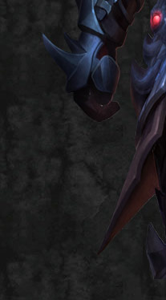
- 原图来源：https://w2i.wanmei.com/event/200805/newline/images/main_01_01.jpg

- 原图来源：https://w2i.wanmei.com/event/200805/newline/images/pic/tu1.jpg
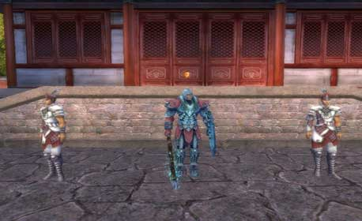
- 原图来源：https://w2i.wanmei.com/event/200805/newline/images/pic/tu2.jpg
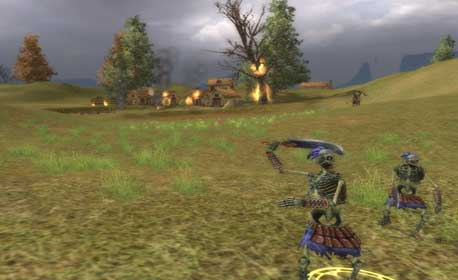
- 原图来源：https://w2i.wanmei.com/event/200805/newline/images/pic/tu3.jpg
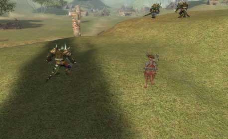
- 原图来源：https://w2i.wanmei.com/event/200805/newline/images/right_01.jpg

- 原图来源：https://w2i.wanmei.com/event/200805/newline/images/right_02.jpg

- 原图来源：https://w2i.wanmei.com/event/200805/newline/images/banner_01_01.png

- 原图来源：https://w2i.wanmei.com/event/200805/newline/images/banner_01_02.png

- 原图来源：https://w2i.wanmei.com/event/200805/newline/images/banner_01_03.png

- 原图来源：https://w2i.wanmei.com/event/200805/newline/images/banner_01_04.png

- 原图来源：https://w2i.wanmei.com/event/200805/newline/images/banner_01_05.png

- 原图来源：https://w2i.wanmei.com/event/200805/newline/images/bottom.jpg

## 主线任务

- 来源：https://w2i.wanmei.com/rwjs/rwxt/20091016/30083.shtml
- 原文发布时间：2009-10-16
- 获取状态：ok
- 本地结构化数据：[JSON](../pages/4e85b28bf4fac13e36e9.json)

1.战歌之城的秘密，只有最有勇气、实力强大的人才有资格知道。如果你自认为符合这样的要求，那就去寻找各地的五行地巡使吧。他的故事也许能让你了解到更多。
任务名：战歌之城.探访桃源
领取NPC：五行地巡使
领取前提：人物达到80级。
完成方式：找到桃源的新NPC“舞歌行”
任务奖励：金钱7098
经验11830
元神2697
2.听过了舞歌行讲述的故事，你决定到战歌之城内见见舞歌行让你寻找的人——金棂子。
任务名：战歌之城
领取NPC：舞歌行
领取前提：完成过“战歌之城.探访桃源”任务
完成方式：找到战歌之城内的NPC“金棂子”
任务奖励：金钱7098
经验11830
元神2697
3.金棂子对你讲述了战歌之城光辉历史与她现在所受到的屈辱，其后要求你除去战歌之城内五名凶狠的怨灵将军。
任务名：鏖战群魔
领取NPC：金棂子
领取前提：完成过“战歌之城”任务
完成方式：在开始挑战战歌之城后，杀死五名怨灵大将。
任务奖励：金钱69888
经验116480
元神26557
4.解决了五名怨灵将军的你表现出了强大的实力，金棂子于是让你去寻找传说中的水昭然。
任务名：寻找水昭然
领取NPC：金棂子
领取前提：完成过“鏖战群魔”任务
完成方式：在战歌之城内寻找传说中第二次元素精灵降临的使者“水昭然”。
任务奖励：金钱11356
经验18928
元神4315
5.找到水昭然后，你彻底了解到了战歌之城的过去。为了解除这座仙境之城的痛苦，你必须除掉最终的怨灵boss——血罗王。
任务名：决战之歌
领取NPC：水昭然
领取前提：完成过“寻找水昭然”任务
完成方式：杀死血罗王
任务奖励：金钱34944
经验58240
元神13278
万象更新石1个

## 新手村任务

- 来源：https://w2i.wanmei.com/rwjs/rwxt/20140928/73624.shtml
- 原文发布时间：2014-09-28
- 获取状态：ok
- 本地结构化数据：[JSON](../pages/2db2d9bbff5097d18343.json)

新手村主线剧情概述（1-19级）
悠悠数载，那灵渡汀洲早已成为完美世界众生灵降世之地。话说这一年，发生了一件一件异事，封印着灵渡汀洲众多仙兽元魂的《天喻兽图》不知被何人开启，放出了流火蝶，七兜兽，焚阳豹，默音鸾鸟，贝叶鲛人，醉青猴，袂雪狐七大仙兽元魂。这七大仙兽，早年间曾是灵渡汀洲有名的恶兽，被天女们降服后，取出元魂封印于《天喻兽图》，失去元魂的恶兽，没了恶念，才变成游走嬉戏于山水间的灵兽。如今，元魂回窍，恶念顿生，恶兽们开始肆意破坏这人间仙境，一雪多年被囚禁之耻。为今之际，只能找到恶兽，重取其元魂，方能解决恶兽祸乱之灾。此等小事，当然不必再烦劳九天之上的天女，交给何人去办？天女俯看灵渡汀洲众生，已然有了最佳人选！
序号
任务名
领取NPC
限制前提
完成NPC
奖励经验
奖励元神
奖励金钱
奖励声望
可接取等级
任务
1
神选之子
各族新手引导
1
司空旋
25
10
8
1
2
天降大任
司空旋
1
神选之子
司空旋
30
12
9
1
3
立即行动
司空旋
2
天降大任
中书客
100
40
30
1
4
心净则明
中书客
2
立即行动
司空旋
120
48
36
1
5
战备就绪
司空旋
3
230
92
69
1
众人相助
0
0
拜遏药师
药师
0
0
拜遏裁缝
裁缝
0
0
拜遏铁匠
铁匠
0
0
拜遏巧匠
巧匠
0
0
拜遏货郎
货郎
0
0
披坚执锐
司空旋
0
0
6
再试身手
司空旋
3
战备就绪
司空旋
260
104
78
1
7
放下偏见
中书客
4
再试身手
中书客
200
80
60
2
8
做出表率
中书客
4
放下偏见
中书客
320
128
96
2
9
意外发现
中书客
4
350
140
105
2
意外发现
0
0
显著特征
中书客
0
0
10
圣兽踪迹
中书客
5
意外发现
400
160
120
2
天喻兽图
中书客
0
0
灵魂链接
中书客
0
0
11
流火蝶
中书客
5
圣兽踪迹
480
192
144
2
圣湖沐浴
0
0
元魂归位
中书客
0
0
12
烈火燎原
司空旋
5
圣兽踪迹
450
180
135
2
13
新生命
中书客
6
650
260
195
2
珍贵的蛋
中书客
0
0
宠物孵化
宠物管理员
0
0
14
夺命追踪
司空旋
6
650
260
195
2
紧随其后
0
0
就地正法
0
0
15
风雨飘摇
中书客
6
中书客
700
280
210
2
16
一路向北
司空旋
7
夺命追踪
吴一针
300
120
90
2
17
敌人之血
吴一针
7
吴一针
800
320
240
2
18
偷天换日
吴一针
7
敌人之血
林间结界
800
320
240
2
18
无处可藏
吴一针
7
偷天换日
800
320
240
2
亲密召唤
0
0
真身显现
吴一针
0
0
20
乘胜追击
吴一针
8
无处可藏
千色
1200
480
360
2
驱除邪恶
千色
8
无处可藏
千色
1100
440
330
2
25
复合感染
定心
8
定心
1200
480
360
2
26
水样
定心
9
复合感染
1000
400
300
2
多点取样
定心
0
0
上游取水
0
0
中游取水
0
0
下游取水
0
0
27
探索源头
定心
9
水样
1000
400
300
2
镜湖深处
0
0
湖底暗影
定心
0
0
28
圣洁湖泊
千色
9
探索源头
1200
480
360
2
北部幻影
0
0
暗影显现
0
0
驱逐暗影
0
0
南部幻影
0
0
暗影显现
0
0
驱逐暗影
0
0
东部幻影
0
0
暗影显现
0
0
驱逐暗影
0
0
29
群雄混战
千色
9
探索源头
千色
1400
560
420
2
天女的召唤
千色
10
天女
1000
400
300
2
30
再接再厉
天女
10
天女的召唤
1100
440
330
2
返回彩云国
千色
0
0
接头人
落秋心
0
0
31
隐形的翅膀
落秋心
10
落秋心
1800
720
540
2
32
为了松鼠
落秋心
10
落秋心
1800
720
540
2
35
守护祭坛
落秋心
11
守护祭坛
2000
800
600
2
40
补充能量
守护祭坛
11
守护祭坛
守护祭坛
2500
1000
750
2
41
杀鸡儆猴
守护祭坛
11
补充能量
寒笑石
2500
1000
750
2
42
未知的恐惧
寒笑石
12
2000
800
600
2
查明真相
恐惧之人
0
0
查明真相
恐惧之人
0
0
查明真相
恐惧之人
0
0
43
野兽暴走
伏羲驯兽师
12
未知的恐惧
2200
880
660
2
44
重新武装
伏羲勇士
12
未知的恐惧
伏羲勇士
2100
840
630
2
45
奋起反击
伏羲勇士
12
重新武装
伏羲勇士
2100
840
630
2
分发武器
0
0
寻找难民
伏羲难民
0
0
寻找难民
伏羲难民
0
0
寻找难民
伏羲难民
0
0
伺机待发
伏羲勇士
0
0
46
保护弱小
伏羲长者
13
奋起反击
2200
880
660
2
解除围困
伏羲长者
0
0
安全无虞
0
0
拯救弱小
被困村民
0
0
拯救弱小
被困村民
0
0
47
绝世神兵
伏羲长者
13
保护弱小
2300
920
690
2
神兵护卫
0
0
近在咫尺
伏羲长者
0
0
48
风卷残云
伏羲驯兽师
13
保护弱小
2500
1000
750
2
49
骄阳陨落
少乐
13
绝世神兵
少乐
2800
1120
840
2
50
物归原主
伏羲长者
14
骄阳陨落
伏羲长者
2800
1120
840
2
51
静态防御
伏羲长者
14
骄阳陨落
2800
1120
840
2
多处布防
0
0
北部防御点
0
0
东部防御点
0
0
南部防御点
0
0
守卫森严
伏羲长者
0
0
52
一路畅通
伏羲勇士
14
骄阳陨落
2900
1160
870
2
53
重要信物
少乐
14
少乐
3000
1200
900
2
54
裂魂者
少乐
15
重要信物
一瓢仙
2800
1120
840
2
55
灵魂石
一瓢仙
15
裂魂者
一瓢仙
3000
1200
900
2
56
暴食之刃
一瓢仙
15
灵魂石
一瓢仙
3000
1200
900
2
57
噬魂之戒
一瓢仙
15
灵魂石
一瓢仙
3100
1240
930
2
58
寄魂花
斐冷
16
裂魂者
斐冷
3500
1400
1050
2
59
亡者之冠
斐冷
16
裂魂者
3500
1400
1050
2
有求未必应
丰谕老者
0
0
死亡的代价
丰谕老者
0
0
目睹亡者
斐冷
0
0
60
精神入侵
斐冷
16
亡者之冠
3500
1400
1050
2
灵魂分裂
0
0
邪恶之魂
一瓢仙
0
0
61
困兽之斗
一瓢仙
16
精神入侵
一瓢仙
4000
1600
1200
2
62
高地民族
一瓢仙
17
困兽之斗
冷醉
3500
1400
1050
2
63
失控的法术
冷醉
17
冷醉
4500
1800
1350
2
65
血液的秘密
冷醉
17
失控的法术
冷非颜
4500
1800
1350
2
66
神灵的指示
冷非颜
17
血液的秘密
4500
1800
1350
2
雾隐村
0
0
奇怪的仪式
0
0
众灵回应
冷非颜
0
0
67
风之力
冷非颜
18
神灵的指示
冷非颜
6000
2400
1800
2
68
法术免疫
冷非颜
18
风之力
6500
2600
1950
2
金生水
0
0
水生木
0
0
木生火
0
0
火生土
0
0
土生金
0
0
融会贯通
冷非颜
0
0
68
万全准备
冷非颜
18
法术免疫
冷非颜
6500
2600
1950
2
削其羽翼
冷非颜
19
万全准备
5000
2000
1500
2
69
最后的风之子
冷非颜
19
万全准备
冷非颜
6000
2400
1800
2
70
雪羽之谜
冷非颜
19
最后的风之子
4500
1800
1350
2
长者的智慧
雾隐长者
0
0
探险家
探险家
0
0
真相大白
冷非颜
0
0
71
深入狐穴
19
雪羽之谜
冷非颜
6500
2600
1950
2
72
封印之石
0
0
73
学成归来
冷非颜等12个主线NPC
20
深入狐穴
无
0
0

### 原始表格（按行与单元格保存）

#### 表 1

| 列 1 | 列 2 | 列 3 | 列 4 | 列 5 | 列 6 | 列 7 | 列 8 | 列 9 | 列 10 | 列 11 |
| --- | --- | --- | --- | --- | --- | --- | --- | --- | --- | --- |
| 序号（跨2行/1列） | 任务名（跨2行/2列） | 领取NPC（跨2行/1列） | 限制前提（跨1行/2列） | 完成NPC（跨2行/1列） | 奖励经验（跨2行/1列） | 奖励元神（跨2行/1列） | 奖励金钱（跨2行/1列） | 奖励声望（跨2行/1列） |  |  |
| 可接取等级 | 任务 |  |  |  |  |  |  |  |  |  |
| 1 | 神选之子 |  | 各族新手引导 | 1 |  | 司空旋 | 25 | 10 | 8 | 1 |
| 2 | 天降大任 |  | 司空旋 | 1 | 神选之子 | 司空旋 | 30 | 12 | 9 | 1 |
| 3 | 立即行动 |  | 司空旋 | 2 | 天降大任 | 中书客 | 100 | 40 | 30 | 1 |
| 4 | 心净则明 |  | 中书客 | 2 | 立即行动 | 司空旋 | 120 | 48 | 36 | 1 |
| 5 | 战备就绪 |  | 司空旋 | 3 |  |  | 230 | 92 | 69 | 1 |
|  | 众人相助（跨1行/2列） |  |  |  |  |  | 0 | 0 |  |  |
|  |  | 拜遏药师 |  |  |  | 药师 |  | 0 | 0 |  |
|  |  | 拜遏裁缝 |  |  |  | 裁缝 |  | 0 | 0 |  |
|  |  | 拜遏铁匠 |  |  |  | 铁匠 |  | 0 | 0 |  |
|  |  | 拜遏巧匠 |  |  |  | 巧匠 |  | 0 | 0 |  |
|  |  | 拜遏货郎 |  |  |  | 货郎 |  | 0 | 0 |  |
|  | 披坚执锐（跨1行/2列） |  |  |  | 司空旋 |  | 0 | 0 |  |  |
| 6 | 再试身手 |  | 司空旋 | 3 | 战备就绪 | 司空旋 | 260 | 104 | 78 | 1 |
| 7 | 放下偏见 |  | 中书客 | 4 | 再试身手 | 中书客 | 200 | 80 | 60 | 2 |
| 8 | 做出表率 |  | 中书客 | 4 | 放下偏见 | 中书客 | 320 | 128 | 96 | 2 |
| 9 | 意外发现 |  | 中书客 | 4 |  |  | 350 | 140 | 105 | 2 |
|  |  | 意外发现 |  |  |  |  |  | 0 | 0 |  |
|  |  | 显著特征 |  |  |  | 中书客 |  | 0 | 0 |  |
| 10 | 圣兽踪迹 |  | 中书客 | 5 | 意外发现 |  | 400 | 160 | 120 | 2 |
|  |  | 天喻兽图 |  |  |  | 中书客 |  | 0 | 0 |  |
|  |  | 灵魂链接 |  |  |  | 中书客 |  | 0 | 0 |  |
| 11（跨3行/1列） | 流火蝶 |  | 中书客 | 5 | 圣兽踪迹 |  | 480 | 192 | 144 | 2 |
|  | 圣湖沐浴 |  |  |  |  |  | 0 | 0 |  |  |
|  | 元魂归位 |  |  |  | 中书客 |  | 0 | 0 |  |  |
| 12 | 烈火燎原 |  | 司空旋 | 5 | 圣兽踪迹 |  | 450 | 180 | 135 | 2 |
| 13 | 新生命 |  | 中书客 | 6 |  |  | 650 | 260 | 195 | 2 |
|  |  | 珍贵的蛋 |  |  |  | 中书客 |  | 0 | 0 |  |
|  |  | 宠物孵化 |  |  |  | 宠物管理员 |  | 0 | 0 |  |
| 14 | 夺命追踪 |  | 司空旋 | 6 |  |  | 650 | 260 | 195 | 2 |
|  |  | 紧随其后 |  |  |  |  |  | 0 | 0 |  |
|  |  | 就地正法 |  |  |  |  |  | 0 | 0 |  |
| 15 | 风雨飘摇 |  | 中书客 | 6 |  | 中书客 | 700 | 280 | 210 | 2 |
| 16 | 一路向北 |  | 司空旋 | 7 | 夺命追踪 | 吴一针 | 300 | 120 | 90 | 2 |
| 17 | 敌人之血 |  | 吴一针 | 7 |  | 吴一针 | 800 | 320 | 240 | 2 |
| 18 | 偷天换日 |  | 吴一针 | 7 | 敌人之血 | 林间结界 | 800 | 320 | 240 | 2 |
| 18 | 无处可藏 |  | 吴一针 | 7 | 偷天换日 |  | 800 | 320 | 240 | 2 |
|  |  | 亲密召唤 |  |  |  |  |  | 0 | 0 |  |
|  |  | 真身显现 |  |  |  | 吴一针 |  | 0 | 0 |  |
| 20 | 乘胜追击 |  | 吴一针 | 8 | 无处可藏 | 千色 | 1200 | 480 | 360 | 2 |
|  | 驱除邪恶 |  | 千色 | 8 | 无处可藏 | 千色 | 1100 | 440 | 330 | 2 |
| 25 | 复合感染 |  | 定心 | 8 |  | 定心 | 1200 | 480 | 360 | 2 |
| 26 | 水样 |  | 定心 | 9 | 复合感染 |  | 1000 | 400 | 300 | 2 |
|  |  | 多点取样 |  |  |  | 定心 |  | 0 | 0 |  |
|  |  | 上游取水 |  |  |  |  |  | 0 | 0 |  |
|  |  | 中游取水 |  |  |  |  |  | 0 | 0 |  |
|  |  | 下游取水 |  |  |  |  |  | 0 | 0 |  |
| 27（跨3行/1列） | 探索源头 |  | 定心 | 9 | 水样 |  | 1000 | 400 | 300 | 2 |
|  | 镜湖深处 |  |  |  |  |  | 0 | 0 |  |  |
|  | 湖底暗影 |  |  |  | 定心 |  | 0 | 0 |  |  |
| 28（跨8行/1列） | 圣洁湖泊 |  | 千色 | 9 | 探索源头 |  | 1200 | 480 | 360 | 2 |
| 北部幻影（跨1行/2列） |  |  |  |  |  | 0 | 0 |  |  |  |
|  | 暗影显现 |  |  |  |  |  | 0 | 0 |  |  |
|  | 驱逐暗影 |  |  |  |  |  | 0 | 0 |  |  |
| 南部幻影（跨1行/2列） |  |  |  |  |  | 0 | 0 |  |  |  |
|  | 暗影显现 |  |  |  |  |  | 0 | 0 |  |  |
|  | 驱逐暗影 |  |  |  |  |  | 0 | 0 |  |  |
| 东部幻影（跨1行/2列） |  |  |  |  |  | 0 | 0 |  |  |  |
|  |  | 暗影显现 |  |  |  |  |  | 0 | 0 |  |
|  |  | 驱逐暗影 |  |  |  |  |  | 0 | 0 |  |
| 29 | 群雄混战 |  | 千色 | 9 | 探索源头 | 千色 | 1400 | 560 | 420 | 2 |
|  | 天女的召唤 |  | 千色 | 10 |  | 天女 | 1000 | 400 | 300 | 2 |
| 30（跨3行/1列） | 再接再厉 |  | 天女 | 10 | 天女的召唤 |  | 1100 | 440 | 330 | 2 |
|  | 返回彩云国 |  |  |  | 千色 |  | 0 | 0 |  |  |
|  | 接头人 |  |  |  | 落秋心 |  | 0 | 0 |  |  |
| 31 | 隐形的翅膀（跨1行/2列） | 落秋心 | 10 |  | 落秋心 | 1800 | 720 | 540 | 2 |  |
| 32 | 为了松鼠 |  | 落秋心 | 10 |  | 落秋心 | 1800 | 720 | 540 | 2 |
| 35 | 守护祭坛 |  | 落秋心 | 11 |  | 守护祭坛 | 2000 | 800 | 600 | 2 |
| 40 | 补充能量 |  | 守护祭坛 | 11 | 守护祭坛 | 守护祭坛 | 2500 | 1000 | 750 | 2 |
| 41 | 杀鸡儆猴 |  | 守护祭坛 | 11 | 补充能量 | 寒笑石 | 2500 | 1000 | 750 | 2 |
| 42（跨4行/1列） | 未知的恐惧（跨1行/2列） | 寒笑石 | 12 |  |  | 2000 | 800 | 600 | 2 |  |
|  | 查明真相 |  |  |  | 恐惧之人 |  | 0 | 0 |  |  |
|  | 查明真相 |  |  |  | 恐惧之人 |  | 0 | 0 |  |  |
|  | 查明真相 |  |  |  | 恐惧之人 |  | 0 | 0 |  |  |
| 43 | 野兽暴走 |  | 伏羲驯兽师 | 12 | 未知的恐惧 |  | 2200 | 880 | 660 | 2 |
| 44 | 重新武装 |  | 伏羲勇士 | 12 | 未知的恐惧 | 伏羲勇士 | 2100 | 840 | 630 | 2 |
| 45 | 奋起反击 |  | 伏羲勇士 | 12 | 重新武装 | 伏羲勇士 | 2100 | 840 | 630 | 2 |
|  | 分发武器（跨1行/2列） |  |  |  |  |  | 0 | 0 |  |  |
|  |  | 寻找难民 |  |  |  | 伏羲难民 |  | 0 | 0 |  |
|  |  | 寻找难民 |  |  |  | 伏羲难民 |  | 0 | 0 |  |
|  |  | 寻找难民 |  |  |  | 伏羲难民 |  | 0 | 0 |  |
|  | 伺机待发（跨1行/2列） |  |  |  | 伏羲勇士 |  | 0 | 0 |  |  |
| 46 | 保护弱小 |  | 伏羲长者 | 13 | 奋起反击 |  | 2200 | 880 | 660 | 2 |
|  | 解除围困（跨1行/2列） |  |  |  | 伏羲长者 |  | 0 | 0 |  |  |
|  | 安全无虞（跨1行/2列） |  |  |  |  |  | 0 | 0 |  |  |
|  |  | 拯救弱小 |  |  |  | 被困村民 |  | 0 | 0 |  |
|  |  | 拯救弱小 |  |  |  | 被困村民 |  | 0 | 0 |  |
| 47 | 绝世神兵 |  | 伏羲长者 | 13 | 保护弱小 |  | 2300 | 920 | 690 | 2 |
|  |  | 神兵护卫 |  |  |  |  |  | 0 | 0 |  |
|  |  | 近在咫尺 |  |  |  | 伏羲长者 |  | 0 | 0 |  |
| 48 | 风卷残云 |  | 伏羲驯兽师 | 13 | 保护弱小 |  | 2500 | 1000 | 750 | 2 |
| 49 | 骄阳陨落 |  | 少乐 | 13 | 绝世神兵 | 少乐 | 2800 | 1120 | 840 | 2 |
| 50 | 物归原主 |  | 伏羲长者 | 14 | 骄阳陨落 | 伏羲长者 | 2800 | 1120 | 840 | 2 |
| 51 | 静态防御 |  | 伏羲长者 | 14 | 骄阳陨落 |  | 2800 | 1120 | 840 | 2 |
|  | 多处布防（跨1行/2列） |  |  |  |  |  | 0 | 0 |  |  |
|  |  | 北部防御点 |  |  |  |  |  | 0 | 0 |  |
|  |  | 东部防御点 |  |  |  |  |  | 0 | 0 |  |
|  |  | 南部防御点 |  |  |  |  |  | 0 | 0 |  |
|  | 守卫森严（跨1行/2列） |  |  |  | 伏羲长者 |  | 0 | 0 |  |  |
| 52 | 一路畅通 |  | 伏羲勇士 | 14 | 骄阳陨落 |  | 2900 | 1160 | 870 | 2 |
| 53 | 重要信物 |  | 少乐 | 14 |  | 少乐 | 3000 | 1200 | 900 | 2 |
| 54 | 裂魂者 |  | 少乐 | 15 | 重要信物 | 一瓢仙 | 2800 | 1120 | 840 | 2 |
| 55 | 灵魂石 |  | 一瓢仙 | 15 | 裂魂者 | 一瓢仙 | 3000 | 1200 | 900 | 2 |
| 56 | 暴食之刃 |  | 一瓢仙 | 15 | 灵魂石 | 一瓢仙 | 3000 | 1200 | 900 | 2 |
| 57 | 噬魂之戒 |  | 一瓢仙 | 15 | 灵魂石 | 一瓢仙 | 3100 | 1240 | 930 | 2 |
| 58 | 寄魂花 |  | 斐冷 | 16 | 裂魂者 | 斐冷 | 3500 | 1400 | 1050 | 2 |
| 59 | 亡者之冠 |  | 斐冷 | 16 | 裂魂者 |  | 3500 | 1400 | 1050 | 2 |
|  |  | 有求未必应 |  |  |  | 丰谕老者 |  | 0 | 0 |  |
|  |  | 死亡的代价 |  |  |  | 丰谕老者 |  | 0 | 0 |  |
|  |  | 目睹亡者 |  |  |  | 斐冷 |  | 0 | 0 |  |
| 60（跨3行/1列） | 精神入侵 |  | 斐冷 | 16 | 亡者之冠 |  | 3500 | 1400 | 1050 | 2 |
|  | 灵魂分裂 |  |  |  |  |  | 0 | 0 |  |  |
|  | 邪恶之魂 |  |  |  | 一瓢仙 |  | 0 | 0 |  |  |
| 61 | 困兽之斗 |  | 一瓢仙 | 16 | 精神入侵 | 一瓢仙 | 4000 | 1600 | 1200 | 2 |
| 62 | 高地民族 |  | 一瓢仙 | 17 | 困兽之斗 | 冷醉 | 3500 | 1400 | 1050 | 2 |
| 63 | 失控的法术（跨1行/2列） | 冷醉 | 17 |  | 冷醉 | 4500 | 1800 | 1350 | 2 |  |
| 65 | 血液的秘密（跨1行/2列） | 冷醉 | 17 | 失控的法术 | 冷非颜 | 4500 | 1800 | 1350 | 2 |  |
| 66 | 神灵的指示 |  | 冷非颜 | 17 | 血液的秘密 |  | 4500 | 1800 | 1350 | 2 |
|  |  | 雾隐村 |  |  |  |  |  | 0 | 0 |  |
|  |  | 奇怪的仪式 |  |  |  |  |  | 0 | 0 |  |
|  |  | 众灵回应 |  |  |  | 冷非颜 |  | 0 | 0 |  |
| 67 | 风之力 |  | 冷非颜 | 18 | 神灵的指示 | 冷非颜 | 6000 | 2400 | 1800 | 2 |
| 68（跨7行/1列） | 法术免疫 |  | 冷非颜 | 18 | 风之力 |  | 6500 | 2600 | 1950 | 2 |
|  | 金生水 |  |  |  |  |  | 0 | 0 |  |  |
|  | 水生木 |  |  |  |  |  | 0 | 0 |  |  |
|  | 木生火 |  |  |  |  |  | 0 | 0 |  |  |
|  | 火生土 |  |  |  |  |  | 0 | 0 |  |  |
|  | 土生金 |  |  |  |  |  | 0 | 0 |  |  |
|  | 融会贯通 |  |  |  | 冷非颜 |  | 0 | 0 |  |  |
| 68 | 万全准备 |  | 冷非颜 | 18 | 法术免疫 | 冷非颜 | 6500 | 2600 | 1950 | 2 |
|  | 削其羽翼 |  | 冷非颜 | 19 | 万全准备 |  | 5000 | 2000 | 1500 | 2 |
| 69 | 最后的风之子（跨1行/2列） | 冷非颜 | 19 | 万全准备 | 冷非颜 | 6000 | 2400 | 1800 | 2 |  |
| 70 | 雪羽之谜 |  | 冷非颜 | 19 | 最后的风之子 |  | 4500 | 1800 | 1350 | 2 |
|  |  | 长者的智慧 |  |  |  | 雾隐长者 |  | 0 | 0 |  |
|  |  | 探险家 |  |  |  | 探险家 |  | 0 | 0 |  |
|  |  | 真相大白 |  |  |  | 冷非颜 |  | 0 | 0 |  |
| 71 | 深入狐穴 |  |  | 19 | 雪羽之谜 | 冷非颜 | 6500 | 2600 | 1950 | 2 |
| 72 |  | 封印之石 |  |  |  |  |  | 0 | 0 |  |
| 73 | 学成归来 |  | 冷非颜等12个主线NPC | 20 | 深入狐穴 | 无 |  | 0 | 0 |  |
|  |  |  |  |  |  |  |  |  |  |  |

## 系统简介

- 来源：https://w2i.wanmei.com/rwjs/rwxt/20091015/29939.shtml
- 原文发布时间：2009-10-15
- 获取状态：ok
- 本地结构化数据：[JSON](../pages/cfd5e06566ad40e6a9d2.json)

完美世界国际版任务体系博大精深，主要分为如下几类：
修真任务
完美世界国际版中的居民必须不断的修行，自我提升。以期超脱生死大限，升入仙界、魔界甚至窥探神界。而修真任务即是引导玩家突破自身局限，到达全新境界的关键性任务。不完成则无法领悟新的技能。
寻龙任务
寻龙任务是一个全新的庞大任务体系，可以重复进行，为循环任务。每10级为一个阶段，共分八个层次，适合20-100级之内的玩家完成。以下表单是任务系列的一个纲要。
循环任务
怨灵大军正源源不断的自怨灵之门涌入到完美世界国际版，玩家可以在NPC处重复接受某些具有针对性的任务，以遏制怨灵的蔓延之势。每一次循环任务完成后都将获得相应奖励。
英雄任务
这是一个需要英雄，且不乏英雄的时代。英雄们崛起的最好的证明便是BOSS们的倒下，不论是冥界逆天级的九子鬼母，还是远古的巨龙。当然去挑战它们的时候别忘了叫上你的兄弟，BOSS的强大有时候毫无道理可言。
冒险任务
冒险任务意味着玩家将要去探索危机四伏而又回报丰厚的地宫与幻境，通常它们会以副本的形式出现，这是完全属于冒险者及其伙伴的私人领域，他们可以不受干扰向怪物们展示技巧、勇气与智慧与义气。
破阵任务
完美世界国际版中的怪物，可不会傻呆呆的站在那儿受虐。不同的怪物拥有不同的技能与策略，有的甚至会预先布下各种配合严密、机关暗伏的阵法。玩家贸然闯入可能会大吃苦头。
再厉害的阵法也有其虚弱的命门。能否抓住破绽，一举击溃敌阵呢？破阵任务将给玩家带来充满趣味与挑战的全新体验。
传奇任务
传奇任务是比英雄任更艰巨的挑战，通常是由一系列的大型任务构成，任务的末尾同样要面对凶狠的BOSS。当然玩家在传奇任务的每一个环节结束后，都将获得独立的奖励。
奇遇任务
完美世界国际版上的奇遇无处不在，不论玩家是在打怪、挖矿还是探险，经常会有意外的发现：被怪物吞下去的还未消化的密函；受困的公主发出的求援信件；埋在地底的尸体揭示的惊人秘密……
热心的玩家如果接受并完成这些“意料之外”的任务，同样会获得“意料之外”的回报。
经营任务
“有钱能使鬼推磨”，在现实生活中或许不太正确，在完美世界国际版中却是完全可行的。足够的完美币不但可以驱神役鬼，还可以购买神兵利器、学习高阶的技能、甚至换取究极资源：点卡。
为缓解玩家对完美币的海量需求，完美世界国际版中设置了许多经营类的任务，不需打怪，不用升级，稍稍动动脑、跑跑路也可以财源滚滚，直至富甲一方。快哉快哉！
日常任务
除了上述种种特色任务之外，完美世界国际版还拥有数以千记的日常任务，可以充分满足喜爱做任务玩家的需求。随着游戏的更新，数量更多的、更复杂的、更精彩的任务亦将陆续加入，敬请期待。

## 修真指引

- 来源：https://w2i.wanmei.com/rwjs/xzxt/20091027/36516.shtml
- 原文发布时间：2009-10-27
- 获取状态：ok
- 本地结构化数据：[JSON](../pages/cdec3b3a495354f01f5d.json)

仙魔的修行是中国古代神话的一个重要组成部分，它充满了无数的神奇和奥秘，多少人为此苦苦探索和追寻，追寻一种至高至纯的境界，探索那无穷无尽的奥秘。国产史诗级唯美3D网游《完美世界国际版》以中国古代神文化为故事背景，把神秘的修真任务升华，让这种中国古文化仙魔之术达到了顶峰。
《完美世界国际版》所有职业都拥有技能树，而技能树中每种技能都对应有修行要求，其中修真等级就是很重要的一个。《完美世界国际版》中玩家的修真等级分为两段，其中凡人段分8个阶段，分别为筑基、灵虚、合和、元婴、空冥、履霜、渡劫、寂灭和大乘。在中国的仙侠文化中，修真者的修行之路一向是漫长艰辛，想要参透生死玄关直达天界，还需付出常人难以想象的努力，在整个修真过程中，根绝任务的阶段，修行被分为“筑基”、“灵虚”、“合和”、“元婴”、“空冥”、“履霜”、“渡劫”、“寂灭”、“大乘”、“飞升”等阶段，当修行者达到“大乘”的标准之后才算是初窥天道。大乘是凡人段的最高阶修真，任务开始等级为71级，任务完成等级为79级，为一个总共由大小10个任务组成的超级主线任务。通过该任务，玩家不仅可以了解到《完美世界国际版》的故事背景，更能领会“大乘”期逆天的超凡感觉。进入大乘期后，玩家将可以做自己升仙入魔，脱离凡身的准备了。
修真任务是《完美世界国际版》一个特色任务，也是主线任务。玩家要想得到不断的修行提升，去完成更高的目标和追求必须要做好修真任务，而且随着级别的提升，修真任务的难度也就越大。只有亲身进入游戏体验，才能感受到中国古代神文化无穷的底蕴和魅力。在实力飞升之后选择登天成仙或者入地为魔，善恶全在一念间，选择自己的霸王之路，体验不一样的江湖人生。

## 修真机制

- 来源：https://w2i.wanmei.com/rwjs/xzxt/20091016/30082.shtml
- 原文发布时间：2009-10-16
- 获取状态：ok
- 本地结构化数据：[JSON](../pages/79892b4429f7e877878f.json)

修真是游戏中人物学习高级技能的一种前提条件，也是对玩家能力的一种考验，通过接主线修真任务可以提高自身修真级别。
修真级别分为筑基、灵虚、和合、元婴、空冥、履霜、渡劫、寂灭、大乘。当人物到达大乘之后可进行升仙入魔的修行，升仙分为：上仙、真仙、天仙，入魔分为：狂魔、魔圣、魔尊。当人物达到学习技能的相应等级后，还需要提升修真级别才可以学到更高级的相关技能。
人物等级达到9级可提升至灵虚，19级可提升至合和，29级可提升至元婴，39级可提升至空冥、49级提升至履霜，59级可提升至渡劫，69级可以修真至寂灭，79级可以修真至大乘，89级即可升仙入魔，99级可以成为真仙或魔圣。

## 《完美世界国际版》新主线任务揭密

- 来源：https://w2i.wanmei.com/event/200805/newline/iframe_header.htm
- 原文发布时间：页面未标明
- 获取状态：ok
- 本地结构化数据：[JSON](../pages/e83bb97385dd93465398.json)

### 官方原始图片（尚未全部转录）

- 原图来源：http://images.wanmei.com/huodong/images/w2i/logo/transparent.gif
  图片未获取。
- 原图来源：https://w2i.wanmei.com/event/200805/newline/images/header_01.jpg
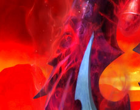
- 原图来源：https://w2i.wanmei.com/event/200805/newline/images/header_02.jpg
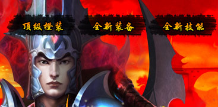
- 原图来源：https://w2i.wanmei.com/event/200805/newline/images/header_03.jpg
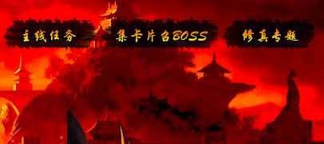
- 原图来源：https://w2i.wanmei.com/event/200805/newline/images/header_04.jpg
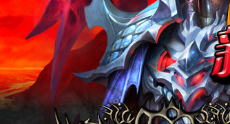
- 原图来源：https://w2i.wanmei.com/event/200805/newline/images/header_05.jpg
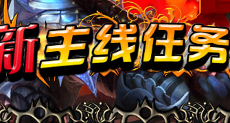
- 原图来源：https://w2i.wanmei.com/event/200805/newline/images/header_06.jpg
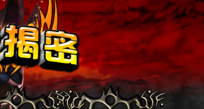

## 《完美世界国际版》新主线任务揭密

- 来源：https://w2i.wanmei.com/event/200805/newline/index_02.htm
- 原文发布时间：页面未标明
- 获取状态：ok
- 本地结构化数据：[JSON](../pages/1fe80fc9d9958da87b08.json)

第二步“查明真相”
接收前提：完成上一任务自动获得。
铲除银霜
完成方式：进入英雄冢内杀死boss银霜，得到物品“破碎晶体”和神秘物品“映月铜镜”。
鉴定晶体
接收前提：带有“破碎晶体”。
完成方式：与履冰对话。
鉴定古镜
接收前提：带有“映月铜镜”。
完成方式：与履冰对话。
圣城大贤者
完成方式：与光芒老人对话。（祖龙东南部天文台上）“查明真相”完成。

### 官方原始图片（尚未全部转录）

- 原图来源：https://w2i.wanmei.com/event/200805/newline/images/left_01.jpg

- 原图来源：https://w2i.wanmei.com/event/200805/newline/images/left_02.jpg

- 原图来源：https://w2i.wanmei.com/event/200805/newline/images/main_01_01.jpg

- 原图来源：https://w2i.wanmei.com/event/200805/newline/images/pic/tu4.jpg
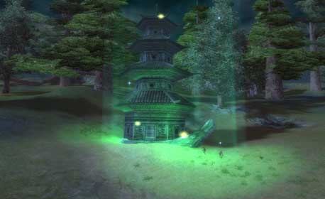
- 原图来源：https://w2i.wanmei.com/event/200805/newline/images/right_01.jpg

- 原图来源：https://w2i.wanmei.com/event/200805/newline/images/right_02.jpg

- 原图来源：https://w2i.wanmei.com/event/200805/newline/images/banner_01_01.png

- 原图来源：https://w2i.wanmei.com/event/200805/newline/images/banner_01_02.png

- 原图来源：https://w2i.wanmei.com/event/200805/newline/images/banner_01_03.png

- 原图来源：https://w2i.wanmei.com/event/200805/newline/images/banner_01_04.png

- 原图来源：https://w2i.wanmei.com/event/200805/newline/images/banner_01_05.png

- 原图来源：https://w2i.wanmei.com/event/200805/newline/images/bottom.jpg

## 《完美世界国际版》新主线任务揭密

- 来源：https://w2i.wanmei.com/event/200805/newline/index_03.htm
- 原文发布时间：页面未标明
- 获取状态：ok
- 本地结构化数据：[JSON](../pages/992deb2b04eb83864a12.json)

第三步“最后的希望”
接收前提：光芒老人（祖龙东南部天文台上）。
完成方式：
1、与祖龙城光芒老人对话。（祖龙东南天文台上）
2、杀死碧空灯魂得到50碧空之精。
3、与灵光贤者履冰对话。（祖龙东北天文台）
4、杀死可悲的林云，得到定海石。（夜哭岛秘宝窟内）
5、将定海石交还履冰。
6、与履冰对话。
7、杀死古蛇·流得到古蛇元灵，杀死鼓神·空得到雷音神令。（黄昏圣殿）
8、与履冰对话。

### 官方原始图片（尚未全部转录）

- 原图来源：https://w2i.wanmei.com/event/200805/newline/images/left_01.jpg

- 原图来源：https://w2i.wanmei.com/event/200805/newline/images/left_02.jpg

- 原图来源：https://w2i.wanmei.com/event/200805/newline/images/main_01_01.jpg

- 原图来源：https://w2i.wanmei.com/event/200805/newline/images/pic/tu5.jpg
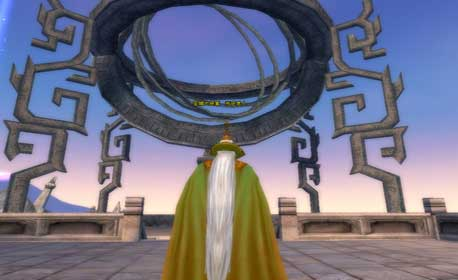
- 原图来源：https://w2i.wanmei.com/event/200805/newline/images/right_01.jpg

- 原图来源：https://w2i.wanmei.com/event/200805/newline/images/right_02.jpg

- 原图来源：https://w2i.wanmei.com/event/200805/newline/images/banner_01_01.png

- 原图来源：https://w2i.wanmei.com/event/200805/newline/images/banner_01_02.png

- 原图来源：https://w2i.wanmei.com/event/200805/newline/images/banner_01_03.png

- 原图来源：https://w2i.wanmei.com/event/200805/newline/images/banner_01_04.png

- 原图来源：https://w2i.wanmei.com/event/200805/newline/images/banner_01_05.png

- 原图来源：https://w2i.wanmei.com/event/200805/newline/images/bottom.jpg

## 《完美世界国际版》新主线任务揭密

- 来源：https://w2i.wanmei.com/event/200805/newline/index_04.htm
- 原文发布时间：页面未标明
- 获取状态：ok
- 本地结构化数据：[JSON](../pages/058e746aaf0da73a1ed5.json)

第四步“时空之轮”
接收前提：光芒老人处接得。
1、杀死 怨毒者 血眼 （553，469），亵渎者 黑爪（564，472），复仇者 毒舌（580，483）。
2、与光芒老人对话。
3、杀死冥府牛头和冥府马面。
4、与光芒老人对话。
5、与祖龙时空使者对话（祖龙最中央）。

### 官方原始图片（尚未全部转录）

- 原图来源：https://w2i.wanmei.com/event/200805/newline/images/left_01.jpg

- 原图来源：https://w2i.wanmei.com/event/200805/newline/images/left_02.jpg

- 原图来源：https://w2i.wanmei.com/event/200805/newline/images/main_01_01.jpg

- 原图来源：https://w2i.wanmei.com/event/200805/newline/images/pic/tu6.jpg
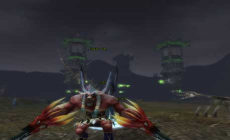
- 原图来源：https://w2i.wanmei.com/event/200805/newline/images/right_01.jpg

- 原图来源：https://w2i.wanmei.com/event/200805/newline/images/right_02.jpg

- 原图来源：https://w2i.wanmei.com/event/200805/newline/images/banner_01_01.png

- 原图来源：https://w2i.wanmei.com/event/200805/newline/images/banner_01_02.png

- 原图来源：https://w2i.wanmei.com/event/200805/newline/images/banner_01_03.png

- 原图来源：https://w2i.wanmei.com/event/200805/newline/images/banner_01_04.png

- 原图来源：https://w2i.wanmei.com/event/200805/newline/images/banner_01_05.png

- 原图来源：https://w2i.wanmei.com/event/200805/newline/images/bottom.jpg

## 《完美世界国际版》新主线任务揭密

- 来源：https://w2i.wanmei.com/event/200805/newline/index_05.htm
- 原文发布时间：页面未标明
- 获取状态：ok
- 本地结构化数据：[JSON](../pages/8620a35de1f02343fc2b.json)

第五步“勇士之彰”
完成任务得到时空钥匙，可在时空使者处打开时空之门，进入千年前的天泪之城。
勇士之彰
接收NPC：老天泪“圣城时空使者”。
接收前提：完成前一任务。
完成方式：对话。
奖励：任务奖励腰佩。

### 官方原始图片（尚未全部转录）

- 原图来源：https://w2i.wanmei.com/event/200805/newline/images/left_01.jpg

- 原图来源：https://w2i.wanmei.com/event/200805/newline/images/left_02.jpg

- 原图来源：https://w2i.wanmei.com/event/200805/newline/images/main_01_01.jpg

- 原图来源：https://w2i.wanmei.com/event/200805/newline/images/pic/tu7.jpg
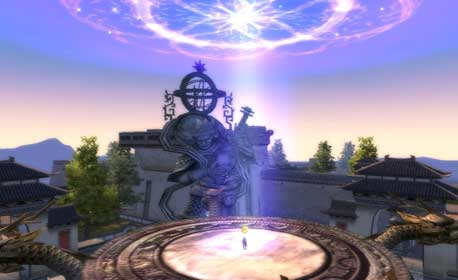
- 原图来源：https://w2i.wanmei.com/event/200805/newline/images/right_01.jpg

- 原图来源：https://w2i.wanmei.com/event/200805/newline/images/right_02.jpg

- 原图来源：https://w2i.wanmei.com/event/200805/newline/images/banner_01_01.png

- 原图来源：https://w2i.wanmei.com/event/200805/newline/images/banner_01_02.png

- 原图来源：https://w2i.wanmei.com/event/200805/newline/images/banner_01_03.png

- 原图来源：https://w2i.wanmei.com/event/200805/newline/images/banner_01_04.png

- 原图来源：https://w2i.wanmei.com/event/200805/newline/images/banner_01_05.png

- 原图来源：https://w2i.wanmei.com/event/200805/newline/images/bottom.jpg

