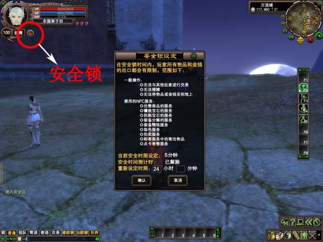
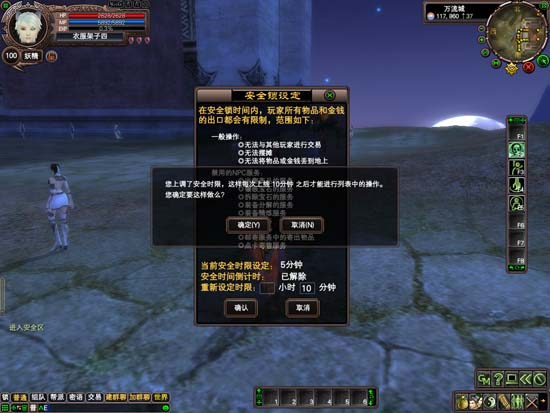
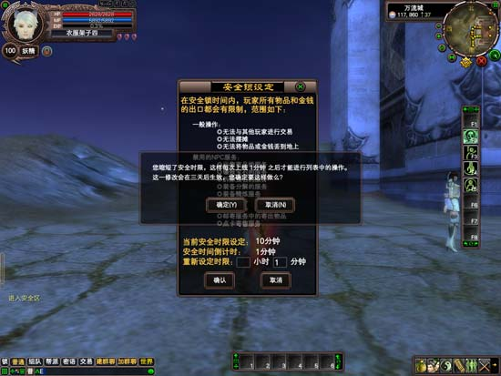

# 其它资料

属性图片为官方原始资料，不代表已识读；网页表格中的固定/随机标记保留原文，不将随机池视为全部同时获得。

## VIP卡

- 来源：https://w2i.wanmei.com/other/vip/20091102/36691.shtml
- 原文发布时间：2009-11-02
- 获取状态：ok
- 本地结构化数据：[JSON](../pages/b937a011d00062f3f84b.json)

《完美国际》黄金霸主卡获取方式
获取《完美国际》黄金霸主卡有两个途径，一是以公会为单位团体申请，二是个人申请。公会入驻统一申请的请直接加官方公会管理员QQ申请入驻即可；个人申请的请直接登录到黄金霸主卡自助领取页面领取。
一、《完美国际》公会入驻申请方式：
公会入驻请先加官方公会管理员QQ：814979782（公会入驻请注明入驻服务器、公会名称），入驻后提交以下申请资料：
1.公会（家族）名称
2.公会介绍
3.公会会长
4.入驻服务器
5.入驻人数
6.公会会长真实姓名
7.会长联系方式
8.公会论坛网址（可无）
9.会长（管理者）邮箱
二、个人申请：
个人玩家请直接登录黄金霸主卡自助领取页面进行领取。
黄金霸主卡领取地址：http://event8.wanmei.com/w2i/200907/wigoldmember/wimemberadd.jsp
《完美国际》黄金霸主卡使用说明：
1、新玩家登录官方网站http://passport.wanmei.com注册完美通行证时，选择产品后填入激活码进行激活；
2、玩家进入游戏后，分别在达到10、20、30、40、50、60级时，系统自动弹出黄金霸主卡激活任务，玩家到指定的NPC处完成任务后，将得到对应的超值礼物。
《完美国际》黄金霸主卡内容：
10级奖励：极品黄金新手武器：冰刃-战斗之弓、冰刃-战斗之仗、冰刃-战斗之锤
20级奖励：青铜护身符和青铜守神符以及新手戒指
30级奖励：极品鞋“逐日之靴”以及经验丹（朱果）2个
40级奖励：飞行点全开物品（山河地理图）1张
50级奖励：精练辅助石（天罡石和地煞石）各5颗
60级奖励：百分百精练成功道具（1星龙珠）5个
体验超越感受 世界与你同步
w2i.wanmei.com

## 装备损毁

- 来源：https://w2i.wanmei.com/other/safe/20091015/29923.shtml
- 原文发布时间：2009-10-15
- 获取状态：ok
- 本地结构化数据：[JSON](../pages/f97f556c4495611bcb5a.json)

人物死亡惩罚规则修改
安全锁下不会再掉落装备栏物品及包裹物品。
启用新的死亡惩罚规则“装备损毁”，此规则将与死亡掉落惩罚一同生效。
蓝名不管是被怪物杀死还是被人物杀死都不会掉落装备栏及包裹栏的物品。
“装备损毁”规则的详细说明：
装备损毁的启用
死亡无惩罚的场景（如命运魔方、神无谷、战歌之城等）和消耗替身娃娃的情况下不启用装备损毁惩罚和物品掉落惩罚
安全锁状态下被人杀死不启用物品掉落惩罚，只启用装备损毁惩罚
非安全锁状态下被人杀死同时启用物品掉落惩罚和装备损毁惩罚
安全锁状态下被怪物杀死不启用物品掉落惩罚，不启用装备损毁惩罚
非安全锁状态下被怪物杀死启用物品掉落惩罚，不启用装备损毁惩罚
装备损毁涉及的装备栏范围
装备栏中的飞剑、防具、饰品、武器、天书（不包括锦囊妙计、时装、坐骑、弹药、喇叭、摆摊凭证）
装备损毁的详细规则
安全锁状态下，随人物的Pk值增加而损毁几率增加，每次死亡只可能损毁一件物品，该物品在已装备并且可损毁的装备栏范围内随机
非安全锁状态下，随人物的Pk值增加而损毁几率增加，每次死亡只可能损毁一件物品，该物品在已装备的并且天人合一的并且可损毁的装备栏范围内随机
简单说：安全锁状态下可能损毁未被天人合一的已装备物品（意思是安全锁状态下已装备的物品都可能损毁，不会管天人与否），而非安全锁状态下只可能损毁天人合一的已装备物品（意思是非安全锁状态下只会损毁天人合一的已装备物品）
装备损毁后的结果
装备被损毁后附加属性效果及本体属性效果均失效，飞剑无法使用。
装备损毁的奖励及修复
角色死亡后如果有一件装备损毁了，则该角色会掉落出修复此件装备所需的道具，如幻仙石、完美石等，修复此装备所需要的成本为掉落出道具数量的1.2倍，向上取整。
举例1，玩家“我是谁”死亡，武器被损毁，掉落了1个幻仙石，则修复此武器需要2块幻仙石
举例2，玩家“我是谁”死亡，飞剑被损毁，掉落了10块幻仙石，则修复此飞剑需要12块幻仙石
原则上价值越高的物品被损毁后掉落的物品越好或掉落的物品越多，原则上会按照装备的拆分物进行损毁掉落物及数量的计算，不适宜按照此规则计算的会按物品价值计算。具体的修复道具和修复道具所需数量可以通过NPC的修复损毁物品服务查询。
装备损毁的修复服务
装备损毁后可以找NPC通过服务修复此装备，NPC会提示玩家修复此装备需要什么物品及需要的物品数量，同时被损毁的装备上也会提示。安全锁下禁用修复损毁装备的服务。
相关问题汇总与回复：
Q：为什么我白名安全锁下反而可能受到装备损毁惩罚？而且被人杀被怪杀都受？
A：安全锁是一种特殊的状态，此状态下包裹及装备栏的物品均不会再掉落，不管是红名白名都一样，为了平衡原有的死亡惩罚体系，安全锁状态下不管被人杀死还是被怪杀死都可能会造成装备损毁效果
Q：这个内容的更新时间是什么时候？我怎么知道自己的装备需要什么材料以及多少材料来修复？
A：这个内容在7月22日已经更新，具体的某一件装备的修复道具和数量可以找NPC查询，依据是该装备的拆分物及拆分物数量，少部分不适用此规则的物品会单独计算。
Q：什么是装备损毁？装备损毁了会怎么样？
A：装备损毁是在战斗中玩家死亡导致的附加在装备上的一个效果，装备损毁后虽然可以使用，但附加属性、本体属性均不会再生效，飞剑损毁后无法再使用。此特殊状态与装备耐久无关。
Q：为什么装备损毁规则对安全锁状态下和非安全锁状态下的惩罚不同？看上去好复杂！
A：为了把玩家账号受到的损失降到最低，安全锁状态下将修改为完全不受物品掉落惩罚的影响，因此，需要引入新的装备损毁规则来平衡PK惩罚，也是为什么安全锁状态下和普通状态下的惩罚规则有所区别的原因。其实这个区别简单的解释就是——不管角色PK值多少、天人合一了多少装备、在打怪还是在PK，因为原来的物品掉落惩罚将完全失效，所以受到的装备损毁惩罚会比普通状态下多一点点。
Q：我包里没幻仙，装备损毁了掉出的幻仙石哪里来的？掉出来的一定是幻仙石吗？
A：损毁掉落是装备被置成损毁状态时产生的，一般会由杀死该角色的玩家拾取。被杀的玩家装备损毁后需要相当于1.2倍（向上取整）损毁掉落的道具修复。也就是说，装备损毁的惩罚成本其实大部分是被PK胜利的一方拿走了，多出的0.2倍仅仅是为了使PK的收益永远小于损失。原则上价值越高的物品被损毁后掉落的物品越好或掉落的物品越多，原则上会按照装备的拆分物进行损毁掉落物及数量的计算，不适宜按照此规则计算的会按物品价值计算。即可理解为，掉落物包括但不限于幻仙石，掉落物是元石类物品。
Q：PK值如何计算，白名的PK值是多少？
A：白名的PK值是0，粉名是特殊状态的白名，PK值也是0，浅红名为0-2，中红名为2-10，深红为10-100，计算PK值比较简单的方法是用红名时间除以2。
Q：损毁的几率如何计算？
A：安全锁下，损毁一件装备的概率为 白名1% 浅红2% 中红3% 深红4% 损毁的范围是所有已经装备的物品。
非安全锁下，装备了天人和一的装备的情况下，装备损毁概率为 白名 0 浅红1% 中红2% 深红3%。
Q：装备损毁了怎么办？
A：装备损毁了需要修理，所需的修理道具和数量会在装备悬浮提示中体现，修理需要找城镇内的NPC，考虑到方便性，很多地方的NPC都提供修复损毁装备的服务
Q：蓝名的修改
A：蓝名在原有的程序处理中不管是被人杀死（虽然这不可能）还是被怪杀死都有极小几率掉落包裹中的物品，此次修改把这部分极小几率也去掉了。
Q：我有一堆天人了的装备淘汰下来的，现在扔在那里也没用，能把它们都爆成幻仙石或者其它元石吗？
A：理论上是可以的，但需要说明的是，物品的损毁掉落是随着物品本身价值计算的，掉出来的不全是幻仙石，也不全是完美石，并且已损毁未修复的装备是不会再次损毁的，也就是说只能掉一次。
Q：我的装备损毁了，计算损毁掉落物品及损毁掉落数量的依据是什么？
A：现在武器、护具、饰品、飞剑、天书五大类物品可能被损毁。大多数武器、护具、饰品的损毁掉落物品和数量是由其拆分物决定的，范围是一元石至幻仙石，数量大约为拆分数量的一半，特殊装备（如军衔装、能够拆出装备魂的黄昏覆霜神月装备、不可拆分的装备等等）原则上遵循同品阶同精良度的装备规定损毁掉落物品和损毁掉落数量；飞剑的损毁掉落物品为幻仙石，损毁掉落数量由飞机的速度决定，越快的飞机数量越多；天书的损毁掉落物品为幻仙石，损毁掉落数量由天书的级别决定，级别越高的天书数量越大，圣诞卡属于1级天书。具体修复所需的物品及修复数量可以找提供修复损毁装备服务的NPC查询，方法是将装备拖至修复栏中，即可显示修复该装备所需的物品和物品数量，如果没有显示则代表此装备无法被损毁。以下提供天书简单的对照表：
1级 1
2级 2
3级 3
4级 4
5级 6
6级 8
7级 10
目前最贵的16品装备修复道具为幻仙石，损毁后能掉落30块，修复需要为36块。这也是目前游戏中修复一次成本最高的装备了。
体验超越感受 世界与你同步
w2i.wanmei.com

## 安全锁

- 来源：https://w2i.wanmei.com/other/safe/20091015/29922.shtml
- 原文发布时间：2009-10-15
- 获取状态：ok
- 本地结构化数据：[JSON](../pages/a7c908929df25f764600.json)

安全锁介绍：
安全锁系统是一个强行设定的上线保护系统，在安全锁模式下，玩家所有物品金钱无法通过任何途径转移或消耗。
安全锁有时间限制，当时间限制为零后，安全锁模式自动解除，所有限制取消。
安全锁对应每个账号，同一账号下所有角色都受同一时间限制影响。
所有玩家上线后都会默认为安全锁模式，玩家可以自行设定安全锁时间限制（有最大时间和最小时间）。但不可能解除安全锁模式。
安全锁时限修改：
安全时限初始默认为1分钟，可以由玩家自行修改，最小时限1分钟，最长时限24个小时。玩家可以在设定时限处自行输入数字设定，小时处输入大于24的数字自动调整为24。
输入后确定，即可以修改安全锁时限，并在再次登录账号后生效。
玩家将时限由低向高调整不受影响(注意：每次安全锁的调整后最少5分钟才能进行下次的调整)，如果由高向低调整，则不论调整时间多少，该调整都将在调整开始后3天生效。
安全锁限制内容：
在安全锁时间内，玩家所有物品和金钱的出口都会有被限制，包括范围如下：
一般操作
♦ 无法与其他玩家进行交易
♦ 无法摆摊
♦ 无法将物品或金钱丢到地上
NPC服务
♦ 出售商品的服务（无法将物品出售给NPC，但买入不受限制）
♦ 镶嵌宝石的服务
♦ 拆除宝石的服务
♦ 装备分解的服务
♦ 拍卖服务
♦ 邮寄服务中的寄出物品。（收取不受限制）
♦ 点卡寄售服务（元宝交易）
♦ 装备精炼服务
♦ 染色服务
玩家死亡时身上物品掉落不受安全锁系统影响。
试图进行如上操作时，会弹出面板提示：
“安全锁状态下无法进行此操作”
体验超越感受 世界与你同步
w2i.wanmei.com

### 官方原始图片（尚未全部转录）

- 原图来源：https://w2i.wanmei.com/pic/news_img/safelock03.jpg

- 原图来源：https://w2i.wanmei.com/pic/news_img/safelock02.jpg

- 原图来源：https://w2i.wanmei.com/pic/news_img/safelock01.jpg

