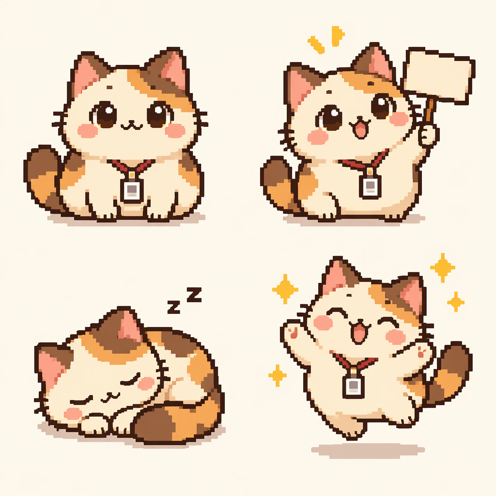
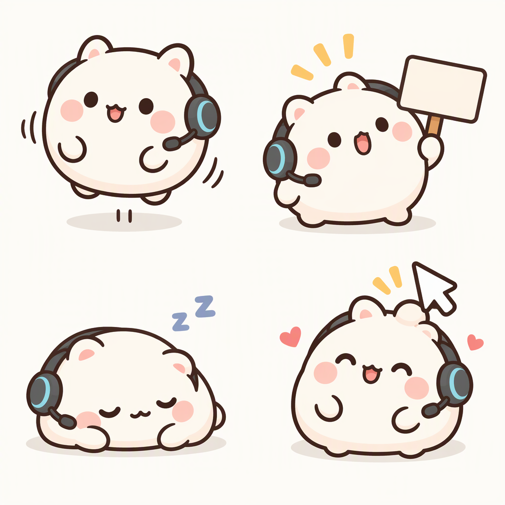
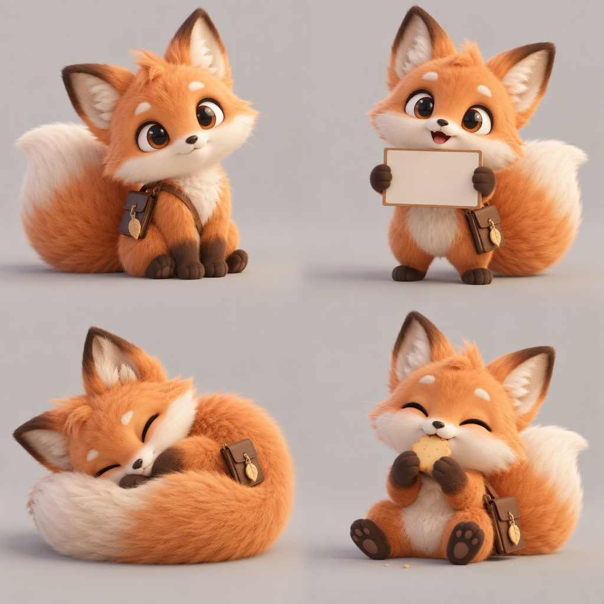
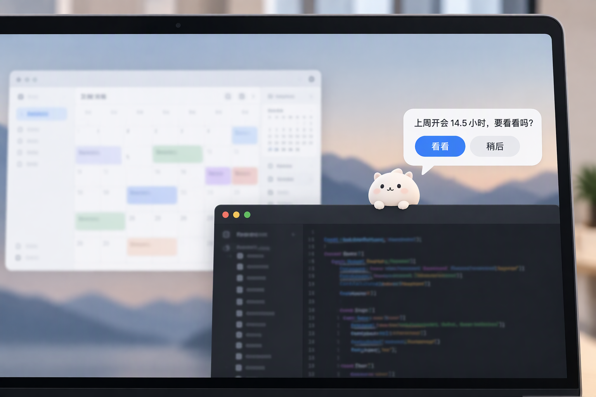

# 宠物形象概念图（第一轮）

- 状态：待用户选择
- 日期：2026-11-18
- 关联：Q10、ADR-0012、ADR-0015

这些是方向探索，不是定稿。每张图里都有同样的四个状态，方便比较：待机、提醒（举牌子）、睡觉（开会时安静或大脑没运行）、开心（被摸头、喂食或提议完成）。

## A 像素风 · 三花猫

- 气质：复古、游戏感强，挂着工牌像同事。
- 实现：逐帧精灵图，资源小，Canvas 绘制，在两个平台上表现最稳定；按像素判断点击区域最简单。
- 代价：表情细节有限；要动作流畅就得画很多帧。

## B 扁平卡通 · 团子（戴耳麦）

- 气质：软萌、干净，和办公界面最搭，体积小也不碍眼。
- 实现：可以用矢量或逐帧动画，也能做成骨骼动画（形变、弹跳很自然）；换皮肤（换配饰）成本低。
- 代价：风格比较常见，要靠配饰和动作做出辨识度。

## C 2.5D / 3D 手办风 · 小狐狸

- 气质：质感最好，最有“养了一只宠物”的感觉。
- 实现：做法是预渲染成序列帧，或者用 Live2D 和 Spine 做伪 3D。美术成本最高，资源也最大。
- 代价：放在桌面上缩到很小时，细节会糊；多套皮肤的成本高。

## D 放在桌面上的效果（以 B 为例）

- 宠物趴在窗口边缘，用气泡给出“事实 + 选项”。气泡里的数字直接来自报告数据，不经人格改写（约束 I15）。

## 总架构师建议

- **优先选 B**：小尺寸下辨识度好，和办公场景最协调，换皮肤成本低，适合配合成长系统解锁配饰。A 可以作为“复古皮肤”备选。
- 动物或角色、配色、配饰都可以混搭，例如“B 的画风 + A 的三花配色和工牌”。
- 选定后进入第二轮：定稿形象、完整动作表（拖动、被戳、吃东西、举牌、睡觉、开心、思考），再确定动画技术（写进 MOD-12 设计）。
